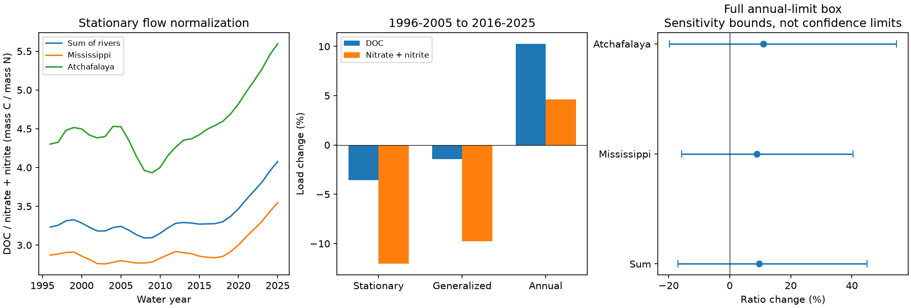

# Annual source limits permit a fall in the Gulf river carbon-to-nitrate ratio despite a 9.65% point rise between 1996-2005 and 2016-2025

## Question and result

Did dissolved organic carbon (DOC) delivery increase relative to nitrate delivery at two Gulf river outlets? We tested period load ratios with USGS release 3.0. The combined ratio rose from 3.247 to 3.560 mass units of carbon per mass unit of nitrogen under stationary flow normalization. This is a 9.65% point rise. However, the published annual error limits permit a change from -16.94% to +44.98%. This range is a sensitivity bound, not a confidence interval. The direction of change is not secure against errors within these limits.

The point rise does not require more carbon delivery. Normalized DOC fell by 3.57%, while nitrate plus nitrite fell by 12.06%. The ratio rose because the denominator fell more. Annual loads without flow normalization give a different component pattern: both loads rose. These estimates do not establish a change in available carbon, nitrogen removal, oxygen demand, or coastal hypoxia.



## Prior evidence and added test

River carbon and nutrient balance is an established research topic. Shousha and others (2023, doi:10.1029/2023GB007820) showed that different elemental export responses can change river stoichiometry in a Quebec basin. A Mississippi basin study modeled eight constituent yields, including DOC (doi:10.3390/environments10090162). These studies motivate separate checks of carbon and nitrogen, but do not establish the present outlet ratio change.

Prior campaign work tested total N:P and filtered N:P at these same sites (SCI citations below). Searches of campaign results for dissolved organic carbon and nitrate gave no matching result. Early candidate questions about filtered nutrients, silica and chloride already had campaign reports. We therefore chose a DOC test after inspecting source metadata and initial period ratios. This is an exploratory benchmark, not a registered test or a claim of first discovery. The added evidence is a carbon-to-nitrate comparison, its component changes, and a source-error robustness radius. Data overlap with earlier campaign work; this is not independent confirmation.

## Data

The source is USGS release 3.0, May 2026, doi:10.5066/P1BCA8QV. STFR is Mississippi River near St. Francisville, Louisiana (07373420). MELV is Atchafalaya River at Melville, Louisiana (07381495). We sum their loads to represent combined delivery. These are not all Gulf rivers. A water year ends in September. NO3_NO2 is filtered nitrate plus nitrite as nitrogen; we use the short name nitrate here. DOC is dissolved organic carbon. The ratio uses load mass, not a molar conversion and not total organic C:total N.

The source reports DOC loads only from 1996 because older samples are sparse. We use the first and last complete ten-year periods in its DOC record: 1996-2005 and 2016-2025. There are 30 complete years for both forms, both sites and all three methods. No year is removed in the primary comparison. There are 360 river-year-method-form rows and 180 supplied GULF rows for checks. Source GULF totals are rounded separately. Our primary calculation sums river rows before division. This explains small differences from a calculation on the supplied GULF rows.

Stationary flow normalization (FNS) uses the modeled-period flow distribution. Generalized normalization (FNG) permits a changing flow distribution and uses a centered window of 12 years on each side, as described by the source. WRTDS-K estimates annual loads at actual flows. All methods share source data and retrospective fits. FNS is the primary method; FNG and K are checks. They are not independent measurements or forecasts.

## Calculation and uncertainty

For each form and period, sum the two river loads and take the mean across years. The period ratio is mean DOC load divided by mean nitrate load. It is not the mean of annual ratios. The percentage change is 100 times (late ratio / early ratio - 1).

For FNS and FNG, the source supplies marginal annual 90% lower and upper load limits. Let C and N be period mean loads, with limits L and U obtained by the same averaging and summing. A period ratio must lie between C_L/N_U and C_U/N_L if every input is inside its own interval. Divide the late lower ratio by the early upper ratio for the minimum change; reverse the limits for the maximum. Positive loads make these extrema exact over this rectangular set. This permits arbitrary dependence within the box. It does not assign a probability to that set. Joint coverage of all annual limits is unknown, and systematic error can be outside them. K has no such limits, so we give no K bounds.

We also scale every deviation from its point estimate toward its own lower or upper limit by a common fraction lambda. We solve for the smallest lambda at which the worst-case ratio change reaches zero. This is a deterministic robustness radius in units of each input's error width. It is not a standard error, probability, or measure of likely error. It permits coordinated opposite errors between nutrients and periods. The primary radius is 0.329978. Thus an adverse combination of errors only one third of the way to the reported limits can erase the positive point change. The full box is wider. This monotone calculation needs no model covariance assumption.

## Results

| Site or sum | Method | Ratio change (%) | DOC load change (%) | Nitrate load change (%) | Ratio change box (%) |
|---|---|---:|---:|---:|---|
| Sum | FNS | 9.65 | -3.57 | -12.06 | -16.94 to 44.98 |
| Sum | FNG | 9.25 | -1.43 | -9.77 | -16.87 to 44.78 |
| Sum | K | 5.39 | 10.26 | 4.62 | Not supplied |
| Mississippi | FNS | 8.87 | -4.28 | -12.08 | -15.77 to 40.44 |
| Atchafalaya | FNS | 11.03 | -2.26 | -11.98 | -19.78 to 54.67 |

The FNS mass ratios were 2.834 to 3.085 in the Mississippi and 4.437 to 4.927 in the Atchafalaya. Both point ratios rose. Their full error boxes include a fall. A larger Atchafalaya ratio does not prove carbon production or nitrate removal within that river. Its water and constituent inputs differ.

Using late periods 2015-2024, 2011-2025 and 2016-2024 gives combined FNS point rises of 7.31%, 6.43% and 8.12%. Each source-limit box includes zero. Across all three methods and all four late periods, combined point rises range from 3.73% to 9.65%. These checks reuse the same data; they do not supply independent support. All 36 site-method-period results are in files/period_results.csv.

## Limits and next test

This analysis does not resolve the sign of the true ratio change. It does show that a positive ratio estimate can coexist with a decline in normalized carbon load. A source-error box cannot show that all signs are equally likely. A useful next test needs joint error draws across forms, sites and years from the load model. A bootstrap of the smooth annual estimates would not recover this error and was not used.

The years and endpoints were chosen after exploratory inspection. The first ten years are constrained by sparse early DOC samples. End-of-record estimates can change with later data. Annual ratios hide seasonal extremes and short recovery periods. DOC quantity does not give its chemical reactivity or biological availability. Nitrate is only one part of nitrogen. Flow normalization is a model adjustment, not a controlled intervention. Neither the ratio nor the component contrast identifies land sources, changes in management, river retention, groundwater effects or changes in ocean response.

## Reproduction and rights

Run these commands from the extracted package root:

```sh
python files/analyze.py --output ../repeat-carbon
python files/audit.py
```

Python with numpy, pandas, scipy and matplotlib is required. Input bytes are bundled for offline reproduction under the source CC0 public dedication. files/provenance.json gives the exact shared path, source URL, version and SHA-256 hashes. files/EXTERNAL_NOTICE.txt preserves source credit and terms. No new shared download was needed. The exact input hash is checked before computation. files/retrieve.py can retrieve a fresh copy to a new file outside the signed package and requires the same hash.

The independent audit uses standard-library decimal arithmetic, direct sums and direct perturbation of original rows. It reproduces the primary point, bounds and radius. A repeat run matched both CSV outputs and the PNG byte for byte. files/checks.json records software versions and the maximum discrepancy between summed rivers and the independently rounded GULF data. The figure is a static PNG. Files are covered by the exact SCI baseline license where new rights apply. External CC0 materials retain their public dedication.

## Worker record

Job: sci-1107-dell-earth-and-ocean-sciences-1203f9e37d32. Topic: earth-and-ocean-sciences. Campaign: 11_07_2026. Machine: dell. Account: codex-myxtap. Model: gpt-6.1-sol with high reasoning effort in T3 Code. Analysis date: 2026-11-09. The campaign-machine signing key does not claim personal authorship. No private key is bundled. This publication was signed locally without remote archive submission.
