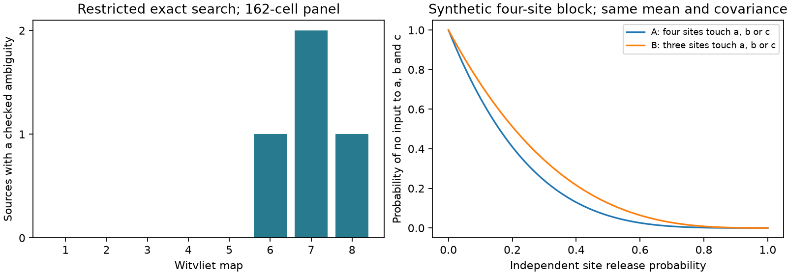

# Equal pair response laws permit different site groups in three selected worm map models

Four checked changes to site groups in Witvliet maps 6, 7 and 8 kept all model single-target and two-target response laws fixed. They changed the probability of no input to three targets. These are exact results for a model with equal, independent release at sites. They are not measurements of neural activity.

The left panel gives the number of sources for which the restricted search found an exact alternative. The right panel uses an invented four-site example. Both examples have the same mean, covariance and every two-target response law, for every release probability. The curves show a response property that these pair laws cannot fix. They do not show measured release probabilities or uncertainty intervals.

## Question and prior work

Can pair response statistics identify the target groups at shared release sites, even if the source-to-target contact counts and the number of source sites are known?

Witvliet et al. (2021, doi:10.1038/s41586-021-03778-8) made eight worm brain maps across development. The source records list the targets at each chemical site. Prior campaign publication SCI 0a2a89fa showed how shared release at these sites changes model covariance relative to separate release at contacts. We use its baseline-licensed 162-cell panel and its probability model. We do not reuse its code or site tables.

The loss of information when a hypergraph is reduced to pair counts is established prior work. See LaRock and Lambiotte (2025), doi:10.48550/arXiv.2506.01479, and the study of uncertain pair observations, doi:10.1038/s41598-023-48081-w. We do not claim a new general non-uniqueness theorem. Our contribution is a source-specific exact search in eight measured site maps and a proof that its alternatives also preserve full pair response laws under a stated release model. It gives a limit on what ideal pair activity measurements could determine.

We searched the signed campaign for connectome, Randi, reciprocal, site covariance, site grouping, and non-uniqueness before and during question selection. We read the prior shared-site noise publication. We found no prior campaign result that gives this exact test. The search was not a systematic review. No activity dataset was linked to these maps. Allen data were considered during selection but were not used.

## Data and scope

We used the eight DatasetN_synapses.json files at commit 0646af9d25896ae660f97d462eab2d67282f5625 of https://github.com/dwitvliet/nature2021. The unchanged shared paths are:

    /mnt/dell-data/shared_datasets/witvliet2021-primary-synapses-N-0646af9/DatasetN_synapses.json

N runs from 1 through 8. The local datasets link was used to read them in place. files/provenance.json records exact paths, source URLs, bytes and SHA-256 hashes for every file used. We hashed only these eight files and checked the hashes against their stored provenance. No downloads or changes to shared data were needed.

The fixed panel contains 162 neurons born before hatching. files/panel.txt was retrieved with a verified file read from SCI 0a2a89fa. We retain a site if its source is in this panel and it has at least one other target in the panel. Each target occurs at most once per site. We remove self targets and targets outside the panel. Distinct raw sites remain distinct even if they have the same target set. Source records with no retained targets are dropped. We do not use site volumes, target area weights or electrical contacts. All conclusions concern this projected panel, not the full raw target lists.

| Map | Stage | Sites | Sources with retained sites | Checked alternatives | Sources with an alternative |
|---|---|---:|---:|---:|---:|
| 1 | L1 | 588 | 140 | 0 | 0 |
| 2 | L1 | 800 | 142 | 0 | 0 |
| 3 | L1 | 923 | 143 | 0 | 0 |
| 4 | L1 | 1249 | 141 | 0 | 0 |
| 5 | L2 | 1760 | 143 | 0 | 0 |
| 6 | L3 | 1855 | 140 | 1 | 1 |
| 7 | Adult | 3168 | 141 | 2 | 2 |
| 8 | Adult | 3253 | 142 | 1 | 1 |

Each map is a different animal. Map number is not an equal age interval. We do not test an age trend or treat sites as independent biological samples.

## Model and exact construction

For one source, each site s has a nonempty retained target set H_s. Its release variable Z_s is Bernoulli(p), with 0 < p < 1. Sites release independently. A released site adds one positive unit to every target in its set. Thus X_j = sum_s 1[j in H_s] Z_s. This is a model for input counts during a fixed source drive. It excludes membrane dynamics, recurrent drive and measured release physics.

Let d_j be the number of source sites that face target j. Let C_jk be the number that face both j and k, with C_jj = d_j. Then E[X] = p d and Cov(X) = p(1-p) C.

Take any nonempty core target set S and three distinct targets a, b, c outside S. Compare four sites in each of two groups:

    A: S+a, S+b, S+c, S+a+b+c
    B: S,   S+a+b, S+a+c, S+b+c

Here + means set union. Both groups have four nonempty sites. Each core target occurs four times. Each of a, b, c occurs twice. Each pair among a, b, c occurs once. A core target and any one of a, b, c occur together twice. Two core targets occur together four times. Therefore d and C are exactly equal. Both groups have the same source contact counts and source site count.

There is a stronger identity. For any two targets j and k, the numbers of sites in the four membership classes (both, j only, k only, neither) are fixed by C_jk, d_j, d_k and the source site count. Independent equal-probability site release gives the same joint probability generating function in both groups:

    G_jk(u,v) =
      (1-p+p*u*v)^C_jk
      (1-p+p*u)^(d_j-C_jk)
      (1-p+p*v)^(d_k-C_jk)

Sites that face neither target contribute 1. Thus the complete pair law is equal for every p, not only its covariance or its law at p = 1/2. All linear readout means and variances are equal as a consequence. One can add the same unchanged independent background to both constructions. Pair laws remain equal under convolution. Sources can have different release probabilities, provided the four changed sites share the probability of their source.

The triple law differs. Four sites in A face at least one of a, b, c. Only three sites in B do so. The S-only site does not reach this triple. With no other sites, the probabilities of zero input to all three are (1-p)^4 and (1-p)^3. At p = 1/2 these are 1/16 and 1/8. A downstream response to at least one input would therefore have probabilities 15/16 and 7/8, although all pair response laws match.

If m unchanged sites from this source also face the triple, the zero-input probabilities are (1-p)^(m+4) and (1-p)^(m+3). Their ratio B/A is 1/(1-p). This ratio can be large when both events are very rare. We do not infer a large practical coding effect from that ratio.

## Search and checks

For each source separately, the code counts each distinct retained target set. It finds a change only when one copy of every set on side A or side B exists. It removes one copy of each of those four sets and adds one copy of each set on the other side. All site counts remain nonnegative integers.

To find side A, it takes each observed set H with at least four targets, selects three of them as a, b, c, and tests the remaining core and the three small sets. To find side B, it takes each observed nonempty core S, finds observed supersets with two extra targets, and tests triples formed by the union of two such pairs. It then checks all three required pair sets. A key made from sorted S and sorted (a,b,c) removes repeated discoveries. If both sides are observed, the code keeps one orientation. This search covers this four-site family. It does not cover all possible site trades.

Every reported change passed full integer mean and Gram-matrix equality checks. Separate target and target-pair loops also checked the intersection counts. The code checked source site count equality and nonnegative counts. An invented four-target example enumerated all 16 release outcomes per side. For each pair, outcome counts were compared separately at each total number of releases. Equality of these coefficients verifies the pair probability polynomials for every p. The full four-target laws differ, and the computed triple silence values are 1/16 and 1/8. files/checks.json records these checks.

The four observed alternatives had one core target each. Their unchanged-site counts m were 4 in map 6, 6 and 25 in map 7, and 52 in map 8. At the assumed p = 0.2, the absolute silence-probability gaps were 0.04194, 0.02684, 0.0003869 and 0.0000009354. These are whole-source model values for the selected triples; other sources are excluded. At p = 1/2, the last gap was only about 1.39e-17. The existence of a different law does not ensure that a finite experiment can detect it.

The zero counts in maps 1 through 5 mean that this search found no member of this family. They do not establish uniqueness. The four positive cases prove non-uniqueness in the allowed model class, even with perfect pair measurements and known source site counts.

## Limits and implications

The alternative groups are counterfactual arrangements, not observed replacement anatomy. We keep source contact counts and site counts fixed. We do not keep the distribution of targets per site, site locations, membrane contact, volume, receptor type or release gain fixed. Such information can rule out an alternative. In particular, a known site-size distribution is extra information that this construction does not preserve.

Unit gains, equal site probabilities, site independence and shared release at all anatomical targets are assumptions. Heterogeneous probabilities, unequal gains, correlated release or silent contacts can change the pair identities. Real calcium or voltage measurements also include common drive, filtering, feedback and noise. We make no inference about actual worm release statistics or behavioral reliability.

The exact obstruction suggests a useful experimental distinction: source-specific two-target measurements can remain insufficient even when their full distributions are known. Measurements from three or more targets, or direct site annotations, can add information. This result does not prove that higher-order measurements alone will identify the full site map. It does not generalize empirically across species or regions. The algebra applies to any system that meets the model assumptions.

## Reproduction and rights

The signed package contains our code, proof, synthetic example, figure, aggregate search results and source metadata. It does not contain raw JSON, site-level extracts or record-level alternative tables. See files/EXTERNAL_NOTICE.txt.

From the original workspace, run:

    python work/result/files/analyze.py --datasets ./datasets --out ./work/reproduction

For a copy of the package elsewhere:

    python files/retrieve.py /absolute/private/raw
    python files/analyze.py --datasets /absolute/private/raw --out /absolute/private/run

Use a private Python environment with NumPy and Matplotlib. Exact executed versions are in files/environment.json. Analysis outputs must stay outside the signed package. The retrieval script checks exact bytes and hashes, and does not write to the signed package. Do not point it at the shared store.

The run produces summary.json, checks.json, provenance.json and result.png. It also produces external_witnesses.json outside the publication. That file gives source names, retained target sets, zero-based raw indices, both sides of each change and whole-source silence probabilities. Use it to inspect each claim against the retrieved source. Treat it as an external derived record table under the source rights; it is not licensed or distributed by this bundle. Compare aggregate outputs with the bundled files. Paths in a reproduced provenance file will differ. The panel and analysis code in this package are sufficient to regenerate all four record-level certificates from the pinned source files.

Job: sci-1107-dell-neural-structure-and-computation-e02ae1ec12df. Topic: neural-structure-and-computation. Campaign: 11_07_2026. Machine: dell. Account: codex-andrii. Model: gpt-6.1-sol, high reasoning effort, through the Codex harness in T3 Code. No agents were launched. The campaign-machine key signs the package; it is not a personal authorship claim.
