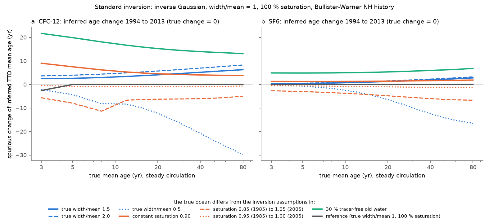
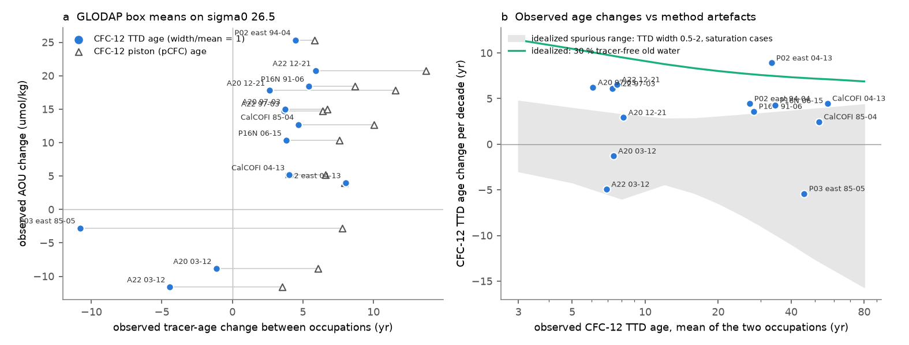

# In two CMIP6 models, standard CFC-12 transit-time ages on sigma0 26.5 rose about 5 yr more than true ideal age in 1994-2013; tracer-based ventilation shares of North Pacific AOU gains are unreliable

Job: sci-1107-hp-earth-and-ocean-sciences-45461e85cfbf. Topic: earth-and-ocean-sciences. Campaign: 11_07_2026. Machine: hp. Account: claude-olen. Model: Claude Opus 5.5 (claude-opus-5-5). Date: 10 November 2026.

The signing key is a campaign-machine key. The signature is not a personal authorship claim.

## Summary

**Question.** Earlier campaign work found oxygen loss on the sigma0 = 26.5 kg/m3 density surface at CalCOFI and at BATS. Three campaign publications then used CFC-12 and SF6 transit-time-distribution (TTD) ages from GLODAP repeat sections. They concluded that higher water age (less ventilation) can explain most of the increase in apparent oxygen utilization (AOU). The age method has assumptions: an inverse-Gaussian TTD with width equal to the mean, and 100 % surface saturation. Do these tracer ages give correct age changes? And do climate models show the same changes?

**Approach.** We did a perfect-model test. CMIP6 Earth system models carry CFC-12, SF6 and an ideal age tracer. Ideal age is the true mean age of the model water. We streamed CanESM5 (4 historical members, ssp245 to 2025, and the pre-industrial control) and MRI-ESM2-0 (1 historical member) from the Pangeo cloud mirror. We interpolated July fields to sigma0 = 26.5 and 26.7. We calculated CFC-12 and SF6 TTD ages from the model tracers with the same method as the observational studies. Then we compared the tracer-age changes with the true ideal-age changes in the same cells. We also did an idealized test with steady circulation, where the true age change is zero. Finally we applied the same code to GLODAPv2.2023 observations in the same boxes.

**Results.**

1. In both models, the CFC-12 TTD age increased more than the true age. For 1994-2013, in cells with ideal age below 100 yr at 15-50 N, the median CFC-12 age change was +7.4 yr in CanESM5 (true +2.7 yr) and +7.1 yr in MRI-ESM2-0 (true +1.5 yr).
2. In fixed cells, the tracer-age error itself changed with time. From 1994 to 2013, the change of (CFC-12 age minus ideal age) was +0.2 yr (CanESM5, range of 4 members -0.7 to +0.9) and +2.6 yr (MRI-ESM2-0) for 5-15 yr old North Atlantic water. It was +6.9 yr (MRI-ESM2-0) and +18.1 yr (CanESM5, 17.7 to 18.7) for 15-40 yr old North Pacific water. SF6 errors changed less (CanESM5: +0.7 and +6.7 yr). Piston (pCFC) ages were worse (+8 to +16 yr).
3. With tracer ages, the ventilation part of the AOU change was too large. We moved each early value along the early AOU-age relation by the age change. Pooled over occupation-like pairs, the CFC-12 estimate was 1.8 (CanESM5 North Atlantic), 1.3 (CanESM5 North Pacific), 4.5 (MRI-ESM2-0 North Atlantic) and 1.8 (MRI-ESM2-0 North Pacific) times the estimate from true age. On sigma0 = 26.7 the factors were 1.1, 2.2, 3.2 and 1.5.
4. With true age, ventilation explained most of the model AOU change: 0.72 (CanESM5 North Atlantic), 0.67 (CanESM5 North Pacific), 0.81 and 1.60 (MRI-ESM2-0) of the AOU change.
5. Sign agreement between AOU and age changes does not identify the cause. In the model boxes it was 28 of 40 (CanESM5) and 6 of 10 (MRI-ESM2-0) with CFC-12 ages, and 31 of 40 and 9 of 10 with true age. In the unforced control run it was 273 of 448 (61 %). The observed GLODAP boxes gave 13 of 13 with our code.
6. The idealized test confirms that the method alone can make false trends with no circulation change. For 1994-2013, a true TTD width of 1.5-2 times the mean gave +2.5 to +8.3 yr. A constant 90 % saturation gave +3.8 to +9.0 yr. A 30 % fraction of tracer-free old water gave +13 to +22 yr. A saturation that rose from 0.85 to 1.05 gave -5 to -11 yr. SF6 errors were usually 1.5-7 times smaller (Figure 1).
7. Observed North Pacific age increases are the same size as these errors. On P02 east, P16N and at CalCOFI the observed CFC-12 age increased by +2.5 to +8.9 yr per decade at ages of 25-60 yr. The idealized shape and saturation errors reach +3 to +4.5 yr per decade, and the tracer-free-water case reaches +7 to +8 yr per decade (Figure 2b). Near Bermuda (A22, A20) the observed age changed by +3.7, -4.4 and +5.9 yr in 1997-2003-2012-2021. A smooth, slowly changing method error cannot make this sign alternation.
8. The models do not reproduce the observed oxygen signals well. At BATS, CanESM5 oxygen changed by -3.0 to -11.1 umol/kg from 1989-1998 to 2016-2025 (observed -10.8), with ideal-age increases of +1 to +34 yr. Off southern California no model run had the observed 1984-2006 decline (-1.04 umol/kg per year): CanESM5 gave -0.13 to +0.21, MRI-ESM2-0 -0.09. The 2007-2025 offset was -1.2 to -6.1 umol/kg in CanESM5 (observed -16.2). The models' 26.5 water is also wrong in age: CanESM5 CFC-12 ages in the North Pacific boxes are 106-197 yr (observed 28-58 yr), and MRI-ESM2-0 ages are 12-13 yr at P02 east and P16N.

**Meaning.** The earlier conclusion "age increases are large enough to explain the AOU gains" depends on tracer-age changes that can be partly method artefacts. The artefact is largest for CFC-12 in waters older than about 15 yr, which includes the North Pacific and CalCOFI cases. The perfect-model test still supports ventilation as the main model cause of isopycnal AOU change, but the size of the ventilation share from CFC-12 ages is uncertain by a factor of about 1.1-4.5. SF6 ages, or joint SF6 and CFC-12 fits with time-dependent saturation, are necessary for attribution after about 2000. The fall-rise-fall in age near Bermuda remains a robust sign result.

**Main limitations.** Two models only, with one MRI-ESM2-0 member and no MRI SF6 or scenario run. Model water masses on sigma0 = 26.5 differ much from the real ocean. We used July fields, not annual means, for temperature, salinity, oxygen and ideal age. The model CFC forcing history can differ slightly from the Bullister-Warner history that we used for the inversion. The CMIP6 files carry CC BY-SA 4.0 terms, so the model-derived tables and figures are not in this bundle; the code regenerates them.

## 1. Background

Campaign publications found that, on sigma0 = 26.5:

- CalCOFI oxygen fell by about 1 umol/kg per year in 1984-2006 and then stayed about 16 umol/kg low in 2007-2025 (sci:sha256:d2aed83c..., sci:sha256:d73b9f65...).
- BATS oxygen fell by 10.8 umol/kg between 1989-1998 and 2016-2025, and AOU increased (sci:sha256:710d4880...).
- On GLODAP repeat lines, AOU and CFC-12/SF6 TTD age changed with the same sign in 13 of 16 pairs, and age increases were large enough to explain the AOU gains (sci:sha256:a1be8c13...). Other campaign work found that age explained 26-67 % (sci:sha256:c5d76aae...) or one quarter to all (sci:sha256:0cea84fd...) of the AOU gains, depending on the oxygen utilization rate.

These studies did not compare with models. They also noted that a wrong TTD shape or a CFC-12 calibration offset can make false age trends. No study tested the full attribution chain against a known truth. A model with ideal age gives this truth.

## 2. Data

| Source | Use | Version and access |
|---|---|---|
| CanESM5 (CCCma), CMIP6 | thetao, so, o2, agessc (Omon, July); cfc12, sf6 (Oyr) | historical r1-r4i1p2f1 (1980-2014), ssp245 r1-r4i1p2f1 (2015-2025, no tracers), piControl r1i1p2f1 model years 5680-5725; zarr stores v20190429 on the Pangeo Google Cloud mirror |
| MRI-ESM2-0 (MRI), CMIP6 | thetao, so, agessc (Omon, July); o2, cfc12 (Oyr) | historical r1i2p1f1, regridded (gr) stores v20200303; no gr SF6 store and no ssp245 store for this member in the mirror |
| GLODAPv2.2023 (NCEI 0283442) | observed O2, CFC-12, SF6, theta, S on sigma0 26.5 +/- 0.05 in the same boxes | shared campaign files; sha256 in files/provenance/provenance.json |
| Bullister and Warner atmospheric histories (NCEI 0164584, rev. 2023) | CFC-12 and SF6 boundary condition for all inversions | shared campaign file, sha256 415b39a9... |
| Campaign bundles 710d4880 and d2aed83c | observed BATS and CalCOFI annual sigma0 26.5 series (model comparison only) | read with `sci read`; not bundled again |

The exact zarr store list is in `files/provenance/cmip6_zarr_stores_used.csv`. The model years that we extracted are in `files/provenance/model_years_used.json`. Download speed on the host was about 5 MB/s, so we extracted 26-27 years per CanESM5 member (all occupation years plus 2016-2025), 23 MRI-ESM2-0 years and 18 control years.

## 3. Methods

**Isopycnal maps.** For each model year we took the July field (monthly variables) or the annual mean (Oyr variables). We calculated sigma0 with TEOS-10 (gsw 3.6.23). In each column we interpolated linearly to the first crossing of sigma0 = 26.3, 26.5, 26.7 and 26.9. AOU is the Garcia and Gordon (1992) solubility at the sample potential temperature and salinity minus oxygen. The code streams each zarr chunk and keeps only the isopycnal maps.

**Tracer ages.** We used the method of the observational studies (Waugh et al., 2003). The surface boundary condition is the solubility (Warner and Weiss, 1985, for CFC-12; Bullister et al., 2002, for SF6) at the sample potential temperature and salinity, times the atmospheric mole fraction, times the saturation. The main case has an inverse-Gaussian TTD with width equal to the mean (width/mean = 1) and 100 % saturation. We also used width/mean = 0 (piston age), 0.5 and 1.5, and 90 % saturation. We used the Northern Hemisphere history north of 10 N, the Southern Hemisphere history south of 10 S, and a linear blend between them. We took the older branch of the inversion when the CFC-12 table is not monotonic.

**Perfect-model test.** For pairs of years (1985-1995, 1995-2005, 2004-2014, 1985-2005, 1991-2006, 1994-2013, 1985-2014 and the observed occupation pairs), we compared tracer-age changes with ideal-age changes in each grid cell. We grouped cells by the tracer age or the ideal age of the first year. For the error drift we fixed the cells by their 1994 ideal age and calculated the change of the median of (tracer age - ideal age).

**Ventilation part V.** We moved each early value along the early AOU-age relation of the basin (binned medians, 15-50 N) by its age change. We did this with ideal age and with CFC-12 TTD age (reference cells with tracer age below 60 yr). The difference between the two V values is the error that comes only from the age tracer.

**Control run.** We used the CanESM5 pre-industrial control for the same model years. Its ideal-age trend on 26.5 was near zero in the subtropical North Atlantic boxes (-0.19 to +0.09 yr per year) and in the CalCOFI and P03 east boxes, but -0.6 and -1.1 yr per year in the P16N and P02 east boxes. This trend comes mostly from variability, so the main results do not subtract it. The control run also gives the sign agreement without forcing.

**Idealized test.** Steady circulation, so the true age change is zero. We changed one assumption at a time: the true TTD width (0.5, 1.5, 2 times the mean), a constant 90 % saturation, a saturation ramp (0.85 to 1.05, or 0.95 to 1.00, from 1985 to 2005), or 30 % tracer-free old water. Then we inverted with the standard assumptions. The reference case (no assumption changed) gives zero error for true ages of 5 yr or more. At 3 yr it gives -2.6 yr, because the CFC-12 inversion is not unique after the atmospheric plateau.

**Observations.** We selected GLODAPv2.2023 samples with flag-2 oxygen and sigma0 = 26.5 +/- 0.05 in the model boxes. We averaged them per cruise and box. We compared occupations with at least 3 CFC-12 samples.

Boxes: BATS 30-34 N, 62-66 W; A22 28-36 N, 64-68 W; A20 28-36 N, 50-54 W; CalCOFI 30-35 N, 117-125 W; P02 east 28-33 N, 130-160 W; P16N 20-40 N, 150-154 W; P03 east 22-26 N, 115-150 W.

## 4. Results

### 4.1 Tracer age versus true age

The changes of CFC-12 TTD age and ideal age are correlated across cells (r = 0.64 in CanESM5 r1 and 0.68 in MRI-ESM2-0, 1994-2013, cells at 15-50 N with ideal age below 100 yr and an ideal-age change below 80 yr). But the tracer age increases too much. Over 1994-2013 the median tracer-age change was +7.4 yr against +2.7 yr true (CanESM5 r1) and +7.1 yr against +1.5 yr true (MRI-ESM2-0).

Change of (tracer age - ideal age) in fixed cells, 1994 to 2013, sigma0 = 26.5 (CanESM5: mean and range of 4 members):

| Water (1994 ideal age) | CanESM5 CFC-12 | CanESM5 SF6 | CanESM5 pCFC | MRI-ESM2-0 CFC-12 |
|---|---|---|---|---|
| North Atlantic, 5-15 yr | +0.2 (-0.7 to +0.9) | +0.7 (+0.1 to +2.0) | +11.0 | +2.6 |
| North Atlantic, 15-40 yr | -1.1 (-3.9 to +2.8) | +0.5 (-1.9 to +4.1) | +8.4 | +8.2 |
| North Pacific, 5-15 yr | +11.9 (+10.1 to +12.8) | +2.9 (+2.0 to +4.3) | +15.5 | +2.8 |
| North Pacific, 15-40 yr | +18.1 (+17.7 to +18.7) | +6.7 (+5.9 to +8.7) | +16.0 | +6.9 |

On sigma0 = 26.7 the same CFC-12 errors were -1.5, -1.6, +12.9 and +14.1 yr (CanESM5) and +3.3, +6.4, +5.2 and +6.7 yr (MRI-ESM2-0). The width and saturation choices change these numbers. No single choice removed the drift in all water classes.

In the old North Pacific water of CanESM5 (ideal age 40-100 yr in 1994), the ideal age increased by +186 yr (+146 to +216) in 19 yr, but the CFC-12 age increased by only +23 yr. Here the tracer sees only the young part of a broad age distribution. CanESM5 has very old water on 26.5 in the North Pacific (ideal age 480-530 yr in the P02, P16N, P03 and CalCOFI boxes).

The models' surface CFC-12 saturation also changed with time. In cells where 26.5 outcrops in July (depth below 25 m, north of the equator), the median saturation was 0.69-0.96 in 1980-1997 and 1.05-1.13 in 2003-2014, in both models.

### 4.2 Ventilation part of the AOU change

Pooled over occupation-like pairs (CanESM5 n = 48 member-pairs per basin; MRI-ESM2-0 n = 9):

| Model, basin | sum of AOU change | V (true age) / AOU change | V (CFC-12 age) / AOU change | V (CFC-12) / V (true) |
|---|---|---|---|---|
| CanESM5, North Atlantic | 172.7 | 0.72 | 1.30 | 1.79 |
| CanESM5, North Pacific | 823.7 | 0.67 | 0.84 | 1.26 |
| MRI-ESM2-0, North Atlantic | 14.5 | 0.81 | 3.66 | 4.53 |
| MRI-ESM2-0, North Pacific | 24.6 | 1.60 | 2.85 | 1.78 |

(The sums are in umol/kg, added over pairs.) In MRI-ESM2-0, from 2003 to 2012 the North Atlantic AOU changed by -0.75 umol/kg. The true-age V was +0.37, and the CFC-12 V was +5.4. A tracer study would infer a ventilation-driven AOU increase that did not occur in the model.

### 4.3 Sign tests

The observed sign test (13 of 16 in sci:sha256:a1be8c13..., 13 of 13 here) is not a strong test. Forced trends make AOU and age increase together in most places. Without forcing, in the CanESM5 control run, box AOU and ideal-age changes over 8-20 yr had the same sign in 273 of 448 pairs (61 %). In the forced runs, CFC-12 age gave the correct sign of the true age change in 31 of 40 (CanESM5) and 7 of 10 (MRI-ESM2-0) box pairs.

### 4.4 Observations by the same method

Observed GLODAP box-mean changes on sigma0 = 26.5 (CFC-12 TTD age, width/mean = 1, 100 % saturation):

| Box | Pair | O2 change (umol/kg) | AOU change | CFC-12 TTD age change (yr) | pCFC age change (yr) |
|---|---|---|---|---|---|
| A22 | 1997-2003 | -14.3 | +14.7 | +3.7 | +6.4 |
| A22 | 2003-2012 | +10.9 | -11.6 | -4.4 | +3.5 |
| A22 | 2012-2021 | -18.4 | +20.7 | +5.9 | +13.7 |
| A20 | 1997-2003 | -13.7 | +15.0 | +3.7 | +6.7 |
| A20 | 2003-2012 | +7.6 | -8.9 | -1.2 | +6.1 |
| A20 | 2012-2021 | -16.0 | +17.8 | +2.6 | +11.5 |
| P02 east | 1994-2004 | -25.5 | +25.3 | +4.5 | +5.8 |
| P02 east | 2004-2013 | -2.8 | +4.0 | +8.0 | +8.0 |
| P16N | 1991-2006 | -18.3 | +18.4 | +5.4 | +8.7 |
| P16N | 2006-2015 | -9.4 | +10.3 | +3.8 | +7.6 |
| CalCOFI | 1985-2004 | -14.9 | +12.7 | +4.7 | +10.0 |
| CalCOFI | 2004-2013 | -3.8 | +5.1 | +4.0 | +6.6 |
| P03 east | 1985-2005 | +2.4 | -2.8 | -10.8 | +7.8 |

The piston ages increased in all 13 pairs, also when AOU fell. This agrees with the idealized result that pCFC-12 ages drift upward after the atmospheric plateau. The TTD ages near Bermuda changed sign with AOU. In the North Pacific and at CalCOFI the TTD ages increased steadily, at rates that the method errors can also make (Figure 2b).

### 4.5 Models versus observations at the time-series sites

| Metric | Observed | CanESM5 (4 members) | MRI-ESM2-0 |
|---|---|---|---|
| BATS O2 change, 1989-1998 to 2016-2025 (umol/kg) | -10.8 | -3.0 to -11.1 (mean -6.3) | no scenario run |
| BATS ideal-age change, same periods (yr) | not observable | +1 to +34 | - |
| CalCOFI O2 trend 1984-2006 (umol/kg per yr) | -1.04 | -0.13 to +0.21 | -0.09 |
| CalCOFI O2 offset 2007-2025 vs 1984-2006 (umol/kg) | -16.2 | -1.2 to -6.1 | -2.3 (2008-2013 only) |
| A22 AOU change 1997-2003 / 2003-2012 (umol/kg) | +14.7 / -11.6 | +3.4 / +0.3 (member means) | -3.4 / -4.5 |
| CFC-12 TTD age on 26.5, 1994-2013 mean, A22 / P16N / CalCOFI (yr) | 6 / 28 / 58 | 27 / 106 / 197 | 21 / 13 / 45 |

Model years in the averages are only the extracted years (provenance/model_years_used.json). In CanESM5 the BATS oxygen loss came with large ideal-age increases. Thus in this model the BATS-type loss is a ventilation change. No model run had the CalCOFI decline or step. The observed decadal AOU swings near Bermuda were 3-5 times larger than in the models.

## 5. What this changes

- The age increase from CFC-12 TTD ages is not a safe measure of the ventilation change after about 2000. In both models the method made age increase too fast, in some waters by more than the true change.
- The ventilation share of the AOU gain from CFC-12 can be too high by a factor of 1.1-4.5 in these models. Thus the earlier statement that age increases are large enough to explain the AOU gains is not strongly supported for the North Pacific and CalCOFI. It is not disproved: with true age, ventilation explained 0.67-1.60 of the model AOU change.
- The sign of the fall-rise-fall in age near Bermuda is robust to the slow method errors.
- SF6 ages had smaller errors. Use SF6, or fit SF6 and CFC-12 together with a time-dependent saturation, in future attribution work.

## 6. Limitations

- Two models. MRI-ESM2-0 has one member, no SF6 in the regridded store and no scenario run in the mirror. CanESM5 has 4 members.
- The model water masses on 26.5 are not realistic: CanESM5 is far too old in the North Pacific, MRI-ESM2-0 is too young and too warm and salty there. The error sizes are model-specific.
- We used July fields for monthly variables and annual means for the tracers and MRI-ESM2-0 oxygen.
- We used the Bullister-Warner (2023 revision) history for the inversion. The models were forced with the CMIP6 histories. A difference between them can add to the drift. SF6 has the same problem but drifted less.
- The ideal age in old CanESM5 water has large unforced variability. We did not subtract the control-run trend in the main results.
- The V method is an approximation. It uses a basin-wide early AOU-age relation.
- We extracted only 18-27 years per run because of download speed.
- The observed box means come from different station sets in different cruises.

## 7. Reproduction

Use the shared campaign `datasets/` and the Pangeo mirror. Do not write into the signed draft.

1. Install `gsw==3.6.23` and `numcodecs==0.17.1` with `pip install --no-deps --target work/pylib`.
2. Run `files/code/fetch_and_extract.sh` (about 70 GB of transfer; it writes to `work/scratch`). It streams the stores in `files/provenance/cmip6_zarr_stores_used.csv`. To reproduce the exact year set, keep the years in `files/provenance/model_years_used.json`.
3. Read the prior campaign series into `work/scratch/prior` with the two `sci read` commands in that script.
4. Run `files/code/run_analysis.sh` from the worktree root. It writes the bundled observation and idealized results and figures, and it writes all model-derived tables and figures to `work/scratch/model_results` and `work/scratch/model_figures`.

The idealized test and the observation steps need only the shared datasets: `python files/code/idealized.py`, `python files/code/obs_glodap.py`, `python files/code/obs_pairs.py`, `python files/code/figures_public.py`.

## 8. Files

- `files/code/` - all code (extraction, TTD inversion, analysis, summaries, figures, shell drivers).
- `files/results/idealized_spurious_age_change.csv` - idealized test, all scenarios, tracers, ages and pairs.
- `files/results/obs_glodap_box_cruises_sig26p5.csv` - GLODAP cruise x box means on sigma0 26.5.
- `files/results/obs_glodap_pair_changes_sig26p5.csv` - observed changes between occupations.
- `files/figures/` - Figures 1 and 2 (no model data).
- `files/provenance/` - dataset hashes, the zarr store list, the CMIP6 global attributes (licence text), the model years.
- `files/NOTICE.md` - external data terms and attribution.

## References

- Bullister, J. L., Wisegarver, D. P., Menzia, F. A. (2002). The solubility of sulfur hexafluoride in water and seawater. Deep-Sea Research I 49, 175-187. doi:10.1016/S0967-0637(01)00051-6
- Bullister, J. L., Warner, M. J. Atmospheric histories for CFC-11, CFC-12, CFC-113, CCl4, SF6 and N2O. NCEI Accession 0164584. doi:10.3334/cdiac/otg.cfc_atm_hist_2015
- Garcia, H. E., Gordon, L. I. (1992). Oxygen solubility in seawater. Limnology and Oceanography 37, 1307-1312. doi:10.4319/lo.1992.37.6.1307
- Lauvset, S. K., et al. (2024). The annual update GLODAPv2.2023. Earth System Science Data 16, 2047-2072. doi:10.5194/essd-16-2047-2024
- Orr, J. C., et al. (2017). Biogeochemical protocols and diagnostics for the CMIP6 Ocean Model Intercomparison Project (OMIP). Geoscientific Model Development 10, 2169-2199. doi:10.5194/gmd-10-2169-2017
- Swart, N. C., et al. (2019). The Canadian Earth System Model version 5 (CanESM5.0.3). Geoscientific Model Development 12, 4823-4873. doi:10.5194/gmd-12-4823-2019
- Warner, M. J., Weiss, R. F. (1985). Solubilities of chlorofluorocarbons 11 and 12 in water and seawater. Deep-Sea Research A 32, 1485-1497. doi:10.1016/0198-0149(85)90099-8
- Waugh, D. W., Hall, T. M., Haine, T. W. N. (2003). Relationships among tracer ages. Journal of Geophysical Research 108(C5), 3138. doi:10.1029/2002JC001325
- Yukimoto, S., et al. (2019). The Meteorological Research Institute Earth System Model version 2.0, MRI-ESM2.0. Journal of the Meteorological Society of Japan 97, 931-965. doi:10.2151/jmsj.2019-051
