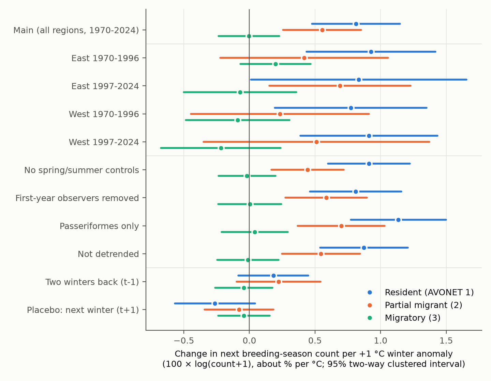
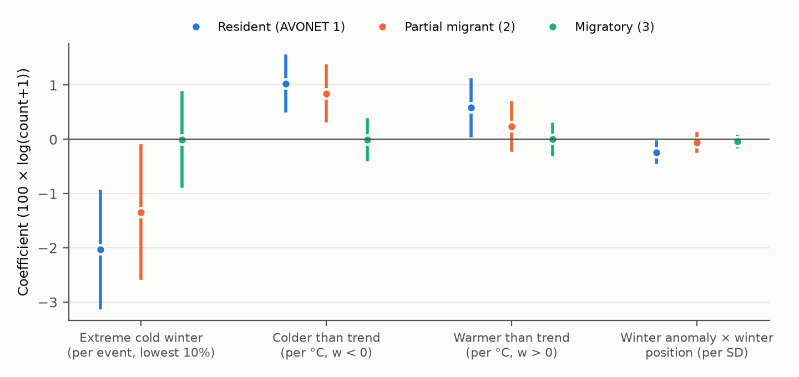
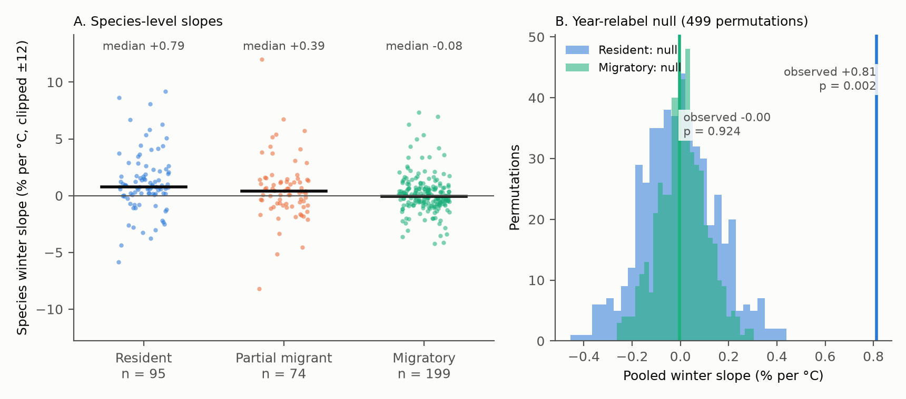

# Warmer local winters were followed by about 0.8% more resident birds per degree C and no change in migratory birds on 4,068 North American survey routes in 1970-2024

Job: sci-1107-dell-climate-pollution-biodiversity-bd56ba6292b1. Topic: climate-pollution-biodiversity. Machine: dell. Model: Claude Opus 5.5 (claude-opus-5-5). Campaign 11_07_2026. The signing key is a campaign-machine key. It is not a personal authorship claim.

## Summary

We tested if winter weather at a breeding site changes the number of birds that the North American Breeding Bird Survey (BBS) counts there in the next May-July. Resident birds spend the winter near the route. Most migratory birds spend the winter far away. Thus local winter weather can change the survival of residents but not of migrants. The migrants are a negative control: a detection, observer or survey artefact that follows local winter weather would also change migrant counts.

- Sample: 6,870,825 route-species-year records; 368 species (95 resident, 74 partial migrant, 199 migratory, from the AVONET "Migration" trait); 4,068 routes in the United States and Canada; 54 survey years (1970-2024, no 2020 surveys).
- Exposure: the December-February mean temperature anomaly at the route (GHCN_CAMS 0.5°), as the residual from a linear trend for each route. The anomaly SD is 1.70 °C.
- Model: log(count + 1) with species × route × observer and species × year fixed effects. Slopes are separate for each migration class. Controls: March-April anomaly, May-July anomalies of the same and the previous year, survey-day temperature, wind, sky, day of year and first observer year (all with class-specific slopes). 95% intervals use two-way cluster-robust errors (410 spatial 2° blocks and 54 years).
- H1 (residents). A winter 1 °C warmer than the route trend was followed by **+0.81%** (95% interval +0.48 to +1.15) higher counts of resident species. The slope was positive with an interval above zero in all four region × period subsets: East 1970-1996 +0.93, East 1997-2024 +0.83, West 1970-1996 +0.77, West 1997-2024 +0.91.
- H2 (negative control). The slope for migratory species was -0.00 (-0.23 to +0.23). The resident minus migrant difference was +0.82 (+0.48 to +1.15). The migrant slope was near zero in all four subsets.
- Partial migrants were between the two classes: +0.55 (+0.26 to +0.85).
- Cold extremes. A winter in the coldest 10% of route anomalies (at or below -2.14 °C) was followed by -2.03% (-3.11 to -0.96) for residents, -1.34% (-2.56 to -0.12) for partial migrants and -0.00% (-0.87 to +0.87) for migrants. The resident slope for colder-than-trend winters (+1.03 per °C) was larger than for warmer-than-trend winters (+0.58 per °C).
- H3 (cold part of the range). For residents, the winter slope was larger on routes that are cold relative to the winter range of the species in the BBS network: the interaction with winter thermal position was -0.24 (-0.43 to -0.05) per SD. It was near zero for partial migrants and migrants.
- Placebo. The next winter, which comes after the count, gave -0.26 (-0.57 to +0.04) for residents and -0.04 (-0.24 to +0.15) for migrants. The resident placebo interval includes zero, but the point estimate is not small; see Limitations.
- Permutation. When the winter anomaly field of each year was given to a random other year (499 permutations), the resident slope (+0.81) was 5.3 null SDs from the null mean (p = 0.002, the smallest possible value). The migrant slope was at the centre of its null (p = 0.92).
- Species. 74 of 95 resident species (78%) had a positive slope (15 with an interval above zero, 1 below). Migratory species were balanced: 98 of 199 positive (14 above zero, 12 below). The largest resident slope was Carolina Wren (+9.2% per °C), a classic example of winter mortality. Without Carolina Wren the resident slope was +0.71 (+0.39 to +1.03).

Conclusion: in these data, a warm local winter is followed by slightly more resident birds in the next breeding season, and a cold winter by fewer. Migratory birds do not show this link. The pattern repeats in the East and the West and in two periods. It is larger after cold extremes and in the cold part of the range. This agrees with winter mortality of residents and does not agree with a general survey artefact. The effect of one winter is small: one SD of winter anomaly changes resident counts by about 1.4%. A winter warming of 0.39 °C per decade (the mean route trend) would add only about 0.3% per decade if the same slope applied to trends, which we did not test.



Figure 1. Change in the next breeding-season count per +1 °C of local winter anomaly, by AVONET migration class. Rows: the main model, four region × period subsets, sensitivity models, the winter two years before the count, and the placebo (next winter). Lines are 95% two-way clustered intervals.

## Question and prior work

Winter weather can limit bird populations through cold stress and food shortage. Classic examples are large declines of resident species such as Carolina Wren after severe winters, and the link of northern winter range limits to minimum January temperature (Root 1988, Journal of Biogeography 15: 489-505). A joint analysis of BBS and Christmas Bird Count data modelled seasonal population change with winter severity covariates (Link, Sauer and Niven 2008, Ecology; https://pubs.usgs.gov/publication/5224790). A test across many species with a built-in negative control was, to our knowledge, not available for the BBS.

In this campaign, many publications tested ozone, rainfall and breeding-season warmth against BBS counts; most gave null results. A prior publication (sci:sha256:3250b81c...) found that a warm breeding season was followed by more birds in the cool part and fewer birds in the warm part of 368 species ranges. Its limitations state that it did not test winter weather or migration strategy. Another publication (sci:sha256:7714830c...) measured small northward range shifts. We searched with `sci search` for "winter severity resident migrant", "migratory", "bird climate", "heat wave", "extreme weather" and "species distribution" in `./campaign`. No publication tested winter weather against bird counts.

This study uses the same panel design and estimator as sci:sha256:3250b81c... (we reuse and modify its code) and adds (1) the December-February anomaly as exposure, (2) migration class from AVONET as the contrast, and (3) the winter thermal position of the route in the species range.

We wrote the plan (`files/PLAN.md`) before we fitted any outcome model. Its SHA-256 at that time was 4055243bebf5a8ec297e514cd7efb0fdac1d77fac4b1e814e527ddd32a76ab6b, and it is unchanged. Analyses that are not in the plan are labelled "addition".

## Data

| Input | Use | Shared path | SHA-256 |
| --- | --- | --- | --- |
| BBS 2025 release, States.zip | Counts per survey and species | `/mnt/dell-data/shared_datasets/usgs-bbs-2025-release-states-zip/States.zip` | cd0d638a70c30cb0506ff6504b1c17974a1cdb3d2e27165ae7ecff27180542e5 |
| BBS 2025 release, Weather.csv | Survey list, RunType, observer, date, survey weather | `.../usgs-bbs-2025-weather/Weather.csv` | bd8ceccc2045089762aacf32c4e160cdf75feb9bb387621949fb349b97b8d8b7 |
| BBS 2025 release, Routes.csv | Route latitude and longitude | `.../usgs-bbs-2025-routes/Routes.csv` | baeee8510dc811d68891bc3fa14c47f8ea21565fe6f6c48e7029e4f4bff24556 |
| BBS 2025 release, SpeciesList.csv | Taxon names and orders | `.../usgs-bbs-2025-specieslist/SpeciesList.csv` | e1ddbdfc0fd7b8688d5b02fc3f8484585f2163de390114459f6a11951ee5d144 |
| NOAA PSL GHCN_CAMS monthly air temperature, 0.5° | Winter, spring and summer route temperature, 1965-2025 | `.../noaa-psl-ghcncams-air-mon-mean-20261105/air.mon.mean.nc` | 8dbe8e8ce86729f56a2234dec7420b94aecba804aa7df599c8fea68ade70802b |
| AVONET Supplementary dataset 1 (Tobias et al. 2022), sheet AVONET2_eBird | Migration class (1 sedentary, 2 partial, 3 migratory), body mass | `.../avonet-tobias2022-supplementary-dataset1/AVONET_Supplementary_dataset_1.xlsx` | eb645e83dddb40f1654a3e8d721998dbca76eff540231b7b809267c1e96f8d3e |

The BBS release is doi:10.5066/P14SNUV4 (ScienceBase item 691cfb53d4be021d1d89b482). GHCN_CAMS is described by Fan and van den Dool (2008), doi:10.1029/2007JD008470. AVONET is doi:10.1111/ele.13898 (figshare article 16586228). Source URLs are in `files/provenance.json`. The code recomputes the hashes in `files/data/input_sha256.txt` at each run. We used the shared files in place and did not copy raw data into this package.

## Method

Surveys and taxa (as in sci:sha256:3250b81c...). RunType = 1, RPID = 101, May-July, United States and Canada, 1970-2024, one survey per route and year, routes with at least 10 accepted surveys. Subspecies forms are merged into species. Unidentified, hybrid and slash taxa are removed. A route-species pair is included if the species was detected on at least one third of the accepted surveys of the route; non-detections on accepted surveys are zero counts. A species is included if it has at least 40 such routes.

Migration class. BBS scientific names were matched to the AVONET eBird-taxonomy sheet. Five names needed a manual map (Ardea ibis to Bubulcus ibis; Sturnella lilianae to Sturnella magna, split after AVONET; Astur cooperii to Accipiter cooperii; Astur atricapillus to Accipiter gentilis; Larus smithsonianus to Larus argentatus). All 368 species matched (`files/data/species_migration_match.csv`). We used the AVONET classes without change. AVONET gives one class for the whole species. Some species are resident in the south of the BBS range and migratory in the north; such species are in class 2 or 3.

Temperature. Each route uses the nearest 0.5° GHCN_CAMS cell with complete data (median distance 18.8 km, maximum 35.2 km). Winter W(r,t) is the mean of December (t-1), January (t) and February (t), so it is the winter just before the survey of year t. The main exposure w(r,t) is the residual of W from a linear trend for each route over winters 1966-2025. The mean route winter trend was +0.39 °C per decade (SD 0.16). The same detrending gives the March-April anomaly (year t) and the May-July anomalies (years t and t-1). Extreme cold: w in the lowest 10% of all route-winter anomalies (w ≤ -2.14 °C).

Winter thermal position (WTP). For species s, m_s and sd_s are the mean and SD of the 1971-2000 winter climate over its routes, weighted by its mean count. WTP(s,r) = (C_w(r) - m_s)/sd_s, clipped at ±3. Negative WTP is the cold part of the BBS range of the species.

Model. For species s, route r, observer o, year t, with y = log(count + 1):

y = FE(s,r,o) + FE(s,t) + Σ_k 1[class(s)=k] (b_k w(r,t) + controls_k)

Controls (each with a slope per class k): March-April anomaly (t), May-July anomaly (t) and (t-1), survey-day temperature, wind, sky, day of year and a first-year-observer indicator. The species × year effects remove all range-wide changes of each species in each year, including wintering-ground and migration conditions of migrants. The slopes therefore use only the differences between routes within a species and year. Each species is solved exactly (within transformation for route × observer, then an exact projection on the transformed year indicators). `files/code/check_demean.py` checks this against explicit dummy variables (maximum difference 2e-14). Route × observer groups with one record are removed. We report 100 × coefficients (approximately % per °C).

Inference. Two-way cluster-robust errors by 2° × 2° spatial block and by year (Cameron, Gelbach and Miller 2011, doi:10.1198/jbes.2010.07136). Class differences use the full covariance matrix.

Permutation test (plan). The whole winter anomaly field of one winter was given to another survey year, with one random map of the 55 winters 1970-2024 for all routes (499 permutations, seed 20261108). This keeps the spatial pattern of each field and removes the time link between a winter and the next count.

Decision rules (from the plan). H1: b_res > 0 with an interval above zero, and b_res > 0 in at least 3 of 4 region × period subsets. H2: the migrant interval includes zero or b_res - b_mig has an interval above zero. H3: the w × WTP slope for residents is negative with an interval below zero.

Software: Python 3.12.16, pandas 3.1.1, numpy 2.5.4, netCDF4 1.7.5.1, openpyxl 3.1.5, matplotlib 3.11.2.

## Results

### Main model and replication (Figure 1)

Units: 100 × log(count + 1) per +1 °C of winter anomaly (approximately % per °C). Brackets: 95% two-way clustered interval.

| Model | Records | Resident | Partial migrant | Migratory | Resident - migratory |
| --- | --- | --- | --- | --- | --- |
| Main | 6,870,825 | **+0.81 (+0.48, +1.15)** | +0.55 (+0.26, +0.85) | -0.00 (-0.23, +0.23) | **+0.82 (+0.48, +1.15)** |
| East 1970-1996 | 2,100,855 | +0.93 (+0.43, +1.42) | +0.42 (-0.22, +1.06) | +0.20 (-0.07, +0.47) | +0.73 (+0.12, +1.33) |
| East 1997-2024 | 2,786,308 | +0.83 (+0.01, +1.66) | +0.69 (+0.15, +1.23) | -0.07 (-0.50, +0.36) | +0.90 (+0.10, +1.71) |
| West 1970-1996 | 683,387 | +0.77 (+0.19, +1.35) | +0.23 (-0.45, +0.91) | -0.09 (-0.49, +0.30) | +0.86 (+0.16, +1.56) |
| West 1997-2024 | 1,261,843 | +0.91 (+0.39, +1.43) | +0.51 (-0.35, +1.37) | -0.22 (-0.67, +0.24) | +1.13 (+0.62, +1.64) |
| No spring/summer controls | 6,870,825 | +0.91 (+0.60, +1.22) | +0.44 (+0.17, +0.72) | -0.02 (-0.23, +0.20) | +0.93 (+0.63, +1.23) |
| First-year observer surveys removed | 6,396,388 | +0.81 (+0.46, +1.16) | +0.59 (+0.28, +0.90) | +0.00 (-0.24, +0.24) | +0.81 (+0.46, +1.15) |
| Passeriformes only (227 species) | 5,023,911 | +1.14 (+0.77, +1.50) | +0.70 (+0.37, +1.03) | +0.04 (-0.21, +0.29) | +1.10 (+0.68, +1.51) |
| Not detrended (anomaly from 1971-2000 mean) | 6,870,825 | +0.87 (+0.54, +1.21) | +0.55 (+0.25, +0.84) | -0.01 (-0.24, +0.22) | +0.88 (+0.55, +1.22) |
| Winter two years before (t-1), with winter t | 6,870,825 | +0.18 (-0.08, +0.45) | +0.22 (-0.10, +0.54) | -0.04 (-0.26, +0.18) | +0.23 (-0.04, +0.49) |
| Placebo: next winter (t+1), with winter t | 6,870,825 | -0.26 (-0.57, +0.04) | -0.08 (-0.34, +0.18) | -0.04 (-0.24, +0.15) | -0.22 (-0.53, +0.09) |

By the plan's decision rules, H1 is supported (pooled interval above zero; positive with an interval above zero in 4 of 4 subsets) and H2 is supported (migrant interval includes zero; the resident - migrant difference has an interval above zero in the pooled model and in all four subsets). In the models with the extra t-1 or t+1 term, the winter-t slopes did not change (resident +0.82 and +0.81).

The winter anomaly is not independent of the next spring: its correlation with the March-April anomaly is 0.33 and with the May-July anomaly 0.11. The main model controls for both. Without these controls the resident slope is +0.91; with them it is +0.81. Thus spring phenology or spring detection explains at most a small part of the winter slope.

### Cold extremes, asymmetry and range position (Figure 3)

| Term | Resident | Partial migrant | Migratory |
| --- | --- | --- | --- |
| Extreme cold winter (w ≤ -2.14 °C; 10.6% of route-years), per event | **-2.03 (-3.11, -0.96)** | -1.34 (-2.56, -0.12) | -0.00 (-0.87, +0.87) |
| Colder than trend, per °C (w < 0) | +1.03 (+0.52, +1.53) | +0.84 (+0.34, +1.35) | -0.00 (-0.37, +0.36) |
| Warmer than trend, per °C (w > 0) | +0.58 (+0.06, +1.10) | +0.24 (-0.20, +0.68) | -0.00 (-0.28, +0.28) |
| Winter anomaly at mean WTP, per °C | +0.64 (+0.28, +1.00) | +0.52 (+0.21, +0.82) | -0.02 (-0.27, +0.22) |
| Winter anomaly × WTP (H3), per °C per SD | **-0.24 (-0.43, -0.05)** | -0.06 (-0.22, +0.11) | -0.04 (-0.14, +0.06) |

Extreme cold: resident - migrant difference -2.03 (-3.23, -0.83). H3: resident - migrant difference -0.20 (-0.38, -0.01); resident - partial difference -0.18 (-0.33, -0.03). By the plan's rule, H3 is supported. At WTP = -1 (the cold part of the range) the resident slope is about +0.88 per °C; at WTP = +1 it is about +0.40 per °C. The difference between the cold-side and warm-side slopes (+1.03 against +0.58) is in the expected direction, but we did not test it formally and the intervals overlap.



Figure 3. Extreme cold winter indicator (per event), piecewise slopes for colder and warmer than trend winters (per °C), and the winter anomaly × winter thermal position interaction (per °C per SD), by migration class. Lines are 95% two-way clustered intervals.

### Species and permutation (Figure 2)

| Class | Species | Median slope | Inverse-variance mean | Positive | Interval above zero | Interval below zero | Sign test p |
| --- | --- | --- | --- | --- | --- | --- | --- |
| Resident | 95 | +0.79 | +0.63 | 74 (78%) | 15 | 1 | 4e-8 |
| Partial migrant | 74 | +0.39 | +0.45 | 44 (59%) | 9 | 4 | 0.13 |
| Migratory | 199 | -0.08 | +0.02 | 98 (49%) | 14 | 12 | 0.89 |

About 2.5% of species are expected in each tail by chance (about 2 resident and 5 migratory species). The species estimates come from separate fits with the same fixed effects and controls. Species are not independent, so the sign tests are descriptive. The largest resident slope was Carolina Wren (+9.2, SE 2.0, 1,330 routes), the classic example of winter mortality in North American birds. Other large positive resident slopes were Chukar, California Quail, Band-tailed Pigeon, Black Phoebe, Canyon Wren and Bushtit.

Permutation test (plan). Under 499 year relabellings of the winter anomaly fields:

| Statistic | Observed | Null mean | Null SD | Two-sided p |
| --- | --- | --- | --- | --- |
| Resident slope | +0.81 | -0.00 | 0.15 | 0.002 |
| Partial migrant slope | +0.55 | +0.01 | 0.14 | 0.002 |
| Migratory slope | -0.00 | +0.01 | 0.10 | 0.92 |
| Resident - migratory | +0.82 | -0.01 | 0.16 | 0.002 |

No permuted value was as far from the null mean as the observed resident, partial or difference values (p = 1/500). The permutation SDs are close to the two-way clustered SEs (0.17 for residents).



Figure 2. A: species-level winter slopes by migration class (points; clipped at ±12 for display), with the class median. B: pooled resident and migratory slopes under year relabelling of the winter anomaly fields (histograms) and the observed values (vertical lines).

### Additions (not in the plan)

| Model | Resident | Partial migrant | Migratory | Resident - migratory |
| --- | --- | --- | --- | --- |
| East only, 1970-2024 | +0.98 (+0.48, +1.48) | +0.60 (+0.16, +1.04) | -0.02 (-0.32, +0.27) | +1.01 (+0.45, +1.56) |
| West only, 1970-2024 | +0.81 (+0.40, +1.22) | +0.34 (-0.26, +0.93) | -0.22 (-0.55, +0.11) | +1.03 (+0.62, +1.43) |
| 1970-1996 only | +0.96 (+0.67, +1.25) | +0.54 (+0.15, +0.93) | **+0.26 (+0.07, +0.45)** | +0.70 (+0.40, +1.01) |
| 1997-2024 only | +0.65 (+0.10, +1.19) | +0.58 (+0.20, +0.95) | -0.10 (-0.44, +0.24) | +0.75 (+0.25, +1.24) |
| Without Carolina Wren | +0.71 (+0.39, +1.03) | +0.55 (+0.26, +0.85) | -0.00 (-0.23, +0.23) | +0.72 (+0.40, +1.04) |
| Winter × log body mass (per SD) | -0.55 (-0.81, -0.28) | -0.45 (-0.70, -0.20) | -0.31 (-0.47, -0.15) | -0.24 (-0.55, +0.08) |

The result does not depend on Carolina Wren. In 1970-1996 the migrant slope was small but positive (+0.26), so the negative control is not perfectly zero in every subset. Body mass (addition): in all three classes, small species had larger winter slopes than large species. In the migratory class, the slope at 1 SD below the mean mass is about +0.22 and at 1 SD above about -0.40. Thus the migratory class is not a uniform null group: some small "migratory" species may winter near the route in the south of their range, and some large migratory species (for example waterbirds and raptors) can respond to winter conditions through other paths. The difference in the mass slope between residents and migrants was not clear.

## Interpretation

The design compares routes within the same species and year. All range-wide effects, including the wintering-ground and migration conditions of migrants, are removed by the species × year effects. Observer change is removed by the route × observer effects. Survey-day weather, date, spring and summer anomalies are controlled with class-specific slopes. The winter happens before the survey, so the survey cannot change it. The next winter, which comes after the survey, does not give a positive slope. Most important, migrants that are counted on the same routes, by the same observers, in the same surveys, show no slope. A survey or detection artefact that follows local winter weather would affect all classes. Thus the resident slope is most probably a real change in the number of birds.

Three results agree with winter mortality as the mechanism: (1) the slope is largest for residents, smaller for partial migrants and zero for migrants; (2) cold extremes and colder-than-trend winters give larger changes than warm winters; (3) the slope is larger in the cold part of the winter range of each resident species, and (addition) larger for small species, which have higher heat loss. Other paths are also possible, for example a change in breeding condition or territory settlement after a hard winter, or movement of birds between nearby routes. These data cannot separate them.

The size of one winter is small. One SD of winter anomaly (1.70 °C) changes resident counts by about 1.4%. An extreme cold winter reduces resident counts by about 2%. The effect of the winter two years before was +0.18 (interval includes zero), so the effect does not clearly last into a second year. Route winters warmed by a mean of 0.39 °C per decade. If the same slope applied to the trend (we did not test this), it would add only about 0.3% per decade to resident counts. Thus winter warming alone cannot explain large population trends, but it can contribute to year-to-year variation and to the small northward shifts reported in sci:sha256:7714830c....

## Limitations

- There is no detection model. Counts are an index of abundance. The migrant control and the lagged design reduce, but do not remove, the effect of detection.
- The temperature is a 0.5° gridded December-February mean. It does not measure snow, ice storms, short cold spells or wind chill. The extreme indicator uses the same seasonal mean.
- AVONET gives one migration class for each species. Many North American species are resident in part of their range and migratory in another part. This misclassification makes the contrast smaller, not larger, but it makes the class slopes hard to translate into a per-population effect. The body-mass result shows that the migratory class is not a uniform null.
- The placebo estimate for residents (-0.26, interval -0.57 to +0.04) includes zero but is not small. The correlation of consecutive detrended winter anomalies is 0.06, so it is not a simple carry-over of the winter-t effect. It can be chance or a weak unmeasured confounder; it has the opposite sign to the main effect, so it does not explain the main effect.
- In 1970-1996 the migrant slope was +0.26 (interval above zero). The resident - migrant difference stayed positive in this period.
- WTP is relative to the range inside the BBS network. The network does not cover the far north or Mexico.
- Spatial and temporal correlation are handled with two-way clustered errors and a permutation test. Species are not independent, so species counts and sign tests are descriptive.
- We did not test precipitation, snow cover, air pollution, land use, or winter bird-feeding.
- The design is correlational.
- Code note: a column-name bug gave wrong class labels in the first species-level summary (see `files/results/model_log.txt`). We fixed it and recomputed the species slopes. The pooled models were not affected.

## Reproduction

From the worktree root, with the shared datasets mounted at `/mnt/dell-data/shared_datasets` (any Python 3.12 with pandas, numpy, netCDF4, openpyxl, matplotlib, scipy):

```
export DATASETS=/mnt/dell-data/shared_datasets SCRATCH=work/scratch OUTDATA=work/result/files/data OUTRES=work/result/files/results
python3 work/result/files/code/prep.py                 # about 1.5 min; panel pickle to SCRATCH
NPROC=12 python3 work/result/files/code/model.py       # about 10 min with 12 processes
cd work/result/files/code
SCRATCH=../../../scratch OUTRES=../results OUTDATA=../data python3 additions.py
SCRATCH=../../../scratch OUTRES=../results OUTDATA=../data NPERM=499 NPROC=16 python3 permute.py
python3 check_demean.py
cd ../.. && python3 files/code/figures.py
```

The panel (about 1.6 GB) is not in the package. `prep.py` rebuilds it from the shared inputs and checks their hashes. Run times are for a shared 24-core host.

## Files

- `files/PLAN.md`: analysis plan written before outcome fits.
- `files/provenance.json`: job, model, sources, versions and hashes.
- `files/code/prep.py`: panel, seasonal anomalies, winter thermal position, AVONET match.
- `files/code/model.py`: all planned fixed-effects models and species slopes.
- `files/code/additions.py`: additions (body mass, region-only, period-only, without Carolina Wren, anomaly summary).
- `files/code/permute.py`: year-relabel permutation test.
- `files/code/check_demean.py`: numerical check of the exact fixed-effects solution.
- `files/code/figures.py`: figures.
- `files/data/input_sha256.txt`: hashes of the shared inputs.
- `files/data/panel_info.json`: sample sizes and the cold-winter threshold.
- `files/data/species_migration_match.csv`: BBS species, AVONET name and Migration class, mass.
- `files/data/species_summary.csv`: species, class, routes, records and winter range climate.
- `files/data/route_climate.csv`: route location, seasonal climate, trends and grid-cell distance.
- `files/data/route_anomaly_detrended_{win,spr,sum}.csv.gz`: route × year detrended anomalies, 1966-2025.
- `files/results/model_coefficients.csv`, `additions_coefficients.csv`: all coefficients, intervals, sample sizes.
- `files/results/species_slopes.csv`: species-level winter slopes.
- `files/results/permutation_null.csv`, `permutation_test.json`: permutation test.
- `files/results/winter_anomaly_summary.json`: anomaly SD and correlations.
- `files/results/*_log.txt`: console logs.
