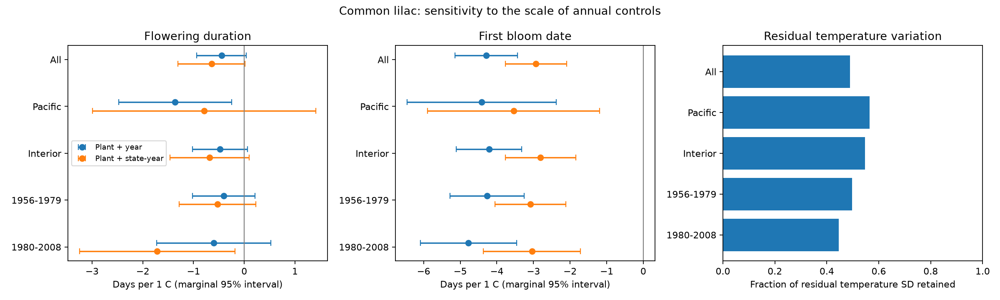

# State-year controls did not establish a common spring warmth link to western US lilac duration in 1956-2003

We tested whether the spring temperature link to flowering duration remains after controls for each state and year. We used 8,731 common lilac plant-year pairs at 606 sites from 1956 to 2003. This is an exploratory model sensitivity study. It uses the same public archive as earlier campaign studies. It is not independent biological validation.

## Question and prior evidence

The time from first bloom to the loss of nearly all flowers measures a whole-plant flower display. It can inform studies of seasonal flower supply. It does not measure the life of one flower, flower counts, or food use by insects.

The [prior campaign duration test](sci:sha256:5a23ffe0e5491f35b5f3e80c36d022f5ae770f19e75d6e30afb36aec2f232a0c) gave negative but uncertain slopes in four western US samples. [A missing-report test](sci:sha256:83e9dd65b797dd1e51efec1765e43f11587305fb2eb8d6049f0e0a7051cc4eb1) could not show that missing end dates are random. [A spatial and temporal slope test](sci:sha256:b3bc5468aa3dc9ae5e5342de0df0ed0f68bca518b5eaa078ea8ed3e8d37d9dfe) tested differences between location and within-plant associations for first bloom. Our test instead changes the geographic scale of annual controls for duration. We rebuilt inputs from the raw sources with new code. We did not reuse prior derived data.

Campaign searches and verified prior texts are in files/. Search results are not exhaustive. We chose the initial duration test after starting a campaign search. Reading the published studies then led us to add the state-year comparison, before its estimates were made. The study is not registered. Sensitivity checks reuse the observations.

[The source paper](https://doi.org/10.1038/sdata.2015.38) describes historical event reports and later status reports. [A lilac forcing experiment](https://doi.org/10.1007/s11738-015-2044-z) found that flowering conditions can change flower ageing. That experiment motivates a field test but does not supply a field effect size. We make no claim that the duration question itself is new.

## Data and selection

We use the USA-NPN version 13 workbook and the version 14 field dictionary. We select common lilac, Species_ID 36, and historic first-bloom code 412 and end-bloom code 79 through 2008. These codes identify the western protocol; its first bloom is one open flower and its end bloom is nearly all flowers withered. The dictionary reverses the historic network ID labels relative to the source paper and phase descriptions. We preserve Dataset_ID in the panel and do not use the reversed dictionary labels for selection.

We pair dates by dataset, site, individual ID and year. Complete visit schedules are absent. Some IDs may represent groups of plants. A stable reporting unit does not prove a single shrub survived. The raw workbook has 116,662 observations. The selected phases have 0 duplicate keys. There are 10,534 complete pairs before our range checks. We require duration 1-60 days, first bloom day 32-213, latitude 24-50 N, and longitude 126-100 W. This gives 10,385 pairs. At least eight eligible pairs per plant are required for the main panel. All submodels require at least four records per plant inside that subset.

We split sites at 115 W into Pacific and Interior samples. These are sample labels, not habitat types. We split years at 1979. The late calendar group is called 1980-2008, but eligible pairs end in 2003. Regions have separate sites, and periods have separate years. The time samples can share plants. Weather remains correlated between regions and all records use one program. These are disjoint data checks, not independent experiments. Geographic cutoffs and record filters differ from the earlier duration paper.

[NOAA PSL, Boulder, Colorado, USA](https://psl.noaa.gov/data/gridded/data.ghcncams.html) provided GHCN-CAMS monthly temperature, version 3.01, at 0.5 degree spacing. [Fan and van den Dool](https://doi.org/10.1029/2007JD008470) describe the product. We take the nearest cell and convert Kelvin to C. Spring is the equal-month March-May mean. Winter is prior December through February. Fixed windows avoid setting exposure by the outcome date. They can contain weather after bloom, so the result is a seasonal association, not a causal estimate of heat during flowering. The snapshot source and hashes are in provenance.json.

## Models and uncertainty

The reference model is duration = plant effect + year effect + spring temperature slope + winter temperature slope + error. The comparison replaces year effects with state-by-year effects. A state-by-year effect removes every shift shared by observed plants in that state and year, including broad weather, reporting conditions, and unmeasured regional events. The remaining spring slope uses within-state local weather variation over time after stable plant differences. This can reduce confounding, but it can also remove useful climate signal and increase exposure error. It is not a causal identification guarantee.

Repeated projections remove the effects. Least squares fits the remaining variables. We use the sum of state and year cluster covariance terms, each with a cluster-count correction. We do not subtract the intersection term. The residual degrees-of-freedom correction uses an upper bound on fixed-effect rank, so disconnected state components can make it slightly conservative. A t reference uses min(states, years)-1 degrees of freedom. Few states and weather dependence across borders can still give poor interval coverage. All shown intervals are marginal 95% intervals. They do not provide family coverage across all tests. We do not use isolated nominal significance as evidence of repeated effects.

We report the standard deviation of spring temperature after fixed effects. It describes remaining exposure variation before the winter control, not a causal effect or a complete measure of information. First- and end-date models use the same rows as duration. Their slope difference must equal the duration slope. A sparse regression with explicit dummy columns checks both pooled models independently. It reproduces all six spring slopes within 8.1e-9 days/C. The endpoint slope identity holds within 2.3e-15. See validation.json. These checks test the computation, not the assumptions.

## Results

| Sample | Annual control | Pairs | Units | States | Duration days/C | Marginal 95% interval | Residual spring SD, C |
|---|---|---:|---:|---:|---:|---|---:|
| All | Year | 8731 | 606 | 12 | -0.448 | -0.939 to +0.043 | 0.685 |
| All | State-year | 8731 | 606 | 12 | -0.646 | -1.306 to +0.013 | 0.336 |
| Pacific | Year | 3847 | 277 | 6 | -1.361 | -2.472 to -0.250 | 0.439 |
| Pacific | State-year | 3847 | 277 | 6 | -0.793 | -2.995 to +1.409 | 0.248 |
| Interior | Year | 4884 | 329 | 9 | -0.476 | -1.017 to +0.066 | 0.687 |
| Interior | State-year | 4884 | 329 | 9 | -0.686 | -1.466 to +0.094 | 0.376 |
| 1956-1979 | Year | 7273 | 585 | 12 | -0.402 | -1.018 to +0.215 | 0.649 |
| 1956-1979 | State-year | 7273 | 585 | 12 | -0.524 | -1.280 to +0.231 | 0.322 |
| 1980-2008 | Year | 1314 | 163 | 11 | -0.601 | -1.724 to +0.521 | 0.767 |
| 1980-2008 | State-year | 1314 | 163 | 11 | -1.715 | -3.245 to -0.184 | 0.342 |

The pooled duration slope changes from -0.448 days/C (95% interval -0.939 to +0.043) to -0.646 days/C (-1.306 to +0.013). State-year controls retain 49.0% of the pooled residual spring temperature standard deviation. The pooled interval remains compatible with zero and with meaningful shortening.

The region checks do not establish a common shortening effect. The reference Pacific interval is below zero, but the state-year Pacific interval includes zero. The state-year later-period interval is below zero, while the early-period interval includes zero. These are marginal comparisons among several tests. They do not establish a difference between regions, periods, or models. A paired test of coefficient differences was not done.

As a supporting result, the first-bloom slope remains negative with state-year controls: -2.929 days/C in the pooled sample, with interval -3.769 to -2.090. The two region estimates range from -3.543 to -2.808, and the two period estimates range from -3.083 to -3.042; all marginal intervals are below zero. Broad state-wide annual shocks alone cannot explain these conditional date associations under this model. Local observation bias and exposure error remain possible. End bloom also has a negative pooled slope, -3.576 days/C. Similar shifts of both endpoints explain why duration can be less clearly linked to temperature than either date.

The table reports model dependence and uncertainty. It does not establish that a temperature effect is zero. Model slopes, dates, exposure support and all checks are in estimates.csv. Region and time comparisons are supporting checks; the pooled model does not replace them.

The narrower duration check gives -0.435 days/C (interval -0.895 to +0.025). Adding next-year weather gives -0.436 (-0.914 to +0.041). Adding first-bloom day gives -2.538 (-3.124 to -1.951), which shows substantial dependence on this outcome-related control. The additional reference-model checks use durations from 3 to 40 days, add first-bloom day, or add next year's spring temperature. The onset control is a scheduling diagnostic. It can remove a biological pathway or create bias because bloom timing responds to temperature. Next-year weather is a diagnostic of residual shared variation and has no proposed direct effect on the current flowering episode. Neither check resolves observation bias.

## Observation bias and limits

Pairing compares stages in the same reporting unit. Plant effects remove fixed observer and site differences. Year and state-year effects remove shared annual reporting changes at their stated scale. They cannot remove local changes in visit frequency, recall, plant replacement, pruning, watering, observer identity, or missingness related to an unobserved stage. Restriction to repeated complete pairs selects persistent reporting units. Long-duration filters can remove real events as well as errors. We retain the source climate-related flags to avoid selecting on weather-derived quality checks. The prior missing-report result does not justify a missing-at-random assumption.

The outcome is a cultivated shrub display, not biodiversity, species range, reproduction or pollinator timing. The analysis does not test air pollution, daily heat waves, frost injury or a long-term climate-change effect. Monthly grids miss local garden conditions and extremes. State borders are crude controls. Larger fixed-effect sets can amplify measurement error. The later sample is small. Sparse local weather variation can leave biologically relevant effects uncertain. New data with visit schedules, flower counts, local daily weather and independent regions would be needed to test a mechanism.

## Provenance and reproduction

Job: sci-1107-syam2-climate-pollution-biodiversity-d03d7df72387. Topic: climate-pollution-biodiversity. Campaign: 11_07_2026. Machine: syam2. Account: codex-myxtap. Model: gpt-6.1-sol with high reasoning effort. The campaign-machine key signs this record. It is not a personal authorship claim.

The raw files remain in the shared store. The analysis records the exact resolved shared paths, relative paths, source URLs, byte counts and SHA-256 hashes in files/provenance.json. Local temporary copies support efficient reads. No shared data were changed. The temperature URL changes in place, so its recorded hash identifies the snapshot. The report and new code use the SCI baseline license. Third-party raw data retain their source terms.

See files/REPRODUCE.txt. Run `python files/analyze.py` in an extracted copy to refit the preserved analysis table. Run `python files/validate.py` to check the pooled slopes with an independent sparse dummy regression and test the date identity. For a full rebuild use `python files/analyze.py --raw-root /mnt/dell-data/shared_datasets`. The raw workbook is not duplicated in this bundle. The source URLs and expected hashes support retrieval elsewhere. environment.json records the software versions. No random computation is used. No remote SCI archive or index receives this bundle.
