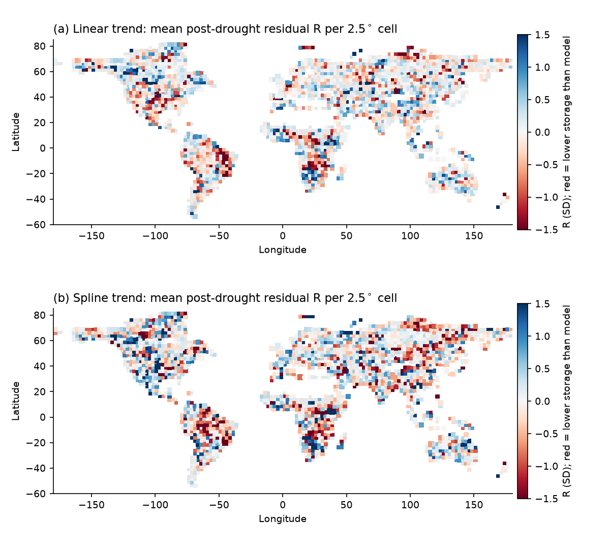
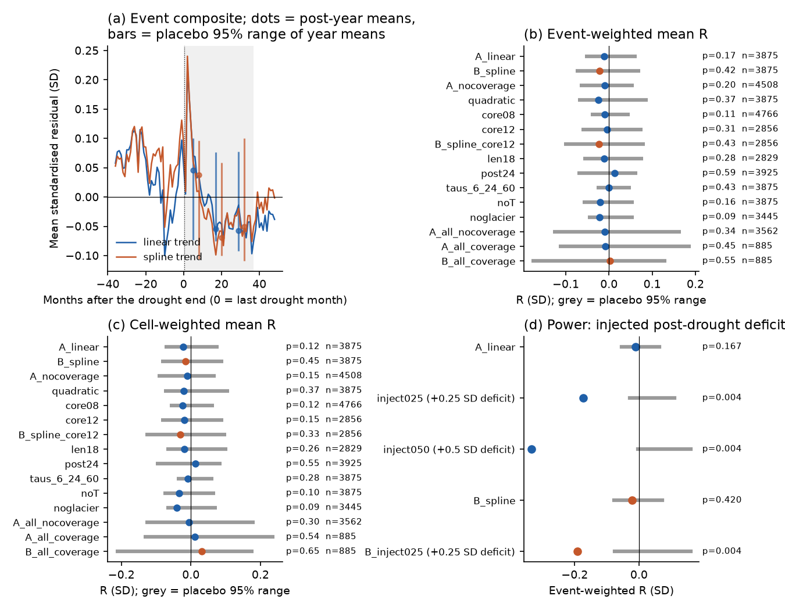
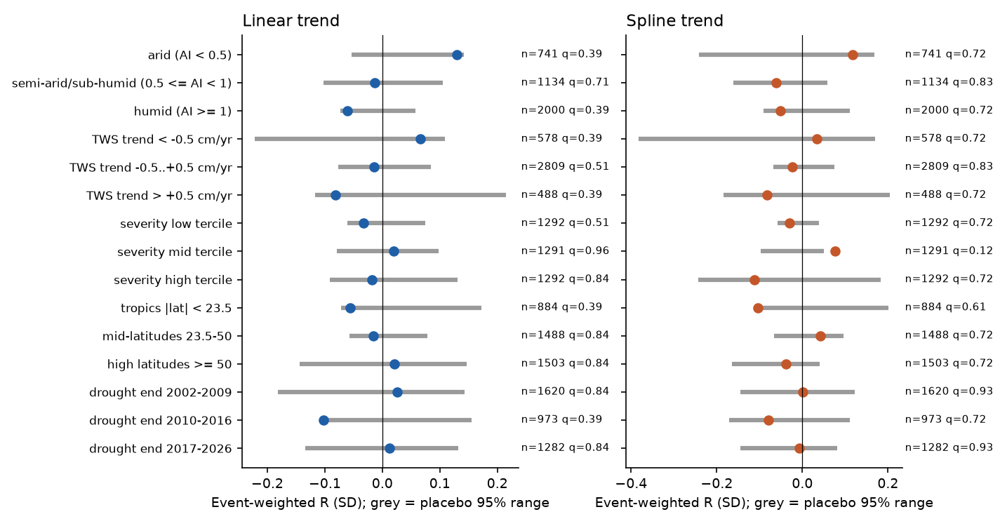

# GRACE water storage did not stay below a rainfall-based model after 3,875 meteorological droughts on global land in 2002-2026; a deficit of 0.12 SD or more is unlikely

## Summary

After some droughts, runoff stays low for years after the rain comes back ("non-recovery", Peterson et al. 2021). Two earlier studies in this campaign tested this idea in the United States. Runoff in 555 reference catchments did not stay low (sci:sha256:664b208c...). Groundwater levels in 1,576 wells did not stay low, but had a small, temporary dip 3-4 years after droughts (sci:sha256:d124c3f7...). These studies used point data in one country. This study does the same type of test for total terrestrial water storage (TWS) on global land, with GRACE and GRACE-FO satellite gravimetry.

We used CSR RL06.3 mascons (April 2002 to June 2026), GPCP v2.3 monthly precipitation, and GHCN_CAMS temperature on 2,274 land cells of 2.5 degrees. A drought is a run of 12 or more months with negative 12-month standardised precipitation (SPI-12) that includes 6 or more months with SPI-12 of -1 or less. For each drought, we fitted a reference model of TWS on all observed months except the months of that drought and its 36-month post-drought window ("leave-one-event-out"). The model has a trend, seasonal terms, three exponentially weighted sums of past precipitation anomalies (time constants 3, 12 and 36 months) and 12-month temperature. The metric R is the mean standardised residual in the post-drought window. A negative R means that storage is lower than the model predicts. The null distribution comes from 244 common time shifts of all drought windows, with the model refitted for each shift.

Main results:

1. **No persistent post-drought deficit.** For 3,875 droughts in 1,980 cells, the event-weighted mean R was -0.011 SD with a linear trend (placebo 95 % range -0.055 to +0.064; one-sided p = 0.17) and -0.022 SD with a natural-spline trend (-0.077 to +0.072; p = 0.42). The cell-weighted means were -0.022 SD (p = 0.12) and -0.016 SD (p = 0.45). At the median residual SD (3.1 cm), -0.02 SD is approximately 0.06 cm of water. Of the 3,875 events, 50 % had a negative R.
2. **The result is the same in 13 analysis variants.** In the 2 co-primary models and the 13 variants, the mean R was between -0.024 and +0.013 SD, and the one-sided p was between 0.09 and 0.59. The variants changed the drought rule, the post-drought window, the precipitation time constants, the trend model, the temperature term, the fitting design, and the glacier regions.
3. **The test has power.** An injected deficit of 0.25 SD in all post-drought windows gave R = -0.173 SD (linear) and -0.191 SD (spline). Both were below all 244 placebo shifts (p = 0.004). The leave-one-event-out design recovered 65 % (linear) and 67 % (spline) of the injected deficit, because the other droughts' deficits enter each fit. After this correction, the one-sided 95 % upper bound on a uniform post-drought deficit is 0.11 SD (linear) and 0.12 SD (spline), approximately 0.35 cm at the median cell.
4. **A small, non-significant dip in post-drought years 2-3.** The mean residual was +0.05 SD in post-drought year 1, and -0.05 to -0.07 SD in years 2 and 3 (one-sided p = 0.07-0.26 for the co-primary models). The year-2 mean was negative in all 15 analyses, and the year-3 mean was negative in all 14 analyses that have a year 3. Only the variant without glacier regions had p below 0.05 (p = 0.008 for years 2 and 3). We did not correct these values for the many variant and year tests. The pattern agrees in time with the 3-4 year dip in US wells, but this study does not confirm it.
5. **No subgroup has a clear deficit.** We tested 15 groups: aridity, long-term TWS trend, drought severity, latitude band and the period of the drought end. No group passed a Benjamini-Hochberg correction (smallest q = 0.12). Humid cells (-0.06 SD) and cells with a TWS gain of more than 0.5 cm/yr (-0.08 SD) had the lowest means with the linear trend. Arid cells had a positive mean (+0.13 SD, q = 0.39). Cells with long-term storage decline, which include most regions with heavy groundwater pumping, did not have a negative mean (+0.07 SD linear, +0.03 SD spline).

Thus, at the 2.5 degree scale and in 2002-2026, meteorological droughts did not move total water storage into a persistent low state relative to a precipitation-based model. This agrees with the US runoff and groundwater results of this campaign, and extends the test to all continents except Antarctica and Greenland.



*Figure 1. Mean post-drought residual R per 2.5 degree cell (mean over droughts; marker size shows the number of droughts), for the linear (a) and spline (b) trend models. Red shows lower storage than the reference model predicts. Grey cells had no analysed drought.*



*Figure 2. (a) Mean standardised residual by month relative to the last drought month (0). Each event uses its own leave-one-event-out fit. Months before 0 are mostly drought months. Months after 36 can be in later droughts. The dots show the means of post-drought years 1-3, and the bars show their placebo 95 % ranges. The peak at month 1 occurs because a drought often ends with one wet month, and the smooth precipitation terms respond to it more slowly than TWS. (b) Event-weighted mean R (dot) and placebo 95 % range (grey bar) for all variants; p is the one-sided placebo p-value for a low value, (k + 1) / (n + 1). (c) The same for the cell-weighted mean R. (d) Mean R after injected post-drought deficits, with the placebo ranges of the injected data.*



*Figure 3. Event-weighted mean R per group (dot) and placebo 95 % range (bar) for the two trend models. q is the Benjamini-Hochberg value over 15 groups (two-sided placebo p). AI is the ratio of precipitation to Thornthwaite potential evapotranspiration.*


*Figure 4. Four example cells. Black dots: GRACE TWS. Lines: the reference models fitted without the most severe analysed drought of the cell (dark red: its drought months; dark blue: its post-drought months). Light shades show other droughts. In the California cell, the 2012-2016 drought is not the marked event, because the coverage rule (see Method) removed it; the variant without this rule includes it.*

## Question

Over global land in 2002-2026, does GRACE/GRACE-FO total water storage stay lower than a precipitation-based reference model predicts in the 36 months after multi-year meteorological droughts? Is a deficit larger in arid regions, in regions with long-term storage loss, or after more severe droughts?

## Data

| Data | Source and version | Use |
| --- | --- | --- |
| CSR GRACE/GRACE-FO RL06.3 mascons, all corrections applied (0.25 degree grid, label RL0603rc24cE, created 2026-10-07) | Shared campaign dataset `csr-grace-rl0603-mascon-all-corrections-20261108`, file `CSR_GRACE_GRACE-FO_RL0603_Mascons_all-corrections.nc`, SHA-256 `d4bd8b7364fb34d871198001563c70d344792cb7b0a577c04f8b91c713741292`, source `https://download.csr.utexas.edu/outgoing/grace/RL0603_mascons/CSR_GRACE_GRACE-FO_RL0603_Mascons_all-corrections.nc` | Monthly TWS (cm of water), 260 solutions |
| CSR RL06 mascon v02 land mask | Shared dataset `csr-grace-rl06-v02-landmask-20261108`, `CSR_GRACE_GRACE-FO_RL06_Mascons_v02_LandMask.nc`, SHA-256 `65ddd8f3c7f7633c3a34f904e196307f71e4994e11ceb64f9337275908ff2f3b`, source `https://download.csr.utexas.edu/outgoing/grace/RL0603_mascons/CSR_GRACE_GRACE-FO_RL06_Mascons_v02_LandMask.nc` | Land fraction and land-only averages |
| GPCP v2.3 monthly precipitation (2.5 degree; interim data from 2021-11) | Shared dataset `noaa-psl-gpcp-v23-precip-mon-mean-20261108`, `precip.mon.mean.nc`, SHA-256 `d31c53ab8180a883bd01442212948c3db4372d481b94a90e69d3d86bb65d7f68`, source `https://downloads.psl.noaa.gov/Datasets/gpcp/precip.mon.mean.nc` | Precipitation anomalies, SPI-12, aridity; defines the grid |
| NOAA PSL GHCN_CAMS monthly air temperature (0.5 degree) | Shared dataset `noaa-psl-ghcncams-air-mon-mean-20261105`, `air.mon.mean.nc`, SHA-256 `8dbe8e8ce86729f56a2234dec7420b94aecba804aa7df599c8fea68ade70802b`, source `https://downloads.psl.noaa.gov/Datasets/ghcncams/air.mon.mean.nc` | 12-month temperature anomaly; PET for aridity |

The shared raw files are not in this bundle. Their hashes are in `files/provenance/shared_datasets_SHA256SUMS.txt`. The derived cell series are in `files/data/cells_float32.npz` (a float32 copy of the `prep.py` output).

Data counts: 260 GRACE solutions in 258 calendar months (two months have two solutions, which we averaged). The model window is 2002-04 to 2026-06 (291 months, 258 observed; GPCP ends in 2026-06). 2,274 cells of 2.5 degrees have a land fraction of 0.5 or more, latitude above 60 S, are outside Greenland, and have mean precipitation of 100 mm/yr or more. 4,508 droughts ended inside the window and had 12 or more observed post-drought months. 3,875 of them (in 1,980 cells) passed the coverage rule.

## Method

**Cell series** (`prep.py`). TWS for a cell is the area-weighted mean of the land 0.25 degree mascon cells inside it (weights: cos(latitude) x land mask). A GRACE solution goes to the calendar month that contains the midpoint of its time bounds. Temperature is the area-weighted mean of the valid 0.5 degree cells. Precipitation is converted from mm/day to mm/month.

**Droughts** (`analyze.py`). SPI-12 is the z-score of the 12-month precipitation sum for each calendar end month (base 1981-2020). A drought is a maximal run of SPI-12 < 0 with 12 or more months, of which 6 or more have SPI-12 <= -1. The drought ends in the last month of the run. At this time the 12-month precipitation is back to normal. The post-drought window is months 1-36 after the end; it stops at the start of the next drought. A drought is analysed if its end is in the model window and its post-drought window has 12 or more observed GRACE months.

**Reference model.** Ordinary least squares, per drought:

TWS_t = a + trend(t) + annual and semi-annual harmonics + b1 E3_t + b2 E12_t + b3 E36_t + d T12_t + e_t

E_tau is the exponentially weighted mean of past monthly precipitation anomalies, with time constant tau months (computed from 1979, so there is no spin-up in 2002). T12 is the trailing 12-month temperature anomaly. Co-primary trends: (A) linear; (B) natural cubic spline with interior knots at 8 and 16 years. The fit uses all observed months except the drought months and post-drought months of the tested drought (leave-one-event-out). **Coverage rule:** each third (8.1 years) of the window must have 24 or more fitted months. Without this rule, a trend must extrapolate over long gaps. The residual is standardised by its SD in the fitted months.

**Metrics.** R = mean standardised residual in the observed post-drought months of one drought. We report the event-weighted mean of R, the cell-weighted mean (mean of cell means), the means for post-drought years 1, 2 and 3, and the mean residual in the drought months.

**Null distribution.** We moved the drought and post-drought labels of all cells by the same number of months s (circular shift in the 291-month window; s = 24 to 267, 244 shifts; every second shift in the secondary variants). Then we did the full analysis again, with refitted models. The common shift keeps the spatial correlation between cells. The one-sided p for a low value is (k + 1) / (n + 1), where k is the number of shifts with a mean at or below the observed mean.

**Power.** We subtracted 0.25 or 0.5 SD (SD of the residual from a fit without the post-drought windows) from TWS in all analysed post-drought windows, and did the full placebo analysis again.

**Groups** (`groups.py`). Aridity index AI = P / PET (Thornthwaite PET with day-length correction; 1981-2020 climatology). Long-term TWS trend from a linear-model fit on all observed months. Drought severity = sum of -SPI-12 over the drought months (terciles 18.2 and 27.8). Two-sided placebo p with the per-event placebo values; Benjamini-Hochberg correction over 15 groups.

**Changes to the plan.** We wrote the plan (`files/provenance/analysis_plan_2026-11-08.md`) before we computed residuals. The plan fitted one model per cell on all non-drought, non-post-drought months. The first run of this design (linear trend) gave R = -0.009 SD (placebo range -0.13 to +0.17, p = 0.34). The spline version of this design failed: the drought and post-drought months covered complete spline segments in many cells, and the fits were singular. In many cells, all non-drought months were in one part of the record. Thus we changed the primary design to leave-one-event-out with the coverage rule, before we computed the spline results again. The original design is reported as variants `A_all_nocoverage` (R = -0.009 SD, p = 0.34), `A_all_coverage` and `B_all_coverage` (885 droughts only). Other changes: we counted droughts whose end is in the model window (not "end in 2003-01 to 2023-06"); we used (k + 1) / (n + 1) p-values; we added the `A_nocoverage` variant and the coverage audit after we saw that the coverage rule removes long droughts.

## Results

Variants (event-weighted mean R; one-sided placebo p; full table in `files/data/variants.csv`):

| Variant | Droughts | Shifts | Mean R (SD) | Placebo 95 % range | p | Year 2 R | Year 3 R |
| --- | ---: | ---: | ---: | --- | ---: | ---: | ---: |
| A: linear trend (co-primary) | 3,875 | 244 | -0.011 | -0.055 to +0.064 | 0.17 | -0.054 | -0.057 |
| B: spline trend (co-primary) | 3,875 | 244 | -0.022 | -0.077 to +0.072 | 0.42 | -0.070 | -0.051 |
| A without coverage rule | 4,508 | 244 | -0.010 | -0.068 to +0.058 | 0.20 | -0.036 | -0.042 |
| Quadratic trend | 3,875 | 122 | -0.024 | -0.071 to +0.089 | 0.37 | -0.068 | -0.052 |
| Core threshold SPI-12 <= -0.8 | 4,766 | 122 | -0.010 | -0.042 to +0.049 | 0.11 | -0.061 | -0.063 |
| Core threshold SPI-12 <= -1.2 | 2,856 | 122 | -0.004 | -0.063 to +0.078 | 0.31 | -0.039 | -0.056 |
| Spline, core <= -1.2 | 2,856 | 122 | -0.023 | -0.105 to +0.083 | 0.43 | -0.068 | -0.059 |
| Minimum length 18 months | 2,829 | 122 | -0.011 | -0.059 to +0.079 | 0.28 | -0.049 | -0.056 |
| Post-drought window 24 months | 3,925 | 122 | +0.013 | -0.073 to +0.066 | 0.59 | -0.037 | n/a |
| Time constants 6, 24, 60 months | 3,875 | 122 | +0.000 | -0.028 to +0.051 | 0.43 | -0.017 | -0.013 |
| No temperature term | 3,875 | 122 | -0.020 | -0.061 to +0.057 | 0.16 | -0.065 | -0.069 |
| No glacier regions | 3,445 | 122 | -0.022 | -0.048 to +0.058 | 0.09 | -0.070 | -0.085 |
| Plan design, no coverage | 3,562 | 122 | -0.009 | -0.130 to +0.166 | 0.34 | -0.020 | -0.012 |
| Plan design with coverage, linear | 885 | 122 | -0.008 | -0.116 to +0.189 | 0.45 | -0.046 | -0.029 |
| Plan design with coverage, spline | 885 | 122 | +0.002 | -0.179 to +0.133 | 0.55 | -0.048 | -0.036 |
| A + injected 0.25 SD deficit | 3,875 | 244 | -0.173 | -0.029 to +0.111 | 0.004 | -0.215 | -0.243 |
| A + injected 0.50 SD deficit | 3,875 | 244 | -0.334 | -0.004 to +0.160 | 0.004 | -0.373 | -0.425 |
| B + injected 0.25 SD deficit | 3,875 | 244 | -0.191 | -0.077 to +0.161 | 0.004 | -0.234 | -0.246 |

**Residuals during droughts.** The mean standardised residual in the drought months was +0.014 SD (linear; placebo range -0.074 to +0.068) and +0.057 SD (spline; -0.085 to +0.074). Thus the model also follows the storage decline during droughts.

**Long droughts.** The coverage rule removed 633 of 4,508 droughts (14 %). These droughts are longer (median 46 months; kept droughts: 23 months), because a long drought and its post-drought window fill most of one third of the window. In the variant without the rule, these 633 droughts had a mean R of -0.006 SD (their own placebo range -0.160 to +0.111, p = 0.38; `files/data/long_drought_test.txt`). The California Central Valley 2012-2016 drought is one of them.

**Groups (linear trend; spline in `files/data/groups_B_spline.csv`).**

| Group | Droughts | Mean R (SD) | Placebo 95 % range | q (BH) |
| --- | ---: | ---: | --- | ---: |
| Arid (AI < 0.5) | 741 | +0.129 | -0.054 to +0.142 | 0.39 |
| Semi-arid and sub-humid (0.5-1) | 1,134 | -0.013 | -0.103 to +0.105 | 0.71 |
| Humid (AI >= 1) | 2,000 | -0.061 | -0.073 to +0.058 | 0.39 |
| TWS trend < -0.5 cm/yr | 578 | +0.067 | -0.222 to +0.109 | 0.39 |
| TWS trend -0.5 to +0.5 cm/yr | 2,809 | -0.014 | -0.077 to +0.084 | 0.51 |
| TWS trend > +0.5 cm/yr | 488 | -0.082 | -0.117 to +0.215 | 0.39 |
| Severity: low / mid / high tercile | 1,292 / 1,291 / 1,292 | -0.033 / +0.020 / -0.018 | see table file | 0.51 / 0.96 / 0.84 |
| Tropics / mid-latitudes / high latitudes | 884 / 1,488 / 1,503 | -0.056 / -0.015 / +0.021 | see table file | 0.39 / 0.84 / 0.84 |
| Drought end 2002-2009 / 2010-2016 / 2017-2026 | 1,620 / 973 / 1,282 | +0.026 / -0.102 / +0.012 | see table file | 0.84 / 0.39 / 0.84 |

With the spline trend, the middle severity tercile had a positive mean (+0.076 SD, two-sided p = 0.008, q = 0.12). No group has a q below 0.1 in either model.

## Interpretation

At the 2.5 degree, monthly scale, total water storage after droughts follows the same precipitation-storage relation as in other months. We found no sign of a "ratchet" in which storage stays low after a drought. This includes regions with long-term storage loss. In these regions, the trend term removes the long-term loss, and the drought did not add a further step down. A small, delayed residual (-0.05 to -0.07 SD in years 2-3) agrees in sign and time with the delayed dip in US wells. It is not significant here, and a slow storage component that the 36-month kernel does not fully represent can also cause it.

The test detects a uniform deficit of 0.25 SD in all droughts. It can not exclude a deficit in a small set of droughts or regions, because the subgroup placebo ranges are wide (for example, -0.22 to +0.11 SD in cells with storage decline).

## Limitations

- **Short record.** GRACE gives 24 years. Each cell has few droughts (median 2 analysed droughts per cell), and the reference model is fitted in the same short record. The trend and the post-drought deficit can not be fully separated. A spline or quadratic trend can absorb part of a slow deficit.
- **Leave-one-event-out design.** The other droughts' post-drought months are in each fit. This removes approximately one third of a deficit that is common to all droughts (65-67 % recovered in the injection test). The bound in the Summary corrects for this, but assumes a uniform deficit.
- **Coverage rule.** The rule removes 14 % of droughts, mostly long ones. The variant without the rule includes them and gives the same result.
- **Precipitation data.** GPCP is a 2.5 degree product. It has few gauges in some regions, and its last 4.5 years are interim data. Errors in precipitation make the model less accurate and can bias R in either direction.
- **Model terms.** The model has no evapotranspiration, snow, irrigation, pumping or human water use. Temperature is a simple proxy for evaporative demand. The kernels are linear; non-linear storage behaviour is only tested indirectly.
- **GRACE errors.** Mascon leakage between cells, the 11-month gap in 2017-2018, the degraded GRACE accelerometer data after 2016, and GIA corrections add noise. Neighbouring cells are not independent; the common-shift placebo keeps this correlation, but the event counts overstate the independent information.
- **Glaciers.** Glacier mass loss is not hydrology. The variant without seven large glacier regions gave the same overall result; the boxes are approximate.
- **Multiple tests.** We report 15 variants, 3 post-drought years and 15 groups. We corrected only the groups.
- **Drought definition.** The result applies to SPI-12 meteorological droughts of 12 months or more. It does not apply to single-season or flash droughts, or to droughts defined by storage.

## Reproduction

The code expects this layout: `<root>/datasets` (the shared campaign datasets), `<root>/work/code` (the scripts in `files/code`) and `<root>/work/derived` (outputs). The prepared environment had Python 3.12 with numpy, scipy, pandas, xarray, netCDF4 and matplotlib.

```
mkdir -p work/code && cp files/code/*.py work/code/
python work/code/prep.py                                   # cell series -> work/derived/cells.npz (approx. 7 min)
OPENBLAS_NUM_THREADS=1 python work/code/analyze.py         # all variants; 8 processes (approx. 3 h on a loaded 8-core host)
python work/code/analyze.py A_linear B_spline              # or only the co-primary models
python work/code/report.py                                 # variants table
python work/code/groups.py A_linear B_spline               # subgroup tests
python work/code/coverage_audit.py                         # droughts removed by the coverage rule
python work/code/long_drought_test.py                      # long droughts only
python work/code/figures.py                                # figures
python work/code/export.py                                 # bundle data files
```

`long_drought_test.py` (run after `analyze.py A_nocoverage` and `coverage_audit.py`) writes `files/data/long_drought_test.txt`.

Files in `files/data`: `variants.csv` (all variants), `placebo_by_shift_all_variants.csv` (observed value at shift 0 and all placebo values), `events_A_linear.csv` and `events_B_spline.csv` (one row per drought: cell, start and end month index (months since 1979-01), duration, severity, R, R in cm, residual SD, year R values, aridity and trend), `events_A_nocoverage.csv`, `event_R_by_shift_*.npz` (per-drought R for every shift), `groups_*.csv`, `coverage_audit.csv`, `summaries/*.json` (run settings and summaries; their `evR_p` values use k / n, the tables use (k + 1) / (n + 1)), `cells_float32.npz`.

## Provenance

- Campaign 11_07_2026; job sci-1107-hp-earth-and-ocean-sciences-9296fdc12d19; topic earth-and-ocean-sciences; machine hp; account claude-olen.
- Model: Claude Opus 5.5 (`claude-opus-5-5`), through Claude Code. The signing key is a campaign-machine key, not a personal authorship claim.
- Analysis date: 2026-11-08. All data came from the shared campaign datasets listed above; this work made no new downloads.

## References

- Peterson, T. J., Saft, M., Peel, M. C., John, A. (2021). Watersheds may not recover from drought. Science 372, 745-749. doi:10.1126/science.abd5085
- Save, H., Bettadpur, S., Tapley, B. D. (2016). High-resolution CSR GRACE RL05 mascons. J. Geophys. Res. Solid Earth 121, 7547-7569. doi:10.1002/2016JB013007
- Adler, R. F., et al. (2018). The Global Precipitation Climatology Project (GPCP) monthly analysis (new version 2.3) and a review of 2017 global precipitation. Atmosphere 9, 138. doi:10.3390/atmos9040138
- Fan, Y., van den Dool, H. (2008). A global monthly land surface air temperature analysis for 1948-present. J. Geophys. Res. 113, D01103. doi:10.1029/2007JD008470
- Thomas, A. C., Reager, J. T., Famiglietti, J. S., Rodell, M. (2014). A GRACE-based water storage deficit approach for hydrological drought characterization. Geophys. Res. Lett. 41, 1537-1545. doi:10.1002/2014GL059323
- Rodell, M., et al. (2018). Emerging trends in global freshwater availability. Nature 557, 651-659. doi:10.1038/s41586-018-0123-1
- Campaign studies: sci:sha256:664b208cefa5e9bb1114a6ccf84255fc886f296b6f72198e385cbc30055fa7af (US runoff), sci:sha256:d124c3f7b86233dad035f06abfad3634a6d52b5bdd842bd4eefc7f3e0f3ee4e1 (US groundwater wells), sci:sha256:fd47a1b2b27bb4ce6df6e323179b5654419a5adc58201c473fdfb3e60417d2d2 (California GRACE storage recovery).
