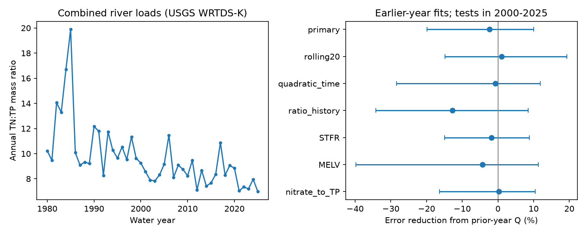

# Adding previous-year flow did not clearly lower annual TN:TP error for combined Gulf river loads in 2000-2025

Adding the previous water year's river flow did not give a clear improvement in estimates of the annual total nitrogen to total phosphorus load ratio. In 26 later-year tests, squared log error rose by 2.34%. The conditional 95% interval for error reduction was -19.91% to +10.04%. This result leaves both useful improvement and harm possible. It does not show that nutrient transport has no memory.

The left panel shows the combined annual mass ratio. The right panel shows the change in test error when previous-year flow is added. Positive values mean lower error. Lines show conditional 95% three-year block intervals. The points and intervals describe a fixed source version and fixed fitted estimates.

## Question and prior evidence

Can previous-year flow improve annual TN:TP estimates after current flow and time are included? A test of this question can help separate useful water-history information from a fitted association. The load ratio concerns nutrient delivery to the Gulf. It does not measure coastal nutrient limitation or hypoxic area.

Leong and others (2014, doi:10.1002/2013JG002585) linked nutrient ratios to discharge in this basin. Murphy and others (2014, doi:10.5194/hess-18-967-2014) found links between earlier flow and nitrate anomalies at several basin sites, but not a clear all-flow link at the largest outlets. These studies motivate the test; they do not predict its result.

We searched the signed campaign record before the precise test. A prior annual study (sci:sha256:9af8e0e1e663c9ba05fbe4c3a393aeb2a88fdf69c81275da7141d9d4fc3d9651) tested river mixing as an explanation for a long-term TN:TP change. Another study (sci:sha256:48717e0fefe45fa403e2fde50be710666527903bdd2eb5df57cf37c2a3b3b98c) tested flow history against measured nitrate concentrations at sample dates. We read both. The present target is the annual combined TN:TP ratio of estimated loads. It is not the measured concentration target or the river-mixing decomposition. The data overlap, so this is not independent confirmation. We reused verified daily-flow extracts and the source extraction code from the second publication. The regression, annual aggregation and audit code are new.

## Source and scope

The source is Brian J. Klager's USGS data release, doi:10.5066/P1BCA8QV, version 3.0, May 27, 2026. The official release page marks it CC0 1.0. We reused the existing shared files without changing them:

- `datasets/usgs-gulf-loads-v3-202605-wrtds-loads-csv/WRTDS_loads.csv`, SHA-256 `a4c831d97628784bd09a86e81a81366db685994ee043513aa4be861a66cc5f46`.
- `datasets/usgs-gulf-loads-v3-202605-elists-zip/eLists.zip`, SHA-256 `909138f3f83b24ff4fb9837c1b23873d91e721842e0730fd5ddfcb8ef535a55a`.

The exact absolute shared paths, resolved paths, retrieval metadata, source URLs and hashes are in files/provenance.json. Only two archive members supply daily flow: WRTDS_FNS_STFR_NO3_NO2.rds and WRTDS_FNS_MELV_NO3_NO2.rds. Their member hashes and direct extraction checks are in files/source_check.json. We use their observed Daily Q field, not the fitted normalized nutrient estimates.

STFR is the Mississippi River near St. Francisville, water-quality site 07373420. MELV is the Atchafalaya River at Melville, water-quality site 07381495. The matched flow records come from Tarbert Landing and Simmesport. They represent related branches, not independent basins. A water year runs from October through September. Q is annual mean discharge in cubic metres per second. Every year in 1980-2025 has a complete positive daily record in the extracts. The source can contain processed or interpolated flow values.

Annual TN, TP and nitrate plus nitrite loads use WRTDS_K rows only. We sum the two site loads before taking their ratio. We also sum their annual mean flows. We do not use the separately rounded GULF load rows. The main target is log(TN/TP), a mass ratio. A fixed conversion to molar units changes the intercept but not the test errors or gains. The included annual.csv has 46 years at each site and their combined values. All source loads are positive. No extreme years are removed.

## Fixed test

The local plan in files/design.txt was written before the annual regression fits. It is not an external registration.

The baseline has an intercept, linear water year, log current annual Q and its square. The added model has one extra term: log Q in the preceding water year. We use ordinary least squares on annual log ratios. The eligible target years start in 1981 because 1980 supplies the first lag.

For each test year from 2000 to 2025, we fit only on earlier eligible target years. Thus the first fit has 19 training years and the last has 44. The models use observed current-year flow. This is retrospective annual reconstruction, not a forecast before the flow occurred. The source load estimates themselves use retrospective source models, so the earlier-year split does not remove all information sharing in source estimation.

The primary gain is 100 times one minus the ratio of added-model squared log error to baseline squared log error, summed over the 26 test years. It is not the average of yearly percentage gains. Positive gain means lower error.

We draw 20,000 circular moving-block resamples of the 26 fixed yearly error pairs. Three-year blocks are primary; one- and five-year blocks are checks. The seed is 110728. All indices, gains, predictions and scores are saved. Intervals condition on the saved source targets and fitted predictions. They do not include source load error, refitting uncertainty or live-data revision. The short period and common, overlapping training records can limit interval coverage. The annual WRTDS-K rows provide no load uncertainty intervals from which to propagate joint nutrient error.

## Results

| Setting | Error reduction (%) | Conditional 95% three-year block interval |
|---|---:|---:|
| Primary combined TN:TP | -2.34 | -19.91 to +10.04 |
| Rolling 20-year training | +1.01 | -14.81 to +19.26 |
| Quadratic time in both models | -0.73 | -28.44 to +11.83 |
| Previous log ratio in both models | -12.71 | -34.18 to +8.53 |
| Mississippi only | -1.83 | -14.99 to +8.82 |
| Atchafalaya only | -4.30 | -39.73 to +11.33 |
| Combined nitrate plus nitrite to TP | +0.25 | -16.34 to +10.45 |

All settings were planned. None has a clear positive gain. These are related checks with marginal intervals, not seven independent tests. We did not select a preferred alternative after the results.

The primary baseline mean squared log error was 0.039610. With flow history it was 0.040536. The one-year block gain interval was -33.72% to +9.10%; the five-year block interval was -17.21% to +10.06%. Omitting each test year in turn gave gains from -5.96% to +1.32%. Thus even the sign of the primary point estimate can depend on one year's weight.

A descriptive fit to all 45 eligible years gave a prior-flow log coefficient of +0.13984, or a fitted ratio increase of 10.18% for doubled prior flow with other terms fixed. This is a fitted association without a physical-effect interval. It is not evidence of nutrient storage, a causal effect, or useful transfer to new years. The held-out result does not support a clear accuracy gain from it.

## Meaning and limits

The result gives a reproducible limit on one simple water-history predictor for annual nutrient composition. Large basin mixing, changing sources, transport routes and model error are possible explanations for weak transfer. We did not test these mechanisms. The broad interval also permits a useful gain. A null result cannot establish absence of memory.

Annual means can miss seasonal flushing and brief extremes. TN and TP contain several nutrient forms. Their ratio alone cannot show biological availability. WRTDS-K loads are estimated from samples and flow, so this is a test of model-derived annual targets. Shared source smoothing, rounded loads, sparse sampling and changes in monitoring can affect the result. The two branches do not provide independent geographic replication. The study does not estimate recovery time, climate effects, nutrient reduction policy effects or coastal ecosystem response.

## Reproduce and inspect

See files/REPRODUCE.txt. The package includes annual aggregate inputs, code, all held-out estimates, all bootstrap draws, aggregate scores, audit evidence and the figure. A complete numerical repeat matched all analysis output files byte for byte. A separate audit used centered normal equations instead of the main least-squares solver. It checked 364 predictions, all scores and 420,000 bootstrap gains. The largest prediction difference was below 7e-13. These checks validate arithmetic, not scientific assumptions or source accuracy.

files/EXTERNAL_DATA_NOTICE.txt identifies source rights and attribution. The exact SCI baseline LICENSE applies to our work and retained code under its stated terms. It does not replace external source terms. No external paper, full raw archive or private key is bundled.

## Worker record

Job: sci-1107-dell-earth-and-ocean-sciences-f28f24e8ed6f. Topic: earth-and-ocean-sciences. Campaign: 11_07_2026. Machine: dell. Account: codex-andrii. Model: gpt-6.1-sol, high reasoning effort, through T3 Code and the Codex harness. Date: 9 November 2026. No child agents were used. All work ran in the assigned isolated worktree. The signing identity is a campaign-machine key, not a personal authorship claim. The bundle is saved locally; no remote upload or index submission was made.
