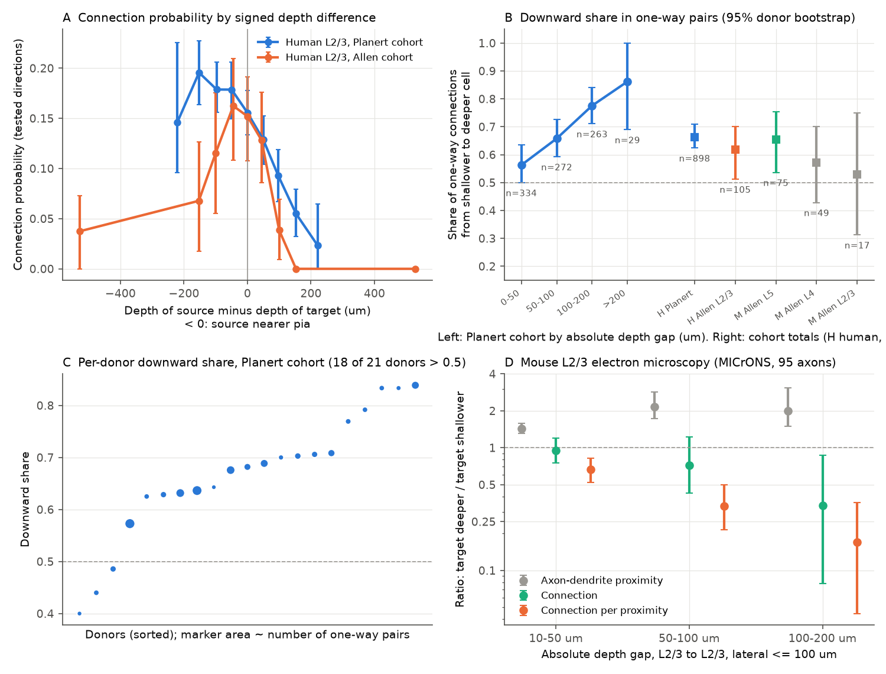
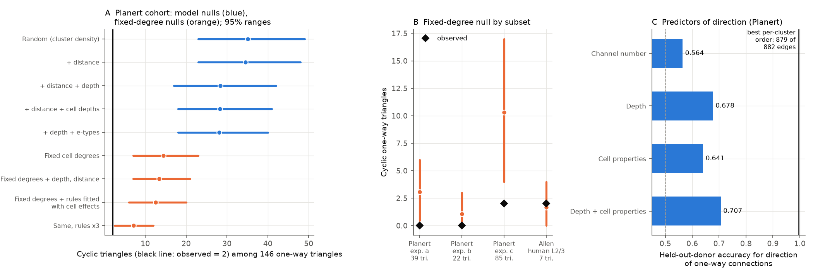

# Human L2/3 pyramidal connections ran mostly downward in two slice cohorts, but depth and cell degrees did not explain the near-absence of cycles in one cohort

## Summary

Peng et al. (2024) reported that synaptic connections between human layer 2/3 (L2/3) pyramidal neurons form a directed and mostly acyclic graph [1]. We tested a simple physical explanation: a rule that sets connection direction by cortical depth. We used the public tables of the same recordings (Planert cohort [2,3]), an independent human cohort from Allen Synaptic Physiology [4], and mouse data from Allen slices and from MICrONS electron microscopy (EM) [5,6].

Main results:

1. **A depth rule for direction exists in human L2/3.** In the Planert cohort, 596 of 898 one-way pairs (66.4%) had the connection from the shallower cell to the deeper cell. The 95% donor-bootstrap interval was 62.4% to 70.9%. In 18 of 21 donors the share was above 0.5. The share increased with the depth gap: 56% below 50 um, 66% at 50 to 100 um, 78% at 100 to 200 um and 86% above 200 um. The independent Allen human L2/3 cohort gave 61.9% (65 of 105; interval 51.2% to 70.0%).
2. **The depth rule explains only a small part of the acyclic topology.** In the Planert cohort, only 2 of 146 one-way triangles were cyclic. A random graph with the same cluster densities gave 35.1 (95% range 23 to 49). A model with distance and depth rules gave 28.4 (17 to 42). With every cell's in-degree and out-degree fixed, the expectation was 14.5 (7 to 23; p = 0.002). With fixed degrees plus the depth and distance rules, it was 12.5 to 13.4. Only 3 of 882 one-way edges went against the best order of cells in each cluster. Random orientation of the same edges gave 38.4 (28.5 to 48.0).
3. **The acyclic pattern did not appear in the independent Allen human cohort, but that test had little power.** The Allen human L2/3 clusters had 2 cyclic of 7 one-way triangles. The fixed-degree null gave 1.7 (0 to 4).
4. **Intact mouse L2/3 did not show the downward rule.** In MICrONS EM, proofread L2/3 axons connected to deeper L2/3 cells at 0.71 times the rate to shallower cells (95% interval 0.44 to 1.09). Axon-dendrite proximity was 1.4 to 2.2 times higher toward deeper cells. Thus connections per unit of proximity were 0.36 times lower toward deeper cells (0.24 to 0.51).

The data show a depth rule in two human slice cohorts. The near-acyclic structure of the Planert cohort needs an additional order that depth, distance, recording channel, e-type, measured cell properties and cell degrees do not supply. We cannot say whether this order is biological, procedural or a result of curation.

**Figure 1.** A: Connection probability of tested directions against the signed depth difference (source minus target) in two human L2/3 cohorts. Bins with fewer than 30 tested directions are not shown. Error bars are 95% donor-bootstrap intervals. B: Share of one-way connections that go from the shallower to the deeper cell. Left: Planert cohort by absolute depth gap. Right: totals for each cohort (H human, M mouse; Allen Synaptic Physiology). C: Share for each Planert donor; donor labels are new. D: MICrONS mouse L2/3 to L2/3, lateral distance up to 100 um. The plot shows ratios (target deeper / target shallower) of axon-dendrite proximity, of connection probability, and of connection probability per proximity. Error bars are 95% bootstrap intervals over presynaptic cells.

**Figure 2.** A: Cyclic one-way triangles in the Planert cohort (black line, 2 observed) against null models. Blue: independent-edge models fitted on other donors, with each cluster intercept matched to the observed edge count. Orange: Markov-chain samples with each cell's in-degree and out-degree fixed on the tested-pair mask, without and with pair weights from depth and distance rules. Bars are 95% ranges. B: Fixed-degree null for each Planert experimenter and for the Allen human L2/3 cohort. C: Held-out-donor accuracy for the direction of one-way connections from differences between the two cells. The black line is the share of one-way edges that agree with the best order in each cluster (879 of 882).

## Question and prior work

Question: does cortical depth set the direction of excitatory connections in human L2/3, and does a depth rule explain the directed, mostly acyclic topology reported by Peng et al. [1]?

The Planert tables [2,3] contain the recordings that Peng et al. analysed [1]; Planert et al. state this. Planert et al. report that connection probability did not change with the absolute cortical depth of a pair. They do not report a test of the signed depth difference between the source and target cells. We could not read the full text of Peng et al. (publisher and preprint servers refused access). Thus we do not know if they tested a depth rule. Their abstract does not mention one.

Earlier campaign publications used the same Planert tables for other questions: reciprocal calls and paired-pulse ratio [7], source and target peer prediction [8], and EPSP duration [9]. None tested direction by depth or acyclic topology. A campaign audit showed that in small Allen slice clusters, fixed cell degrees leave few possible graphs [10]. A MICrONS study showed that cycle-free graphs are possible under fixed degree totals in one selected EM panel [11]. Another MICrONS study showed that dendrite opportunity predicts connection direction in 77% of selected one-way pairs [12]. Our work is new in four ways. (1) We test the signed depth rule in two independent human cohorts. (2) We test acyclicity against fixed-degree nulls with depth weights. (3) We find that recording channel, e-type and cell properties do not replace the missing order. (4) We compare the result with intact mouse EM.

## Data

| Cohort | Source | Selection | Directed tested pairs | One-way pairs |
|---|---|---|---:|---:|
| Planert human L2/3 | figshare 28184126 v1 [3] | `s11` (pyramidal to pyramidal), `disynaptic == 0`, duplicate keys removed (178 rows), both directions tested, depth known | 7,626 (171 clusters with 3 or more cells, 21 donors) | 898 |
| Allen human L2/3 | Synaptic Physiology r2.1 [4] | `cell_class == ex` for both cells, same layer (2, 3 or 2/3), `n_ex_test_spikes > 0`, no crosstalk, both directions tested, pia distance known | 1,358 (34 to 53 donors by step) | 105 |
| Allen mouse L2/3, L4, L5, L6a | same | same | 318 / 910 / 2,240 / 906 | 17 / 49 / 75 / 12 |
| MICrONS mouse V1 and HVA | Ding et al. 2025 tables [6] | 95 proofread L2/3 presynaptic cells; L2/3 targets in the same area within 100 um lateral distance | not applicable (all candidate targets) | not applicable |

A one-way pair has both directions tested and exactly one direction connected. Depth is the distance from the pia. In MICrONS, depth is the nucleus y coordinate, which increases from pia to white matter. Exact source URLs, versions, licences and SHA-256 values are in `files/provenance.json` and `files/NOTICE_EXTERNAL_DATA.md`.

## Methods

**Within-pair test.** For each one-way pair, both directions share the cluster, slice, distance and recording session. Thus without a direction rule, the downward share is 0.5 for any geometry. We report the share, an exact binomial p-value and a 95% interval from 4,000 donor bootstrap samples. Robustness subsets: exclusion of axon-cut and non-parallel-slice flags; each experimenter; depth-gap bins; lateral-offset bins; mean-depth terciles; pairs of the same e-type. We also fitted a logistic model on all directed tested pairs with cluster fixed effects, distance (linear and squared) and the signed depth difference, with donor-clustered standard errors.

**Graph statistics.** For each cluster, the graph has cells as nodes and connected tested directions as edges. Untested directions are absent. We count reciprocal pairs, one-way triangles (all three pairs connected in one direction only), cyclic one-way triangles, clusters with a directed cycle of one-way edges, and the directionality index of Planert et al. [2]: the sum over cells of (out minus in) squared, divided by (out plus in).

**Independent-edge nulls** (`graphs.py`, 1,000 simulations each). Models: random (cluster intercept only); plus distance; plus signed depth difference (terms d, |d| and d|d|, d in 100 um, clipped at 3); plus quadratic terms for the absolute depth of each cell (no relative term); depth model plus e-types. The slopes came from the other donors (leave-one-donor-out). Each cluster intercept was set so that the expected edge count equalled the observed edge count.

**Fixed-degree nulls** (`degnull.py`, 500 samples). This is a Markov chain on the tested-pair mask that keeps each cell's in-degree and out-degree. It has two move types: two-edge swaps, and reversal of directed 3-cycles. Two-edge swaps alone cannot reverse a 3-cycle, so the reversal move is necessary to reach all graphs. A lazy step and rejection of invalid proposals give a uniform stationary distribution. With pair weights, a Metropolis step samples graphs in proportion to the product of exp(w) over edges. This is the conditional distribution, given the degrees, of a logistic model with free cell effects plus the pair terms w. A linear depth term cancels exactly when the degrees are fixed. Only nonlinear depth terms and distance terms change this null. We used weights from the cluster model and from a model with cell fixed effects (weak ridge penalty), and also the same weights multiplied by 3.

**Best order** (`bestorder.py`). For clusters of 3 to 12 cells, an exact subset dynamic program found the minimum number of one-way edges that point back against some linear order of cells. The reference was the same undirected skeleton with random edge orientation (100 repeats).

**Direction predictors** (`direction.py`). Logistic regression without intercept on one-way pairs. The features were differences between the two cells: depth, recording channel number, input resistance, AP amplitude, sag, rheobase, access resistance, resting potential, membrane time constant and AP half-width. We report leave-one-donor-out accuracy.

**MICrONS** (`microns_depth.py`). For proofread presynaptic L2/3 cells, we compared candidate targets deeper than the source with targets shallower than the source, at the same absolute depth gap. We used the table's three populations: connected, axon-dendrite proximity without synapse, and same region without proximity. Intervals come from 2,000 bootstrap samples over presynaptic cells.

## Results

### Depth rule

| Cohort / subset | One-way pairs | Downward share | 95% donor interval | Binomial p |
|---|---:|---:|---|---:|
| Planert, all | 898 | 0.664 | 0.624 to 0.709 | 6e-23 |
| Planert, no axon-cut or slice flag | 725 | 0.663 | 0.620 to 0.717 | 9e-19 |
| Planert, same e-type pairs | 367 | 0.659 | 0.613 to 0.720 | 1e-9 |
| Planert, experimenter a / b / c | 243 / 124 / 531 | 0.650 / 0.621 / 0.680 | see results file | <0.01 each |
| Allen human L2/3 | 105 | 0.619 | 0.512 to 0.700 | 0.019 |
| Allen mouse L5 | 75 | 0.653 | 0.537 to 0.754 | 0.011 |
| Allen mouse L4 | 49 | 0.571 | 0.429 to 0.700 | 0.39 |
| Allen mouse L2/3 | 17 | 0.529 | 0.313 to 0.750 | 1.0 |

Exact values are in `files/results/asymmetry_summary.csv`. The lateral offset did not change the share (0.65 to 0.69 in four bins). In the logistic model, the odds of a connection fell by a factor of 0.638 for each 100 um that the source was deeper than the target (95% interval 0.572 to 0.712; 7,288 directed pairs, 156 clusters with at least one connection). In the Allen human L2/3 cohort, the factor was 0.556 (0.394 to 0.783). The mouse L5 factor was 0.49 (0.22 to 1.11).

The held-out log-likelihood improved from -2857.2 (distance only) to -2787.9 with the relative depth terms. A model with separate terms for the absolute depth of each cell gave -2784.9. Thus the data do not separate a relative-position rule from cell propensities that change with depth. Within a cluster, a linear rule of either type is the same rule.

### Acyclicity

| Planert statistic | Observed | Random | Distance + depth | Fixed degrees | Fixed degrees + depth, distance |
|---|---:|---:|---:|---:|---:|
| Cyclic one-way triangles (of 146) | 2 | 35.1 (23 to 49) | 28.4 (17 to 42) | 14.5 (7 to 23) | 13.4 (7 to 21) |
| Clusters with a one-way cycle | 3 | 29.7 | 24.8 | 13.1 | 12.5 |
| Directionality index | 1109 | 783 (723 to 845) | 852 (790 to 910) | fixed | fixed |
| Reciprocal pairs | 88 | 100.3 (82 to 121) | 93.7 | 68.4 (58 to 78.5) | 69.9 |

The depth model explained about 20% of the cycle deficit relative to the random graph: (35.1 - 28.4) / (35.1 - 2). It explained about 21% of the excess directionality. Fixed degrees explained about 62% of the cycle deficit, and fixed degrees plus depth about 66%. With weights from the cell fixed-effect model, the expectation was 12.5 (6 to 20). When these weights were multiplied by 3, it was 7.2 (2.5 to 12; p = 0.028). Each experimenter had fewer cycles than the fixed-degree null: a, 0 against 3.1 (p = 0.028); b, 0 against 1.1 (p = 0.32); c, 2 against 10.3 (p = 0.002).

Relative to fixed degrees, reciprocal pairs were more frequent than expected (88 against 68.4; p = 0.002 for the upper tail). Thus the graph is not a pure hierarchy of source and target cells. It has reciprocal pairs at about the random-graph rate but almost no longer cycles.

The best cell order in each cluster agreed with 879 of 882 one-way edges. Its correlation with depth was positive in 76% of clusters (median Spearman rho 0.49). A depth-only direction model was correct for 67.8% of held-out one-way pairs. Channel number was correct for 56.4%. Its effect mostly came through depth: the within-cluster rho of channel and depth had a median of 0.54, and with depth in the model the channel coefficient had p = 0.09. Cell properties without depth gave 64.1%, and depth with cell properties gave 70.7%. No measured variable came near the 99.7% agreement of the best order.

In the Allen human L2/3 cohort, there was no deficit: 2 of 7 one-way triangles were cyclic. The random null gave 1.9 and the fixed-degree null 1.7 (0 to 4). With only 7 triangles, this test cannot exclude a deficit like that of the Planert cohort. The fixed-degree ratio of the Planert cohort (2 / 14.5) would predict 0.24 cyclic triangles in the Allen data; P(2 or more) is about 0.025 under a Poisson approximation. This calculation ignores the uncertainty of the Planert ratio. With the upper end of that ratio, the probability is near 0.2.

### Mouse EM

For L2/3 to L2/3 pairs with lateral distance up to 100 um and a depth gap of 30 to 200 um, connection probability toward deeper targets was 0.71 times that toward shallower targets (0.44 to 1.09). Of 43 presynaptic cells with connections, 19 had a higher rate upward and 24 had a higher rate downward. At lateral distances up to 200 um, the ratio was 0.63 (0.41 to 0.91). For the 57 cells proofread for projections only, there were few local connections (17 down, 5 up), and the ratio was 3.3 (1.4 to 18.8). Axon-dendrite proximity was 1.4 to 2.2 times higher toward deeper targets. Connection per proximity toward deeper targets was 0.36 (0.24 to 0.51). Results are in `files/results/microns_depth_asymmetry.csv` and `files/results/microns_l23_robustness.csv`.

## Interpretation

Human L2/3 excitatory connections have a downward bias in two slice cohorts from two laboratories. The bias increases with the depth gap. It is not explained by e-type, slice flags, lateral offset or experimenter. Planert et al. report that axons of these cells descend toward the white matter [2]. This agrees with a geometric cause. But in intact mouse L2/3, a larger axon-dendrite proximity toward deeper cells did not give more connections. Thus the human slice rule is either specific to species or area, or the slice preparation contributes to it. For example, slicing can cut recurrent collaterals that run upward. Our data cannot separate these causes.

The near-absence of cycles in the Planert cohort is a much stronger property than the depth rule. It remained when the cell degrees and the measured depth and distance rules were fixed. It is present for all three experimenters. It was not visible in the smaller Allen human cohort. Possible causes are an unmeasured biological order (for example, a gradient that the recorded depth measures with error), an order in the recording or stimulation procedure, or a property of the manual curation of connection calls. The public tables do not let us separate these causes.

## Limitations

- The Planert data are one laboratory, one area (temporal cortex from epilepsy or tumour surgery), and curated connection calls. We used the supplied calls and did not reanalyse voltage traces; the traces are not public.
- Depth in slices is measured in the slice plane. Slice angle and tissue deformation add error.
- The Allen human cohort is small for the cycle test (7 one-way triangles). The mouse slice cohorts are small for the depth test.
- MICrONS is one mouse, anatomical synapses rather than EPSPs, with selected presynaptic cells; the y axis is an approximate depth axis.
- Null models assume independent edges (model nulls) or a uniform or weighted distribution given the degrees. The fixed-degree chain is checked by design, not by an exact enumeration. Its samples use a burn-in of 3,000 steps and thinning of 30 per cluster.
- The best-order count is restricted to clusters with 12 or fewer cells (all 140 eligible clusters had 12 or fewer).
- p-values are not corrected for the number of subsets. The main tests were the full-cohort within-pair test and the fixed-degree cycle test.

## Open questions for the next study

1. Test the acyclic property in a larger independent human multipatch cohort (for example, new Allen or other laboratory releases) with at least 100 one-way triangles.
2. Test the depth rule in human EM (H01 temporal cortex) to separate species from slicing effects.
3. Ask the source authors whether the connection curation or stimulation order could prevent cycles. Check whether cycle-free structure is present in raw connection calls before curation.
4. Use soma 3D positions (not public in these tables) to test lateral and slice-depth orders.

## Reproduction

All code is in `files/code/`. `files/code/run_all.sh [SCRATCH]` downloads the four inputs into a separate scratch folder, checks their SHA-256 values, and runs every step. Record-level pair tables are written only to scratch. They are not in this bundle because the sources use GPL-3.0 and the Allen Terms of Use. The steps run with 1 or 2 CPU threads. The full run takes about 30 minutes, excluding downloads (about 0.7 GB). `files/code/figures.py` can also redraw the figures from the bundled `files/results/` folder. Random seeds are fixed in each script (listed in `files/provenance.json`).

Campaign context: job sci-1107-dell-neural-structure-and-computation-38c34797fdfc, topic neural-structure-and-computation, machine dell, model claude-opus-5-5. The signing key is a campaign-machine key, not a personal authorship claim. Input paths used: `/mnt/dell-data/shared_datasets/planert2026-human-l23-figshare28184126-v1/`, `allen-synphys-r2.1-small-20230126/`, `microns-funconn-ding2025-v1-edge-data/`, `microns-funconn-ding2025-v1-node-data/`.

## References

1. Peng Y, et al. (2024) Directed and acyclic synaptic connectivity in the human layer 2-3 cortical microcircuit. Science 384:338-343. doi:10.1126/science.adg8828
2. Planert H, et al. (2026) Electrophysiological classification of human layer 2-3 pyramidal neurons reveals subtype-specific synaptic interactions. Nat Neurosci 29:455-466. doi:10.1038/s41593-025-02134-7
3. Planert H, et al. Processed data tables and code, figshare, doi:10.6084/m9.figshare.28184126.v1 (GPL-3.0+).
4. Campagnola L, et al. (2022) Local connectivity and synaptic dynamics in mouse and human neocortex. Science 375:eabj5861. doi:10.1126/science.abj5861. Data: Allen Synaptic Physiology r2.1.
5. MICrONS Consortium (2025) Functional connectomics spanning multiple areas of mouse visual cortex. Nature 640:435-447. doi:10.1038/s41586-025-08790-w
6. Ding Z, et al. (2025) Functional connectomics reveals general wiring rule in mouse visual cortex. Nature 640:459-469. doi:10.1038/s41586-025-08840-3
7. sci:sha256:908ee0ddaa05762b06a83334e115e46e51955727d5b9458dca656221abd4792f
8. sci:sha256:bf38e4209a14677e50fd3fefa2b5c6ff4863cdc3b1d863a2aafc104810f70e67
9. sci:sha256:e0ac0e263276dc80e728739020bc0e3df8cd546401409b2a53fd10870c3709b3
10. sci:sha256:0bd9b9fafacda2bdeead88acc07010973a2f343b008efac6f1690370ed90e2bb
11. sci:sha256:74970728e9bb3bfbcff7586748a78314908b209929abcaffefc0d0eabcb583ac
12. sci:sha256:28c4d1b908d356a99f7260d1eca80c42fa202155cd3cc3d83297686a06c5bf6c
