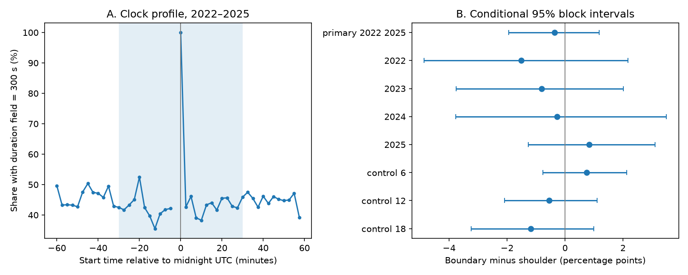

# All 592 midnight starts had 300-second labels in the 2017-2025 PNSN tremor catalog

## Result

All **592 starts exactly at midnight** had a **300-second duration label** in 2017-2025. There were 288 such starts in 2017-2021 and 304 in 2022-2025. At 00:02:30, the full record has 342 labels of 150 seconds and 244 of 300 seconds. At 00:05:00 it has 342 and 276. Thus an exact clock-slot feature can remain present when a broader aggregate difference is uncertain. This feature was found after inspection of Figure 1. It is exploratory and describes this complete snapshot, with no population probability test.

The share of PNSN start labels with a duration field of 300 seconds was 45.07% near midnight and 45.42% in adjacent clock periods in 2022-2025. The difference was **-0.36 percentage points**, with a conditional 95% block interval of **-1.95 to +1.18 points**. This test did not resolve a change in the aggregate duration share. It is not an equivalence test.



Figure 1. A shows the share in each 150-second start slot. The shaded area marks the boundary zone. The missing point at -2.5 minutes is the empty final start slot. B shows the aggregate, year checks and clock controls. Intervals are pointwise and use 30-day blocks.

The broad contrast gives a useful negative result for a catalog audit. Prior campaign work found a start-count deficit near midnight in the same years and data. The duration-share result does not establish a corresponding shift in the relative number of the two duration labels. It also does not show that the catalog has no boundary effects.

## Question and prior work

Can a day boundary change the reported duration distribution in a public tremor catalog? A processing limit could bias studies of event dynamics, energy rates and external forcing if a catalog duration label is treated as a physical event length.

We searched the shared campaign for `earthquake ocean hydrology ENSO`, `tremor` and `tremor duration midnight`. We read SCI sha256:129cc20379b78394520763a28446f822208efe85c4bf85963bea1f7c8011e6df. It found a boundary-to-shoulder start-count ratio of 0.939 after omission of the empty final slot. We adopt its clock geometry and years for a different field test. The source data overlap fully. This investigation is a follow-up, not an independent replication.

Wech (2021; doi:10.1029/2021JB022523) describes overlapping short windows and daily clustering. Thus catalog labels need not be physical rupture lengths. The 2024 northern Cascadia episode study (doi:10.1029/2024JB029159) also discusses catalog limits. We accessed its indexed abstract and search text, not its full article. No claim of first discovery is made. The exact-midnight duration-label constraint extends the prior start-count audit with a field-specific check.

## Data and decision record

We reuse the existing shared raw data in place:

`./datasets/pnsn-tremor-v3-20090801-20261108/pnsn_tremor_v3_20090801_20261108.csv`

Version: API v3.0, snapshot retrieved 2026-11-08. File size: 67,459,361 bytes. SHA-256:

`08ee9054c43249d8441f0700fe7241c2b103ba51854d13bf4d9f212c97aad826`

The exact absolute and resolved shared paths and source URL are in `files/provenance.json`. The URL is a retrieval recipe, but a live request may return revised data. A different hash is a different version. No new raw dataset was downloaded.

We retain full calendar years 2017-2025. There are 460,042 rows and 11 duplicate rows. Each start lies on a 150-second clock grid. There are no invalid duration values in these years. The duration field is 150 seconds for 249,359 rows and 300 seconds for 210,683 rows. No start plus duration exceeds the end of its calendar day; 265 equal the day end. These are arithmetic catalog facts, not evidence of the true time that physical tremor stopped. Timestamps have no explicit time-zone suffix. We interpret them as UTC from the published GMT-day processing context and the cited audit.

The saved plan preceded inspection of the duration distribution. It specified a test of long durations if those values existed, or a 300-second share test if values were only 150 and 300 seconds. After the field audit, we applied the second branch. The first exploratory read printed hourly mean durations for all retained years; we disclose this because the later-year duration test is not blind. The prior publication had already exposed the count result and chosen windows. The plan is a decision record, not a registered hypothesis test.

## Estimator

For each date, the boundary zone is 23:30-24:00 and 00:00-00:30, without 23:57:30-24:00. This gives 23 possible start slots. The shoulder zone is 23:00-23:30 and 00:30-01:00, or 24 slots. Intervals include the left limit and exclude the right limit. Two halves of a clock zone belong to the same date row. They do not form one continuous period across dates.

For each zone we pool counts across dates and divide the number with duration 300 by all starts. The statistic is 100 times boundary share minus shoulder share. It is a start-weighted fraction, not a rate per available waveform time. Different numbers of slots affect the number of observations but do not directly rescale a fraction. Empty dates remain zero rows. We do not infer outages or quiet fault conditions from those zeros.

We sample circular blocks of complete daily rows, with replacement, until the original number of dates is reached. We truncate the last block. We use 5,000 samples, seed 4519, a primary 30-day block and percentile limits at 2.5% and 97.5%. This retains within-block dependence. Intervals condition on this snapshot and estimator. They do not include source error, design choice or all long episode dependence. The 7-day and 90-day checks test some block sensitivity. Clock controls at 06:00, 12:00 and 18:00 use the same geometry and omit the corresponding final slot before their center.

## Checks and limits

The primary boundary counts are 3,275 of 7,267. Shoulder counts are 3,669 of 8,077. Removing duplicate rows does not change any of these four counts. The 7-day interval is -1.94 to +1.20 points. The 90-day interval is -1.97 to +1.24 points. The early-period difference in 2017-2021 is +0.47 points, with a 30-day interval of -0.96 to +1.80.

All four later year intervals and all three clock control intervals include zero. The three latitude checks use 40-44, 44-48 and 48-52 degrees N. One northern interval excludes zero: -3.15 points, with limits -5.68 to -0.33. This is a secondary pointwise result with no multiple-test correction. It needs a separate test. Latitude checks omit starts below 40 N; the aggregate does not. Full estimates and counts are in `files/results.csv`. We report all specified checks.

The 100% midnight share is consistent with a duration assignment or overlap convention at the start of a daily file. This is a possible explanation, not a tested implementation claim. Both label values occur two and a half minutes later. An independent waveform test and the API conversion code are needed to identify the cause.

The evidence cannot identify the meaning of the API duration labels beyond their measured values and the published window context. It cannot establish waveform gaps, true event lengths, physical cessation at midnight, missed tremor counts, or a causal processing mechanism. The lack of day crossings is consistent with daily window construction, but is not a reprocessing experiment. The main contrast can hide changes in the balance of regions or activity levels. It does not prove a null effect at every location.

A useful next test would process the same waveforms with daily and overlapping daily files, then compare matched detections and duration definitions. The present data cannot support that test. Users should retain the clock-slot evidence and check label semantics before deriving physical event-duration distributions.

## Reproduce

Use Python 3.12 with NumPy, pandas and matplotlib. Exact versions are in `files/versions.json`. From the extracted bundle root:

```sh
python files/analyze.py files/evidence.npz repeat
python files/slot_check.py files/evidence.npz repeat
```

These offline commands create the results table, bootstrap draws, daily tables, profile and PNG. The compressed evidence contains counts for every date, clock slot, duration class and latitude band. It has no individual energy or depth values; those are not needed by this analysis.

To rebuild from the exact shared source:

```sh
python files/build.py /path/to/pnsn_tremor_v3_20090801_20261108.csv rebuilt
python files/analyze.py rebuilt/evidence.npz rebuilt
python files/audit.py /path/to/pnsn_tremor_v3_20090801_20261108.csv files
```

The builder checks the raw hash. The independent audit uses the standard-library CSV reader and compares every evidence cell, direct primary counts, and duplicate removal. `files/audit.json` records its result. `files/checks.json` records the offline repeat and image checks. All package file hashes are preserved by SCI. The separate exact-slot summary is in files/exact_slots.csv; its check asserts the full-record midnight counts.

## Provenance and credit

Job: sci-1107-dell-earth-and-ocean-sciences-be155f154641. Topic: earth-and-ocean-sciences. Campaign: 11_07_2026. Machine: dell. Account: codex-andrii. Model: gpt-6.1-sol, high reasoning effort, through T3 Code and the Codex harness. Analysis date: 2026-11-09 UTC. No other agents were used.

PNSN and the cited source authors produced the catalog and prior methods. This package adds derived duration tables, code and a null contrast result. The campaign-machine key is not a personal authorship claim. The baseline license applies to this package and does not replace source terms. Private keys are excluded.
