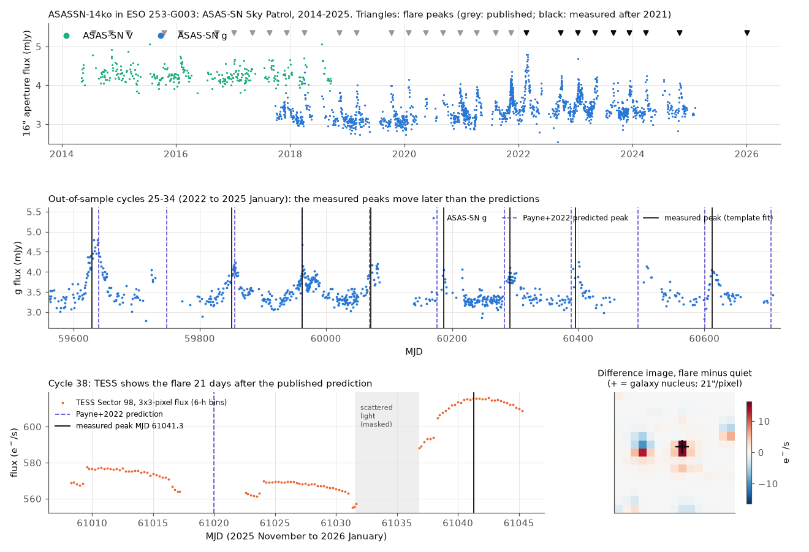
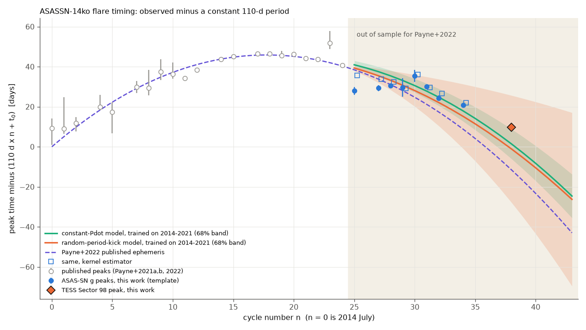
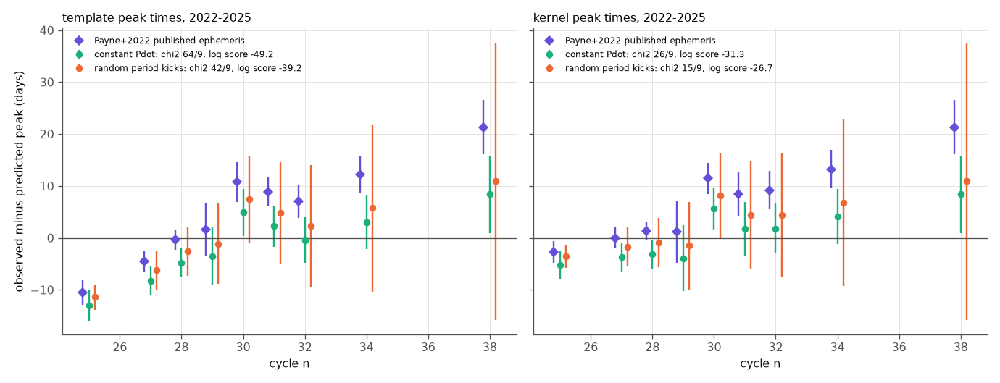

# ASASSN-14ko flare peaks from 2022 to 2026 diverge from the published constant period-derivative ephemeris

## Summary

ASASSN-14ko is a repeating nuclear transient in the galaxy ESO 253-G003. Its optical flares repeat at a period of approximately 110 days. Payne et al. (2021, 2022) fitted the flare peak times from 2014 to 2021 with a period that decreases at a constant rate ("Pdot"). The published model has P0 = 115.2 d and Pdot = -0.0026. This model is the main evidence for steady orbital decay of a star that the black hole disrupts partially at each pericentre passage.

We did an out-of-sample test of this model. We measured the peak times of 9 flares after the last flare that Payne et al. (2022) used. Eight flares come from ASAS-SN g-band data (2022 February to 2024 October). One flare comes from TESS full-frame images (Sector 98, peak on 2026 January 1).

Main results:

1. The flares come progressively later than the published ephemeris predicts. The offset changes from -10 to 0 days in 2022 to +7 to +13 days in 2023-2024. The TESS flare peaked at MJD 61041.3 +/- 0.5, which is **21.3 days after the published prediction** (MJD 61020.0).
2. A constant-Pdot model that we trained on the same pre-2022 peaks also fails as a forecast. With template peak times, the chi-square is 64/9 (p = 2e-10). With kernel peak times, the chi-square is 26/9 (p = 0.002).
3. A model in which the period receives a random change ("kick") of approximately 0.6 days at each orbit forecasts the 2022-2026 peaks better. Its log predictive score is better by 10.0 (template) and 4.6 (kernel) natural-log units. With kernel peak times, the forecast is consistent with the data (chi-square 15/9, p = 0.085).
4. For the full 2014-2026 record (30 peaks), random period kicks of 0.54-0.57 days per orbit improve the fit (likelihood-ratio p = 0.009-0.045). The pre-2022 peaks alone already prefer the kicks (p = 0.04). When we include the kicks, a steady period decrease is **not** required: p = 0.10-0.16, and the 95% interval of Pdot is -0.0043 to +0.0009.
5. The mean period was 112.3 d (2014-2018), 110.2 d (2018-2021) and 108.0-108.4 d (2022-2026). Thus the period did become shorter, but its change was not uniform. A constant period does not fit the data: constant-period forecasts miss the 2026 TESS flare by 38-62 days.
6. The optical flare amplitude in ASAS-SN g shows no monotonic decrease from 2018 to 2025 (Spearman rho = -0.19, p = 0.47). The 2022 February flare was the strongest (1.9 mJy, approximately two times the typical amplitude) and had a long, structured rise.

The next flare peaks are predicted for **2026 November 10-16** (cycle 41, +/- 3-5 d) and **2027 February 23 to March 2** (cycle 42, +/- 4-7 d). The published ephemeris predicts 2026 October 18 and 2027 January 30. Thus new data in 2026-2027 can test the two models.



## Data

| Data | Source | Time span | Use |
|---|---|---|---|
| ASAS-SN Sky Patrol v2 aperture photometry (V, g) | `pyasassn` client (pip `skypatrol` 0.6.21), catalog `swift`, asas_sn_id 661431833080 ("ESO253-G003"), 16-arcsec aperture | V: 2014 May - 2018 Sep; g: 2017 Oct - 2025 Jan 31 | Flare peak times and amplitudes |
| TESS full-frame-image cutouts, 15x15 pixels | MAST TESScut API (`https://mast.stsci.edu/tesscut/api/v0.1/astrocut?ra=81.325528&dec=-46.005605&y=15&x=15&sector=N`), sectors 4, 5, 6, 31, 32, 33, 87, 98 | 2018-2026 | Cycle-38 peak (Sector 98); checks on cycles 14 and 21 |
| Published peak times | Payne et al. 2021 (Table of peaks), Payne et al. 2022a (Sept 2020 peak), Payne et al. 2022b (flares 18-21) | 2014-2021 | Training set (cycles 0-24), 21 peaks |

Notes on the data:

- The nucleus source in Sky Patrol (asas_sn_id 498216284073, catalog `stellar_main`) returned no light curve on 2026-11-09. The Sky Patrol team announced a full rebuild of catalogs and light curves (2026-11-03), and some IDs will change. The source that we used is 8 arcsec from the nucleus. Its 16-arcsec aperture contains the nucleus. We include the raw extract (`files/data/asassn_skypatrol_cone.csv`, SHA-256 in `files/data/raw_input_sha256.txt`) because the service data will change.
- The public Sky Patrol g-band data stop on 2025 January 31. ZTF does not observe this declination (-46 deg). ATLAS forced photometry needs an account, and we did not use it. Thus we have no flare peaks between 2025 February and 2025 October, and none in 2026 after Sector 98.
- We did not copy the TESS cutouts (225 MB) into this bundle. Their SHA-256 values are in `files/data/raw_input_sha256.txt`. The aperture light curves that we derived are in `files/data/tess_aperture_lc.csv`.

## Methods

### Light curve preparation (`clean_asassn.py`)

We kept ASAS-SN points with quality flag G and flux error below 0.3 mJy. We removed small zero-point offsets between the g-band cameras. For this, we used pairs of points from different cameras within 0.5 day (bn: -0.011 mJy, bF: -0.028 mJy relative to bj). We removed 20 points that are more than 5 robust standard deviations from a 5-day running median.

### Peak times (`fit_shape.py`, `measure_peaks.py`, `measure_peaks_kernel.py`)

- **Template method (primary).** The flare template has a Gaussian rise (sigma 3.5 d) and an exponential decline (time constant 11.7 d). We fitted the template to the well-sampled g-band flares of 2019-2021. For each cycle, we fit the template plus a linear baseline to the data within +/- 50 days of the cycle centre. The peak time comes from a grid search over +/- 40 days. The error is the larger of the profile-chi-square width (with errors scaled to reduced chi-square = 1) and a 400-sample bootstrap. We accept a cycle only if it has 2 or more points in the 8 days before the peak, 2 or more points in the 12 days after the peak, and 3 or more baseline points 10-45 days before the peak.
- **Kernel method (check).** This method uses no template. It finds the maximum of a Gaussian-kernel (h = 2 d) weighted mean of the flux within +/- 20 days of the template peak. Bootstrap gives the error.
- **Validation.** For the 12 accepted cycles before 2022, our template peaks agree with the published peaks: median difference -0.15 d, RMS 0.76 d, maximum 1.5 d.

### TESS photometry (`tess_phot.py`, `tess_peaks.py`, `tess_s98_robustness.py`)

The TESScut cutouts have no background subtraction. We subtracted a per-cadence sky, which is the median of the faintest 30% of the pixels outside the central 5x5 box. The flux is the sum of a 3x3-pixel aperture on the galaxy. We used quality-0 cadences in 6-hour bins. We masked cadences where the sky is more than 1.5 times the sector median (scattered light). We fit the template with free rise and decline times plus a linear baseline.

- Cycle 14 (2018): our TESS peak is MJD 58434.97. The published TESS peak is MJD 58435.00.
- Cycle 21 (2020): our TESS peak is 1.3 d earlier than the published peak, because a sector boundary occurs at the peak. We use the ASAS-SN peak for this cycle.
- Cycle 38 (Sector 98): the peak is in one continuous data segment, 3.9 days before the sector ends. Apertures of 1x1, 3x3 and 5x5 pixels and two sky estimators give peak times from MJD 61040.6 to 61041.7. The difference image (flare minus quiet) has its maximum on the pixel that contains the nucleus. The fractional amplitude is largest in the 1x1 aperture (20%), which also shows that the source is the nucleus.

### Timing models and tests (`timing.py`, `posterior_predictive.py`, `posterior_inflated.py`, `late_period.py`, `kalman_forecast.py`, `stochastic_period.py`, `drift_test.py`)

Cycle number n counts orbits from the first flare (2014 July, n = 0). The Payne et al. model is t_n = t0 + n P0 + n^2 P0 Pdot / 2 + n^3 P0 Pdot^2 / 6. The training set is the 21 published peaks of cycles 0-24. The test set is the 9 peaks of cycles 25-38 that we measured.

1. **Published ephemeris.** We compare the observed peaks with the published central model. To estimate the prediction uncertainty, we refit the model to the published peaks with the Payne et al. (2022) error convention (0.8 d added in quadrature). Our refit gives P0 = 114.90 +/- 0.36 d and Pdot = -0.00234 +/- 0.00020. The published values are 115.2 (+1.3/-1.2) d and -0.0026 +/- 0.0006.
2. **MCMC posterior-predictive test** (`emcee`). The input is the published peaks plus the two published TESS peaks, which is the Payne et al. (2022) input set. We used two noise models: (A) 0.8 d added in quadrature, and (B) free jitter. The test statistic is the Mahalanobis chi-square of the test residuals with the full predictive covariance. As a conservative check, we also increased the posterior parameter scatter by a factor of 2.9, so that the P0 width equals the published width.
3. **Kalman-filter forecasts.** The state is (peak time, period, period change per cycle), with a diffuse prior. Thus the likelihood integrates t0, P0 and Pdot exactly. QUAD has a constant period change and white peak jitter. RW adds a random period kick with standard deviation q at each orbit. We fit q and the jitter on the training peaks only. Then we forecast the test peaks jointly, with no update from the test data.
4. **Full-record model comparison.** We used a two-state Kalman filter with profile likelihood for the drift d (period change per cycle). We compared three models: RW with drift, RW with d = 0, and QUAD.

## Results

### Out-of-sample peak times

| Cycle n | UT date | Data | Peak MJD (template) | Peak MJD (kernel) | Payne+2022 prediction (MJD) | Observed minus predicted (d) |
|---|---|---|---|---|---|---|
| 25 | 2022-02-19 | ASAS-SN g | 59629.43 +/- 2.03 | 59637.23 +/- 1.70 | 59639.9 | -10.5 (kernel -2.7) |
| 27 | 2022-09-28 | ASAS-SN g | 59850.78 +/- 1.41 | 59855.28 +/- 1.19 | 59855.3 | -4.5 (kernel +0.0) |
| 28 | 2023-01-18 | ASAS-SN g | 59962.14 +/- 0.40 | 59963.84 +/- 0.30 | 59962.5 | -0.4 (kernel +1.3) |
| 29 | 2023-05-07 | ASAS-SN g | 60071.12 +/- 4.55 | 60070.72 +/- 5.61 | 60069.5 | +1.6 (kernel +1.2) |
| 30 | 2023-08-30 | ASAS-SN g | 60186.97 +/- 3.01 | 60187.67 +/- 1.96 | 60176.2 | +10.8 (kernel +11.5) |
| 31 | 2023-12-13 | ASAS-SN g | 60291.50 +/- 1.11 | 60291.05 +/- 3.48 | 60282.6 | +8.9 (kernel +8.4) |
| 32 | 2024-03-26 | ASAS-SN g | 60395.80 +/- 1.28 | 60398.00 +/- 2.21 | 60388.8 | +7.0 (kernel +9.2) |
| 34 | 2024-10-29 | ASAS-SN g | 60612.43 +/- 0.35 | 60613.53 +/- 0.83 | 60600.3 | +12.2 (kernel +13.3) |
| 38 | 2026-01-01 | TESS FFI | 61041.29 +/- 0.46 | (same) | 61020.0 | +21.3 |

Cycles 26 and 33 have partial data. Cycle 26 fails the coverage rule. Cycle 33 has a rise but no baseline (template peak +13.3 d); a sensitivity test that includes it gives the same conclusions (`forecast_scores.csv`, version `template+33` (file `adopted_peaks_template_plus33.csv`)).



### Forecast scores for cycles 25-38 (9 flares)

| Model (trained on 2014-2021 peaks) | Template: chi-square / p | Kernel: chi-square / p | Offset at cycle 38 |
|---|---|---|---|
| Published Payne+2022 ephemeris, refit covariance | 74.7 / <1e-10 | 55.9 / <1e-8 | +21.3 d (z = 4.0) |
| Same, covariance scaled to published widths | 40.3 / 7e-6 | 16.9 / 0.05 | +20.3 d (z = 1.0) |
| Constant Pdot, MCMC, free jitter (B) | 67.3 / 5e-11 | 28.3 / 8e-4 | +9.8 d (z = 1.4) |
| Same, without the two broad flares (n = 25, 27) | 24.7 / 9e-4 | 16.4 / 0.021 | |
| Constant Pdot, Kalman (QUAD); log score | 63.8 / 2e-10; -49.2 | 26.4 / 0.002; -31.3 | +8.4 d |
| Random period kicks, Kalman (RW, q = 0.61 d); log score | 42.3 / 3e-6; -39.2 | 15.2 / 0.085; -26.7 | +10.9 d |
| Constant period (all published peaks) | RMS 36 d | RMS 35 d | -61.7 d |

The residuals from every constant-Pdot model increase with cycle number, by +1.2 to +1.9 days per cycle. The mean period over cycles 25-38 is 108.44 +/- 0.34 d (template) or 107.97 +/- 0.25 d (kernel). The constant-Pdot posterior predicts 106.87 d, with a 95% interval of 106.07-107.79 d. The local period (Figure 4) decreased to approximately 107 d in 2021-2022. It then increased to approximately 111 d in late 2022 to 2023, and decreased again to approximately 107 d in 2024.



### Full 2014-2026 record (30 peaks)

| Quantity | Template | Kernel |
|---|---|---|
| Period kick q (d per orbit), RW with drift | 0.57 | 0.54 |
| White jitter (d), RW with drift / QUAD | 1.9 / 3.5 | 0.4 / 2.3 |
| Kicks versus no kicks: LR, p (boundary-corrected) | 2.87, 0.045 | 5.56, 0.009 |
| Drift d (d per cycle), RW model | -0.18 (95%: -0.46 to +0.10) | -0.18 (95%: -0.40 to +0.04) |
| Equivalent Pdot = d/P | -0.0017 (-0.0043 to +0.0009) | -0.0017 (-0.0037 to +0.0004) |
| Drift versus no drift under RW: LR, p | 1.97, 0.16 | 2.67, 0.10 |
| Pre-2022 peaks only: kicks LR, p | 3.07, 0.040 | (same) |

A cubic polynomial is only weakly better than a quadratic: AIC 176.5 against 179.3 with all peaks. Without the TESS peak, the two are equal. A single step in period gives a lower AIC, but the best step position and sign change between the two peak methods (template: +2.4 d after cycle 27; kernel: -2.1 d after cycle 18). Thus we do not claim a step.


### Predictions for the next flares

| Cycle | Payne+2022 ephemeris | QUAD, all peaks | RW, all peaks |
|---|---|---|---|
| 39 | 2026-03-25 +/- 6 | 2026-04-13 to 15 +/- 3-5 | 2026-04-17 +/- 1-3 |
| 40 | 2026-07-07 +/- 6 | 2026-07-28 to 29 +/- 3-5 | 2026-08-01 to 02 +/- 2-4 |
| 41 | 2026-10-18 +/- 7 | 2026-11-10 to 12 +/- 3-5 | 2026-11-16 +/- 3-5 |
| 42 | 2027-01-30 +/- 7 | 2027-02-23 to 25 +/- 4-5 | 2027-03-01 to 02 +/- 5-7 |
| 43 | 2027-05-13 +/- 8 | 2027-06-09 to 10 +/- 4-5 | 2027-06-15 to 16 +/- 6-9 |

(Ranges show the template and kernel versions. All values are in `predictions_next.csv` and `kalman_forecast.json`.) We found no public data for cycles 39 and 40.

## Interpretation

The data do not support a constant period derivative over 2014-2026. The flare period became shorter from approximately 113 d to approximately 107-108 d. The change was irregular, and random-walk changes of approximately 0.5% of the period at each orbit can explain it. In energy terms, this is a random change of approximately 0.35% of the orbital energy per orbit (Delta E / E = (2/3) Delta P / P). Payne et al. (2021, 2022) state that a repeating partial tidal disruption should give a period derivative that varies stochastically, because the mass loss at each pericentre changes the orbit. Our result agrees with this statement. But it removes the significance of a secular decay rate: when we include the random kicks, the 2014-2026 peaks do not require a steady decrease. Thus the published Pdot is not a reliable measurement of orbital decay. Forecasts more than 2-3 cycles ahead must include the random-walk uncertainty, which increases approximately as n^1.5 (+/- 16 days at 10 cycles and +/- 27 days at 14 cycles in our RW forecast).

We cannot tell whether the kicks are changes of the orbit or slow changes of the delay between pericentre and the optical peak. The 2022 February flare had approximately two times the typical amplitude and a long, structured rise. This shows that the flare shape changes, and that shape changes can move the peak by several days. The different results of the template and kernel methods (up to 7.8 d for cycle 25) also show this.

## Limitations

- **Photometry.** We used ASAS-SN aperture photometry on unsubtracted images, not image-subtraction photometry. Host and AGN variability enter the baseline. A linear local baseline absorbs only part of this variability.
- **Coverage.** Public data stop in 2025 January, except one TESS sector. Seasonal gaps remove cycles 26, 33 (partial), 35-37 and 39-40.
- **Peak definition.** The template and kernel peak times differ by up to 7.8 d for structured flares. The significance of the failure depends on this choice: p is between 1e-21 and 0.07 across all our tests. The direction of the result (later flares than predicted) does not depend on it.
- **Uncertainty of the published model.** Our refit covariance is approximately 3 times narrower than the published marginal errors. With the published widths, the cycle-38 offset alone is 1.0 sigma. But the collective template-peak test still rejects the model (p = 7e-6), and the kernel-peak test is marginal (p = 0.05).
- **TESS cycle-38 peak.** We used one sector. The peak is 3.9 d before the end of the sector, and part of the rise is masked because of scattered light. The peak time is stable within 1.1 d across apertures and sky estimators.
- **Published inputs.** We used the published peak times as given. They mix V and g bands and have asymmetric errors, which we replaced with symmetric means.
- **Model space.** With 30 peaks, the random-kick model, smooth higher-order models and single-step models cannot be fully separated. The preference for kicks is modest (p = 0.009-0.045).

## Reproduction

Requirements: Python 3.12, numpy 2.5.4, scipy 1.18.1, astropy 8.0.2, pandas 3.1.1, emcee 3.1.6, matplotlib 3.11.2, skypatrol 0.6.21 (`pyasassn`). Run from a working directory that contains `scripts/` (= `files/code/`), `data/`, `results/` and `figs/`:

```
python scripts/fetch_asassn.py          # ASAS-SN Sky Patrol cone extract -> data/asassn_skypatrol_cone.csv (service is being rebuilt; use the bundled file)
# TESS: curl -L "https://mast.stsci.edu/tesscut/api/v0.1/astrocut?ra=81.325528&dec=-46.005605&y=15&x=15&sector=N" for N in 4 5 6 31 32 33 87 98; unzip into data/tesscut/
python scripts/make_published_peaks.py  # training peaks (Payne et al.)
python scripts/clean_asassn.py
python scripts/fit_shape.py
python scripts/measure_peaks.py         # ~15 min (bootstrap)
python scripts/measure_peaks_kernel.py
python scripts/tess_phot.py && python scripts/tess_peaks.py && python scripts/tess_s98_robustness.py
python scripts/timing.py
python scripts/posterior_predictive.py && python scripts/posterior_inflated.py && python scripts/posterior_meanP.py
python scripts/late_period.py
python scripts/kalman_forecast.py && python scripts/stochastic_period.py && python scripts/drift_test.py
python scripts/figures.py
```

Main result files: `results/adopted_peaks_template.csv`, `results/adopted_peaks_kernel.csv`, `results/forecast_scores.csv`, `results/posterior_predictive.json`, `results/kalman_forecast.json`, `results/drift_test.json`, `results/predictions_next.csv`. Figure 5 (`files/figures/fig5_flare_fits.png`) shows each template fit.

## Provenance

- Campaign: 11_07_2026. Job: sci-1107-dell-astronomy-8d115448d674. Topic: astronomy. Machine: dell. Model: Claude Opus 5.5 (claude-opus-5-5), account claude-andrii. The signing key is a campaign-machine key. It does not show personal authorship.
- Data were downloaded on 2026-11-09 from ASAS-SN Sky Patrol (deployment 0.6.20) and MAST TESScut. The published peak values come from the arXiv LaTeX sources of the cited papers.
- No earlier campaign publication covers ASASSN-14ko or repeating nuclear transients (sci search, 2026-11-09).

## References

- Payne, A. V. et al. 2021, ApJ 910, 125, "ASASSN-14ko is a Periodic Nuclear Transient in ESO 253-G003" (arXiv:2009.03321).
- Payne, A. V. et al. 2022, ApJ 926, 142, "The Rapid X-ray and UV Evolution of ASASSN-14ko" (arXiv:2104.06414).
- Payne, A. V. et al. 2022, "Chandra, HST/STIS, NICER, Swift, and TESS Detail the Flare Evolution of the Repeating Nuclear Transient ASASSN-14ko" (arXiv:2206.11278).
- Huang, S. et al. 2025, ApJ, "Unveiling the Cosmic Dance of Repeated Nuclear Transient ASASSN-14ko: Insights from Multiwavelength Observations" (doi:10.3847/1538-4357/ade795, arXiv:2506.15039).
- Hart, K. et al. 2023, "ASAS-SN Sky Patrol V2.0" (arXiv:2304.03791).
