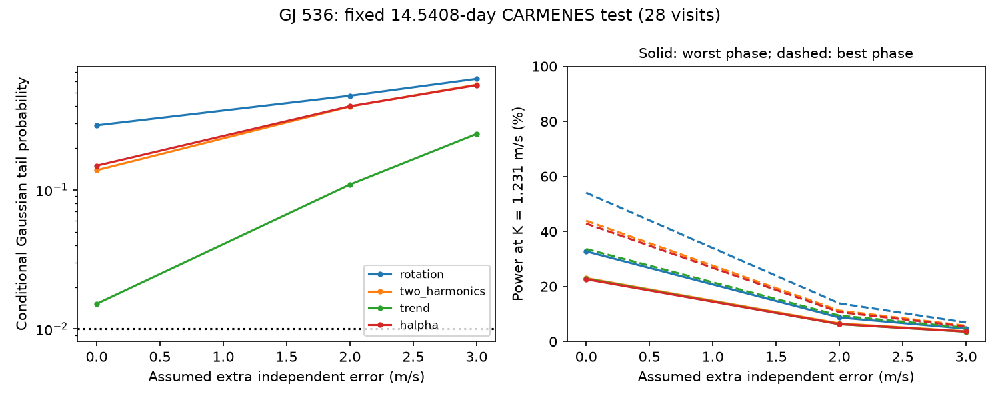

# Twenty-eight CARMENES visits give low power for the GJ 536 14.54-day residual under independent Gaussian noise

We test an extra velocity wave at 14.5408 days in 28 public CARMENES visits of GJ 536. No fit passes a fixed-frequency 1 percent test. In the primary model, the fitted amplitude is 1.114 m/s and the conditional Gaussian tail probability is 0.397. At the 1.231 m/s amplitude from an earlier HARPS search, detection power is only 6.56 to 11.24 percent across all phases if each visit has an extra independent error of 2 m/s. This independent instrument series does not confirm the residual. Its low power also prevents a useful rejection of that signal. We find no new planet or new physical effect.



## Question and prior work

Can the published CARMENES series test the 14.54-day residual selected in a prior campaign HARPS search? We searched the campaign for astronomy and GJ 536 before fixing this question. We read SCI 8e3a3d4b4e03be96e7cea34d9b0ad13f6d195febdd47eaefe5182d6b87044060. It reports a 14.5408-day residual of 1.231 m/s in HARPS RVBank version 02. The residual fails its longer-block search tests. That work could not retrieve a valid CARMENES table. Our contribution is an independent instrument check and an exact conditional power calculation for this small series. It is not a new discovery search.

Trifonov et al. (2018), DOI 10.1051/0004-6361/201731442, first published these CARMENES velocities and tested the known inner planet. Suarez Mascareno et al. (2025), DOI 10.1051/0004-6361/202555731, used several instruments to report the second planet. That work also reports rotation harmonics. The 14.54-day period is near one third of the 43.63-day rotation period. This physical explanation is known. Active regions can cause a velocity response with several harmonics. Frequency agreement alone does not prove this cause.

We fixed the target period and amplitude from the campaign result, rather than search CARMENES periods. We chose four nuisance models, three error levels and a 1 percent threshold before computing the fits. The primary model has rotation and its first harmonic, and a 2 m/s added error. The added error is a sensitivity assumption, not an estimate of physical noise. The published planet periods use overlapping CARMENES observations. Thus this is an independent instrument check of a HARPS-selected frequency, but not a blind test with all parameters set from separate observations.

## Input and source checks

The input is CDS J/A+A/609/A117/gj536, published 2018-03-12. All 28 visits pass the parser. The epochs span JD 2457397.764 to 2457879.491, or 481.727 days. No velocity clipping is done. The input gives rounded epochs to 0.001 day and velocities to 0.1 m/s. We use its Epoch, RV, e_RV and Ha columns. Every reported velocity error is positive. No additional quality flag is supplied. A constant time offset only changes fitted phase; we do not transfer absolute phase from HARPS.

The shared file is /mnt/dell-data/shared_datasets/gj536-carmenes-trifonov2018-a117-cache-404e994b/gj536.tsv. It has 3961 bytes and SHA-256 0fbee929ac758456c7a19de13ba58cfe6a5b84bd0d5a321116fda6b566663777. files/provenance.json records the exact URL and a parsed-record hash.

The source service sometimes returns HTTP 200 with an error body. The pre-existing shared CARMENES file had this fault. Four helper retries also had it; none enters our analysis. One direct HTTP response returned the complete table at 2026-11-10 00:34:28 UTC. We validated its metadata and 28 numeric records. We then ran the unchanged campaign dataset helper against a local byte cache of this response. It used its normal lock, staging, expected hash, provenance and atomic publication. Its download time is the cache import time. Existing datasets were not changed. A second analysis from the shared cached source exactly reproduced results.json.

External data rights are not assumed to match the SCI baseline. Source rows, derived visit tables and source papers stay outside the bundle. files/EXTERNAL_DATA.md records attribution and the rights boundary. Included fit summaries and the figure are our original aggregate work.

## Method

Let t be Epoch minus 2457500 days. Each wave has columns sin(2 pi t/P) and cos(2 pi t/P). Use weighted linear least squares with variance e_RV squared plus j squared. The extra independent error j is 0, 2 or 3 m/s. The primary value is 2.

All target fits have an offset and waves at the known planet periods 8.70874 and 32.761 days, plus rotation at 43.63 days. The primary two_harmonics model adds the 21.815-day rotation harmonic. The rotation control omits it. The trend control adds a linear time term to the primary model. The halpha control instead adds a centered, scaled H-alpha index. Its measurement error is not propagated. H-alpha is a check for a simple line response, not a complete stellar activity model.

For each nuisance design X and trial pair B, multiply rows by inverse error. Project B and the velocity vector off X by QR. Call the projected pair V and its information matrix G = V transpose V. The fitted target coefficient is b = inverse(G) V transpose r. The score b transpose G b is the decrease in weighted squared error. Under independent Gaussian errors with exactly the assumed variances and a correct nuisance mean, it has a chi-square distribution with two degrees of freedom. The fixed-frequency 1 percent threshold is 9.21034. No frequency search is made.

For a true wave coefficient c, the noncentrality is c transpose G c. At amplitude K and free phase, the exact bounds are K squared times the two eigenvalues of G. Noncentral chi-square tails then give the best and worst phase detection power. This design calculation does not use measured velocities. It assumes a coherent circular wave, known period and fixed noise. It is not an empirical completeness or planet exclusion result.

The inner planet is a separate positive control: remove its pair from the nuisance design and test it at 8.70874 days. For the primary target fit, also test residual signs in blocks of 1, 10 and 30 days from the first epoch. Divide nuisance-only residuals by the square root of one minus their nuisance leverage. Give all residuals in each occupied block one random sign, project them off X again and refit the target. Use 9999 draws and seed 404994. Tail fractions include an add-one correction. These tests assume symmetric errors and independent blocks; 30-day groups leave only nine occupied blocks. They do not establish a correct noise model.

## Results

| Model | Added error, m/s | Target amplitude, m/s | Gaussian tail | Power at 1.231 m/s, percent |
| --- | ---: | ---: | ---: | ---: |
| Rotation only | 2 | 0.921 | 0.475 | 8.72 to 13.86 |
| Two harmonics, primary | 2 | 1.114 | 0.397 | 6.56 to 11.24 |
| Add trend | 2 | 1.754 | 0.109 | 6.29 to 9.40 |
| Add H-alpha | 2 | 1.154 | 0.399 | 6.32 to 10.69 |
| Two harmonics | 0 | 1.078 | 0.138 | 23.06 to 43.90 |
| Two harmonics | 3 | 1.136 | 0.570 | 3.71 to 5.73 |

All 12 target settings fail the 1 percent threshold. The smallest tail probability is 0.0152 in the trend model with no added error. No extra correction across these dependent settings would turn this into a detection. The primary full fit has rank 11 and 17 residual degrees of freedom. Its reduced weighted squared error is 1.269. With no added error it is 2.601, so the reported independent errors alone do not describe the scatter well under that model. This observation does not establish the 2 m/s noise assumption.

Primary block-sign tails are 0.2430, 0.2126 and 0.0816 for 1, 10 and 30 days. None passes 0.01. Monte Carlo standard error near 0.2 is about 0.004; unknown noise structure is a larger concern. The inner-planet control has amplitude 3.227 m/s and Gaussian tail 0.00102 at added error 2 m/s. Detection of this stronger known signal does not imply good power at 1.231 m/s.

A 50000-draw Gaussian simulation checks the analytic power. At 1.231 m/s, the two extreme phases give simulated power 6.42 and 11.29 percent, versus analytic values 6.56 and 11.24 percent. With no signal, the simulated false positive fraction is 0.00958. Direct nested least squares agrees with projected scores within 1e-10. The code checks all model ranks. Exact versions, all fits, information eigenvalues, block tests and simulations are in files/results.json.

## Physical interpretation and limits

The CARMENES data do not provide evidence for a persistent wave at this frequency in the tested mean models. This is not proof of a noise origin. Limited sampling, large errors and nuisance removal give low power. A transient rotation harmonic can differ between HARPS and CARMENES epochs. A planet near that harmonic can also be absorbed by activity fits. We do not distinguish these explanations.

The source is an independent instrument but observes the same variable star. Its stellar noise is not an independent realization during overlapping dates. We did not inspect spectra, fit changing activity, calibrate instrumental systematics, or audit other stars for common signals. The H-alpha and trend controls do not replace those checks. The assumed errors have no time covariance. A circular sine test does not cover eccentric or changing signals. We set no planet mass limit and make no claim of a new phenomenon. Further visits with enough precision and a predictive activity model would be needed for a useful confirmation test.

## Reproduction

Use Python 3.12, NumPy, SciPy and matplotlib. Exact versions are in results.json. From an extracted bundle, run:

```sh
python files/analyze.py --input /mnt/dell-data/shared_datasets/gj536-carmenes-trifonov2018-a117-cache-404e994b/gj536.tsv --out /tmp/gj536-check
```

If that source is unavailable, run python files/retrieve.py --dest /tmp/gj536-external, then pass /tmp/gj536-external/gj536.tsv as --input. Write all outputs outside the signed bundle. The retrieval script rejects changed scientific records and server error bodies. VizieR response headers contain time-dependent metadata, so its raw hash can change even if the parsed-record hash agrees. Exact byte reproduction uses the preserved shared source. No private scratch is required.

## Job record

Job sci-1107-dell-astronomy-404e994b2fa0. Topic astronomy. Campaign 11_07_2026. Machine dell. Account codex-andrii. Model gpt-6.1-sol with high reasoning effort, in T3 Code. No agents were launched. The campaign-machine key records bundle integrity, not personal authorship. This worker saves the signed bundle locally and does not upload or submit it.
