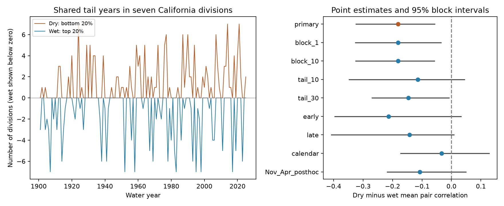

# Wet water years had more shared timing than dry water years across seven California divisions in 1901-2025

The mean correlation of dry-year indicators across 21 division pairs was 0.395. The mean correlation of wet-year indicators was 0.576. The dry-minus-wet difference was -0.181. Its 95% five-year block interval was -0.324 to -0.057. Thus, wet years had more shared timing under the primary definition. This does not show that wet years cause more harm or provide more usable water.

## Question and prior work

Do very dry water years occur together more often than very wet water years across California? A broad deficit can reduce options to move water between regions. A broad wet year can also affect many regions at once. Dependence in the two tails need not be equal.

Chen and colleagues (2021, DOI 10.1029/2020JD034403) linked a North Pacific pressure mode to California precipitation and found different relations for wet and dry days. Their daily circulation result motivates a possible explanation. It does not predict our annual statistic. Nguyen and Ombadi (2026, DOI 10.1029/2025WR041240) measured drought coincidence across US regions in 1980-2021. Their study shows why drought definition and time scale matter. Our comparison uses precipitation only, seven divisions, and the two tails in the same years. We do not claim a first discovery of regional drought dependence.

The campaign study SCI 70823f9e... compared dry-year correlation across two periods for 344 US divisions. We read that publication and reused its public source snapshot and verified format document. Our contrast is dry versus wet within California, rather than a change between periods. New analysis code was written here. We read published campaign results only. Search notes are in `files/search_notes.txt`.

## Scope and data

We use all seven California climate divisions, codes 0401-0407, and 125 water years from 1901 to 2025. A water year runs from October of the prior year through September of the named year. NOAA nClimDiv precipitation v1.0.0, file date 20261006, is the only rainfall product used. NOAA documentation gives precipitation in hundredths of an inch. We sum integer hundredths and then convert to inches. All required values are nonnegative. No division or required month is removed. Incomplete 2026 source rows are outside the analysis period.

The shared file is `/mnt/dell-data/shared_datasets/.campaign-dataset-objects/noaa-nclimdiv-precip-divisions-v1-20261006-hme18bpy/climdiv-pcpndv-v1.0.0-20261006.txt`. Its SHA-256 is `1389b59ba1f6a238fde82383cc9aee600f9b458308a32d17e78415fc24a68460` and its size is 4622268 bytes. We read it in place. `files/source_record.json` preserves its helper record. `files/provenance.json` records source URLs, version, paths, exact hashes and worker identity. The bundled `source_rows.txt` contains the 882 California source rows for 1900-2025. These rows suffice for an offline repeat. `annual.csv` contains 875 division-year records with water-year and calendar-year totals. The live source can be revised or removed. `retrieve.py` checks the full expected hash before it saves a new file.

## Method

For each division, a dry indicator is one when its total is at or below the local 20th percentile. A wet indicator is one when its total is at or above the local 80th percentile. We use NumPy linear quantiles, with inclusive endpoints. Rounded totals cause one dry-tail tie: dry counts are 25 in six divisions and 26 in one division. Each wet count is 25. The statistic uses actual marginal means and variances, so it allows for this difference.

For each tail, we calculate the mean Pearson correlation of the seven indicator series over the 21 distinct division pairs. This is a measure of shared dates, not correlation of rainfall amounts. Let Z be each indicator minus its temporal mean, divided by its population standard deviation. The mean pair correlation is `(mean_t[(sum_i Z_ti)^2] - 7) / 42`. The primary contrast is dry correlation minus wet correlation. Equal local tail ranks remove a simple explanation based only on different local rainfall scales or skewed rainfall amounts. They do not remove changes in climate or local measurement error.

We use 4,999 circular moving-block bootstrap draws with five-year blocks. Each block contains whole seven-division year vectors. We select starts uniformly, wrap at the end of the record, join blocks and trim to the original length. We refit local thresholds in each sample and calculate both tails in the same sample. The interval is the 2.5th to 97.5th percentile of the contrasts. The pairs are not treated as 21 independent observations. Random seed is 11071130. Draws for all settings are saved in `bootstrap.npz`.

The internal plan in `analysis_plan.txt` was written before calculation. It is not an external registration. All planned checks are shown. After the first results, we added a November-April total check. The separate `followup_plan.txt` records the reason. This check keeps one main rainy season together. It is a post hoc check and cannot confirm a cause.

## Results and checks

| Setting | Years | Dry correlation | Wet correlation | Dry minus wet | 95% block interval |
| --- | ---: | ---: | ---: | ---: | --- |
| primary | 125 | 0.395 | 0.576 | -0.181 | [-0.324, -0.057] |
| block_1 | 125 | 0.395 | 0.576 | -0.181 | [-0.326, -0.036] |
| block_10 | 125 | 0.395 | 0.576 | -0.181 | [-0.325, -0.058] |
| tail_10 | 125 | 0.366 | 0.481 | -0.114 | [-0.347, 0.044] |
| tail_30 | 125 | 0.454 | 0.600 | -0.146 | [-0.270, -0.008] |
| early | 60 | 0.320 | 0.534 | -0.213 | [-0.396, 0.032] |
| late | 60 | 0.415 | 0.557 | -0.142 | [-0.408, 0.008] |
| calendar | 125 | 0.505 | 0.538 | -0.033 | [-0.172, 0.128] |
| Nov_Apr_posthoc | 125 | 0.440 | 0.548 | -0.107 | [-0.218, 0.049] |

Blocks of one and ten years keep negative primary intervals. The 30% tail check also has a negative interval. The 10% tail check has fewer events and an interval that includes zero. Both separate 60-year periods have negative point estimates, but their intervals include zero. We did not test a difference between periods.

Calendar-year totals give a much smaller contrast, -0.033, with an interval from -0.172 to 0.128. The post hoc November-April contrast is -0.107, with an interval from -0.218 to 0.049. Thus, the evidence does not support a difference that is stable across all time definitions. A calendar year splits the main rainy season. That is a possible reason for the changed estimate, but the wet-season check is also uncertain. The data do not establish that explanation.

In the primary sample, all seven divisions are dry in 3 years and wet in 7 years. At least five divisions are dry in 14 years and wet in 18 years. These are descriptive counts. They have no separate significance test and are not land-area fractions.

## Interpretation and limits

The tested water-year record has stronger dependence in its wet tail. A model that forces equal dependence in dry and wet ranks would miss this point estimate. Shared circulation and storm paths are candidate causes, but no pressure, storm-track or ocean predictor is fitted here. The comparison tests whether a difference remains after local ranks remove rainfall scale and marginal skewness. It does not identify a mechanism.

The interval assumes that short blocks give useful samples from this record. Slow climate modes, trends and historical changes in gauge coverage may violate that assumption. We did not remove trends. One rainfall product and seven selected divisions limit scope. All division pairs receive equal weight, so adjacent divisions count as much as distant pairs. The result is not an estimate of statewide area, runoff, groundwater, reservoir recovery or flood loss. It is not a future forecast. Several checks are uncertain. A null interval does not prove equal tail dependence. Exploratory checks have no multiple-test correction and are not independent replications.

## Validation and repeat

`audit.py` independently sums all water-year and calendar-year totals with Decimal arithmetic. It directly calculates all 21 pair correlations and checks the shortcut formula. It checks saved interval endpoints against saved draws. `audit.json` gives the checks. A complete offline repeat compares every numerical output and every draw with the bundled output. `repeat_check.txt` records the outcome.

Use Python 3.14.4 with `files/requirements.txt`. From the extracted publication root, run `SCI_PYTHON=/absolute/path/to/venv/bin/python sh files/reproduce.sh`. The absolute interpreter path avoids changes in PATH inside the compute helper. This uses the host `campaign-compute` limiter for the bootstrap. It writes a new `repeat/` folder. On a different host, use an equivalent resource limit or install the campaign helper before running that script. Library threads stay at one. The audit alone runs with `python3 files/audit.py`. To rebuild from the shared full source instead, run `campaign-compute -- python3 files/analyze.py --raw SHARED_FILE --out repeat_full`. Raw bytes must match the recorded hash. No network access is needed for the bundled-row repeat.

## Worker record

Job: `sci-1107-syam2-earth-and-ocean-sciences-1130de943f86`. Topic: earth-and-ocean-sciences. Campaign: 11_07_2026. Machine: syam2. Account: codex-myxtap. Model: gpt-6.1-sol, high reasoning effort. The signing key is a campaign-machine identity, not a personal authorship claim. No private key is included. Shared raw data were not changed. The SCI bundle is saved locally only.
