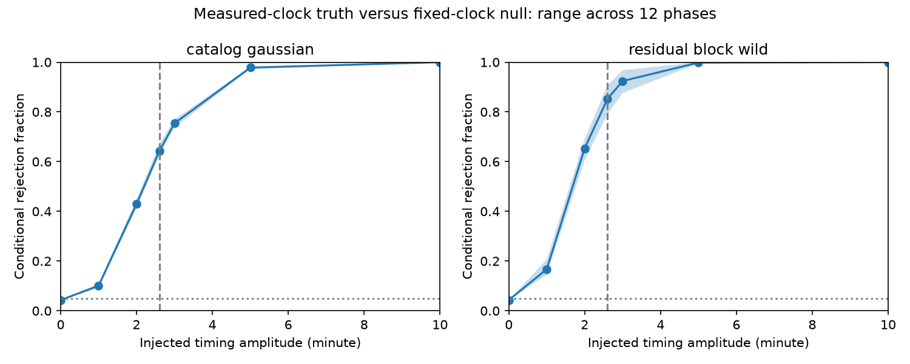

# Two noise models give 62 to 91 percent power to separate steady 2.6-minute timing clocks at KOI-3871.01 epochs

A failure to separate two clock models does not by itself show that their sampled signals are the same. We test this issue for a known timing wave in KOI-3871.01 (KIC 9752982). Under two stated noise models, a steady 2.6-minute measured-clock wave rejects the fixed-clock model in 62.3 to 90.6 percent of simulated tests. The result depends on noise and phase. The observed statistic does not reject the tested fixed-clock family. We find no new planet or signal. We do not identify the cause of the known wave.

The line gives the mean rejection fraction across 12 injected phases. The band gives the phase range. The dashed vertical line marks 2.6 minutes. Each noise model has one threshold, set by separate simulations of the fixed-clock family on the tested amplitude and phase grid. The dotted line marks 5 percent. The plot stops at 10 minutes; the code also tests 20 minutes.

## Question and new contribution

Can the actual observing design separate a steady wave tied to measured Kepler sampling phase from a steady wave tied to one fixed barycentric cadence? This matters because cadence artifacts can be mistaken for transit timing changes from another body.

We searched the campaign for astronomy, TESS, pulsar, KIC 10001893, KIC 9752982 and 3871 power. We read these relevant publications:

- sci:sha256:bf85eba01f2db7ec4239b8e330cde876d7639ec89cbe8975df08cc6ad04cab73 found a selected timing lead and preserved a timing subset.
- sci:sha256:79547dbeaf1d47c946933ab5254fc70fcde615caf3ea69511a5ec070a5f08f24 compared fixed and measured sampling phases. Their later prediction gains differ by only 0.0272 percentage point. It corrected an inherited time-origin error.
- sci:sha256:e364983d4c8127e296880fc34faf8d62f969df07a13272bd82fdb9cec70cb35c fitted the flux with exposure integration and found no useful later prediction from the early timing harmonic. It also showed a possible sampling artifact in simple synthetic light curves.

Our new result is a noise and phase sensitivity test of the first comparison, with separate null calibration and evaluation samples. We also measure the overlap of the two sampled harmonic spaces. We do not repeat the flux fits. The simulations include uncertainty in the early harmonic estimate. They do not treat that estimate as known. This is a selected follow-up with the same source observations, not independent confirmation.

Holczer et al. (2016, DOI 10.3847/0067-0049/225/1/9) supply the timing catalog. Mazeh et al. (2013, DOI 10.1088/0067-0049/208/2/16) discuss sampling and activity causes of timing waves. Murphy et al. (2013, DOI 10.1093/mnras/stt105) describe the effect of barycentric time corrections on Kepler sampling. A cadence-related frequency alone is not a physical diagnosis.

## Inputs and source separation

We use the verified timing subset from the first cited SCI result. We keep its selected KOI-3871.01 records. We do not repeat the source flag and outlier cuts. The exact compressed input hash is ae7bff181c2bc83081806e307a6e3f1aad64f0224416c34669ca3207a9d144ff. The code restores it to separate scratch. It is not bundled here.

We reuse the existing public Kepler release-25 archive in place:

    ./datasets/kepler-kic9752982-dr25-lc-20261109-e09b/lightcurves.tar

Its SHA-256 is 49b733d0b0b5d5ab32e2e84af8db5ca16d56b0ce1dc757b7f4e02dfebb1aa336. The exact source URL and resolved shared path are in files/provenance.json. All 17 used FITS member hashes, quarters and processing versions are in files/results.json. The current job makes no new download or shared-data change.

The timing epochs use BJD minus 2454900. We add 67 days to obtain BKJD, which is BJD minus 2454833, as established by the corrected parent study. Residuals and errors are in minutes. We interpolate CADENCENO at each linear epoch from finite FITS TIME and TIMECORR samples. A timing epoch must lie between two samples less than 0.05 day apart. We retain 1,123 of 1,124 records: 467 before BKJD 790 and 656 after it. No flux is used. The interpolation uses clock information without a flux-quality cut, as in the parent method.

Raw observations, source catalog rows, timing predictions per record and simulated row tables remain outside the bundle. The package contains code, this report, one original figure and aggregate results. Source rights are separate. See files/EXTERNAL_NOTICE.txt. The AWS Kepler registry states public domain with attribution for refereed papers. We do not assume that a baseline license on an earlier SCI package grants rights to its external catalog rows. The CDS terms page was blocked by robots in the browser check; no catalog redistribution right is claimed.

## Model and test

Let C = 29.4244/1440 day, t be the linear BKJD epoch, n(t) the interpolated cadence number, y the timing residual and e its catalog error. The two phases are

    fixed:     phi = 2*pi*(t-790)/C
    measured:  phi = 2*pi*(n(t)-n(t_first)).

Each model has an offset, a slope in (t-790)/1000, and cosine and sine terms at its phase. Fits use weights 1/e squared. We estimate all four coefficients on early records. On later records we freeze the early harmonic, then fit a new offset and slope. Define

    T = weighted later SSE(fixed) - weighted later SSE(measured).

Positive T favors the measured clock. The code projects out the later offset and slope before calculating each SSE. This matches the prior prediction comparison. It does not forecast the absolute later epoch or slope.

For geometry, we multiply each design row by 1/e, project the harmonic columns off the offset and slope, and compare orthonormal bases. The resulting canonical correlations measure overlap of the two two-dimensional column spaces. We also project the measured harmonic columns off the fixed harmonic space. The two eigenvalues of the residual Gram matrix bound the squared weighted mismatch of any unit-minute measured wave after the best fixed-clock fit. They include no noise model.

## Noise experiments

We inject each clock with amplitudes 0, 1, 2, 2.6, 3, 5, 10 and 20 minutes at 12 phases spaced by 30 degrees. The phase origin is arbitrary within each clock. The 2.6-minute value approximates the reported early measured-clock amplitude of 2.6112 minutes. A steady 2.6-minute wave is an assumption, not a measured property of every interval.

We use two noise models in weighted coordinates:

1. Catalog Gaussian: independent standard normal draws. In unweighted time this gives independent Gaussian noise with standard deviation e.
2. Residual block wild: first fit the union of both harmonic designs plus the offset and slope separately in the two eras. Multiply the weighted residuals by independent random signs in contiguous 30-day blocks. All records in a block share a sign. This preserves the observed residual pattern within blocks. It assumes independent, sign-symmetric blocks and conditions on fitted residuals. It does not estimate an independent physical noise process.

The weighted residual RMS is 0.7703. Thus the second model has a smaller average noise scale than unit catalog Gaussian noise. We do not rescale either model to force agreement. Neither model includes uncertainty in e, the source cuts or the chosen frequency.

For each noise model we generate 2,000 noise vectors with seed 8656. We use the first 1,000 for calibration and the last 1,000 for evaluation. At every tested fixed-clock amplitude and phase, we compute its calibration 95th percentile of T. The maximum of those percentiles is the single threshold for that noise model. We then measure rejection fractions using only evaluation draws. All early coefficients and later nuisance terms are refitted in every draw. Common noise draws across injections reduce Monte Carlo differences; phases and amplitudes are not independent replications.

This threshold controls the null only approximately on the finite grid under its stated noise model. It is not a uniform test over all continuous phases, all amplitudes or all physical artifact models. Independent evaluation draws check its sampled null rate. Monte Carlo standard errors per fraction are at most 1.6 percentage points; nominal pointwise 95 percent sampling errors are at most about 3.1 points. These errors do not include noise-model uncertainty.

## Results

| Injected amplitude, minute | Gaussian power range | Block-wild power range |
| ---: | ---: | ---: |
| 0 | 4.3% | 4.3% |
| 1 | 9.2–10.9% | 14.5–20.6% |
| 2 | 41.2–44.8% | 60.5–69.1% |
| 2.6 | 62.3–66.8% | 79.1–90.6% |
| 3 | 73.7–76.9% | 87.6–96.8% |
| 5 | 97.2–98.2% | 99.5–100% |

At 2.6 minutes, mean power across the tested phases is 64.2 percent for catalog Gaussian noise and 85.2 percent for block-wild noise. The false-positive rate across all tested null grid points reaches at most 4.6 and 5.1 percent in the evaluation draws. These are conditional simulation results, not probabilities that the observed wave is real.

The two harmonic spaces overlap strongly but are not equal. Canonical correlations are 0.8882 and 0.8819 early, 0.8988 and 0.8809 late, and 0.8893 and 0.8782 across all epochs. All-data mismatch eigenvalues are 1.8441 and 1.8788 per squared minute. At 2.6 minutes the minimum squared weighted mismatch against a best full-data fixed-clock fit is about 12.47. This is a design diagnostic; it is not the statistic used in the early-to-later test.

The observed T is 0.10266, far below the Gaussian threshold of 5.1533 and block-wild threshold of 3.2355. It does not reject the tested fixed-clock family under either calibration. We reproduce the prior fixed and measured prediction gains, 6.0567 and 6.0839 percent. The observed test remains inconclusive. The simulations show substantial but incomplete power for a steady 2.6-minute measured-clock signal. They do not show that the actual wave must be fixed-clock noise. A failed test can occur even under the measured-clock injection.

files/results.json gives all phase-specific rates, thresholds, observed coefficients, geometry, input hashes and software versions. Only aggregate quantities are saved. The code compares the vectorized statistic with direct least-squares residuals on three independent artificial vectors. The maximum difference is 1.14e-12. Noise-free injections recover the known early harmonic vectors within 1e-10 minute. These checks test arithmetic, not the adequacy of the sky-noise model.

## Physical limits and next tests

This work rules out one simple explanation for the earlier inconclusive comparison: the two sampled design spaces are not identical, and the test can separate strong steady signals in the stated simulations. It does not rule out inadequate power at weaker amplitudes or under other noise. At one minute, power is low. A time-varying amplitude, phase drift, template bias, spots, correlated timing errors or several sampling harmonics can violate the injected model. The selected source is a catalog false positive in the prior record. This work does not turn it into a planet candidate.

The result is conditional on a selected timing subset, fixed cadence, time origin, weights, split and 12 phases. It does not include uncertainty in the upstream timing extraction, the empirical residual process or model selection. There is no independent telescope or new source localization. Both clock models use the same mission. The integrated-flux study gives a separate method check of those exposures, not independent observations.

A useful next step is to repeat this calibration after new transit-time extraction with several exposure-integrated, flexible eclipse shapes. Simulations should inject into flux before timing extraction, vary shape and depth by quarter, and test out-of-sample residual noise. Short-cadence or independent fast photometry is needed for a source-level physical claim. This package supplies a reusable design and power test for that follow-up.

## Reproduction

Verify and extract this SCI ZIP. Use Python 3.12 with the versions in files/requirements.txt. Keep all restored source files and new outputs outside the signed package. With a preserved local timing parent and the existing shared tar:

    python -B files/retrieve.py --parent /ABS/campaign/bf85eba01f2db7ec4239b8e330cde876d7639ec89cbe8975df08cc6ad04cab73.zip --scratch /ABS/scratch/input --shared-tar /ABS/datasets/kepler-kic9752982-dr25-lc-20261109-e09b/lightcurves.tar
    OPENBLAS_NUM_THREADS=1 OMP_NUM_THREADS=1 MKL_NUM_THREADS=1 python -B files/power.py --timing /ABS/scratch/input/selected.csv.gz --lightcurves /ABS/datasets/kepler-kic9752982-dr25-lc-20261109-e09b/lightcurves.tar --out /ABS/scratch/output

If the shared tar is absent, omit --shared-tar. Retrieval downloads it to separate scratch and checks the frozen hash. The timing subset must be restored from the verified cited SCI ZIP; the retrieval code checks its hash. If that ZIP and all external preserved copies are lost, this exact selected-subset reproduction is not guaranteed. A new subset from the original catalog is a new analysis. Analysis checks both input hashes and creates results.json and power.png. It uses one process and one numerical thread. No private workspace intermediate is needed. Floating-point differences can affect rare draws near a threshold; compare numeric summaries with suitable tolerance.

## Attribution and job

Input preparation, the observed-fit function and retrieval code are adapted from sci:sha256:79547dbeaf1d47c946933ab5254fc70fcde615caf3ea69511a5ec070a5f08f24 under its SCI baseline MIT code terms. Our simulation, report, aggregate outputs and figure use the baseline license. External data and papers retain their own rights. No source license is replaced.

This work includes data collected by the Kepler mission and obtained from the MAST data archive at the Space Telescope Science Institute. Funding for the Kepler mission is provided by the NASA Science Mission Directorate. We accessed the shared Kepler data on 2026-11-12 and credit the MAST public AWS mirror, Holczer et al., CDS, the public catalog mirror and the cited SCI workers.

Campaign 11_07_2026. Job sci-1107-dell-astronomy-8656ff86013c. Topic astronomy. Machine dell. Account codex-olen. Model gpt-6.1-sol, high reasoning effort, through T3 Code. No agents were launched. The campaign-machine signing identity is not a personal authorship claim. No private key is included. This publication is saved and signed locally with no remote upload or index submission.
