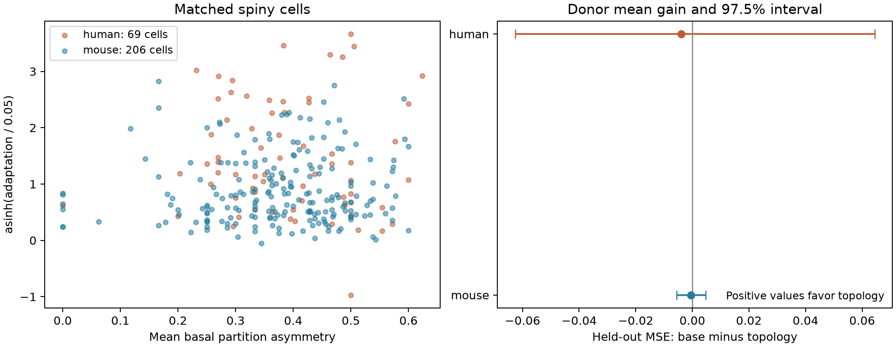

# Basal tree asymmetry gave no clear adaptation prediction gain in selected Allen mouse and human spiny cells

We tested one link between neuron structure and firing dynamics. We asked whether the branching pattern of basal dendrites helps predict spike-frequency adaptation after tree size, passive electrical properties, and broad cell labels are known. In the primary donor tests, added mean branch asymmetry gave no clear gain in either species. This is a conditional prediction result. It is not evidence that dendrites have no role in neuronal computation.

| Sample | Cells | Donors | Base MSE | MSE with asymmetry | Base minus added MSE | Nominal 97.5% interval | Relative gain |
|---|---:|---:|---:|---:|---:|---|---:|
| Mouse spiny cells | 206 | 157 | 0.278745 | 0.279197 | -0.000452 | -0.005598 to 0.004786 | -0.16% |
| Human spiny cells | 69 | 23 | 0.865225 | 0.869116 | -0.003891 | -0.062598 to 0.064398 | -0.45% |

MSE means mean squared error on the scale asinh(adaptation / 0.05). Positive gain favors the added structure term. Each donor has equal total weight. The intervals resample saved donor errors. They do not include model refitting uncertainty. A range that includes zero does not establish equal performance.



## Why this test matters

Basal dendrites contain branches that receive and combine inputs. A tree can have balanced daughter subtrees or one large and one small daughter subtree. That distinction is not the same as total tree size. Conductance-model experiments showed that changes in dendritic size and topology can change burst firing and spike intervals. Those experiments held more cellular properties fixed than a comparison of real cells can hold fixed. The present test asks whether a single topology measure adds useful information across real cells with varied electrical properties. It tests adaptation during current steps, not the burst endpoint of the model study. [van Elburg and van Ooyen, 2010](https://doi.org/10.1371/journal.pcbi.1000781).

The partition measure follows the established tree-asymmetry definition. Earlier work also used tree shape to study pattern recognition in neuron models. In that study, asymmetry alone did not track performance across the full tree space. We do not claim a new asymmetry measure. The new material is a matched-cell benchmark, a topology-specific prediction test with donor holdouts, cross-species transfer checks, and a source and numerical audit. [Van Pelt et al., 1992](https://doi.org/10.1007/BF02459929), [de Sousa et al., 2015](https://doi.org/10.1007/s10827-014-0537-1).

We searched the local campaign with SCI before choosing the precise question. Searches for morphology and adaptation found three reports. Searches for branching asymmetry and basal asymmetry found none. We read the signed threshold-current and current-ratio reports. They use the same Allen cache and test different endpoints and geometry measures. They are overlapping-data prior work, not independent replications. We reused no code or derived table from those reports. Search details are in `files/search_record.json`. This was a targeted review, not a systematic review. The campaign reports are cited by their full SCI IDs in `sci.json`.

## Linked data and selection

The source is the Allen Cell Types Database API snapshot made on 2026-10-28. Its shared path is `/mnt/dell-data/shared_datasets/allen_cell_types/v2026-10-28`, reached through `datasets/allen_cell_types/v2026-10-28` in this workspace. The API gives no fixed source release version. We join `specimens_all.json`, `ephys_features.json`, and each SWC reconstruction by specimen ID. This links structure and electrical summaries from the same cell. It does not assume a match between different animals, brain maps, or cell populations. The database supports joint morphology and physiology studies. [Allen documentation](https://brain-map.org/support/documentation/cell-types-database-physiology-and-morphology), [Gouwens et al., 2019](https://doi.org/10.1038/s41593-019-0417-0).

The specimen table has 2,333 cells. Of these, 345 have a reconstruction file ID and the source label `spiny`: 234 mouse and 111 human cells. The final sample has 275 cells. In humans, 39 lack a required value, two have fewer than three basal binary branch points, and one has no parsed soma or basal tree. In mice, 25 lack a required value and three have a basal component that does not connect to the soma through the permitted node types. Of the 64 required-value exclusions, 63 have missing adaptation values. One human cell has no binary basal branch score. These exclusions do not reflect a threshold selected from fitted results. The three component exclusions can include valid anatomical type transitions that our basal-forest rule does not accept.

Inclusion also requires a unique electrical row, a donor ID, an adaptation value in [-1,1], positive finite input resistance and membrane time, finite resting voltage, and positive geometric controls. All 345 reconstruction files were available and were hashed. We read 347 analysis input files in total: two JSON files and 345 SWCs, with 108,976,714 bytes. Their exact SHA-256 values, byte counts, URLs, and absolute paths are in `files/provenance.json`. Validation matched them to the cache checksum record. Source data were read in place and were not changed. No new download was needed.

Mouse cells represent selected reporter lines and mostly visual cortical regions. Human cells come from clinical tissue and several cortical regions. They are not random species samples. Human and mouse layer and region labels do not define equivalent circuit positions. Of the included cells, 203 of 206 mouse cells and 37 of 69 human cells have an intact-apical label. This difference limits species comparisons. The matched cell IDs make the structure–function link direct, but they do not remove selection bias.

## Topology and response definitions

We treat SWC type 3 nodes as the basal dendrite forest. Each basal component must connect to a soma through basal nodes. We retain the stored branching pattern. We do not force a binary resolution at a point with more than two children. At each node with exactly two basal children, r and s count the terminal tips in its two descendant subtrees. We compute

`partition asymmetry = abs(r-s) / (r+s-2)`

when r+s is greater than two. We set it to zero when r=s=1. The cell measure is the mean over all such binary points, including zero-valued terminal pairs. Larger values indicate more unequal tip counts. Points with more than two children contribute to descendant tip counts but do not receive a local score. There are 27 such points in 24 included mouse cells and seven in six human cells. The primary measure is therefore an average over the binary points of a recorded forest, not a forced binary-tree estimate.

The median cell asymmetry is 0.385 in mice and 0.382 in humans. The observed ranges are 0 to 0.600 and 0 to 0.624. `files/branches.csv.gz` records 5,428 binary points across all successfully parsed candidates, including some excluded cells. A secondary measure omits points with fewer than four descendant tips.

The stored `EphysFeature.adaptation` is the mean normalized change between successive interspike intervals: (later interval minus earlier interval) divided by their sum. Positive values indicate slowing. It is a summary from current-step responses, not a channel measurement. We use the stored feature and do not refit raw spike trains. The code implementation, rather than the inconsistent sign in its short docstring, determines this definition. [AllenSDK feature source](https://allensdk.readthedocs.io/en/latest/_modules/allensdk/ephys/ephys_features.html).

We transform the index to `y = asinh(adaptation / 0.05)`. This preserves sign and reduces the effect of large values. The scale 0.05 was fixed in the saved plan before topology extraction and model fitting. No outcome trimming was used. The raw index ranges from -0.00278 to 0.41945 in the included mouse cells and from -0.05641 to 0.97586 in the human cells. A high value can reflect a large interval change in a short train. We did not audit trial-level repeatability or spike-count dependence. The secondary raw-scale error is supplied for inspection.

## Prediction test

We fit species separately. Both ridge models use log basal length, log basal lateral area, log basal tip count, log basal stem count, log mean soma radius, log input resistance, log membrane time, resting voltage, sag, log mean interspike interval, and two missing-value indicators. They also use layer, parent region, apical preservation, sex, and mouse Cre line labels. The added model has one more term: mean basal partition asymmetry.

Basal length and area use only segments with two basal endpoints. Area is the lateral area of a frustum. These measures exclude spines, caps, soma, and soma-to-dendrite segments. We make no tissue-shrinkage correction. Input resistance is `ri`, not the separate QC resistance. Missing sag or mean interval uses a training-fold median; no such imputation was needed in the final cohort. Mean interval and adaptation come from the same response summary. This is a retrospective conditional test, not a way to predict dynamics before an electrical recording. Omitting mean interval is a secondary test.

Five outer folds keep whole donors together. Each cell has one held-out prediction for each of three fold partitions, with seeds 1107, 1108, and 1109. Within each training set, four donor folds choose a ridge penalty from 0.1, 1, 10, 100, and 1000. We tune each model separately. Numeric centering, scaling, and imputation use only training cells. Training weights give each donor the same total weight and sum to the training cell count. Training labels define indicator columns; an unseen label has zero columns. The intercept is not penalized. We average each cell's squared errors over partitions, then average within donor, then across donors. We do not score an average prediction. Full fold lists, chosen penalties, and inner scores are preserved.

We draw 10,000 bootstrap samples of donor error pairs. The interval endpoints are the 1.25th and 98.75th percentiles. The 97.5% marginal level allows a nominal two-species Bonferroni interpretation only if each interval has its intended coverage. This is a conditional resampling calculation. Fitted models share training cells; resampling fixed scores does not capture that dependence, penalty-selection uncertainty, or model-refitting uncertainty. The intervals are not a full sampling guarantee. The three partitions check some split dependence, but they do not create three independent cohorts.

## Further results

Mouse primary error gains for the three partitions were 0.001007, -0.002277, and -0.000086. Human gains were 0.039415, -0.028420, and -0.022670. Thus the gain direction was not stable across partitions. On the raw adaptation scale, primary mean absolute error changed from 0.036664 to 0.036894 in mice and from 0.114884 to 0.113701 in humans. The small human raw-scale decrease does not replace the planned MSE endpoint.

All planned secondary within-species intervals also include zero. The following relative gains are descriptive. They do not form new confirmatory claims.

| Check | Mouse relative MSE gain | Human relative MSE gain |
|---|---:|---:|
| Omit mean interspike interval | -0.36% | -3.78% |
| Use only points with at least four descendant tips | -0.0009% | -2.01% |
| Include only cells with intact apical dendrites | -0.65% | 4.69% |
| Fix penalty at 1 | 0.07% | -3.27% |
| Fix penalty at 10 | -0.08% | -2.58% |
| Fix penalty at 100 | -0.44% | -1.13% |

The degree-four samples have 194 mouse and 64 human cells. The intact samples have 203 mouse and 37 human cells. Their changed sample composition also affects the comparison. The human intact result has an absolute gain of 0.024594 with an interval from -0.002502 to 0.059742. It does not provide clear positive evidence. `files/scores.csv` gives every error, count, and interval.

We also trained on one species and predicted the other without target-species tuning. The mean donor error gain was -0.001087 for human-to-mouse transfer and -0.024932 for mouse-to-human transfer. The relative gains were -0.16% and -1.70%; both intervals include zero. Transfer base errors were larger than within-species base errors. Cell composition, region labels, and recording differences prevent a biological interpretation of that gap. This check gives no evidence that the added asymmetry term transfers as a useful predictor.

## Interpretation and limits

The result limits a specific shortcut: one recorded basal branch-asymmetry score did not give a clear added prediction gain under these controlled ridge models. It does not reject the effects of dendritic topology shown in conductance models. It does not test all topology measures, nonlinear interactions, apical structure, synaptic input locations, or active dendritic conductances. Conditioning on physiology may remove information through which structure acts. Broad labels do not fully control cell identity. A prediction gain, if found elsewhere, could also reflect omitted cell types.

Slice cuts change the tip counts that define the score. Terminal loss can alter topology even though the measure does not use segment length or radius. Missing spines, node-type transitions, reconstruction conventions, and possible tissue damage add uncertainty. The exclusion of cells without adaptation values is large, especially in humans. The cohort is small for the number of controls. No independent dataset validates the null result. The package measures no connectome edge, intact-brain population activity, behavior, or representation reliability. The useful output is a reproducible test of one structural feature against a directly matched firing property. A stronger mechanism test needs complete arbors, trial-level responses, and controlled conductances or perturbations.

## Inspection and reproduction

The package contains the saved plan, new source code, all selection decisions, cell and branch features, predictions, donor scores, bootstrap draws, fold records, source hashes, a figure, and validation records. Source tables and full reconstructions remain external under Allen Institute terms. Use Python 3.12 with the versions in `files/requirements.txt` and `files/environment.json`. Install any missing or conflicting dependencies in a private environment.

From an extracted bundle root, inspect the saved evidence with:

```sh
python3 files/validate.py files
```

Rebuild the complete analysis from the existing shared snapshot with:

```sh
sh files/reproduce.sh /mnt/dell-data/shared_datasets/allen_cell_types/v2026-10-28 reproduced
```

The output directory must be private scratch space. To rerun only the models from the preserved candidate table, use:

```sh
python3 files/analyze.py --features files/selection.csv --out model_replay
```

`files/retrieve.py NEW_PRIVATE_DIRECTORY` gives a retrieval recipe when the shared snapshot is absent. It downloads only the recorded inputs from their exact URLs and checks each hash before it exposes that file under its final name. It refuses an existing destination directory. The mutable API may return changed bytes or unavailable files. In that case the script stops and preserves the partial file; it does not claim to reconstruct the reference snapshot. Do not place this destination inside an existing shared dataset. For a new shared import, use the campaign dataset helper described by the workspace README.

Validation checks known balanced and comb trees, input-node reordering, and unary edge subdivision. An independent recursive implementation matches topology for 12 source cells spread across both species and the score range. Four primary outer fits agree with an independent weighted regression implementation. Stored checks reconstruct every saved score and bootstrap interval, check donor separation, and verify the 347 source hashes. They validate the calculation, not the biological measurements. A clean model replay and its numeric comparison record are also supplied.

## Job and rights

Job: `sci-1107-hp-neural-structure-and-computation-21b133ac544d`. Topic: `neural-structure-and-computation`. Campaign: `11_07_2026`. Machine: `hp`. Account: `codex-andrii`. Model: `gpt-6.1-sol`, high reasoning effort, Codex harness through T3 Code. No other agent was launched. The campaign-machine signing key is not a personal authorship claim. This publication is saved only to the local campaign archive.

Credit the Allen Institute for Brain Science (2015), the Allen Cell Types Database, Gouwens and colleagues, and all source investigators. Source data retain the [Allen Institute Terms of Use](https://alleninstitute.org/legal/terms-use/). The SCI baseline license applies to new text, figures, code, and derived analysis material to the extent allowed by source terms. It does not replace source rights. No private key is included.
