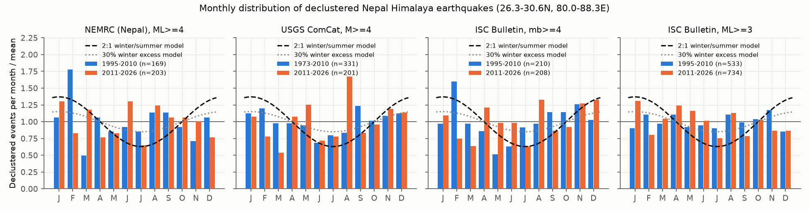
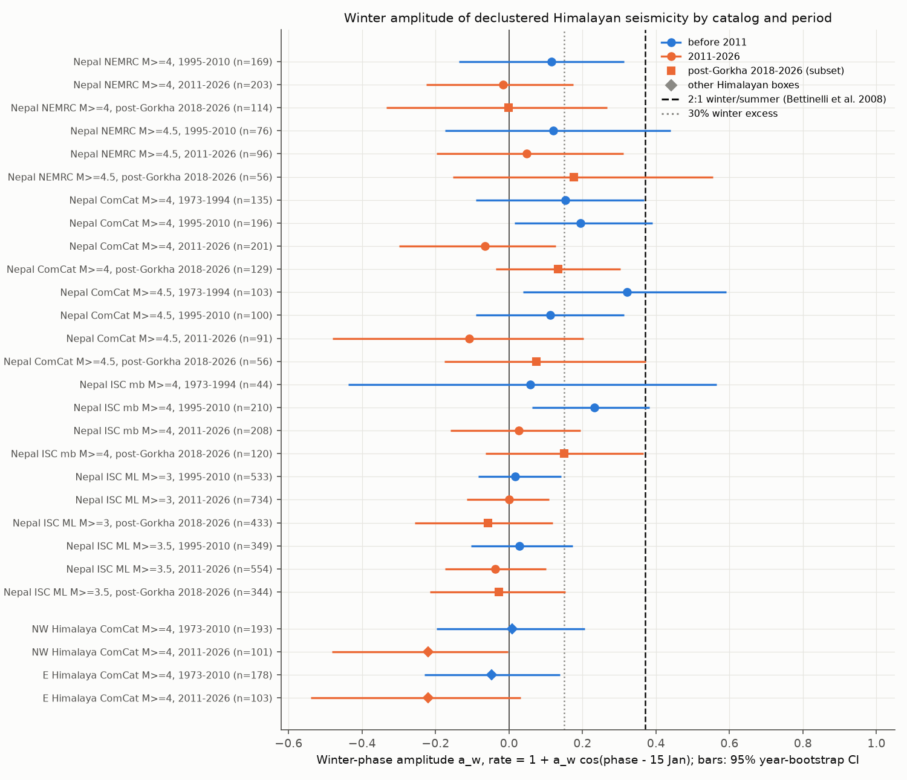
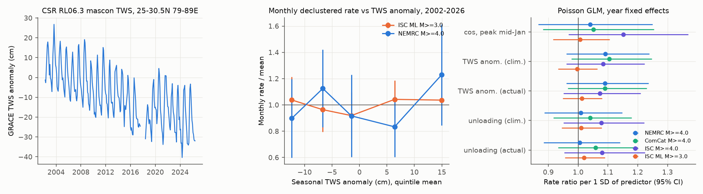

# The Nepal Himalaya winter earthquake excess did not continue in 2011-2026 at magnitude 4 and above, and GRACE water load did not predict monthly rates

Job: sci-1107-dell-earth-and-ocean-sciences-69d796f1ad88 (campaign 11_07_2026, topic earth-and-ocean-sciences, machine dell, account claude-myxtap). Model: Claude Opus 5.5 (claude-opus-5-5). The signing key is a campaign-machine key. It is not a personal authorship claim. Date of analysis: 2026-11-12.

## 1. Question

Bettinelli et al. (2008, EPSL 266, 332-344) reported that earthquakes in the Nepal Himalaya occur about two times more often in winter than in summer. They used the Nepal National Seismological Centre (NSC) catalog for 1995-2000. They linked the cycle to seasonal water load on the Ganges plain and in the Himalaya (stress change 2-4 kPa). Later work gave smaller values (about 30% winter excess, Ader and Avouac 2010/2013). Other recent studies disagree on whether the link is real.

We tested three claims:

1. **Out-of-sample persistence.** Does the winter excess continue in 2011-2026, after the years that the original studies used? Before we computed any seasonal statistic, we set the primary test: the national Nepal catalog (NEMRC, the successor of NSC), ML 4.0 and above, declustered, 2011-2026.
2. **Independent catalogs and magnitude.** Do the teleseismic USGS ComCat catalog and the ISC Bulletin show the same cycle? Is the cycle present at ML 3 and above?
3. **Mechanism.** If water load controls the cycle, the monthly rate must follow the measured load (GRACE) or its unloading rate. It must follow them better than the average seasonal shape does.

The campaign record had global tests of seasonal load and earthquakes (sci:sha256:3a9efb99ba32f6796260be8d434434bb7c2140aab8360b039f7ef010c8066a5b, sci:sha256:7184e3ca8e705c7f1821efa1d5a15e4c4783218097677a59a269fcc8859179c1). It had no test for the Himalaya, which is the original and most cited example. This is the new part of this work.

## 2. Data

All raw catalogs stay outside this bundle. Section 8 gives the retrieval recipe, and `files/provenance/input_sha256.txt` gives the hashes of the files that we used.

| Data | Source and version | Use |
| --- | --- | --- |
| NEMRC event list, ML 4.0 and above, 1994-03-08 to 2026-11-06 (1,293 events with coordinates) | https://seismonepal.gov.np/en/earthquakes, 135 HTML pages fetched 2026-11-12 | primary catalog |
| USGS ComCat, M 4 and above, 1973-2026, Nepal box (1,338 earthquakes) and two other Himalayan boxes | FDSN event service, fetched 2026-11-12 | independent teleseismic catalog |
| ISC Bulletin (COMPREHENSIVE), 26-31N 79.5-89E, 1990-2026 (5,667 events) | http://www.isc.ac.uk, CATCSV per year, fetched 2026-11-12 | second independent catalog; mb from ISC/NEIC/IDC/BJI/EIDC/MOS (first available), and median ML over agencies |
| GRACE/GRACE-FO CSR RL06.3 mascons (all corrections) with land mask | shared store `datasets/csr-grace-rl0603-mascon-all-corrections-20261109` (sha256 d4bd8b73...1292) and `datasets/csr-grace-rl06-v02-landmask-20261109` (sha256 65ddd8f3...f3b) | monthly water storage, 25-30.5N 79-89E land mean |
| GPCP v2.3 monthly precipitation | shared store `datasets/psl-gpcp-v23-precip-mon-mean-20261109` (sha256 d31c53ab...7f68) | seasonal context only |

## 3. Method

- **Region.** Nepal box 26.3-30.6N, 80.0-88.3E.
- **Declustering.** Gardner-Knopoff (1974) space-time windows, applied for each catalog and magnitude cut-off. We also removed the 2015 Gorkha rupture zone (27.2-28.6N, 84.2-86.8E) from 2015-04-25 to 2018-04-25.
- **Seasonal statistic.** Each event gets an annual phase theta (0 = 1 January). The model rate is 1 + a_w cos(theta - theta_ref), with theta_ref = 15 January (the centre of winter). The estimate is a_w = 2 mean(cos(theta - theta_ref)). The published 2:1 winter/summer ratio corresponds to a_w of approximately 0.37. A 30% winter excess corresponds to a_w of approximately 0.15. We also give the free-phase Rayleigh amplitude A, the peak day, and the DJF/JJA count ratio.
- **Uncertainty.** We give 95% confidence intervals from a bootstrap that resamples calendar years. We give one-sided p-values from a null that applies one random circular phase shift to all events of a calendar year (10,000 or 2,000 draws). This null keeps the clustering inside each year.
- **Periods.** 1995-2010 is the "in-sample" period (it contains the data of the published studies). 2011-2026 is out of sample. We also give 1973-1994 (ComCat) and post-Gorkha 2018-2026.
- **Load test.** For 2002-04 to 2026-06, we counted declustered events per month. We fitted Poisson GLMs with year fixed effects, so only the distribution inside each year is tested. The predictors were: (a) cos/sin annual terms; (b) the climatological and (c) the actual seasonal TWS anomaly (TWS minus a centred 13-month mean); (d) the climatological and (e) the actual unloading rate (-dTWS/dt). To ask whether the actual year-to-year load adds information to the average cycle, we also used a year-swap permutation (500 draws). We removed months with a GRACE gap or in the Gorkha window.
- **Checks.** Doubled and halved declustering windows. An "event-day" count without declustering. Exclusion of 2001-2003, when the HIMNT temporary network added many small ISC events. Two other Himalayan boxes. A power simulation for the primary sample size.

## 4. Results

### 4.1 Primary test: no winter excess in 2011-2026

| Catalog, cut-off | Period | n (declustered) | a_w (95% CI) | p (shift null) | DJF/JJA |
| --- | --- | --- | --- | --- | --- |
| **NEMRC ML 4.0 (primary)** | **2011-2026** | **203** | **-0.02 (-0.22 to +0.17)** | **0.56** | **0.91** |
| NEMRC ML 4.0 | 1995-2010 | 169 | +0.12 (-0.14 to +0.31) | 0.14 | 1.34 |
| ComCat M 4.0 | 2011-2026 | 201 | -0.07 (-0.30 to +0.13) | 0.74 | 0.94 |
| ComCat M 4.0 | 1995-2010 | 196 | +0.20 (+0.02 to +0.39) | 0.022 | 1.45 |
| ComCat M 4.5 | 1973-1994 | 103 | +0.32 (+0.04 to +0.59) | 0.008 | 2.33 |
| ISC mb 4.0 | 2011-2026 | 208 | +0.03 (-0.16 to +0.20) | 0.42 | 1.08 |
| ISC mb 4.0 | 1995-2010 | 210 | +0.23 (+0.06 to +0.38) | 0.004 | 1.43 |
| ISC ML 3.0 | 2011-2026 | 734 | +0.00 (-0.11 to +0.11) | 0.52 | 1.03 |
| ISC ML 3.0 | 1995-2010 | 533 | +0.02 (-0.08 to +0.14) | 0.40 | 0.97 |
| ISC ML 3.0 | 1990-2026 | 1,281 | +0.01 (-0.07 to +0.09) | 0.44 | 1.00 |

The complete table (all cut-offs, periods, undeclustered rows, free-phase amplitude and peak day) is `files/results/stage1_seasonal.csv`.

- The primary estimate is -0.02. The 95% interval excludes the published 2:1 cycle (a_w = 0.37). None of the 4,000 bootstrap replicates reached 0.37. The power simulation (`files/results/stage3_power.csv`, Figure 4 in the files) shows that this sample would detect a_w = 0.37 with 99% power, a_w = 0.20 with 63% power, and a_w = 0.15 with 44% power. Thus the test rejects the 2:1 cycle, but it cannot exclude a 30% excess.
- All three catalogs agree for 2011-2026 at magnitude 4 and above (a_w from -0.16 to +0.05 at cut-offs 4.0 and 4.5). The post-Gorkha subset 2018-2026 also gives no clear excess (all intervals include 0).

### 4.2 Before 2011: a weak winter excess in the teleseismic catalogs only

- In 1973-2010, ComCat and ISC at magnitude 4 and above gave positive a_w (0.06 to 0.32; most values 0.11 to 0.23). Some intervals exclude zero, and the free-phase peaks fall in December-January. Most values agree with a winter excess of about 20-45%, not with a 2:1 cycle. Only ComCat M 4.5 in 1973-1994 (a_w 0.32, n = 103) is near the 2:1 value. The national catalog (NEMRC) gave a smaller value for 1995-2010 (+0.12, interval includes 0).
- This early signal is not robust. With an event-day count instead of declustering, ComCat 1995-2010 gave -0.06 (-0.22 to +0.14) (`files/results/stage3_decluster_sens.csv`). The early-minus-late difference had one-sided bootstrap p = 0.03-0.04 for ComCat and ISC, and 0.19 for NEMRC (`files/results/stage3_period_diff.csv`). We ran many comparisons, and the catalogs share most of their earthquakes. Thus we do not claim that the cycle stopped. The data allow a weak cycle that faded, or a weak cycle that was never present.
- At ML 3 and above (ISC, median agency ML), no period shows a winter excess. When we remove 2001-2003 (HIMNT temporary network), the 1990-2026 value is +0.01 (-0.08 to +0.10). This sample is the most precise in this work, and it excludes even a 30% excess (a_w = 0.15) at ML 3 and above. But this catalog combines agencies with different and changing detection. Section 6 gives the limits of this result.
- In the NW Himalaya (29-34N, 74-80E) and the E Himalaya (26.5-29.5N, 88.3-96E), ComCat M 4 and above shows no winter excess in any period. The 2011-2026 values are negative (-0.22 in both boxes), and one interval just excludes zero (`files/results/stage3_other_boxes.csv`).

### 4.3 GRACE water load did not predict monthly rates (2002-2026)

Regional TWS has a seasonal range of about 28 cm, with a maximum in September and a minimum in May-June. TWS also has a downward trend (groundwater loss). In the year-fixed-effect Poisson models (`files/results/stage2_grace.csv`):

| Catalog | n events | Actual TWS anomaly, rate ratio per SD | Actual unloading rate, rate ratio per SD | Year-swap p (actual load beyond average cycle) |
| --- | --- | --- | --- | --- |
| NEMRC ML 4.0 | 241 | 1.09 (0.96-1.24) | 1.01 (0.88-1.14) | 0.88 |
| ComCat M 4.0 | 255 | 1.09 (0.96-1.23) | 1.06 (0.93-1.20) | 0.69 |
| ISC mb 4.0 | 267 | 1.07 (0.95-1.21) | 1.08 (0.95-1.23) | 0.71 |
| ISC ML 3.0 | 896 | 1.01 (0.95-1.08) | 1.02 (0.95-1.09) | 0.18 |

- No load term or annual term was significant at the 5% level. The largest likelihood-ratio statistic was 4.6 (ISC mb, annual cos/sin, 2 degrees of freedom, p = 0.10). All 1-degree-of-freedom statistics were below 2.5.
- The point estimates for the load anomaly are positive, which means slightly more events at high load (August-October). This sign is opposite to the winter-unloading explanation, but no estimate is significant.
- The actual year-to-year load gave no information beyond the average seasonal cycle (year-swap p from 0.18 to 0.88).
- For ML 3 and above, the data exclude a change of more than about 8% per SD of seasonal load. One SD is approximately 10 cm of water, or about 1 kPa of surface load.

## 5. Interpretation

- At magnitude 4 and above, the 2:1 winter/summer cycle reported for the Nepal Himalaya is not present in 2011-2026 in three catalogs. It is also not present in the national catalog for 1995-2010. A weak winter excess (mostly 20-45%) appears in the teleseismic catalogs before 2011, but it depends on the declustering method.
- GRACE load does not explain the monthly rates in 2002-2026, either as load or as unloading rate.
- One possible explanation of the original 2:1 result is that it is specific to small events (ML 2-3) in the NSC network. There, seasonal noise (monsoon rain, rivers, human activity) can change the detection threshold. Our ML 3 and above ISC sample shows no cycle. This agrees with that explanation, but it does not prove it, because we did not have the full NSC catalog of small events.
- A second campaign study found a GRACE-era seasonal thrust signal that was absent in GRACE-FO years (sci:sha256:7184e3ca8e705c7f1821efa1d5a15e4c4783218097677a59a269fcc8859179c1). Our Nepal data show a similar pattern (weak positive before 2011, none after). Both studies cannot separate a real change from a chance result.

## 6. Limitations

- **Sample size.** The primary sample (203 events) can exclude only large cycles (a_w of 0.3 or more). It cannot exclude a 30% winter excess.
- **No small-event catalog.** We did not have the NSC/NEMRC catalog below ML 4, which the original studies used. The ISC ML sample combines many agencies (NDI, IDC, BJI, HIMNT and others) with changing detection over time. Thus it is not a replication of the NSC small-event analysis.
- **Declustering.** Gardner-Knopoff windows are a simple method. The early (pre-2011) teleseismic signal changed with the method.
- **No depth control for NEMRC.** NEMRC does not give depths. The box includes some events in southern Tibet and northern India, for example aftershocks of the 2025 Tingri earthquake (declustering removes most of them).
- **Simple load predictor.** The load test uses a regional TWS mean, not a modelled Coulomb stress on the Main Himalayan Thrust. It also uses no lags beyond the centred difference.
- **Multiple comparisons.** We did not correct the secondary tests for multiple comparisons. Only the primary test was set in advance.
- **Website catalog.** The NEMRC web list can change. The NCS (India) riseq archive did not accept our date filter, so we did not use it.

## 7. What remains open

- Get the NSC/NEMRC catalog below ML 4 (1995-2026), and test seasonality as a function of magnitude above a seasonal completeness model (for example, monthly Mc). This test separates real triggering from seasonal detection.
- Use modelled Coulomb stress on the Main Himalayan Thrust from GRACE or GNSS loading instead of a regional TWS mean.
- Pool all Himalayan segments with a common, set-in-advance design to get a power of 80% or more for a_w = 0.15.

## 8. Reproduction

1. `bash files/code/run_all.sh /path/to/scratch /path/to/datasets`. This fetches NEMRC, ISC and ComCat into the scratch directory, never into the publication. Then it reads the GRACE and GPCP files from the shared store, and it runs `stage1_seasonal.py`, `stage2_grace.py`, `stage3_checks.py` and `figures.py`.
2. Python 3.12 with numpy, pandas, xarray, netCDF4, statsmodels and matplotlib. The run takes about 10 minutes on 2 CPUs.
3. The web catalogs can change after 2026-11-12. Compare your inputs with `files/provenance/input_sha256.txt`. The declustered ComCat tables are in `files/data/`.

Bundled files:
- `files/code/`: all code (MIT, see LICENSE).
- `files/results/`: statistics tables (stage1-3).
- `files/data/`: declustered ComCat event tables (US Government public-domain source) and ComCat monthly counts.
- `files/figures/`: Figures 1-4.
- `files/provenance/`: input hashes, provenance and external data notice.

Event-level NEMRC and ISC tables and the regional GRACE/GPCP series are not bundled (see `files/provenance/EXTERNAL_DATA_NOTICE.md`).

## References

- Bettinelli, P., Avouac, J.-P., Flouzat, M., Bollinger, L., Ramillien, G., Rajaure, S., Sapkota, S. (2008). Seasonal variations of seismicity and geodetic strain in the Himalaya induced by surface hydrology. EPSL 266, 332-344. doi:10.1016/j.epsl.2007.11.021
- Ader, T. J., Avouac, J.-P. (2013). Detecting periodicities and declustering in earthquake catalogs using the Schuster spectrum, application to Himalayan seismicity. EPSL 377-378, 97-105. doi:10.1016/j.epsl.2013.06.032
- Gardner, J. K., Knopoff, L. (1974). Is the sequence of earthquakes in Southern California, with aftershocks removed, Poissonian? BSSA 64, 1363-1367.
- Save, H., Bettadpur, S., Tapley, B. D. (2016). High-resolution CSR GRACE RL05 mascons. JGR Solid Earth 121, 7547-7569. doi:10.1002/2016JB013007
- International Seismological Centre (2026). On-line Bulletin. doi:10.31905/D808B830
- U.S. Geological Survey, Earthquake Hazards Program (2017). ANSS Comprehensive Earthquake Catalog (ComCat). doi:10.5066/F7MS3QZH
