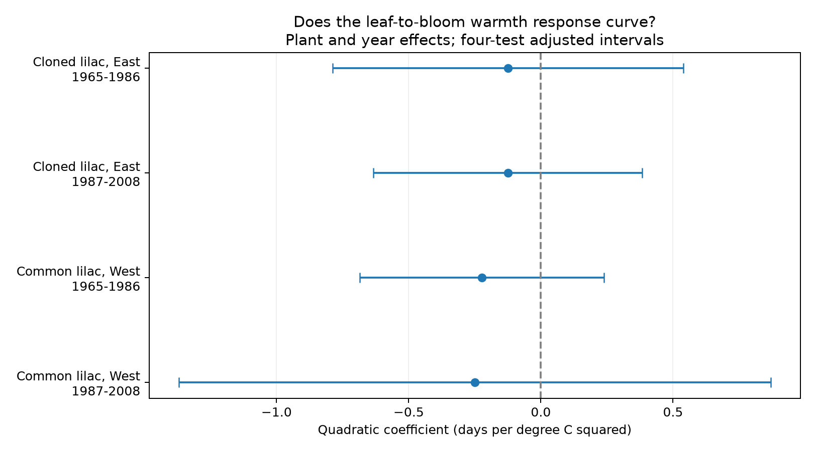

# A curved spring warmth response of US lilac leaf-to-bloom gaps was uncertain in four samples from 1965 to 2008

The four primary tests did not establish a curved response of the leaf-to-bloom gap to spring warmth. Each estimate was negative. Each interval for uncertainty included zero after correction for four tests. This does not show that the response is linear or absent.

## Question and prior work

The time between first leaf and first bloom can change when the two events have different temperature responses. This interval can affect the sequence of plant growth and reproduction. It is not a measure of flower supply, seed production, or pollinator mismatch.

Ma et al. (2021, doi:10.1111/1365-2745.13558) found longer intervals under warming in four European tree species and examined chilling and day length as explanations. The later study, “Climatic drivers and ecological implications of variation in the time interval between leaf-out and flowering” (doi:10.1016/j.cub.2023.06.064), also examined unequal phase responses. These studies motivate a test in US shrubs; they do not predict our coefficient.

We searched signed campaign results before selecting the final question. We read SCI a25494dd25de9765891868574ff46d20757fd95f4a06bb7c603baa4a3460baf8, a6bd7c1e84535d597843343c4a01f2a4bd059556507d1a74452d47094cc7f060, and 6c7d6feb8127fb07551b404bfe5a8da7e3621b9bb73e024ffc20967f33da7622. The first study tested linear leaf-to-bloom slopes. The second tested first-to-full bloom gaps and report presence. The third tested gaps between fixed sites. We changed our initial linear question after this search. Our question is whether a squared spring-temperature term adds a common response across regions and periods. We rebuild the panel from the same public archive. This is a new analysis of overlapping data, not independent validation of those publications. Choices were recorded before model fitting in files/design.txt. This is exploratory work, not a registered test.

## Data and observation controls

We use the USA-NPN v13 lilac and honeysuckle workbook and its v14 field descriptions. Rosemartin et al. (2015, doi:10.1038/sdata.2015.38) describe the data and observation methods. We retain historic programs 7 and 8, years through 2008, valid US states and sites at 24-50 N and 66-125 W. We select common lilac (species 36) and cloned lilac (species 35). First leaf uses phase 76. First bloom uses phase 77 for cloned lilac and phase 412 for common lilac. We choose these dominant historic phase definitions separately. We do not merge the two first-bloom definitions.

Dates must be on day 1-240. We pair records on site, individual, species, and year. The builder takes the earliest date if duplicates exist; no final paired row has duplicate phase records. A plant must have at least ten paired years in the 1956-2008 build window. The resulting panel has 6,162 pairs: 2,904 cloned and 3,258 common lilac pairs. Actual coverage starts in 1961 for cloned lilac and 1967 for common lilac. No selected gap is negative or above 90 days. Flagged records remain in the primary sample because some flags use climate context.

The test uses cloned lilac east of or at -100 longitude and common lilac west of -100, in 1965-1986 and 1987-2008. A plant needs at least five paired years within a tested period. This gives 5,715 plant-years. Regions and periods have separate observations, but share large-scale weather and monitoring methods. Some plants occur in both periods. Taxon and region are confounded, so the two regions are tests in different settings, not matched taxon replications.

Temperature data were provided by NOAA PSL, Boulder, Colorado, USA. We use the shared GHCN CAMS monthly surface-air temperature file, version 3.01. We extract the nearest 0.5-degree grid cell, convert Kelvin to C, and average monthly means with equal weights. Spring is February-April (FMA); winter is the preceding December-February (DJF). These windows overlap in February. The alternate spring window is March-April.

files/provenance.json records the exact shared and resolved paths, source URLs, versions, sizes, and SHA-256 hashes of the three files used. We reused shared raw data in place. No download or shared-data change was needed. The paired panel preserves the keys, dates, locations, flags, and seasonal weather needed for model inspection.

## Model and uncertainty

For each plant, let x be FMA temperature minus its mean over all paired years in the full build panel. This baseline uses observed years, including years outside the model period. It is a retrospective reference, not an independent climate normal. The quadratic term is x squared. Within each sample we fit:

`bloom day - leaf day = plant effect + year effect + b1*x + b2*x*x + b3*DJF + error`.

The target is b2, in days per C squared. The local slope at anomaly x is b1 + 2*b2*x. Thus negative b2 means that the gap-temperature slope falls as seasonal warmth rises. It does not by itself mean that warm springs have shorter gaps. We do not interpret a fitted curve outside the observed range.

Plant effects remove fixed plant and site differences. Year effects remove annual changes shared within the sample. These controls reduce bias from changing site coverage and common annual conditions. They do not remove weather-dependent visits, plant replacement, age, site care, or selective missing reports. Requiring long records selects plants and observers. Pairing can add selection when one event is missing.

We remove plant and year means by repeated projection, then solve least squares. Uncertainty uses state and year cluster score variance, with their intersection subtracted. We apply the common factor `(n-1)/(n-K) * G/(G-1)`, where K counts the estimated slopes and absorbed effects and G is the smaller state or year count. Intervals use a t reference with G-1 degrees of freedom. Four 98.75% marginal intervals give nominal 95% coverage for the four primary b2 tests by the Bonferroni rule. This is an approximate cluster method, especially with ten states in the later West. It does not protect against all spatial dependence across states and years.

A separate sparse regression with explicit plant and year indicators reproduces the four primary coefficient vectors to within 3.5e-10. On the same rows, bloom curvature minus leaf curvature equals gap curvature to within 2.3e-16. A separate statsmodels cluster calculation agrees with the primary covariance matrices to within 2.4e-15. These checks test the calculation, not the causal assumptions. files/verification.json preserves the checks.

## Results

| Sample | Period | Pairs | Plants | States | b2, days/C squared | Adjusted interval |
| --- | --- | ---: | ---: | ---: | ---: | --- |
| Cloned lilac, East | 1965-1986 | 2106 | 145 | 22 | -0.124 | -0.788 to +0.539 |
| Cloned lilac, East | 1987-2008 | 635 | 48 | 13 | -0.125 | -0.633 to +0.383 |
| Common lilac, West | 1965-1986 | 2540 | 188 | 12 | -0.223 | -0.685 to +0.239 |
| Common lilac, West | 1987-2008 | 434 | 58 | 10 | -0.250 | -1.370 to +0.870 |

The estimates range from -0.250 to -0.124 days per C squared. The intervals permit positive and negative curvature. The later western interval is especially wide. No equivalence test was done. A common sign is not proof of a common response, since the samples share weather and archive methods.

Checks omit winter, use March-April warmth, give each plant equal total weight, add plant trends, remove flagged records, or add squared winter anomaly and spring-by-winter terms. All checks use the same four-test interval rule within each variant, but the entire set of variants has no joint coverage guarantee. They are exploratory.

The primary-temperature checks leave all four intervals crossing zero. The March-April check gives negative b2 intervals in the two early samples: -0.602 (-1.054 to -0.150) in the East and -0.548 (-1.060 to -0.035) in the West. Later estimates are +0.021 and +0.209, with intervals that include zero. Thus the early pattern depends on the window and does not repeat later. It is a lead for another test, not a confirmed general result. The phase-date decomposition also has some negative individual intervals; it does not establish a repeated change in the separation between the phases. All coefficients and intervals are in files/curvature_results.csv.

## Meaning and limits

These data do not establish a common curved link between seasonal warmth and the leaf-to-bloom gap. They do not rule out useful departures from a linear model. Different chilling needs, day length, moisture, and temperature timing could change the two phase responses. Winter adjustment and a winter surface check do not identify these mechanisms.

Monthly means smooth short hot or cold events. FMA includes weather after leaf emergence for some plants, and sometimes after bloom. It is not a strict pre-event exposure, a measure of the weather between phases, or a forecast test. A quadratic mean-temperature term does not measure heat waves, frost, or physiological thresholds. Gridded weather can miss site conditions. Observation dates can lag true events; legacy visit schedules are not available here. Temperature error and correlated reporting errors can alter curvature.

The sample consists of selected planted shrubs, not a probability sample of native vegetation. The later samples are much smaller. Fixed effects do not solve unmeasured time-varying bias. We do not estimate air pollution effects, species distributions, community diversity, or a causal effect of human-driven climate change. A stronger test needs daily local weather, documented visits, stable plant identities, and new regions with matched taxa. It should separate chilling, forcing, and frost rather than treat a seasonal square term as a mechanism.

## Reproduction and worker record

Run `python work/result/files/fit_curvature.py` from the worktree root for offline model reproduction. Run `python work/result/files/build_panel.py` first for a raw-data rebuild. files/REPRODUCE.txt gives paths, dependencies, retrieval and hash checks. The package includes the derived panel, code, all results, figure, design record, source provenance, environment, audit, and numerical checks. Source data retain their original terms; the baseline license covers our additions.

Campaign: 11_07_2026. Job: sci-1107-syam2-climate-pollution-biodiversity-5822d8aa067b. Topic: climate-pollution-biodiversity. Machine: syam2. Account: codex-myxtap. Model: gpt-6.1-sol with high reasoning effort, through T3 Code and the Codex harness. Analysis date: 2026-11-08 UTC. The campaign-machine key is not a personal authorship claim. This publication is stored locally, with no remote submission.
