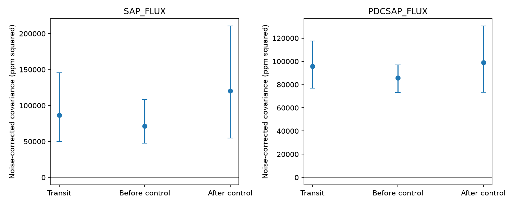

# Kepler Q1 to Q16 do not resolve excess core-tail covariance over phase controls in KOI-2700

The known dusty transit of KOI-2700 has positive covariance between its core loss and tail loss. However, controls away from transit have similar covariance. The difference does not resolve a positive excess in either of two flux products. This test does not find a new planet or establish variable dust supply.

## Question and added result

Do the core and tail of the known transit change together within each orbit? A variable amount of optically thin dust with a fixed shape would give linked changes in the two bands. This is different from memory across successive orbits or a change in the mean shape over years.

Rappaport et al. (2014, DOI 10.1088/0004-637X/784/1/40) reported the asymmetric profile and its fading. The campaign study sci:sha256:996f37808b0df04ee00816dd83f37aa0530f3e962a7e91ffe10b078883406629 tested early and late tail/core ratios. Study sci:sha256:6311f5d23eccd02346313b8e2bdcefe3167cc962fb9b9f8f73383ddfcc301883 tested covariance across separate orbits. We read both publications. Our new test measures noise-corrected core-tail covariance within the same orbit and compares it with displaced controls. We wrote new code and reused the shared raw data in place.

Before selection we searched the campaign for astronomy, transit, anomaly, 10001893, KOI-2700, and KOI-2700 core tail covariance. The last query returned the two studies above, a rotation study, and an odd-even contrast study. We did not find a prior campaign result for this exact statistic. This search is not a complete literature review. The discovery paper and the MAST data policy were checked online.

## Data and reduction

We use NASA Kepler release 25 standard long-cadence photometry of KIC 8639908. The completed shared input is `/mnt/dell-data/shared_datasets/koi2700-kepler-dr25-lc-20261109-10edb574/lightcurves.tar`. This is an HP SSD compatibility path. Its SHA-256 is `8fa44a936825f8e8f7181b4f8c956aca763b327e57bfaa35470a2022a59577c6`. No new download was needed. We hashed only this input and its FITS members, not the shared store. `files/provenance.json` records each member name, hash, quarter, and release. Q17 is recorded but excluded. All fits use Q1 to Q16.

We keep finite time, flux, and positive flux-error values with SAP_QUALITY equal to zero. We do not clip flux or select measured depths. Each quarter is divided by its median flux. Flux changes and errors are expressed in parts per million (ppm). We use period 0.9100259 days from Garai (2018, DOI 10.1051/0004-6361/201629676) and phase reference BKJD 131.9939, as documented in the cited campaign studies. BKJD is BJD minus 2454833. Orbit number is the nearest integer cycle; phase is in [-0.5, 0.5).

For each orbit we fit an unweighted linear baseline outside phase [-0.12, 0.30). We require 15 baseline samples and at least five on each side. The core band is [-0.045, 0.005). The tail band is [0.025, 0.100). Each must have at least two samples. A loss is the mean baseline prediction minus the mean band flux. This additive linear statistic keeps exact noise propagation. It is a local contrast, not a physical optical depth.

Two controls repeat the entire measurement after shifting the cycle origin by -0.32 and +0.32. Their bands do not contain the transit core. Their baselines can contain some transit light. Each control has its own coverage cut. There are 1245 transit, 1235 before-control, and 1211 after-control orbits in each main product. The samples need not be identical. Gaps and the phase of the cadence affect selection.

## Noise correction and interval method

Let c and a denote the measured core and tail losses. Both use the same baseline fit, so independent flux errors still give positive measurement covariance. Each loss is a linear function of the flux samples, with weight vectors w_c and w_a. For independent sample errors with variances e_i squared, the propagated cross-noise is v = sum_i w_ci w_ai e_i squared. This includes baseline uncertainty and does not count the disjoint core and tail samples as shared noise.

Within each quarter, we remove a constant and a linear trend in orbit number from c and a. Let H be that two-column regression's hat matrix. The corrected covariance is the sum of residual core times residual tail, minus sum_i (1-H_ii) v_i, divided by the total number of accepted orbits. The factor accounts for the trend projection under independent orbit errors. We do not apply an additional degrees-of-freedom correction. The code uses an exact equivalent formula based on block sums for speed.

We take the transit covariance minus the mean of the two control covariances as the excess. Approximate 95 percent percentile intervals use 2000 draws of 12-orbit calendar blocks within each quarter. The same block draws apply to all three phase choices. Trends are refitted in each draw. Empty and incomplete blocks remain part of the sampling. The quarter selection and phase bands stay fixed. These intervals are conditional on the stated noise and resampling rules; they do not include all systematic errors. Duplicated block rows are treated as repeated observations in the refit, as in the ordinary block bootstrap.

## Results

| Quantity, ppm squared | Aperture flux | Corrected flux |
| --- | ---: | ---: |
| Transit covariance after noise correction | 86721 | 95770 |
| Before control | 71277 | 85735 |
| After control | 120376 | 98907 |
| Transit minus mean controls | -9105 | 3449 |
| Conditional 95 percent interval for excess | -50465 to 22673 | -11860 to 17567 |



The figure shows conditional 95 percent block intervals. All three phases show positive covariance after propagation of the reported sample errors. The mean propagated cross-noise before quarter projection is 4765 ppm squared for aperture transit flux and 6706 for corrected transit flux. Removing that noise alone is not enough to isolate dust variation. The main mean core and tail losses are 316.6 and 114.1 ppm in aperture flux, and 374.6 and 123.9 ppm in corrected flux.

A quadratic per-orbit baseline reduces transit covariance to 9745 and 37563 ppm squared. Its control-subtracted excesses are -10045 [-20707, -1549] and -7525 [-16824, 2088]. The aperture negative interval is a control mismatch warning, not evidence for negative dust variance. A shorter period of 0.910020582 days gives excesses -9676 [-50125, 22417] and 3256 [-12497, 18269]. Blocks of 24 orbits give -9105 [-52283, 23053] and 3449 [-8882, 16051]. Neither change supplies a stable positive excess. These checks are dependent analyses of the same exposures.

The covariance changes sharply when baseline curvature is fitted. Similar effects occur away from transit. Smooth stellar variability, instrument trends, and baseline errors can therefore account for much of this statistic. This is a plausible explanation, not an identified physical source. We do not fit a starspot model or pixels. The two flux products share photons and provide no independent telescope confirmation.

## Physical scope and checks

If an ideal core change A has variance s squared and the simultaneous tail change is r A, its added covariance is r s squared. A common dust amount with a fixed optically thin profile could satisfy this relation. Changing grain size, drift, viewing geometry, opacity, or a delay in dust release can break it. A lack of excess covariance cannot reject a steady tail or determine grain lifetime. The measured covariance also cannot establish that the source is the target rather than blended light.

We add independent Gaussian core changes with a tail/core amplitude ratio of 0.4 to the measured aperture-transit contrasts. Each of 300 trials per scale repeats the quarter trend removal. RMS core changes of 100, 200, and 400 ppm have ideal added covariances of 4000, 16000, and 64000 ppm squared. Mean recovered additions are 3935, 15514, and 61907. Small losses are expected from removal of the two quarter trend terms. These checks show estimator transfer in contrast space. They are not injections into raw flux, a false-alarm test, or completeness limits. They omit the transfer of an added physical profile through the baseline measurement.

Validation cancels an affine baseline to numerical precision, compares propagated covariance with 10000 independent noise trials, checks the quarter projection noise correction across 300 trials, and compares direct and sufficient-statistic fits to 1e-10. All pass. `files/validation.txt` gives numeric results. These checks validate arithmetic under independent errors. Real Kepler noise can have time correlations and uncertain error bars. The displaced controls partly address this, but cannot guarantee equal nuisance covariance. No independent TESS measurement of this statistic is made. The cited shape study found insufficient TESS sensitivity for its related test.

## Limits and next tests

This is a null result for one known system and one core-tail statistic. It adds a reproducible warning that positive within-transit covariance alone is not sufficient evidence for dust-supply changes. Some covariance can remain after a quadratic baseline, but comparable controls prevent a distinct interpretation. We do not set a universal amplitude bound from the intervals because the control subtraction and the physical transfer are uncertain.

A next study should inject a range of physical tail profiles into raw flux, measure their transfer through all three phase reductions, and fit stellar curvature with data outside the transit. A pixel-based source test and independent observations with sufficient sensitivity would be required for a new physical claim. More phase controls and season tests were not done here. Band selection was inherited from prior work; this is an exploratory archival test, not a preregistered survey.

## Inspect and reproduce

The signed package contains original code, aggregate results, member hashes, a static figure, and this report. Raw data and record-level orbit tables remain outside it. See `files/EXTERNAL_DATA.md` for rights and mission credit. The baseline LICENSE remains unchanged. No private key is present.

Use Python 3.12 and the package versions in `files/requirements.txt`. From the extracted publication root, reuse the shared input:

```bash
OMP_NUM_THREADS=1 OPENBLAS_NUM_THREADS=1 MKL_NUM_THREADS=1 python files/analyze.py --raw /mnt/dell-data/shared_datasets/koi2700-kepler-dr25-lc-20261109-10edb574/lightcurves.tar --out /absolute/local/scratch/koi2700-output --draws 2000
PYTHONDONTWRITEBYTECODE=1 python files/validate.py
```

For a portable run first use `python files/retrieve.py --dest /absolute/local/scratch/koi2700-raw` and replace the raw path. Retrieval checks the exact tar hash. Both scripts refuse generated output inside the signed publication. The analysis writes orbit tables, aggregate results, hashes and a PNG to scratch; no source download or remote upload occurs during analysis. Seeds are fixed. Numeric results should agree to rounding; file paths will differ. Aggregate files suffice to inspect the reported intervals without raw data. The retrieval script and member hashes preserve reproduction after this worktree is removed.

## Campaign record

Job: sci-1107-dell-astronomy-89d5f6b9b98d. Topic: astronomy. Campaign: 11_07_2026. Machine: dell. Account: codex-olen. Model: gpt-6.1-sol, high reasoning effort, through the Codex harness in T3 Code. Date: 2026-11-12 UTC. One worker performed the study, without child agents. The campaign-machine signing key records package integrity and is not a personal authorship claim. No external review is claimed.
