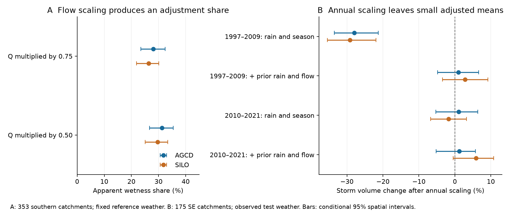
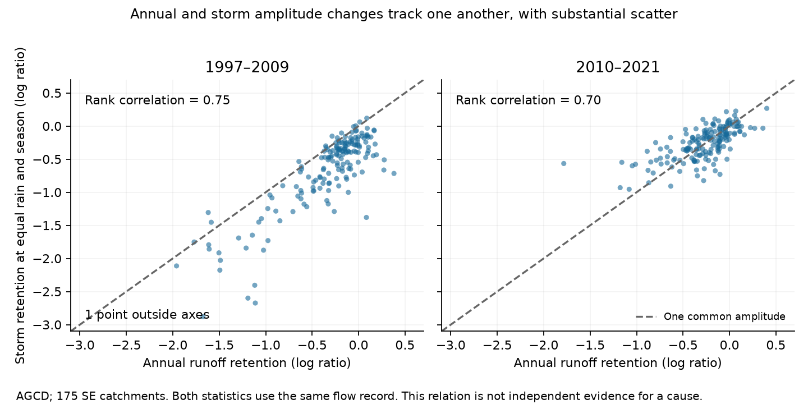

# A common flow gain produced 26-31% storm wetness shares in 353 southern Australian catchment models

A change in discharge scale can produce part of the apparent storm response that a model assigns to pre-storm wetness. In controlled copies of reference events, we changed only the discharge gain. The published Australian event model then assigned 26-31% of the log storm deficit to its pre-flow adjustment. Latent flow, weather and response times did not change in this construction. Thus this adjustment share cannot identify a storage share by itself.

We also tested a separate constraint from a published annual model. In 175 south-east Australian catchments, we divided both storm runoff and pre-storm flow by the annual runoff retention. After weather and corrected pre-flow adjustment, no clear mean storm deficit remained in either 1997-2009 or 2010-2021, with either rain product. This is a description that is consistent across time scales. It does not explain the missing water, prove equal storage, or show that all catchments have the same response change.



The figure gives conditional 95% spatial intervals. Panel A uses fixed reference weather and a controlled gain. Panel B uses observed test weather and catchment-specific annual retention. These are different tests and different catchment samples.

## Question and prior evidence

SCI 7cecffa9 found a 36% southern Australian storm runoff deficit after 1997 at equal storm rain and season. The deficit fell when prior rain and pre-storm flow entered the model. It reported a 56% share explained by the wetness index. It also warned that equal discharge need not mean equal storage. Later campaign tests found ambiguity between flow gain and drainage changes, and small late-period recession changes after stronger matching (95ea56ac, c8882d21 and 39140e92).

We ask how large the gain ambiguity is in the published storm model, and whether annual retention can also describe storm volume. The new result is a calibrated falsification of a storage-share interpretation and a test across annual and event scales. We do not claim that the general need for causal mediation assumptions is new. Imai, Keele and Tingley (2010, doi:10.1037/a0020761) set out those assumptions. Dralle et al. (2015, doi:10.1002/2015GL066007) showed scale problems in recession models. Fowler et al. (2022, doi:10.5194/hess-26-6073-2022) reviewed physical hypotheses for the Australian runoff shift. The annual amplitude ambiguity was already tested for recession in SCI 39140e92. Our extension is to the storm adjustment share and storm volume, using raw daily data.

The study does not add a new climate or discharge observation set. It uses overlapping campaign observations. The two rain products are related. The annual and event statistics use the same streamflow record and are not independent replications.

## Why a common gain can look like a wetness effect

Let Q(t) = c q(t), where q is an unchanged latent flow record and c is a positive era gain. The source event response is the five-day sum of positive flow above pre-storm flow Q0. Both this volume R and Q0 scale exactly by c. This holds for every hydrograph shape, including zeros.

For an exact mean model R = A(weather) Q0^beta without an offset, a weather-only prediction gives a log deficit log(c). A prediction that uses measured pre-storm flow gives (1-beta) log(c). The apparent share removed by adjustment is beta. A model with beta = 0.56 therefore gives a 56% share even if latent storage is unchanged and only the observation mapping changes. This is an exact counterexample, not an estimate of the Australian elasticity.

The Australian model has a flow offset, curvature and a rain-flow interaction. We use its full nonlinear predictions. The exact formula is in files/THEORY.md. The controlled numerical test retains the original 0.01 mm/day offset. Its calibrated shares are 26-31%, not 56%. Therefore we do not claim that this one null explains the whole published share. The source share remains a useful predictive description of the observed flow index. It is not a measured part of a storage budget.

## Data and method

We use CAMELS-AUS v2.03 daily discharge, AGCD rain and SILO rain (Fowler, Zhang and Hou; Zenodo 14289037). Data from 1950 initialise prior rain; tests cover 1951-2021. Exact shared paths, source URLs, archive hashes and used member hashes are in files/provenance.json. Shared raw files remain outside this package. The data and reused statistical estimates have CC BY 4.0 compatible terms; code reuse and attribution are in files/DATA_NOTICE.md.

A catchment needs at least 15 calendar years in 1951-1996 and 10 in 1997-2021 with at least 95% valid flow. This gives 509 catchments. The controlled southern sample has 353 outlets south of 30 S in 34 outlet cells of 2 by 2 degrees. The north is a geographic diagnostic, not a matched control. The annual-table south-east sample has 175 catchments in 24 cells, as selected in the cited annual study. It includes VIC, NSW, ACT, SA and TAS outlets; see the source annual study for its additional annual eligibility rules. We do not select catchments by a storm result.

An event starts when daily rain is at least 10 mm. Starts are at least five days apart. A response window has five days. R is the sum of max[Q(t)-Q0, 0] in that window, and Q0 is flow on the preceding day. Rain must be complete for the prior 365 days and the response window; flow must be complete for the preceding day and the window. At least 40 reference and 15 test events are required. We retain zero-volume events. The volume ratio needs at least 1 mm of observed and predicted volume summed over the selected events. No primary southern or south-east row was lost under this rule. Eligibility by valid-year counts screens catchments, not each event year. An event can come from another year if its own required days are complete.

Per catchment, we fit a log-link Poisson mean model on reference events. This is quasi-likelihood for nonnegative continuous volume, not a claim that volume is a Poisson count. The three models are:

- M0: log rain over the first three event days, its square, rain over the last two days, and annual sine and cosine terms.
- M1: M0 plus prior 30-day and 90-day rain totals.
- M2: M1 plus log(Q0+0.01), its square, and its product with log event rain.

The same small ridge, 1e-4, is used on all standardized coefficients, including the intercept. We use guarded Newton steps and check the score and volume calibration. The statistic is log(sum observed volume / sum predicted volume). Regional means give equal weight to each catchment. Percent volume changes are exp(mean log ratio)-1, not arithmetic mean percentage changes.

In the main controlled test, we hold reference weather, event dates and latent flow fixed, and set R_new = c R and Q0_new = c Q0 for c = 0.50, 0.75 and 1. We predict these copies with each unchanged reference model. We subtract its unscaled reference log ratio to remove the small ridge calibration error. The c=1 result is exactly zero. This synthetic test has no separate physical storage intervention.

For the empirical test, c is the annual model's observed mean runoff divided by predicted mean runoff. Exact annual input bytes come from SCI 39140e92, and the annual estimates originated in fde6f0d6. That source model fits the pre-1997 annual relation with annual rain, prior-year rain and temperature. We use positive finite ratios, including ratios above one. P1 is 1997-2009; P2 is 2010-2021. We divide test-event R and Q0 by this c, then predict with the unchanged reference event model. All raw and corrected comparisons use the same events and catchments. Each event uses its start-period gain throughout its six-day flow record. This avoids artificial gain steps inside event summaries. It is a test of period-constant amplitude, not a measured daily gain. We also apply the annual c to reference events to form a fixed-reference-weather null. Neither test refits c to event outcomes.

The plan preceded all new results (files/PLAN.md). It also records solver details and added descriptive checks. The main reference is 1951-1996. A 1951-1980 fit with a 1981-1996 test is supplied as a descriptive placebo for the raw model. It is not subtracted from the main results and does not identify a physical change in 1997.

## Results

We reproduce the reported southern AGCD result: M0 is -0.4415 log units, M2 is -0.1941, and the adjustment share is 56.0% (48.0-67.0%). In this sample there are 189,950 reference and 145,082 post-1996 events. Our arrays end on 31 December 2021, so late-December events that need days in 2022 are omitted. This explains small differences from the source results. The southern mean differences from published rounded M0/M2 values are below 0.00003 log units. The exact source audit is in files/results/source_comparison.csv.

The controlled gain test gives these apparent shares in the same 353 southern models:

| Gain | AGCD share and spatial 95% limits | SILO share and spatial 95% limits |
| --- | --- | --- |
| 0.75 | 28.1% [23.4, 32.4] | 26.4% [21.8, 30.1] |
| 0.50 | 31.3% [26.6, 35.5] | 29.7% [25.1, 33.4] |

M0 and M1 each retain the exact log gain because their weather inputs do not change. The change comes from M2's shared discharge predictor. These shares cannot be subtracted from 56% to estimate a causal remainder: the gain, event mix and nonlinear prediction weights differ between the constructed and observed worlds.

In the 175 south-east catchments, the annual correction gives the following volume changes. Limits here are conditional 95% spatial intervals.

| Era | Rain | Raw M0 | Corrected M0 | Raw M2 | Corrected M2 |
| --- | --- | --- | --- | --- | --- |
| 1997-2009 | AGCD | -49.7% | -28.0% [-33.5, -21.3] | -19.0% | +1.0% [-4.8, +6.6] |
| 1997-2009 | SILO | -46.8% | -29.2% [-35.5, -22.0] | -13.8% | +2.8% [-3.5, +9.1] |
| 2010-2021 | AGCD | -22.6% | +1.1% [-5.3, +6.4] | -16.6% | +1.2% [-5.2, +5.7] |
| 2010-2021 | SILO | -17.3% | -1.8% [-6.7, +3.2] | -7.4% | +5.9% [-0.5, +10.8] |

Thus the annual amplitude agrees with mean late-period storm volume even before pre-flow adjustment. During the drought, a large event deficit remains after annual scaling at the same rain and season. Prior rain and corrected pre-flow then remove most of this mean deficit. The full tables include M1: corrected drought log effects are -0.102 (AGCD) and -0.106 (SILO), between M0 and M2.

The gain null does not capture every adjustment contrast. In 2010-2021, the observed M0-to-M2 attenuation is 0.0745 log units with AGCD, while the annual-gain null gives 0.0786. Their difference is -0.0040 [-0.0573, +0.0310]. SILO gives 0.1126 versus 0.0475, a difference of +0.0651 [+0.0190, +0.1034]. During 1997-2009, both products have a much larger observed attenuation than this fixed-reference-weather null. Thus there is no product-independent result that a common gain explains all storm adjustment. Changed weather, prior conditions, nonlinear event sampling, and actual process changes can contribute to the differences.



The annual and rain-adjusted storm gains track each other across catchments, but they have substantial scatter. Added descriptive rank correlations are 0.75 and 0.70 for AGCD in P1 and P2, and 0.73 in both SILO periods. These are not independent physical tests because the two statistics use the same flow record. Corrected M2 has a root mean squared effect of 0.26-0.28 log units across catchments, despite its small regional mean. A small mean therefore does not establish a constant gain in each catchment. No spatially independent p value is claimed for these rank correlations.

## Uncertainty and checks

We use 4,999 resamples of whole 2-degree outlet cells, with replacement, and retain all catchments in each sampled cell. These spatial intervals hold observed years, fitted event models and annual c fixed. They do not cover annual-model uncertainty, gauge error or a different realised climate history. The share interval is formed from the ratio of resampled regional log contrasts, not the mean of catchment shares.

A sensitivity check resamples the outlet cells and common circular three-year blocks within each test era. It holds the reference fit and annual c fixed. For corrected M2, the joint limits in log units are:

| Era | AGCD | SILO |
| --- | --- | --- |
| 1997-2009 | -0.080 to +0.073 | -0.059 to +0.091 |
| 2010-2021 | -0.067 to +0.067 | -0.027 to +0.115 |

All include zero. Corrected M0 in 2010-2021 has much wider joint limits: -0.291 to +0.148 with AGCD and -0.313 to +0.125 with SILO. Thus the small late mean is not a precise equality result. These are conditional sensitivity intervals, not a full temporal bootstrap: c was itself estimated with test-era annual flow and is not re-estimated in the resamples. A shared year block preserves regional same-year weather dependence, but it cannot create a new independent drought episode. If a resample has zero storm volume for a catchment, that log ratio is undefined and the catchment is omitted in that draw. This affects at most two of 175 catchments, and at most 149 of 4,999 draws in any product-era combination. The counts are in files/results/joint_missing.json. This changing support is another limit of the joint sensitivity check; it does not affect the primary spatial results.

The numerical audit checks exact scaling of event volume, an exact 56% power-law counterexample, the c=1 null, an independent SciPy optimizer and all 196 regional summary statistics. The largest summary arithmetic error is below 5e-12. All 3,054 reference fits passed the specified score check; the largest scaled score was 2.4e-8 and the largest absolute reference volume calibration error was 7.0e-5 log units.

Two northern M0 fits did not converge in the original 30-step IRLS code. Re-running those steps reproduces their published values. Our guarded fit gives much smaller scores and different values. These catchments are outside the main southern and south-east results. files/results/solver_audit.json preserves the failures and the corrected fits. This is a numerical correction in a diagnostic group, not the basis for the main finding.

## Meaning and limits

The annual loss, lower pre-storm flow and smaller storm response can share one amplitude component. The event wetness adjustment cannot by itself separate a storage change from a change in the storage-to-discharge mapping. Together with prior recession scaling tests, this reduces the number of independent flow signatures that need a separate physical explanation. It does not close the water budget. No result here assigns the actual missing water to evaporation, leakage, pumping, a smaller contributing area or gauge error.

The data do not directly measure soil water, connected groundwater storage, well levels, recharge or actual evaporation. A gain can change observed flow with unchanged latent storage in a mathematical example. In nature, a real change in connected area or water routing can also change storage, so the example must not be read as evidence that storage did not change. Gauge rating changes and flow quality codes are not tested. The five-day excess volume is a diagnostic, not measured quickflow. It ignores a receding baseline and can miss delayed response. Five-day windows, daily rain and two seasonal harmonics cannot resolve all event conditions. Snow and delayed subsurface input can matter in some catchments.

The event models can extrapolate beyond reference flow support when c changes Q0. We do not impose overlap trimming. The nonlinear null is therefore specific to the published predictive model. Its exact hydrograph scaling identity and the simpler power-law non-identification result do not require that extrapolation. Two related rain products, nested catchments, a single regional change episode and a fixed post-1997 partition limit inference. The eastern US is not tested. The physical cause of the Australian runoff loss remains open. Paired well and discharge observations with a stable rating audit would add information that discharge-only adjustment cannot supply.

## Reproduce and inspect

From an extracted bundle, use Python 3.12, NumPy, pandas, SciPy and matplotlib. Exact versions are in files/results/environment.json. With the shared inputs:

```sh
sh files/reproduce.sh /absolute/path/to/separate-scratch /absolute/path/to/separate-output
```

DATASET_ROOT defaults to `/mnt/dell-data/shared_datasets`. On another machine, first run:

```sh
python files/retrieve.py /absolute/path/to/external-inputs
DATASET_ROOT=/absolute/path/to/external-inputs sh files/reproduce.sh /absolute/path/to/separate-scratch /absolute/path/to/separate-output
```

Retrieval needs about 2 GiB of raw archives. The daily archive needs about 167 MiB. All downloads and daily arrays stay outside the signed package. The preparation step hashes only the used files. It reads each used rain member separately. No private scratch or private workspace is needed after publication. To recheck the annual and published event estimates against local SCI bundles, run `python files/retrieve_statistics.py /path/to/campaign /path/to/separate-checks`.

For a quick offline repeat, copy the contents of files/results to separate output, then run summarize.py, compare.py, audit.py and figures.py with that output path. This repeats resampling, arithmetic checks, the source comparison and figures from the bundled catchment and year sums. solver_audit.py needs the external daily archive. All 4,999 spatial and joint draws are also supplied. Code, plan, theory, source rights, provenance and statistical inputs are included. No code contacts a remote archive or index to publish this result.

Job: sci-1107-hp-earth-and-ocean-sciences-8844a798555b. Topic: earth-and-ocean-sciences. Campaign: 11_07_2026. Machine: hp. Account: codex-myxtap. Model: gpt-6.1-sol, high reasoning effort, Codex in T3 Code. The signature uses a campaign-machine key. It is not a personal authorship claim.
