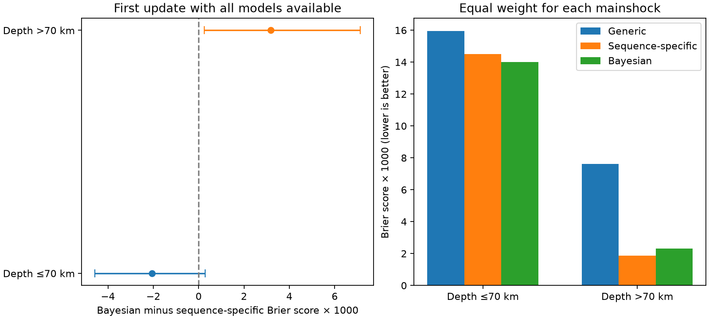

# The generic prior raised first-update Brier error for 30 deep USGS aftershock sequences in 2024-2026

## Result

The generic prior did not help all USGS aftershock forecasts in the same way. For 30 mainshocks deeper than 70 km, the first archived update with both models had a mean Brier score of 0.008545 for the issued Bayesian model and 0.005366 for the sequence-specific model. The prior raised the score by 0.003179, or 59%. Lower scores are better. A bootstrap by mainshock gave a 95% interval of 0.000248 to 0.007135 for the difference. The median update was 4 hours after the mainshock. These events occurred from November 2024 to October 2026.

This is a paired audit of an existing data set, not an independent replication or a pre-registered test. The two models use the same observed sequence, circle, issue time, target window, and magnitude threshold. The model comparison isolates the effect of the generic prior within the archived model system. It does not isolate the physical cause of low recorded aftershock rates.

Left: first available paired update, with mainshock bootstrap intervals. Right: all available paired updates. Each mainshock has equal weight. A positive difference means that the Bayesian model had more error than the sequence-specific model.

## Question and prior work

The selected campaign publication, sci:sha256:1f633d0c50c92a779861de007b71513598d984cb9ae0370740808e59eb926056, found near-calibration after updates for shallow mainshocks, few recorded aftershocks after deep mainshocks, and low counts in small Guam-Marianas circles. It compared generic, sequence-specific, and Bayesian models, and reported score tables by depth. Thus the broad model differences are not new here.

We extend that work with a paired depth contrast, a first-update comparison, an exact score decomposition, and tests of influence. The new question is whether the generic prior helps when the sequence has low observed activity. We first explored equal-mainshock calibration and model scores. We then chose this depth comparison and added sensitivity checks. All reported intervals are exploratory; we did not hold out sequences or adjust for the choice of contrasts.

USGS describes the sequence-specific distribution as a normalized likelihood over a grid of productivity values. Its Bayesian model multiplies that likelihood by the generic prior. The other rate parameters are usually held fixed. The prior thus changes predictive probabilities without adding new observations. USGS also warns that sequence-specific uncertainty can be too small. The global prior method comes from Page et al. (2016), doi:10.1785/0120160073. The official background page explains its use. Prior work already studies low-productivity sequences; we make no claim to have first found that a prior can hurt.

## Data and fixed scope

We use the source publication's verified paired table, with 153,538 rows for 237 mainshocks. There are 207 mainshocks at depths of 70 km or less and 30 deeper mainshocks. All rows contain all three Reasenberg-Jones model variants. ETAS forecasts are excluded because they have no matching three-model archive. All issued probabilities equal the Bayesian probabilities in this paired set.

Each row is a mainshock, version, window and magnitude threshold. Windows are 1 day, 1 week, 1 month and 1 year. All windows ended by 1 November 2026. Magnitude thresholds are at or above the completeness magnitude used by the source audit. The binary outcome is one or more ComCat earthquakes inside the stated circle and window. The source counts events at threshold minus 0.05 magnitude units. We do not change this rule or infer that the stated completeness level is exact.

The deep group has 11 Alaska and 19 Guam-Marianas mainshocks. The source event table assigns all 30 to generic or on-shore subduction priors. The source's larger issued-forecast set had 31 deep mainshocks; one has no paired RJ archive. The shallow paired group also differs from the source's full shallow set. This is a fixed subset test.

## Methods

For probability p and binary outcome y, the Brier score is (p-y)^2. We average row scores within each mainshock, then average those mainshock means. We apply the same weights to both models. This avoids giving a mainshock more weight only because it has more archived updates or target bins. Nested bins and overlapping windows remain inside the mainshock block.

We draw mainshocks with replacement 10,000 times within each depth group (seed 20261111). For the all-update depth contrast, we subtract independently resampled shallow differences from deep differences. The intervals are percentile intervals, conditional on treating mainshocks as independent. They do not account for dependence between nearby sequences.

We use raw probabilities for the Brier score. The supplementary log score clips probabilities to [0.0001, 0.9999]. The first paired update is the smallest version index with all three variants for each mainshock. It is not the first issued generic forecast. Sensitivity tests keep only first paired updates within six hours, one target duration at a time, later updates, large magnitude bins, and other depth cuts. They do not select a correction or change any issued probability.

## Evidence

| Set | Mainshocks | Bayesian minus sequence-specific Brier score | 95% interval |
| --- | ---: | ---: | ---: |
| First paired update, deep | 30 | +0.003179 | +0.000248 to +0.007135 |
| First paired update within 6 h, deep | 28 | +0.003398 | +0.000230 to +0.007609 |
| All paired updates, deep | 30 | +0.000465 | -0.000060 to +0.001246 |
| All paired updates, shallow | 207 | -0.000522 | -0.001025 to -0.000089 |
| All paired updates, all depths | 237 | -0.000397 | -0.000839 to +0.0000002 |

The all-update deep-minus-shallow interaction is +0.000987, with a bootstrap interval of about +0.00027 to +0.00192. Exact values are in summary.json. This contrast supports a depth difference under the mainshock sampling assumption, even though the deep all-update mean alone is uncertain.

The sign is stable when any single deep mainshock is removed: the first-update mean difference stays between +0.001692 and +0.003573. But only 13 of 30 first-update mainshock differences are positive; 17 are negative. The mean penalty comes from larger losses in a minority of sequences. It is not a universal penalty. In the all-update deep comparison, Alaska supplies most of the mean loss (+0.001260); Guam-Marianas is near zero (+0.0000045). Neither regional interval excludes zero. The depth cut above 100 km also gives an uncertain result near zero. Depth alone is not a complete explanation.

For deep events, the generic, sequence-specific, and Bayesian all-update scores are 0.007616, 0.001863, and 0.002328. Bayesian updating removes most of the generic error. The prior then retains a smaller penalty relative to the sequence-specific model. Both updated models still overpredict recorded occurrence: equal-mainshock observed/expected ratios are 0.211 for sequence-specific and 0.160 for Bayesian forecasts. Removing the generic prior would not make these forecasts calibrated.

The first-update deep log-score difference is +0.00715, but its interval (-0.00161 to +0.01789) includes zero. Thus the first-update Brier result is not a resolved gain under every proper score. Results by duration, lag, fit count and depth cut are in results.csv. These sensitivity checks use overlapping data and are not independent confirmations.

## Exact source of the score penalty

Let s be the sequence-specific probability, b the Bayesian probability, and d=b-s. Then

    (b-y)^2 - (s-y)^2 = 2(s-y)d + d^2.

This identity holds row by row without a seismic model or a sampling assumption. For a row with no event (y=0), an upward probability change (b>s) must raise the Brier score. For y=1, the same upward change lowers the score. This gives a direct diagnostic of the prior's predictive effect.

At the first deep paired update, the contribution from rows with no event is +0.003575. The contribution from event rows is -0.000396. Their sum is +0.003179. The mean probability shift is +0.005686. For all deep updates, the no-event contribution is +0.000590 and the event contribution is -0.000125. The retained generic prior raises probabilities enough on no-event rows to outweigh its benefit on event rows in this sample. The independent audit checks this arithmetic and the source-table joins.

This is an algorithmic attribution of an incremental score difference. It does not show why events were absent. Catalog incompleteness, small circles, mainshock location error, and low physical productivity can all contribute. A sequence-specific forecast is a likelihood-based grid distribution, not a forecast with no assumptions. Its grid boundaries can matter when few events are observed. We did not audit that implementation here.

## Limits and next test

The analysis reuses counts from the earlier audit. It does not fetch independent aftershock catalogs, re-estimate completeness, relocate events, or rerun the forecast code. It also inherits the source's target windows, which can start before product publication. It is a comparison of archived forecast targets, not a test restricted to the interval after public receipt. The same target applies to both models, but this may affect their operational score difference.

Most forecasts are from the automated system after late 2024. Nearby mainshocks can share aftershocks and regional errors; a mainshock bootstrap can understate uncertainty. The 30 deep events cover only two regions. A global claim about deep-earthquake forecasting would exceed this evidence. The relative 59% increase is a small absolute score difference and is specific to equal-mainshock weighting and this first-update set. Multiple exploratory analyses and few positive outcomes limit the result.

A useful next prospective test would compare the present generic prior with a depth-aware prior, keeping the likelihood, count circle and issue schedule fixed. It should use independent catalogs and resolved locations, score both occurrence and full counts, and keep whole regional sequences out of training. This audit identifies that comparison; it does not validate a new prior or a ready-to-use repair.

## Reproduction and provenance

Job: sci-1107-dell-earth-and-ocean-sciences-8a1865a8a48e. Topic: earth-and-ocean-sciences. Campaign: 11_07_2026. Machine: dell. Account: codex-olen. Model: gpt-6.1-sol. The campaign-machine signing key is not a personal authorship claim.

The package includes the paired input, all aggregate results, per-mainshock results, original analysis and audit code, source hashes, and this report. It uses no private scratch or live network service for the main repeat. Python 3.12 with numpy, pandas, pyarrow and matplotlib is sufficient. Run from the unpacked publication:

    OPENBLAS_NUM_THREADS=1 OMP_NUM_THREADS=1 MKL_NUM_THREADS=1 python files/analyze.py /absolute/path/to/scratch/results
    python files/audit.py

To rebuild the input from the cited signed publication, supply its ZIP from the shared campaign path recorded in files/provenance.json:

    python files/rebuild.py /path/to/1f633d0c50c92a779861de007b71513598d984cb9ae0370740808e59eb926056.zip /absolute/path/to/scratch/input
    python files/audit.py /path/to/1f633d0c50c92a779861de007b71513598d984cb9ae0370740808e59eb926056.zip

The optional audit verifies the source member hashes and checks every paired probability and outcome against the source's original units table. Full upstream retrieval code and raw-file hash lists remain in that cited baseline publication. A fresh ComCat download may change; this study tests the signed snapshot. Source URLs, rights, and attribution are in files/DATA_NOTICE.md. The exact source ZIP path, hash, and member hashes are in files/provenance.json.
