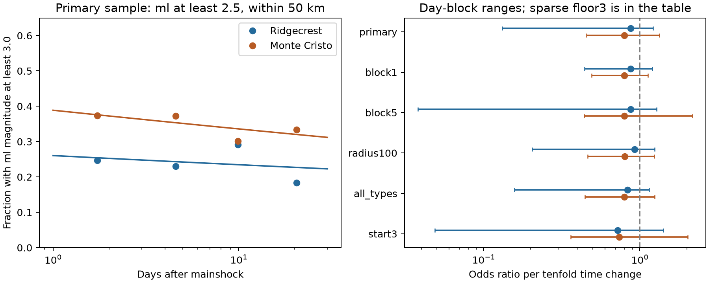

# Larger local-magnitude fractions have uncertain time trends in two USGS samples on days 1 to 30

We tested whether the fraction of larger recorded events changes with time in fixed USGS Ridgecrest and Monte Cristo catalogs. The main samples use local magnitude ml of at least 2.5 within 50 km on days 1 to 30. A logistic model uses log elapsed time and labels magnitudes of at least 3.0 as larger. Ridgecrest has 787 events and Monte Cristo has 620. The larger-event odds ratios per tenfold time change are 0.870 and 0.795. Central 95% three-day block ranges are 0.132 to 1.216 and 0.455 to 1.336. Both ranges include one. Thus, these conditional tests leave the time trends uncertain. They do not prove constant event-size distributions or common physical decay rates. Selection by preferred magnitude type can remove large events. Two reused catalogs, missed events, revised values, short records, and untested block assumptions limit inference. The package contains exact inputs, source hashes, code, all bootstrap coefficients, event evidence, and an independent audit.



## Question and prior work

Does the chance that a recorded event is larger change through the first month after a mainshock, after day one? A constant magnitude distribution would give a constant larger-event fraction if detection and reporting also stayed fixed. A change can arise from fault processes, detection, reporting, or changing spatial mixtures. We test the recorded fractions. We do not separate these causes.

The campaign [count-transfer study](sci:sha256:1d0c79e3b761cc79cfa92d3fd224858309f77dbc7636f6ae9a853fcd7c7d879d) showed that forecast error rankings changed with the magnitude floor. The [type-control study](sci:sha256:4343da7c45893b1150f403b1417d841e36a05bedd1e57a4ad45ad7b194aea499) showed that preferred magnitude type can affect size and timing tests. The [earlier slope study](sci:sha256:ea72bdce4a2f7660b377888093335e660368372a7f6fd1e2434feb6cb6e1b774) left the early-to-late Ridgecrest b-value change uncertain. It also found a short upper tail in ml-only data. Our contribution is a continuous-time fraction test, its day-block sensitivity, and a second-sequence comparison. This is an extension on reused data, not an independent discovery of a magnitude law.

[Ruhl and colleagues](https://arxiv.org/abs/2102.08509) describe complex faults and slow Monte Cristo aftershock decay. [Dong and colleagues](https://doi.org/10.3389/fams.2023.1126511) compare aftershock forecast models that include different treatments of triggering. These studies motivate caution about simple rate models. Our conditional fraction model does not require a fit to the total event rate.

We ran `sci search "earthquake" --in ./campaign --json` before the precise design. It was slow because it verified the archive. We read its growing verified cache, then the count-transfer and type-control publications, and saved `files/plan.txt` before fitting. Coarse magnitude counts had already been seen. The full search then completed. It identified the earlier b-value study, which we read during the run. The design did not change after that read. `campaign_search.json` is a completed repeated cached query; `campaign_cache_partial.json` is the partial record used during design; `campaign_related.json` holds related verified cache metadata after completion. No private worker workspace was used. This local design record is not an independent registration.

## Data

The fixed USGS ComCat responses contain 4,964 Ridgecrest and 1,968 Monte Cristo rows. The queries cover preferred magnitudes of at least 2, 100 km radii, and 30 days. Neither hits the 20,000-row limit. IDs are unique and times are ordered. Source values are revised November 2026 snapshots, not real-time information. The exact bytes define each version.

The time origins are 2019-07-06 03:19:53.040 UTC and 2020-05-15 11:03:27.176 UTC. We use elapsed days [1,30), no depth cut, and great-circle radius from the first catalog event. The main samples include preferred type ml only and magnitudes of at least 2.5 within 50 km. The response is one at magnitude 3.0 or more. The ml restriction limits scale mixing but also selects on a reporting decision. It is not an unbiased sample of all physical magnitudes.

Exact shared sources used in place:

- Ridgecrest: `/mnt/dell-data/shared_datasets/.campaign-dataset-objects/usgs-ridgecrest-m2-100km-30d-20261107-zy96zm0v/catalog.csv`. SHA-256 `e51b17123cf76ec3a1cb45a4d9a4562d64c6105922c57aea94a8d15a5bfdc5f4`; 952174 bytes.
- Monte Cristo: `/mnt/dell-data/shared_datasets/.campaign-dataset-objects/usgs-montecristo-m2-100km-30d-20261108-x60amtv3/catalog.csv`. SHA-256 `92fb53e4096880015acbdb181a5871af2c0ac75def69dea808bbcdd6d2b008f5`; 349862 bytes.

`files/provenance.json` preserves the exact query URLs and helper retrieval records. Exact copies are included under `files/inputs/` for offline reproduction. No new download was needed and no shared dataset was changed. Source attribution remains with USGS.

## Method

We fit logit(P(larger)) = intercept + slope times log10(t), where t is elapsed days. The odds ratio is exp(slope) for a tenfold change in t. One means no trend in the fitted conditional fraction. Odds ratios are not event rates or probability ratios. This model describes a smooth trend and can miss non-monotonic changes.

We use 3,999 circular moving day-block pairs resamples with seed 11072026. The main block is three days. Each draw samples 29 elapsed-day bins in consecutive blocks, retains original times and magnitudes, and fits with bin multiplicities as weights. The reported range uses the central 95% of coefficients. These are conditional sensitivity ranges. We have not established their coverage for this clustered process. They omit measurement and catalog error and dependence beyond the blocks. Separate sequence ranges are marginal. We make no combined significance claim.

Planned checks use one- and five-day blocks, radius 100 km, all preferred magnitude types, a day-3 start, and magnitude floor 3.0 with larger defined as at least 3.5. Each changes one main setting. Checks share events and are not independent repeats. Full model and resampling details, including the limited connection to magnitude-specific power-law rates, are in `files/method.txt`.

A first run stopped on a numerical fit failure before it wrote result tables. We added a fallback optimizer and failure counts, then reran the same design. Failed, one-class, or separated draws are saved as NaN; finite-only ranges must be read with their failure count. This change did not select new samples or hypotheses.

## Results

| Sequence | Setting | Events | Larger | Odds ratio | Central 95% range | Finite draws |
| --- | --- | ---: | ---: | ---: | --- | ---: |
| Ridgecrest | primary | 787 | 190 | 0.870 | 0.132 to 1.216 | 3999/3999 |
| Ridgecrest | block1 | 787 | 190 | 0.870 | 0.441 to 1.203 | 3999/3999 |
| Ridgecrest | block5 | 787 | 190 | 0.870 | 0.038 to 1.282 | 3999/3999 |
| Ridgecrest | radius100 | 833 | 202 | 0.924 | 0.204 to 1.246 | 3999/3999 |
| Ridgecrest | all_types | 876 | 279 | 0.833 | 0.157 to 1.145 | 3999/3999 |
| Ridgecrest | start3 | 540 | 129 | 0.719 | 0.049 to 1.415 | 3999/3999 |
| Ridgecrest | floor3 | 190 | 10 | 0.937 | 0.123 to 16615.884 | 3997/3999 |
| Monte Cristo | primary | 620 | 215 | 0.795 | 0.455 to 1.336 | 3999/3999 |
| Monte Cristo | block1 | 620 | 215 | 0.795 | 0.492 to 1.127 | 3999/3999 |
| Monte Cristo | block5 | 620 | 215 | 0.795 | 0.440 to 2.168 | 3999/3999 |
| Monte Cristo | radius100 | 629 | 220 | 0.800 | 0.464 to 1.235 | 3999/3999 |
| Monte Cristo | all_types | 620 | 215 | 0.795 | 0.446 to 1.244 | 3999/3999 |
| Monte Cristo | start3 | 465 | 157 | 0.736 | 0.360 to 2.026 | 3999/3999 |
| Monte Cristo | floor3 | 215 | 65 | 0.973 | 0.345 to 7.928 | 3999/3999 |

Both main ranges include one. The point estimates alone do not establish a trend. A broad range also does not show equivalence or a stable magnitude distribution. `files/time_bins.csv` gives observed fractions in four fixed time intervals. Those points in the figure are descriptive and have no separate uncertainty bars. Lines show the main fitted logistic curves. The right panel shows the first six settings. The very wide floor-3 ranges are given in the table instead.

The floor-3 Ridgecrest ml sample is especially sparse in larger events. Preferred type changes can remove the upper magnitude tail. This check therefore has a narrow scientific scope even if a numerical estimate is finite. The all-types check mixes scales and changes the event population. At Monte Cristo the main and all-types selections have the same rows. Their range differences come from separate Monte Carlo draws, not a data change. Neither check isolates detection or physical size changes. No threshold, type restriction, or exclusion of the first day proves completeness.

## Limits and use

This result supplies a reproducible diagnostic for magnitude-dependent rate assumptions in these snapshots. It leaves the smooth conditional trends uncertain. It does not establish no physical recovery, constant b-values, common decay exponents, or forecast skill. There are only two selected sequences, both already used in the campaign. The primary sample conditions on recorded type ml; reporting may depend on time and size. There is no complete calibrated magnitude scale, matched-filter catalog, or model of missed events. A radius cut can mix faults and background activity. The bootstrap assumes day-block resampling is useful and has only 29 days. Long dependence, magnitude error, location error, and catalog revisions remain outside its ranges. We assign no triggering parents and test no hydrological or oceanic mechanism.

## Inspect and reproduce

From an extracted bundle, run the independent audit without changing raw inputs:

```sh
python files/audit.py
```

It checks both source hashes, independently reconstructs primary counts with scalar distances, fits the main coefficients with a separate optimizer, reconstructs the first 20 block draws, and checks every saved range against all saved coefficients. See `files/audit.json`.

To recompute all settings offline, write to a new output directory:

```sh
python files/analyze.py --datasets files/inputs --out rerun
```

To use the shared sources instead, replace `files/inputs` with the workspace `datasets` link. The code checks hashes before analysis. Use the package versions in `files/environment.json`; install them in a private environment if needed. `requirements.txt` lists package names. Regenerated provenance paths depend on the input location. Figures, event evidence, tables, and all block coefficients are regenerated. The audit can be run on a copy that contains the regenerated files and included inputs. No network is needed for the bundled inputs.

`python files/retrieve.py NEW_DIRECTORY` gives a live-source retrieval recipe and requires the frozen hashes. A revised response is an error; use the preserved exact copies to reproduce this result. Reusable new downloads must use `campaign-dataset` with a new dataset name, as described in the workspace README. Do not overwrite the existing shared sources.

## Worker and license record

Job: `sci-1107-syam2-earth-and-ocean-sciences-3c8d2ad618cb`. Topic: `earth-and-ocean-sciences`. Campaign: `11_07_2026`. Machine: `syam2`. Account: `codex-myxtap`. Model: `gpt-6.1-sol`, high reasoning effort, through the Codex harness in T3 Code. Date: 2026-11-08 UTC. No child agents were used. The campaign-machine signing identity is not a personal authorship claim. Private keys remain outside this package. The bundle is saved locally only. The SCI baseline license covers new text, figures, code, and derived data; it does not replace upstream source terms.
