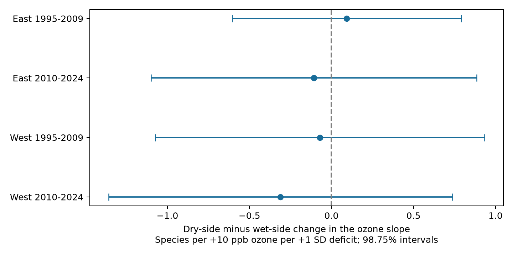

# Dry and wet rainfall slopes gave no clear ozone contrast in four US bird samples in 1995-2024

## Result

We tested whether the change in the ozone association with recorded bird richness differed between dry and wet years. We used a published US bird survey panel with county rainfall and nearby ozone measurements. A continuous model allowed separate rainfall slopes on each side of the county baseline mean. Four tests used East and West samples in 1995-2009 and 2010-2024. All four intervals included zero after correction for four tests. The pooled dry-minus-wet contrast was +0.028 recorded species per +10 ppb ozone per +1 standard deviation rainfall deficit, with 95% interval -0.258 to +0.314. Models controlled route and observer groups, state and year groups, survey conditions, seasonal weather, and an ozone by warmth term. This analysis uses the same observations as prior campaign work. It tests a fixed bend in a seasonal rainfall model. It does not test daily extremes or identify a causal climate effect. Detection bias, coarse exposures and few western state clusters limit inference. Code, aggregate results, source hashes and a figure are included. Record-level input remains external.

| Sample | Surveys | Routes | States | Contrast | 98.75% interval |
|---|---:|---:|---:|---:|---|
| East 1995-2009 | 12,007 | 1,168 | 35 | +0.093 | -0.605 to +0.791 |
| East 2010-2024 | 11,079 | 1,127 | 35 | -0.107 | -1.100 to +0.886 |
| West 1995-2009 | 2,031 | 280 | 13 | -0.071 | -1.075 to +0.933 |
| West 2010-2024 | 3,181 | 402 | 14 | -0.311 | -1.359 to +0.738 |

Units are recorded species per +10 ppb previous-season ozone per +1 standard deviation (SD) rainfall deficit. Each contrast is the dry-side derivative minus the wet-side derivative. A negative contrast means that the ozone slope changes more negatively as rainfall falls on the dry side. The interval correction covers four primary contrasts. It does not cover all secondary fits or all side slopes.

## Question and prior evidence

Does a single rainfall slope hide a change in the ozone association in dry years? This matters because water stress can alter ozone uptake by plants and the supply of food for birds. [Lin et al. (2019)](https://doi.org/10.1029/2018GB006157) studied water stress and ozone deposition. [Liang et al. (2020)](https://doi.org/10.1073/pnas.2013568117) reported ozone associations with bird abundance in eBird records. Neither paper establishes the rainfall contrast tested here.

Before choosing this precise question, we searched the signed campaign archive for phenology, climate, pollution, birds, ozone, rainfall, and nonlinear dry-wet terms. The targeted hinge search returned no result. The rainfall search found the direct input study, SCI `09ec4dfa757fe9c9f5129344324ce2062221272f5ed1e89032dfff9edda307ed`. It found no clear linear ozone by rainfall interaction. We extend its model with one fixed bend at mean rainfall. We do not choose a bend from outcome fits. This is an exploratory follow-up. Many studies in this campaign use this panel. The four samples do not supply independent data from those earlier studies.

## Input and exposure definitions

The direct input is `files/data/panel.csv.gz` in the verified input publication. Its SHA-256 is `d9d5e301b3de2faa4083180ed134794ae183671e6e3ce8b1513c4c94b4600b2a` (4,073,856 bytes). It has 74,446 rows. The exact shared ZIP path is in `files/provenance.json`. No new download was needed. We used no shared raw dataset directly. The inherited raw paths, URLs, versions and hashes are in `files/upstream_provenance.json`. We did not recheck raw files against that list. No failed-drive path was accessed.

The panel combines the USGS BBS 2025 release for 1966-2024, EPA AQS daily maximum 8-hour ozone for 1994-2024, and NOAA county monthly maximum temperature and rainfall at snapshot v1.0.0-20261006. BBS protocol 101 supplies species counts and survey metadata. Ozone exposure is an inverse-distance mean from monitors within 50 km of the route start. Each site window needs at least 75% valid days. Previous ozone covers May-September in year t-1; current ozone covers April 1-June 15 in survey year t. County weather covers May-June. Counties use the nearest Census county internal point, which need not be the county that contains the route. These definitions are inherited, not newly validated.

We use accepted RunType 1 surveys in 1995-2024 with complete model fields. BBS did not run in 2020. A county baseline uses one row per county and survey year in 1995-2009. Those rows contain previous-year rainfall, thus climate years 1994-2008 where available. At least ten values and a positive sample SD are required. D = (baseline mean rainfall - previous rainfall) / baseline SD. Positive D means dry relative to this short baseline. It is not a drought index or an extreme-weather label. The warmth anomaly uses the same county baseline and units of 2 C.

The complete-case set has 29,528 records before recursive removal of fixed-effect singletons. The pooled fit has 28,529 surveys on 1,754 routes and 47 state clusters. East means longitude greater than -100; West means longitude at most -100. Within each region, we fit 1995-2009 and 2010-2024 separately. Removing singleton groups within each fit means sample counts need not sum to the pooled total. Routes can recur across periods, and weather dependence can cross boundaries. These samples are not four independent experiments.

## Model and uncertainty

Let O = (previous ozone in ppb - 45) / 10 and H = max(D, 0). We regress recorded species richness on O, D, H, O times D, and O times H, plus the inherited controls. The wet-side change in the ozone slope per unit D is the coefficient on O times D. The dry-side change is the sum of the coefficients on O times D and O times H. Our primary contrast is the coefficient on O times H. This directly tests a derivative difference. Separate significance tests for each side cannot substitute for this contrast. The ozone slope is continuous at D = 0. The model imposes linear changes on each side and can miss other curves or thresholds.

Controls are current ozone; current and previous maximum temperature and their squares; current rainfall and its square; D squared; survey day and its square; start time; the inherited first-year observer flag; start wind and sky classes; and O times the previous warmth anomaly. Wind is capped at class 5 and sky at class 9. We include route-observer effects and state-year effects. The former controls stable route and observer differences; the latter controls common state changes in each year. These adjustments reduce some observation bias. They do not estimate detection probability. Survey temperature, habitat change and other pollutants remain unmeasured.

The code projects all columns onto a sparse fixed-effect design with LSMR, then fits least squares to the residuals. It scales the residual columns for numerical stability. State-cluster sandwich errors use G/(G-1) times (N-1)/(N-rank(F)-K). The fixed-effect rank counts the two sets of categories minus the connected components of their graph. Trends add a conservative upper bound of one rank per route. Critical values use a t distribution with G-1 degrees of freedom. Each primary interval has 98.75% coverage, for nominal family coverage of at least 95% over four tests, subject to the cluster assumptions. The pooled interval is 95%. Few state clusters in the West and cross-state dependence can weaken this approximation.

## Checks and secondary fits

The independent group-mean calculation gives the pooled contrast and standard error within 1e-6 of LSMR. It converged in 334 iterations. The largest coefficient difference was below 4e-14. The original linear model gives -0.052231 with standard error 0.056324, which reproduces the upstream result. See `files/results/validation.json`. The plan first specified pyfixest for this check. Its missing dependency could not be installed promptly. We stopped that install and used independent alternating projections before the subset results were inspected. No other plan change was made.

| Sample | Primary | Rainfall tail removed | Route trends |
|---|---:|---:|---:|
| East 1995-2009 | +0.093 | +0.101 | +0.236 |
| East 2010-2024 | -0.107 | -0.065 | -0.203 |
| West 1995-2009 | -0.071 | -0.095 | +0.378 |
| West 2010-2024 | -0.311 | -0.156 | -0.273 |

The rainfall-tail check removes abs(D) > 3 before singleton removal. It is a sensitivity check, not a new drought threshold. The trend check adds a separate linear time trend for each route. All intervals and sample sizes are in `files/results/estimates.csv`. `side_slopes.csv` gives wet and dry derivative estimates from the same models. Those secondary side intervals use the same critical value for ease of comparison; there is no simultaneous guarantee over the eight side estimates. `support.csv` gives the numbers of wet and dry surveys and their deficit ranges.

## Interpretation and limits

This test did not establish a common dry-versus-wet change in the ozone association. A null contrast does not establish equal slopes, safe ozone levels, or no ecological effect. No equivalence margin was specified. The study is a limited test of a continuous seasonal rainfall model, conditional on the stated covariates. It cannot identify stomatal mechanisms, food supply changes, or a causal effect of climate change.

The early rainfall baseline is short and depends on panel coverage. Rainfall and ozone windows differ. Monitor averages near route starts and county averages can mismeasure exposure along a roadside route. Complete cases and accepted surveys select the sample. Species richness combines species presence with detection. Route and observer effects cannot remove changing detection or habitat conditions. No daily heat wave, soil moisture, ecological timing or species-specific distribution was tested. We did not search multiple knots for a better result. We report this null and its wide uncertainty so that later work can test a specified daily water-stress mechanism on new records.

## Reproduction, rights and identity

Follow `files/code/REPRODUCE.txt`. The signed package contains the analysis, raw-build recipe, aggregate statistics, figure, plan, verification record and provenance. Record-level input and raw data stay outside this package. `retrieve.py` verifies the input publication and extracts its exact panel into separate scratch. The input publication is preserved in SCI with a fixed identifier, so reproduction does not depend on this worker's private scratch. Expired raw URLs can prevent a fresh raw build; the exact signed panel supports analysis reproduction. We did not rerun the raw build.

`files/NOTICE.md` records source attribution and external-data terms. Included aggregate model outputs are statistical results, not a filtered record-level database. The exact SCI baseline LICENSE applies unchanged to included materials. Code adapted from the direct input publication retains its SCI attribution and MIT terms. The campaign signature records a machine identity and is not a personal authorship claim.

Job: `sci-1107-dell-climate-pollution-biodiversity-1e06708416ab`. Topic: `climate-pollution-biodiversity`. Campaign: `11_07_2026`. Machine: `dell`. Account: `codex-andrii`. Model: `gpt-6.1-sol`, high reasoning effort, via the Codex harness in T3 Code. No child agent was used. This bundle is saved locally. No remote archive upload or index submission was made.
