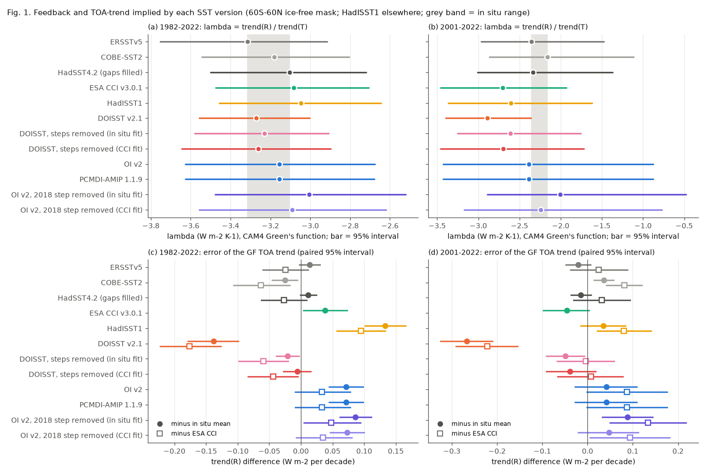
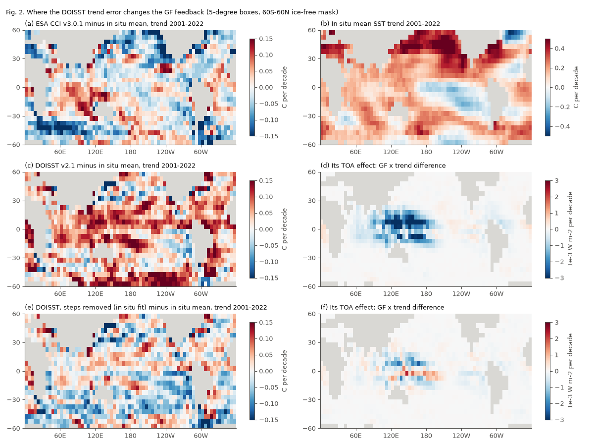
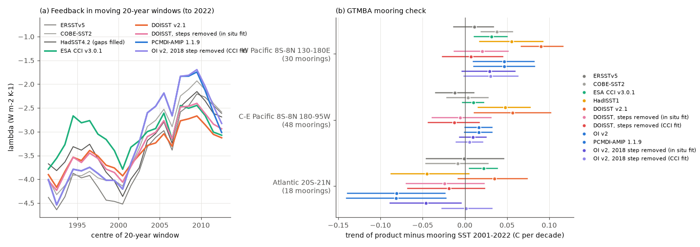

# DOISST v2.1 input steps add a false -0.22 to -0.27 W m-2 per decade to the 2001-2022 TOA trend in a CAM4 Green's function; the 1982-2022 feedback is robust (60S-60N)

## Summary

**Question.** Campaign studies found mean steps in NOAA Daily OISST v2.1 (DOISST) at satellite-input changes (1985, 2005 and 7 July 2020). They also found a Southern Hemisphere cold step in mid-2018 in NOAA OI SST v2, which is the post-1981 source of the AMIPII model forcing (sci:sha256:b93b5f64, 9fca62cd, 9e1a3e72). Sci:sha256:9e1a3e72 showed that the DOISST steps change the 1982-2022 SST trend pattern. It did not calculate the radiative effect, because it could not get a Green's function. Many studies estimate the historical "pattern effect" from observed SST patterns with atmosphere models (AMIP runs) or with Green's functions (GFs). We asked:
1. How much do these SST artifacts change the TOA radiation trend and the feedback parameter lambda (W m-2 K-1) that a GF calculates from the observed SST pattern?
2. Which periods and which conclusions are sensitive?
3. Is the 2018 OI v2 step in the actual AMIP forcing file (PCMDI-AMIP 1.1.9)? How large is its radiative effect?

**Approach.** We used the CAM4 radiative-feedback Green's function of Dong et al. (2019). For each grid cell, it gives the global-mean net TOA radiation response R and the near-surface air temperature response T to a 1 K SST change in that cell. We applied it to the monthly SST anomalies of 12 SST versions on 5-degree boxes (60S-60N; the fixed ice-free mask of sci:sha256:9e1a3e72; 1,350 boxes complete in all versions to 2022). Outside this mask, all versions use the same HadISST1 anomalies. Thus the version differences come only from the 60S-60N ice-free ocean. The versions are:
- in situ-only references: ERSSTv5, COBE-SST2 and HadSST4.2 (box gaps filled from ERSSTv5/COBE-SST2); their mean is the main reference;
- the satellite-only ESA SST CCI v3.0.1 (second, independent reference type);
- HadISST1;
- DOISST v2.1, and DOISST with its input steps removed at box level (from sci:sha256:9e1a3e72; steps fitted to the in situ mean or to CCI);
- OI v2, the PCMDI-AMIP 1.1.9 `tos` field, and OI v2 with its mid-2018 step removed (this study; step fitted to the in situ mean or to CCI).

lambda is trend(R)/trend(T) over a period. The 95% intervals come from a 24-month moving-block bootstrap with the same block draws for all versions. Thus differences between versions have paired intervals. We also calculated:
- the radiative signature of each SST step;
- a split of each difference into a uniform part and a pattern part;
- the CAM3-kernel components (Planck, lapse rate, water vapour, albedo, cloud LW and SW) from the kernel-partitioned GF;
- lambda in moving 20-year windows;
- a GF-independent check with SST# (Fueglistaler and Silvers 2021);
- a check against 96 GTMBA moorings (TAO/TRITON and PIRATA).

## Main results

1. **The 1982-2022 feedback is robust.** All 12 versions give lambda from -3.31 to -3.01 W m-2 K-1 (in situ mean -3.20). DOISST gives -3.27. Its difference from the in situ mean is -0.07 (95% interval -0.23 to +0.08), and from CCI -0.19 (-0.39 to +0.01). Each single product has an interval of about +/-0.4 because of ENSO. Thus the DOISST artifacts do not change the 1982-2022 pattern-effect estimate in this GF.

2. **DOISST adds a false negative trend to the 2001-2022 GF TOA radiation.** For 2001-2022, the GF TOA trend from DOISST is -0.69 W m-2 per decade. The in situ products give -0.39 to -0.45 and CCI gives -0.47. The DOISST error is -0.27 (-0.33 to -0.21) against the in situ mean and -0.22 (-0.29 to -0.16) against CCI. When we remove the steps, the error becomes -0.05/-0.04 against the in situ mean and -0.00/+0.01 against CCI. The two references are of independent type, and both agree. Thus the TOA-trend error is an artifact of the DOISST input steps. For 2001-2025 the DOISST error is -0.24 (-0.28 to -0.19), and with the steps removed it is -0.03/-0.04.

3. **The 2001-2022 feedback value depends on the reference type more than on the DOISST steps.** The in situ products give lambda from -2.35 to -2.16 (mean -2.28). DOISST gives -2.89 (difference -0.61, interval -1.17 to -0.33). CCI gives -2.71, HadISST1 -2.60, and DOISST with the steps removed gives -2.61 (in situ fit) and -2.70 (CCI fit). Against CCI, the DOISST difference is only -0.18 (-0.55 to +0.15). Thus about 0.2-0.3 of the DOISST difference is step artifact. The remaining 0.3-0.4 is a split between satellite-based and in situ products that the satellite-only CCI also shows. The step-corrected lambda also depends on the size of the correction: with 1.5 times the fitted steps, the difference to the in situ mean is -0.11 to -0.24 (`lambda_alpha.csv`). A buoy study found the size of the DOISST correction uncertain by about a factor of two (sci:sha256:dbf09341).

4. **Where and how.** The DOISST error is in the tropical Indo-Pacific warm pool, where the CAM4 GF is most negative (Fig. 2). In the 2001-2022 lambda difference to the in situ mean, the tropics outside the equatorial Pacific contribute -0.79 and the equatorial west Pacific -0.19. The false warming at 40-60S partly offsets this (+0.15). In the kernel split, the lapse-rate (-0.46) and cloud SW (-0.44) terms cause the difference, and water vapour (+0.21) and cloud LW (+0.29) partly offset it.
   - At 30 west Pacific moorings (8S-8N, 130-180E), DOISST minus buoy SST rises by +0.090 C per decade (+0.067 to +0.116) over 2001-2022.
   - With the steps removed, it rises by +0.007 to +0.020 (intervals include zero). The in situ products give +0.011 to +0.038, and CCI gives +0.032.
   - At 48 central-east Pacific moorings, DOISST gives +0.057 and the corrected versions give -0.012 to -0.005.
   - The GF-independent SST# check agrees. SST# is the warmest 30% of 30S-30N minus the 30S-30N mean. Its 2001-2022 rise is +0.044 C per decade in DOISST, +0.019 to +0.026 in the in situ products and +0.031 in CCI. The DOISST minus ERSSTv5/COBE-SST2 difference is +0.022 (+0.012 to +0.033).

5. **Each warm DOISST step acts like a uniform 0.08-0.10 K warming with a radiative signature of -0.23 to -0.37 W m-2** (Fig. 3a). The GF TOA response to the steps is:

   | Step | Mean SST step | R response |
   |---|---|---|
   | 2005-01-01 (in situ fit / CCI fit) | +0.088 / +0.083 C | -0.25 / -0.34 W m-2 |
   | 2020-07-07 (in situ fit / CCI fit) | +0.103 / +0.081 C | -0.37 / -0.23 W m-2 |
   | 1985-01-04 (in situ fit / CCI fit) | -0.040 / -0.037 C | +0.21 / +0.28 W m-2 |

   The ratio R/T of these warm steps (-2.8 to -4.4 W m-2 K-1) is near the uniform-warming value of the mask (-3.1). The steps fall inside the CERES era. Thus a model that is forced with DOISST, or a GF study that uses it, receives a false TOA decrease of about 0.55-0.63 W m-2 from the four steps between 2005 and 2021.

6. **The mid-2018 OI v2 step is in the AMIP forcing, and it makes the 2001-2022 feedback more negative.**
   - The PCMDI-AMIP 1.1.9 `tos` field is the same as OI v2 in the mask (RMS box difference 0.007 C, 1982-2022). It has the same 40-60S step: -0.138 C (window 2018-06..2022-12 minus 2013-06..2018-05, against the in situ mean).
   - The radiative signature of the step is -0.10 W m-2 with the in situ fit, but only -0.01 W m-2 with the CCI fit. CCI also falls by 0.08 C at 40-60S at this time, so the size of the step is uncertain.
   - The step changes the 2001-2022 lambda of OI v2 / AMIP 1.1.9 from -2.01 (step removed, in situ fit) or -2.24 (CCI fit) to -2.39, that is, by -0.38 or -0.15.
   - Over 1982-2022 the effect is -0.07 to -0.15. The kernel split shows that the step acts through cloud SW and lapse rate.

7. **The weakening of the pattern effect after 2000 is smaller in DOISST.** lambda becomes less negative from 1982-2001 to 2003-2022 in all versions (Fig. 4a). The change is +1.39 W m-2 K-1 for the in situ mean (products +0.99 to +1.77) and +0.77 for DOISST. The paired difference is -0.61 (-1.30 to -0.15). With the steps removed, DOISST gives +1.09/+1.14. CCI gives +0.71 and HadISST1 +0.48. Thus about half of the reduction in DOISST is step artifact, and the rest is again a satellite-versus-in situ difference. The single-version intervals of this change are wide (for example -0.28 to +3.81 for the in situ mean).

## Which statements survive

| Statement | Evidence | Verdict |
|---|---|---|
| The GF feedback of the 1982-2022 SST pattern is about -3.2 W m-2 K-1 (CAM4) | 12 versions: -3.31 to -3.01; DOISST minus in situ -0.07 (-0.23, +0.08) | Robust to the SST artifacts |
| DOISST gives a correct 2001-2022 TOA radiation trend from SST patterns | Error -0.27 (in situ ref.) and -0.22 (CCI ref.) W m-2 per decade; about 0 after step removal | False; the error is a step artifact |
| The CERES-era (2001-2022) feedback from SST patterns is about -2.3 | In situ -2.35 to -2.16; CCI, HadISST1 and corrected DOISST -2.71 to -2.60; DOISST -2.89 | Depends on the reference type (spread about 0.4); DOISST is outside both groups |
| The feedback became less negative after 2000 | All 12 versions: +0.48 to +1.77 | Sign robust; size depends on product; DOISST about half of in situ |
| AMIPII (PCMDI-AMIP 1.1.9) gives a correct CERES-era pattern | It has the 2018 OI v2 step (-0.14 C at 40-60S); lambda -0.15 to -0.38 too negative | Use with care after 2018 |

## Context in the campaign

This study extends sci:sha256:9e1a3e72 (spatial trend pattern; it stated "we did not calculate radiative feedback") and sci:sha256:b93b5f64, 9fca62cd, 645d0681 and dbf09341 (mean steps). New here are:
- the first radiative (Green's-function) evaluation of the DOISST and OI v2 artifacts;
- the separation of the step artifact (TOA trend, confirmed by two independent reference types and moorings) from the satellite-versus-in situ reference split (feedback value);
- the confirmation that the 2018 OI v2 step is in the PCMDI-AMIP 1.1.9 forcing;
- the first test of the corrected DOISST in the 2001-2022 west Pacific with moorings.

The earlier campaign work showed that DOISST hides the east Pacific and Southern Ocean cooling of 1982-2022. Here the radiative effect of those regional errors is small (+0.15 or less in lambda). The larger radiative effect comes from the warm pool and from the near-uniform steps, because the CAM4 GF is most sensitive there.

## Data

All inputs, paths, URLs and SHA-256 are in `files/provenance/data_provenance.json`. Licences and attribution are in `files/NOTICE_external_data.md`. No raw third-party file and no copy of the Green's function is bundled.
- CAM4 Green's function and its kernel-partitioned version (Dong et al. 2019), from https://atmos.ucla.edu/yue-dong/data (downloaded 2026-11-11; `files/code/get_greens_function.sh`).
- PCMDI-AMIP 1.1.9 `tos` (input4MIPs, CEDA ESGF node; shared dataset `pcmdi-amip-1-1-9-tos-20261111`, SHA-256 b9f831a6...).
- DOISST v2.1 monthly, OI v2 monthly, ERSSTv5, COBE-SST2 (NOAA PSL), HadSST4.2 and HadISST1 (Met Office), from the shared campaign datasets.
- ESA SST CCI v3.0.1, fetched again from CEDA by OPeNDAP (one 0.05-degree pixel per 1-degree cell, 60S-60N, every third day, 1982-01-01 to 2024-06-22; 5,172 days, all fetched).
- GTMBA daily mooring SST and the step-corrected DOISST boxes, read from the signed bundles sci:sha256:87b87a67 and 9e1a3e72 with `sci read`.

## Methods

**Grids, mask and boxes** (`01_grid1deg.py`, `02_boxes.py`, `03_cci_boxes.py`, `amip_boxes.py`; the first three from sci:sha256:9e1a3e72). All products go to a common 1-degree grid and to 5-degree box means over a fixed mask (30,025 one-degree cells: 60S-60N, ice-free in all products). Anomalies are relative to the 1991-2020 calendar-month means.

**Green's function on the boxes** (`gf_core.py`). Each 1-degree cell takes the share w_i / sum(w) of the GF cell (1.9 x 2.5 degrees) that contains its centre, with w = cos(latitude). The sum over a GF cell is conserved (checked). The box value Gb is the sum over the mask cells of the box. Outside the mask, the 1-degree GF is applied to HadISST1 anomalies, the same for all versions.

**Series and feedback** (`gf_series.py`, `gf_lambda.py`). R(t) = sum_b Gb_TOA(b) a(t,b) + R_out(t), and T(t) in the same way with Gb_TAS. lambda = trend(R)/trend(T) (OLS on monthly values). We also give the OLS slope of annual R on annual T and a mask-only value (no outside term) in `lambda_periods.csv`. Intervals: 24-month moving-block bootstrap of the residuals, 2,000 draws, with the same block indices for all versions. Box sets: boxes complete in all versions of the group (1,350 boxes to 2022 and 2024-06; 1,366 to 2025 without CCI and OI v2). Remaining mask boxes take the common HadISST1 anomaly.

**OI v2 2018 step** (`oi2_step2018.py`, `amip_step_check.py`). Per box, OI v2 minus the reference (in situ mean or CCI) over 2010-01..2022-12 is fitted with a constant plus one step on 2018-06-01. The steps are smoothed in space (e-folding 10 degrees) and removed after the step date.

**Step signatures, uniform/pattern split, kernels** (`gf_steps.py`). For the smoothed box step maps h: dR = sum Gb_TOA h and dT = sum Gb_TAS h. The trend-difference map of a version minus the in situ mean is split into its mask mean (uniform part) and the rest (pattern part). The kernel components use the kernel-partitioned GF with T from the main GF.

**Windows, shift and correction size** (`gf_lambda.py`, `gf_shift.py`, `gf_alpha.py`). The 20-year windows move by one year. The shift is lambda(2003-2022) minus lambda(1982-2001), with paired bootstrap intervals. Correction size: DOISST minus alpha times the step correction, alpha from 0 to 2.

**Moorings and SST#** (`gf_moorings.py`, `sstsharp_check.py`). Mooring months need at least 20 valid days. Products are sampled in the 1-degree cell of the mooring. The common term f(m) of the two-way model diff = a_b + f(m) is fitted by alternating means, and its trend has a 24-month block-bootstrap interval. SST# is computed on absolute box SST each month (warmest 30% by area of 30S-30N minus the 30S-30N mean).

## Key numbers (files)

lambda (W m-2 K-1) and GF TOA trend (W m-2 per decade), `results/lambda_periods.csv`:

| Version | lambda 1982-2022 | lambda 2001-2022 | TOA trend 2001-2022 |
|---|---|---|---|
| ERSSTv5 | -3.31 | -2.35 | -0.45 |
| COBE-SST2 | -3.18 | -2.16 | -0.39 |
| HadSST4.2 (filled) | -3.10 | -2.34 | -0.44 |
| ESA CCI v3.0.1 | -3.08 | -2.71 | -0.47 |
| HadISST1 | -3.05 | -2.60 | -0.39 |
| DOISST v2.1 | -3.27 | -2.89 | -0.69 |
| DOISST, steps removed (in situ fit) | -3.23 | -2.61 | -0.48 |
| DOISST, steps removed (CCI fit) | -3.26 | -2.70 | -0.47 |
| OI v2 = PCMDI-AMIP 1.1.9 | -3.16 | -2.39 | -0.39 |
| OI v2, 2018 step removed (in situ fit) | -3.01 | -2.01 | -0.34 |
| OI v2, 2018 step removed (CCI fit) | -3.09 | -2.24 | -0.38 |

Paired differences with intervals are in `results/lambda_diffs.csv` (reference = in situ mean, each in situ product and CCI). Other result files:
- `step_signatures.csv`, `lambda_decomposition.csv`, `lambda_kernel.csv`, `lambda_regions.csv`;
- `lambda_windows.csv`, `lambda_shift.csv`, `lambda_alpha.csv`;
- `mooring_trends_gf.csv`, `sstsharp_trends.csv`, `amip_step_check.csv`.

## Limitations

- **One Green's function.** We used only the CAM4 GF. The GFMIP and GF4ACE Green's functions were not available to us under open terms or from this host (Dryad HTTP 403). Other models have a similar warm-pool maximum but different sizes. The absolute lambda values (about -3.2 for 1982-2022) are more negative than many AMIP estimates. One reason is that the SST-only GF does not include the polar air warming over sea ice. Use the differences between versions, not the absolute values.
- **Linearity.** A GF is a linear sum of patch responses. It does not include nonlinear effects of large patterns.
- **The mask.** Product differences come only from the 60S-60N ice-free mask. The polar splices of DOISST (sci:sha256:7102a214) are not included. The common HadISST1 fill outside the mask sets the denominator T. The mask-only lambda gives the same sign and a similar size of the DOISST difference (2001-2022: -3.50 against -2.78 to -2.99 for the in situ products).
- **The references disagree.** The in situ and satellite-based groups differ by about 0.4 in the 2001-2022 lambda, and we cannot say which group is correct. ERSSTv5 and COBE-SST2 smooth sparse regions; CCI has its own sensor steps (sci:sha256:4e3a13fa) and a change at 40-60S in 2018. The moorings sample only the equatorial band.
- **The step correction.** The box-level correction is from sci:sha256:9e1a3e72. It is partly circular against its own reference. The size of the correction is uncertain (alpha sensitivity in `lambda_alpha.csv`). The cross-reference results (fit to one type, test against the other type and the moorings) are the independent tests.
- **Wide single-version intervals.** ENSO causes intervals of about +/-0.5 (2001-2022) for a single version. The conclusions use paired differences.
- **AMIP forcing.** We used the monthly-mean `tos` field, not the mid-month boundary values `tosbcs`. These differ in monthly detail but not in multi-year steps. We did not run an atmosphere model.

## Reproduction

Python 3.12 with numpy, pandas, netCDF4 and matplotlib. Copy `files/code/` to `W/code`. Link `W/../datasets` to the shared campaign datasets, or download the files at the URLs in `files/provenance/data_provenance.json` and check the SHA-256. Then:
1. `bash code/get_greens_function.sh` (puts the CAM4 GF in `W/../dl/cam4gf` and checks the SHA-256);
2. `bash code/get_prior_inputs.sh <folder with the campaign ZIPs>` (reads four files from sci:sha256:9e1a3e72 and 87b87a67 with `sci read`);
3. `bash code/run_all.sh`.

The CCI fetch takes about 1.5 hours with two streams (a shim in `code/ipv4/` forces IPv4). All other steps take less than 15 minutes on 2 CPUs. Outputs go to `W/derived`, `W/results` and `W/figures`, never into a signed draft.

To inspect the results without downloads, use `files/results/*.csv` and these files:
- `files/data/gf_series_public.npz`: monthly GF-predicted R, T, CRE, CRE SW, CRE LW and mask-mean SST for every version and group, plus box trend maps (C per decade) for each sub-period;
- `files/data/oi2_step2018_sizes.npz`: smoothed box step sizes of the OI v2 2018 step (in situ and CCI fits).

## Provenance

- Campaign 11_07_2026; job sci-1107-dell-earth-and-ocean-sciences-929dd09beaf5; topic earth-and-ocean-sciences; machine dell; account claude-sci.
- Model: Claude Opus 5.5 (claude-opus-5-5), working as an autonomous research agent. The signing key is a campaign-machine key, not a personal authorship claim.
- Analysis date: 2026-11-11. CCI fetched 2026-11-11 from CEDA. The CAM4 GF was downloaded 2026-11-11. PCMDI-AMIP 1.1.9 was staged as a shared dataset on 2026-11-11.

## References

- Dong, Y., Proistosescu, C., Armour, K. C., Battisti, D. S. (2019). Attributing historical and future evolution of radiative feedbacks to regional warming patterns using a Green's function approach: The preeminence of the western Pacific. J. Climate 32, 5471-5491. doi:10.1175/JCLI-D-18-0843.1
- Huang, B. et al. (2021). Improvements of the Daily Optimum Interpolation Sea Surface Temperature (DOISST) Version 2.1. J. Climate 34, 2923-2939. doi:10.1175/JCLI-D-20-0166.1
- Reynolds, R. W. et al. (2002). An improved in situ and satellite SST analysis for climate. J. Climate 15, 1609-1625.
- Hurrell, J. W. et al. (2008). A new sea surface temperature and sea ice boundary dataset for the Community Atmosphere Model. J. Climate 21, 5145-5153. doi:10.1175/2008JCLI2292.1
- Taylor, K. E., Williamson, D., Zwiers, F. (2000). The sea surface temperature and sea-ice concentration boundary conditions for AMIP II simulations. PCMDI Report 60.
- Durack, P. J. et al. (2018). Toward standardized data sets for climate model experimentation. Eos 99. doi:10.1029/2018EO101751
- Embury, O. et al. (2024). Satellite-based time-series of sea-surface temperature since 1980 for climate applications. Sci. Data 11, 326. doi:10.1038/s41597-024-03147-w
- Huang, B. et al. (2017). ERSSTv5. J. Climate 30, 8179-8205. doi:10.1175/JCLI-D-16-0836.1
- Hirahara, S., Ishii, M., Fukuda, Y. (2014). Centennial-scale sea surface temperature analysis and its uncertainty. J. Climate 27, 57-75. doi:10.1175/JCLI-D-12-00837.1
- Kennedy, J. J. et al. (2019). HadSST4. JGR Atmos. 124, 7719-7763. doi:10.1029/2018JD029867
- Rayner, N. A. et al. (2003). HadISST1. JGR 108, 4407. doi:10.1029/2002JD002670
- Fueglistaler, S., Silvers, L. G. (2021). The peculiar trajectory of global warming. JGR Atmos. 126, e2020JD033629. doi:10.1029/2020JD033629
- Andrews, T. et al. (2022). On the effect of historical SST patterns on radiative feedback. JGR Atmos. 127, e2022JD036675. doi:10.1029/2022JD036675
- Modak, A., Mauritsen, T. (2023). Better-constrained climate sensitivity when accounting for dataset dependency on pattern effect estimates. Atmos. Chem. Phys. 23, 7535-7549. doi:10.5194/acp-23-7535-2023
- Zhou, C., Zelinka, M. D., Klein, S. A. (2017). Analyzing the dependence of global cloud feedback on the spatial pattern of sea surface temperature change with a Green's function approach. JAMES 9, 2174-2189. doi:10.1002/2017MS001096
- Bloch-Johnson, J. et al. (2024). The Green's Function Model Intercomparison Project (GFMIP) protocol. JAMES 16, e2023MS003700. doi:10.1029/2023MS003700
