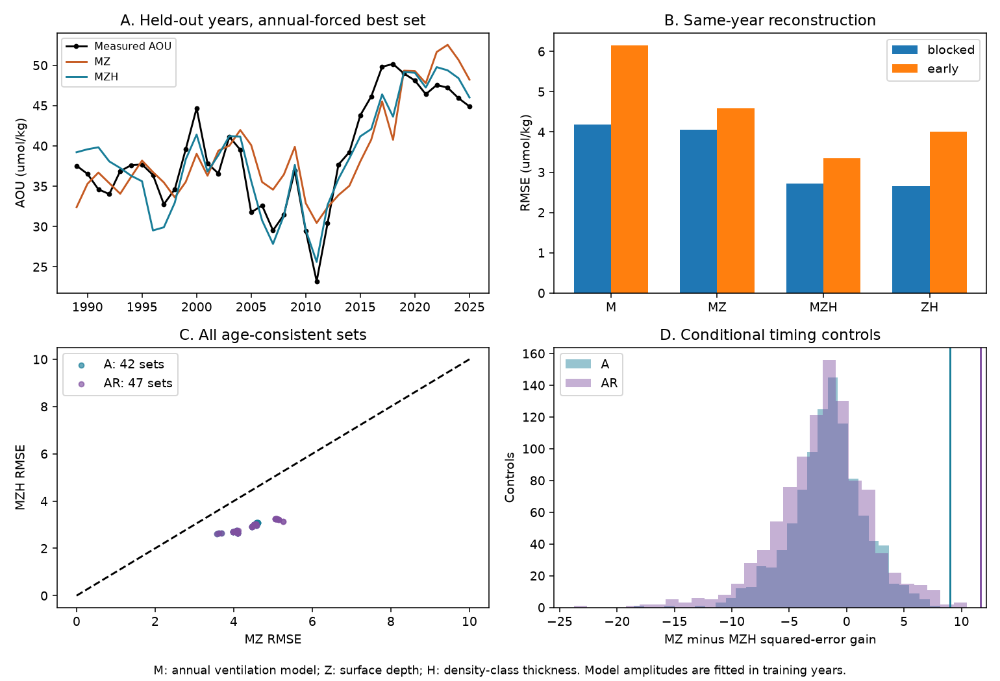

# Class thickness adds held-out BATS oxygen skill beyond annual winter ventilation and depth in 1989-2025

At BATS, measured thickness of the density class around sigma0 26.5 adds information about apparent oxygen utilization (AOU) after an annual-forced ventilation model and surface depth are included. For the primary model set, held-out error falls from 4.05 to 2.72 umol/kg, a 33% decrease. All 89 age-consistent source model sets show a decrease. The thickness effect remains in annual differences. This strengthens a proposed missing-geometry response in the North Atlantic model. It does not prove a class-volume cause or give a closed oxygen budget.

A useful limit also appears. Geometry alone gives blocked error of 2.65 umol/kg, slightly less than the primary combined model. Only 12 of 89 sets improve on geometry alone. The same-year observations therefore do not establish a separate model contribution once geometry is supplied. In the early-fit test, the combined model does improve on geometry alone. These tests give different limits on transfer.

## Question and contribution

The selected work links oxygen loss on sigma0 26.5 to loss of winter outcrop. Its North Atlantic model left large AOU swings unexplained. SCI 058edf7b added annual winter forcing to that model. It improved timing, but left swings 2-4 times too small. A post hoc regression then found that local class thickness added to the model. That result used the full BATS record, did not control depth, and did not test withheld years. SCI af00649e showed thickness skill after depth control, but did not include the new annual-forced model.

We test the missing comparison: does thickness add beyond both annual ventilation and depth, when model amplitude can adjust and test years are withheld? We test all 89 source parameter sets without selecting them on oxygen errors. This is a new conditional test of published evidence, not a new observational record. It supplies a quantitative target for a future model with variable layer geometry.

Nishikawa et al. (2025), DOI 10.1007/s10872-025-00751-1, link Eighteen Degree Water thickness to overlying thermal and biogeochemical structure. Their result concerns the upper layer and does not establish our effect on 26.5. Stanley et al. (2012), DOI 10.5194/bg-9-1969-2012, use tritium and helium-3 to estimate apparent oxygen use at BATS. Such tracer and AOU estimates include water history. Neither that method nor our regression identifies local respiration from AOU alone.

## Data and methods

All inputs are exact annual aggregate files from three verified SCI publications. We use no shared raw dataset directly. Full source paths and SHA-256 hashes are in files/provenance.json. Bundled copies allow offline analysis. Attribution and external terms are in files/NOTICE.md.

The primary observations are 37 annual means for 1989-2025 from SCI af00649e. That source uses BATS Core cruises within 50 km of the station, valid quality flags, common bottles for geometry and AOU, linear density interpolation, and an increasing-density envelope. The primary bracket limit is 250 m and 0.20 kg/m3. At least six months are needed for an annual mean. Monthly adjustment uses 1989-2009 reference means. AOU is oxygen solubility minus measured oxygen. Surface depth Z is z(26.5), in m. Class thickness H is [z(26.6)-z(26.4)]/2, in m per 0.1 kg/m3. H is a local measure, not total mode-water volume.

M is the annual model AOU at BATS from SCI 058edf7b. That model uses WOA23 decadal fields plus an ERSSTv5 annual thermal anomaly, fixed flow and geometry, and a density-gap ventilation law. Parameters were selected with transient-tracer ages, not with the AOU changes. Family A has 42 original age-consistent sets. Family AR has 47 sets recalibrated for annual forcing. These sets are correlated sensitivity cases, not 89 independent observations or a probability sample. Primary sets are K4000_l1_d0.3_Ab22 for A and K2000_l1_d0.2_Ab22 for AR, as chosen in the source study.

Each regression has a free intercept. MZ uses M and depth. MZH adds thickness. ZH uses depth and thickness only. M uses only model AOU. We fit all coefficients in training years, including the model amplitude. Thus a thickness gain is not merely correction of a fixed model-amplitude error. Models with linear time are negative comparisons. No predictor is selected by test error.

The primary check holds out blocks 1989-1993, 1994-1998, 1999-2003, 2004-2008, 2009-2013, 2014-2018 and 2019-2025. Training removes each test block and two adjacent years on either side. The final block has seven years. The early-fit check trains on 1989-2009 and tests 2010-2025. These are conditional same-year reconstructions: target-year H and Z are observed. They are not advance forecasts. The design uses known prior results, so the test is retrospective, not blind or prospective.

Uncertainty for the squared-error gain uses 5,000 circular block draws of the saved paired test errors, block length three. It conditions on the fitted folds and does not refit the full pipeline. For annual differences we fit an intercept, change of M, change of Z and change of H. We use 5,000 length-three paired block resamples of differences and refit for coefficient intervals.

For each primary set, 999 phase controls retain the fitted H dependence on M, Z and linear time, but randomize Fourier phases of the remaining H variation. We rerun blocked prediction for each control. These controls ask whether residual thickness timing helps more than random phases under this construction. They are not an exact exchangeability test or a causal test. Seed: 71465. PLAN.md was saved before the new fits. The geometry-only comparison and all results are reported, including those that weaken the mechanistic interpretation.

## Results

| Inputs | Blocked RMSE, A | Early-fit RMSE, A | Blocked RMSE, AR | Early-fit RMSE, AR |
|---|---:|---:|---:|---:|
| M | 4.18 | 6.15 | 5.49 | 9.09 |
| MZ | 4.05 | 4.59 | 4.56 | 6.26 |
| MZH | 2.72 | 3.35 | 3.02 | 2.95 |
| ZH | 2.65 | 4.00 | 2.65 | 4.00 |
| M, Z and time | 4.46 | 6.32 | 5.36 | 8.09 |

Units are umol/kg. MZ minus MZH mean squared-error gain is 8.99 (95% block interval 1.80 to 15.13) in A and 11.64 (2.35 to 21.26) in AR. Both pass the pre-set positive-lower-bound rule. No phase control reaches the observed gain in either case; the plus-one control fraction is 0.001. This supports information in thickness beyond the shared trend and the tested model-depth terms, under the stated controls.

Across the 42 A sets, adding H lowers blocked RMSE by 27-35% (median 33%). Across the 47 AR sets it lowers RMSE by 27-40% (median 35%). Only six sets in each family beat ZH. The model alone is not enough, but its unique contribution after geometry is supplied is not robust in blocked prediction.

The annual-difference thickness slope is -0.174 umol/kg per m (95% block interval -0.289 to -0.095) for A, and -0.177 (-0.272 to -0.102) for AR. The difference-model amplitude and depth intervals include zero in both cases. Thus a slow common trend cannot by itself account for the thickness relation. Shared profile error and a common winter driver remain possible.

With the 200 m bracket limit, MZ to MZH error falls from 4.01 to 2.70 in A and 4.51 to 3.00 in AR. With the original SCI 597145cb annual tables, which use a different profile method, error falls from 4.33 to 3.25 and 4.85 to 3.56. All checks retain the effect, but its size depends on processing. The full-record MZH thickness slope is -0.170 in A; early and late fits give -0.131 and -0.254. This change cautions against an unchanged coefficient in a future climate.

The late residual does not give a stable extra oxygen-use signal. In 2019-2025 the blocked A MZH mean observed-minus-predicted error is -1.42 umol/kg, but the early-fit error is +2.09. For AR the values are -2.48 and +1.20. Geometry alone gives +1.00 and +3.25. The sign depends on fitting scope. We assign none of these residuals to respiration.

## Implications and limits

The evidence supports class thickness as an observable constraint for the next North Atlantic ventilation model. Such a model should reproduce the thickness-AOU relation while also fitting independent tracers, section changes and water-mass budgets. Simply adding a linear H term to a projection is not justified. Local H can change through lateral transport, isopycnal stretching and mixing, as well as formation. It is not an independent measurement of winter production or renewal.

Only 37 annual values from one station are used. Model and observational aggregate inputs inherit source sampling and calibration errors. Geometry and oxygen use the same bottles, so interpolation errors can be shared. The second profile method is a processing check on the same observations, not independent evidence. Annual fields omit interannual salinity and use smoothed SST. Fixed flow and geometry remain in the source model. Block lengths and phase construction are assumptions. No correction covers all choices made across earlier studies. The gain intervals are conditional; the 89 cases do not add independent sample size. This work does not resolve the California excess, give basin-wide budgets, or validate future oxygen loss.

## Reproduction and checks

Unpack the signed bundle and run:

    sh files/reproduce.sh /absolute/path/to/new-scratch-output

Use Python 3.12 with numpy, pandas and matplotlib. Numerical threads are fixed to one. Exact installed versions are in files/software.json. The run takes a few minutes and writes only to the supplied scratch directory. It repeats all model fits, sensitivities, controls, intervals and the figure. The independent audit standardizes each design and solves normal equations, rather than using the analysis SVD solver. It agrees with 636 saved predictions to 4.34e-13 umol/kg. No private workspace or external download is needed to reproduce the reported analysis. The cited SCI bundles retain raw-data regeneration methods.

Campaign 11_07_2026. Job sci-1107-dell-earth-and-ocean-sciences-7af836bf5390. Topic earth-and-ocean-sciences. Machine dell. Account codex-olen. Model gpt-6.1-sol, high reasoning effort, through the Codex harness in T3 Code. Analysis date 2026-11-11. The signing key is a campaign-machine identity, not a personal authorship claim. No agents were launched and no publication was uploaded by this job.
