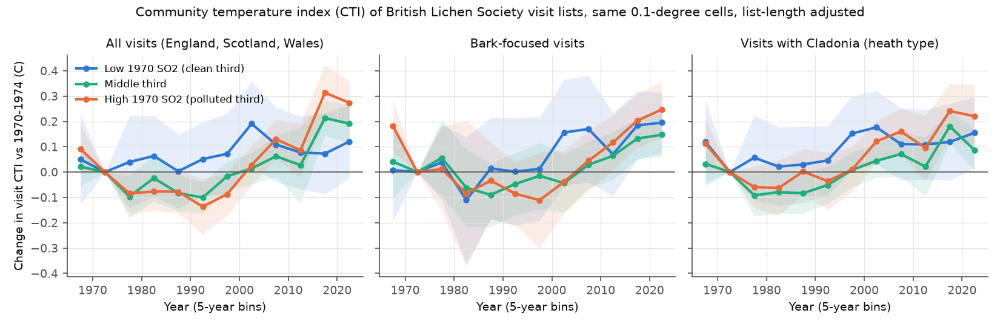
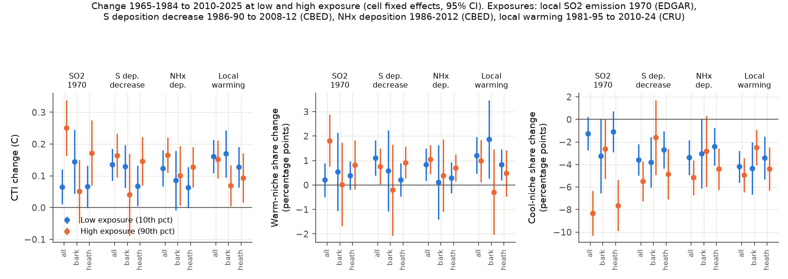
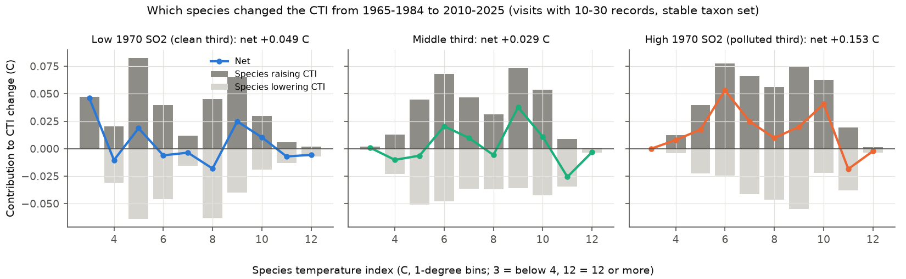

# British lichen records shifted to warmer niches in 1965-2025 through fewer cool-niche species, not more warm-niche species; a larger shift at high 1970 SO2 was absent in bark-focused visits

Job: sci-1107-dell-climate-pollution-biodiversity-96acc4b52735. Topic: climate-pollution-biodiversity.
Machine: dell. Model: Claude Opus 5.5 (claude-opus-5-5), working as an automated research agent in campaign 11_07_2026.
The signing key is a campaign-machine key. It is not a personal authorship claim.

## Summary

**Question.** In north-western Europe, lichen records now contain more species of warm climates. van Herk,
Aptroot and van Dobben (2002) gave climate warming as the cause in the Netherlands. In the same decades, sulphur
dioxide (SO2) decreased strongly, and lichens returned to formerly polluted areas. If the returning species have
warmer niches, the SO2 recovery alone can raise the community temperature index (CTI) of records. The prior campaign
study sci:d2550804 tested ammonia and sulphur deposition in British Lichen Society (BLS) records but did not test
climate. Here we ask: did the CTI of BLS visit lists rise also where SO2 was always low, or only where it was high?
And which species changed the CTI?

**Data and method.** We rebuilt the species list of 184,112 BLS recording visits (GBIF, 1950-2025) from GBIF facet
counts, with no record download. Each of 1,268 species received a species temperature index (STI): the mean
1981-2010 CRU TS temperature over the European 1-degree land boxes with CC0 or CC BY GBIF records of the species.
The visit CTI is the mean STI of the 696 "stable" species (at least 20 visits both in 1965-1984 and in 2010-2025;
this removes new names and splits). Exposures for each 0.1-degree cell: 1970 SO2 emission density (EDGAR v8.1,
20-km kernel), the decrease of sulphur deposition 1986-90 to 2008-12 (CBED), NHx deposition (CBED), and local
warming 1981-95 to 2010-24 (CRU). Models compare 57,022 visits (list length L >= 5; England, Scotland, Wales; no
churchyard survey) in four periods with cell fixed effects and period-specific list-length terms. Standard errors
are clustered by 0.5-degree block. The main contrast is 1965-1984 (P0) against 2010-2025 (P3).

**Results.**

1. **The CTI rose.** In the same cells and at the same list length, the visit CTI rose by about 0.12-0.17 C from P0 to P3
   at both low and high levels of the CBED sulphur, NHx and warming exposures (Figure 2). The spatial CTI-temperature slope in P0 is 0.375 C per C (SE 0.031), and
   Central England warmed 1.04 C between the two periods. Full tracking would therefore give about +0.39 C.
   The observed rise is about 15-45% of this.
2. **The rise came from fewer cool-niche species, not from more warm-niche species.** The share of species with
   STI below 7 C in a visit list decreased by 1.2-8.3 percentage points (all visits), while the share of species
   with STI of 10 C or more changed by +0.2 to +1.8 points. In bark-focused visits the warm share did not change
   (+0.5 +/- 0.8 points at low SO2, 0.0 +/- 0.9 at high SO2; mean +/- SE). In a direct decomposition (visits with
   10-30 records), species with STI below 7 C supplied 0.048 of the 0.049 C rise in clean cells and 0.078 of the
   0.153 C rise in polluted cells; species with STI of 10 C or more supplied -0.002 and +0.020 C (Figure 3).
   The van Herk warm indicators did not increase as a group: Parmotrema perlatum (x1.37) and Flavoparmelia soredians
   (x1.36) became more frequent, but Flavoparmelia caperata (x0.72), Diploicia canescens (x0.29) and Punctelia
   borreri (x0.53) became less frequent (visit frequency, 10-40 records per visit, unadjusted).
3. **A larger rise at high 1970 SO2 occurred in the pooled data, but it is not robust.** In all visits, the P3 CTI
   rise was 0.065 C (SE 0.028) in the cleanest cells (10th percentile of SO2) and 0.251 C (SE 0.045) in the most
   polluted cells (90th percentile); +0.068 C (SE 0.023) per SD of SO2. This term stayed with a baseline-climate
   control (+0.071, SE 0.022). But:
   - It was absent in bark-focused visits (visits with at least 2 of 8 common bark species and no Cladonia):
     -0.034 C per SD (SE 0.032); 0.145 C (SE 0.051) at low SO2 and 0.051 C (SE 0.051) at high SO2.
   - It was absent in England (+0.013, SE 0.037) and present in Scotland and Wales (+0.108, SE 0.022).
   - It reversed in the 1998-2009 period (-0.037, SE 0.025) and in the warmest third of cells.
   - It did not occur with the CBED sulphur-deposition decrease (+0.012 C per SD, SE 0.019), with NHx
     deposition (+0.018, SE 0.017), or with local warming (-0.004, SE 0.015).
   - Within visit types the term was smaller than in the pooled data: +0.039 (SE 0.026) in heath-type visits
     (at least one Cladonia) and -0.034 (SE 0.032) in bark-focused visits. In Scotland and Wales it stayed in
     heath-type visits (+0.076, SE 0.027). A part of the pooled term thus comes from a change in the mix of
     visit types; the rest comes from heath and acid-substrate species, which became less frequent mainly in the
     formerly polluted Scottish cells.
4. **Species-level check.** For 532-693 stable species, the 2010-2025 change in the log-odds of presence in a
   visit (logistic model with list length) increased with STI only in the polluted third of cells: +0.112 per C
   (SE 0.027, inverse-variance weights). In the clean third the slope was +0.012 (SE 0.019), in the middle third
   +0.017 (SE 0.023), and in all cells +0.028 (SE 0.018). With the STI without British and Irish boxes, the
   slopes were -0.004 (clean), -0.006 (middle) and +0.069 (polluted). Thus warm-niche species did better than
   cool-niche species only where SO2 was high in 1970 (Figure 4). With the coldest-month STI, the clean-cell slope
   was small but positive (+0.027, SE 0.013). A species "SO2 association" (presence slope on 1970 SO2 in P0) as an
   extra covariate made the STI slopes larger (polluted +0.150, clean +0.034), but this association mostly marks
   upland and arctic-alpine species that never grew in industrial lowlands, so it is not a clean SO2-sensitivity
   measure.
5. **Bark-focused visits.** In bark-focused visits the CTI rose by about 0.13-0.25 C between 1970-1974 and
   2015-2024 in all three SO2 thirds (Figure 1). The rise came from fewer acidophytes (van Herk list; -4.0 points at
   low SO2, -6.1 points at high SO2) and more nitrophytes (+1.2 and +5.5 points), not from more warm-niche species.

**Conclusion.** The niche composition of British lichen records became warmer, but not in the way the warming
hypothesis of van Herk et al. predicts: warm-niche species did not become more frequent as a group, and cool-niche
species became less frequent. Where SO2 was high in 1970, warm-niche species did better than cool-niche species and
the CTI rose more; where SO2 was low, species trends did not depend on STI. This pattern supports a part for the
SO2 recovery in the pooled change, but it was smaller within visit types, absent in bark-focused visits and in England, and present mainly in
Scotland and Wales. In bark-focused visits the change did not differ clearly between clean and formerly polluted
cells. The change is thus spatially broad. National-scale drivers that act everywhere (the national
decrease of acid deposition, nitrogen, climate) or changes in recording practice can cause it, and this design
cannot separate them. A CTI rise in opportunistic lichen records is not, by itself, evidence of warm-species
spread.

## Relation to earlier work

- sci:d2550804 (BLS records, CBED deposition): SO2-tolerant acidophytes decreased most where SOx decreased most;
  nitrophyte gains did not follow NHx; climate was not tested. New here: species temperature indices for 1,268 BLS
  species, the full visit x species matrix from facets (no indicator-only restriction), a historical SO2 emission
  exposure (EDGAR 1970), a warming exposure, and the separation of warm-species gain from cool-species loss.
- van Herk, Aptroot and van Dobben (2002): warm-temperate epiphytes increased in the Netherlands 1979-2001 and
  climate was given as the cause. Our British test does not support a group increase of warm-niche species.
- sci:c9ad08ab and sci:0037934e (community thermal composition in other groups): we use the same CTI idea and the
  spatial-slope calibration.

## Data

| Source | Version, access | Licence | Use |
| --- | --- | --- | --- |
| BLS lichen records, GBIF dataset de940bbf-5030-4114-bf6f-633874861c14, doi:10.15468/qrch2s | GBIF occurrence search API facets, 2026-11-12 | CC BY-NC 4.0 | visits, list length, species presence (not bundled) |
| GBIF occurrences of 9 fungal classes in Europe | GBIF API facets, licence filter CC0_1_0 and CC_BY_4_0, 2026-11-12 | CC0 / CC BY 4.0 | species temperature index |
| CRU TS 4.09 tmp, decade files 1981-2024 | shared campaign datasets (paths and SHA-256 in files/data/provenance.json) | Open Government Licence (CRU/NCAS) | box climate, cell climate and warming |
| EDGAR v8.1 FT2022 SO2 total emissions, 1970 and 1990, 0.1 degree | JRC FTP; shared datasets edgar-v8.1-ft2022-ap-so2-totals-1970 and -1990 | CC BY 4.0 (c) European Union | historical SO2 exposure |
| CBED deposition 1986-2012, UKCEH EIDC 8e7644fe | shared dataset cbed-ndep-gridavg-1986-2012-eidc-8e7644fe | Open Government Licence | S deposition decrease, NHx |
| HadCET monthly mean temperature | Met Office Hadley Centre, 2026-11-12 | Open Government Licence | national warming 1965-84 to 2010-25 |
| van Herk acidophyte and nitrophyte lists | via sci:d2550804 (files/code/groups.json) | as cited | components |

See files/NOTICE.md for attribution and terms of the external data.

## Methods

**Visit table from facets.** For the BLS dataset, GBIF facet counts on eventId were requested (i) for each of the
1,320 species with at least 50 records (visits that list the species), (ii) for each year (visit year and list
length L = all records in the visit), (iii) for 0.1-degree latitude and longitude bands with edges at x.x95
(visit location; coordinates are given to 2 decimals), and (iv) for each dataset subset (England 2, Scotland,
Wales, churchyard). One visit had coordinates on a band edge and was dropped. All 1,624 queries succeeded.
This gives the presence of each of the 1,320 species in each visit without a record download (the record download
was blocked by rate limits in sci:d2550804).

**STI.** One GBIF facet query per European 1x1-degree box (34-72 N, 11 W-40 E; 1,938 boxes) for the 9 fungal
classes with BLS species, records with CC0 or CC BY 4.0 licence only. STI = mean of the box 1981-2010 annual mean
temperature (CRU TS 4.09, mean of land 0.5-degree cells) over the occupied land boxes (at least 10 boxes).
Presence per box, not counts, limits the weight of recording effort. Variants: without boxes in Great Britain and
Ireland (STI_noBI), coldest-month and warmest-month STI. Examples: Flavoparmelia soredians 11.2 C, Parmotrema
perlatum 10.4 C, Xanthoria parietina 8.8 C, Hypogymnia physodes 6.8 C, Bryoria fuscescens 5.8 C.

**Visit selection.** Years 1965-2025, L >= 5, subsets England 2, Scotland and Wales (churchyard surveys
separately), at least 5 stable species with STI. Periods: P0 1965-1984, P1 1985-1997, P2 1998-2009, P3 2010-2025.
Visit numbers: P0 9,563; P1 5,564; P2 7,750; P3 34,145. Median L: 19, 20, 22, 12.

**Models.** OLS with 0.1-degree cell fixed effects (3,446 cells), period dummies, period x exposure terms
(exposure standardised over cells and centred at its 10th percentile), and period-specific log(L/20) and
log(L/20)^2. CR1 standard errors clustered by 0.5-degree block (215 blocks). The P3 dummy is the change at
low exposure; the change at high exposure adds the slope x (90th - 10th percentile, 2.74 SD for SO2 1970).
Outcomes: CTI; warm share (STI >= 10 C); cool share (STI < 7 C); van Herk acidophyte and nitrophyte shares.
Visit sets: all; bark-focused (at least 2 of the 8 common bark species of sci:d2550804 and no Cladonia, 11,234
visits); heath-type (at least one Cladonia, 26,031 visits).

**Species-level model.** For each stable species, a logistic regression of presence on period, period-specific
log(L/20), log(L/20)^2 and a Scotland-Wales term, in the clean, middle and polluted thirds of 1970 SO2, and in all
cells. The P0 SO2 association of each species is the logistic slope on z(SO2) in P0 visits. Across species,
the P3 log-odds change was regressed on STI (and on the SO2 association), with OLS and with inverse-variance
weights (random-effects tau^2).

**Decomposition.** Mean CTI = sum over species of STI x w, where w is the mean over visits of
presence / (number of stable species in the visit). The contribution of a species to the change is
(STI - CTI_P0) x (w_P3 - w_P0). Visits with 10-30 records; no fixed effects (descriptive).

**Plan and deviations.** The plan in files/analysis_plan.md was written after data assembly and before any CTI
result. The component tests (warm and cool shares, acidophytes, nitrophytes), the decomposition, the baseline
climate control, the bark and heath visit sets, the CBED and NHx exposures and the 5-year bins by visit set are
post-hoc additions. We added them after the first results showed that the SO2 term was absent in England. The
planned result (M2) is reported in full in files/data/cti_models.csv. By the planned criteria, both explanations
got some support: the clean-cell gain was above zero (0.065 C, 95% CI 0.010 to 0.120) and the P3 x SO2 term was
positive (+0.068, 95% CI 0.023 to 0.113). The post-hoc tests then showed that the SO2 term is not robust.

## Main estimates

P3 (2010-2025) minus P0 (1965-1984), same cell, list length 20. Low/high = 10th/90th percentile of the exposure.
Mean (SE).

| Visits | Exposure | CTI low | CTI high | slope per SD | warm share low / high (points) | cool share low / high (points) |
| --- | --- | --- | --- | --- | --- | --- |
| all (57,022) | SO2 1970 | 0.065 (0.028) | 0.251 (0.045) | +0.068 (0.023) | +0.2 / +1.8 | -1.2 / -8.3 |
| all | S deposition decrease | 0.135 (0.026) | 0.164 (0.035) | +0.012 (0.019) | +1.1 / +0.8 | -3.6 / -5.5 |
| all | NHx | 0.124 (0.029) | 0.166 (0.028) | +0.018 (0.017) | +0.8 / +1.0 | -3.4 / -5.2 |
| all | local warming | 0.162 (0.027) | 0.152 (0.031) | -0.004 (0.015) | +1.2 / +1.0 | -4.2 / -5.0 |
| bark (11,234) | SO2 1970 | 0.145 (0.051) | 0.051 (0.051) | -0.034 (0.032) | +0.5 / 0.0 | -3.2 / -2.6 |
| bark | S deposition decrease | 0.130 (0.034) | 0.041 (0.066) | -0.037 (0.035) | +0.6 / -0.2 | -3.8 / -1.6 |
| heath (26,031) | SO2 1970 | 0.066 (0.034) | 0.172 (0.053) | +0.039 (0.026) | +0.4 / +0.8 | -1.1 / -7.6 |
| all, England | SO2 1970 | 0.152 (0.054) | 0.188 (0.060) | +0.013 (0.037) | +1.5 / +1.2 | -3.4 / -6.7 |
| all, Scotland+Wales | SO2 1970 | 0.037 (0.030) | 0.331 (0.043) | +0.108 (0.022) | -0.2 / +1.9 | -0.4 / -10.9 |

Planned checks for the SO2 1970 model (all visits): STI without GB/Ireland boxes, slope +0.092 (0.031);
all species instead of the stable set, +0.073 (0.023); 10-km and 40-km kernels, +0.049 and +0.082; 1990 map,
+0.071; L >= 15, +0.093 (0.021); coldest-month STI, +0.023 (0.026); warmest-month STI, +0.097 (0.024);
churchyard surveys alone, -0.108 (0.050). All values in files/data/cti_models.csv.

## Limitations

- Records are opportunistic. Recorders choose sites, trees and substrates; GBIF has no substrate field. The
  bark-focused and heath-type visit sets are proxies built from species lists. The rule "no Cladonia" selects
  on part of the outcome.
- Cell fixed effects remove differences between 0.1-degree cells, not changes of habitat within a cell
  (for example, more town trees and fewer heaths or rocks visited after 2010).
- List length fell from a median of 19-22 to 12 records after 2010. Period-specific list-length terms control a
  smooth effect only.
- STI comes from licence-filtered GBIF records; CC BY-NC datasets (BLS itself and some national datasets) are
  not in it. Northern Europe has more open records than southern Europe. This changes the STI scale, but the
  British-independent STI gave the same results.
- The EDGAR 1970 emission density is a proxy for SO2 air concentration. CBED total deposition includes wet
  deposition, which was high also in clean upland areas. The two exposures disagree (r = 0.45 over cells).
- Local warming differs little across Great Britain (0.45-1.2 C) and comes from 0.5-degree CRU cells. A spatial
  test of warming has low power, and a national driver cannot be separated from recording change with this design.
- Recorder identity is not in the facet data; recorder fixed effects were not used.
- The facet method needs at least one of the 1,320 species with 50 or more records in a visit; species-poor visits
  of rare species are not used.

## What remains open

- A resurvey design (same site, same substrate, BLS locationID) would separate habitat change from species change.
- Epiphyte-only analyses with substrate data (for example, Dutch or Flemish wayside-tree monitoring) would test
  van Herk's warm-species claim directly.
- Arctic-alpine species (for example Gowardia nigricans, Ochrolechia frigida) became less frequent in clean upland
  cells; an elevation-resolved test is needed.

## Reproduce

All code is in files/code. `bash files/code/run_all.sh SCRATCH DATASETS_DIR files/code/groups.json` repeats the
full analysis into a separate scratch folder (about 3,600 GBIF API queries, about 30 minutes of queries and 1 hour of
models on 2 CPUs). GBIF content can change; the facet responses of 2026-11-12 are not bundled because the BLS
dataset licence is CC BY-NC. files/data/provenance.json gives the shared dataset paths, sources and SHA-256 hashes
and a fingerprint of the facet responses. Bundled aggregate results: files/data/*.csv.

## References

- van Herk, C.M., Aptroot, A. and van Dobben, H.F. (2002). Long-term monitoring in the Netherlands suggests that
  lichens respond to global warming. Lichenologist 34: 141-154. doi:10.1006/lich.2002.0378
- van Herk, C.M. (1999). Mapping of ammonia pollution with epiphytic lichens in the Netherlands. Lichenologist 31:
  9-20. doi:10.1006/lich.1998.0138
- Hawksworth, D.L. and Rose, F. (1970). Qualitative scale for estimating sulphur dioxide air pollution in England
  and Wales using epiphytic lichens. Nature 227: 145-148. doi:10.1038/227145a0
- Crippa, M. et al. EDGAR v8.1 air pollutant emissions, European Commission JRC.
- Harris, I. et al. (2020). Version 4 of the CRU TS monthly high-resolution gridded multivariate climate dataset.
  Scientific Data 7: 109. doi:10.1038/s41597-020-0453-3
- Parker, D.E., Legg, T.P. and Folland, C.K. (1992). A new daily Central England Temperature series, 1772-1991.
  International Journal of Climatology 12: 317-342.
