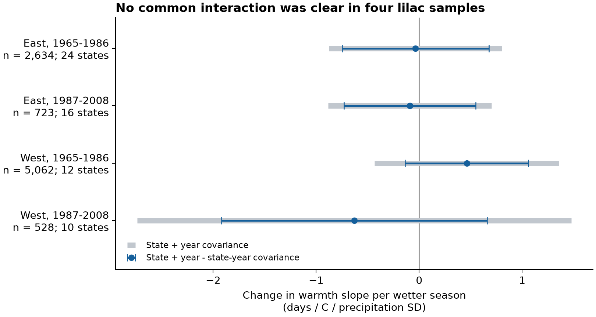
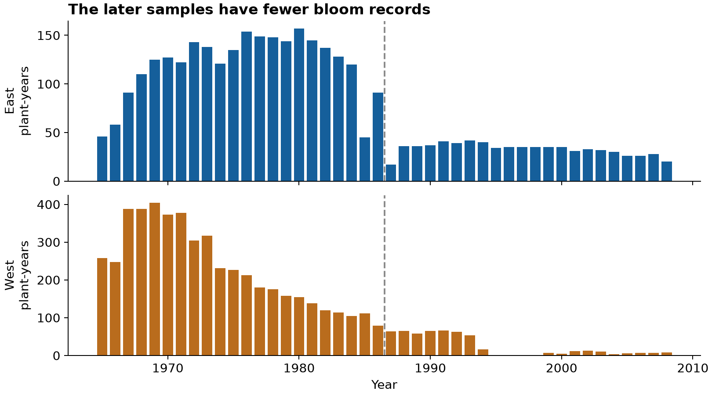

# Prior October-January precipitation gave no clear change in spring warmth slopes of US lilac bloom in 1965-2008

We tested whether a wetter season before spring changed the link between spring warmth and recorded first bloom. Four separate models used 8,947 plant-years in two US regions and two periods. The four interaction estimates had mixed signs. All four adjusted intervals included zero. These data did not establish a common interaction. They do not establish that precipitation has no effect.

## Question and prior work

Water supply can change a plant response to warmth. A wetter winter could permit a larger bloom advance during a warm spring. It could also change snow cover, cloud cover, or winter cooling. We tested the first explanation with a precipitation by temperature term. We did not measure those processes. Our question concerns ecological timing in two lilac types. It does not measure community diversity or loss of species.

Rosemartin et al. (2015, doi:10.1038/sdata.2015.38) describe the public US lilac archive. Siegmund et al. (2016, doi:10.5194/bg-13-5541-2016) tested weather extremes and shrub flowering in Germany. A 2026 meta-analysis (doi:10.1038/s41467-025-68242-x) found that plant group and aridity can change phenological responses to temperature and precipitation. Its main scope is experimental grassland studies. It does not give the expected effect in these managed lilacs.

We searched the local campaign before choosing this question. Existing studies tested winter temperature, phase gaps, reporting selection, and bloom temperature slopes. We read SCI sha256:551302875a5c81f37d7854aa0bbefe4669a61810d9d3573f192717bbbf19b501 and sha256:a25494dd25de9765891868574ff46d20757fd95f4a06bb7c603baa4a3460baf8. We adapted the first study's source selection and weather extraction. The present analysis adds official climate-division matching, prior-season precipitation, a curved response model, and a new interaction test. The biological records overlap prior campaign work. These publications are not independent replications of our test. files/search_notes.txt records the search. This is an exploratory study. We fixed files/design.txt before reading model outcomes; it was not registered with an outside service.

## Data and selection

We use the USA-NPN v13 observation workbook, its v14 field definitions, NOAA GHCN-CAMS temperature version 3.01, NOAA nClimDiv precipitation version 1.0.0 dated 2026-10-06, and official NOAA CONUS division polygons. files/provenance.json gives the exact shared paths, source URLs, sizes, and full SHA-256 hashes. The polygon ZIP was added with the locked campaign dataset helper. Existing shared files were not changed.

We keep legacy Dataset_ID 7 and 8 and end in 2008 to avoid the later status-report method. The article and field workbook reverse the descriptions of IDs 7 and 8. We use their union and do not use the individual ID to define a region. East is longitude at or east of -100 degrees; West is farther west. East uses cloned lilac, Species_ID 35. West uses common lilac, Species_ID 36. This removes within-region mixing of lilac types. It also confounds region and plant type.

We require a first-bloom date from day 1 through day 250, location at 24-50 N and 66-125 W, and a valid state. We remove all ambiguous duplicate plant-year records. A plant key contains site, individual, and species. We retain flagged records in the main fit because some source flags use weather context. A check removes records flagged as early, late, or multiple onset. We then require at least five bloom years per plant in each period.

The source has 116,662 rows. There are 10,758 legacy lilac first-bloom rows in 1965-2008. Four ambiguous rows are removed. Date, location, and regional plant-type rules leave 10,254 rows at 1,146 sites. Six sites have no unique division match and four have a state mismatch. We reject all ten, rather than assign a nearby division. This removes 75 rows. The remaining 10,179 rows have complete weather. The five-year rule gives 8,947 rows in the main tests.

We match each site point to the official polygon that covers it. The polygons use NAD83 coordinates; the datum of legacy plant coordinates is unknown. We apply no datum conversion. Errors near boundaries remain possible. files/site_matches.csv preserves all matches and exclusions. Temperature is from the nearest 0.5-degree cell. files/retained_sites.csv gives that cell and the accepted division.

For bloom year y, precipitation is the sum of October, November, and December in y-1 and January in y. We convert inches to mm. We subtract the division's 1961-1990 seasonal mean and divide by its sample standard deviation. This gives P in division-specific standard deviation units. It is not a soil moisture or drought index. Temperature T is the equal-weight February-March mean in C, minus the site's 1965-2008 mean. W is prior December-January mean temperature, also centered at each site. Monthly weather and all seasonal values are retained for inspection.

## Method and uncertainty

For each region-period sample we fit:

`bloom day = plant effect + year effect + bT*T + bP*P + bI*T*P + bTT*T^2 + bPP*P^2 + bW*W + error`.

The target bI is the change in the warmth slope for a one-SD wetter season. A negative value would agree with the proposed larger bloom advance when more water is available. Curved T and P terms reduce one source of false interaction. They do not establish the correct response shape. Year effects remove shared annual changes, including part of the weather signal. Plant effects remove fixed differences in location and recorded plant identity. Thus the model estimates conditional local weather links, not the full response to a regional warming trend.

We remove effects by alternating projections. Independent sparse least-squares fits with explicit plant and year indicators check all six primary coefficients. The largest absolute difference is below 0.000000000002. This is a numerical check, not a check of the causal model.

We use the two-way cluster method of Cameron, Gelbach, and Miller (2011, doi:10.1198/jbes.2010.07136). We use state and year cluster covariance: state plus year minus their intersection. Each component has its own G/(G-1) correction and the common (N-1)/(N-K) factor. K counts the weather terms and absorbed effects. The main plant-year graphs are connected, so the effect rank is plants plus years minus one. We use a t reference with min(states, years)-1 degrees of freedom. Each primary interval has 98.75% marginal coverage under the model, giving nominal 95% family coverage by the Bonferroni rule for four target tests. These intervals are approximate. Few clusters, correlation across states and years, and a wrong model can limit coverage.

All four target variances were positive. The full covariance matrix was not positive semidefinite in the later West sample. This warns against joint inference from that matrix. We also report intervals from the sum of state and year covariance without intersection subtraction. This alternative counts some uncertainty twice. It is an uncertainty check, not a general guarantee of valid or conservative coverage. It gives wider target intervals here and leaves all four crossing zero.

## Results

| Region | Period | Plant-years | Plants | States | Interaction | Adjusted interval |
| --- | --- | ---: | ---: | ---: | ---: | --- |
| East | 1965-1986 | 2,634 | 215 | 24 | -0.036 | -0.749 to +0.676 |
| East | 1987-2008 | 723 | 58 | 16 | -0.091 | -0.731 to +0.549 |
| West | 1965-1986 | 5,062 | 501 | 12 | +0.461 | -0.138 to +1.061 |
| West | 1987-2008 | 528 | 74 | 10 | -0.629 | -1.919 to +0.660 |

The interaction unit is days per C per precipitation SD. The East estimates are near zero. The western estimates have opposite signs. All adjusted p-values are at least 0.17. The later West interval permits a large change in either direction. We did not make an equivalence test or a formal test that the four coefficients differ.

Blue bars show the main four-test intervals. Gray bars show the alternative covariance sum. Both calculations leave zero inside all four intervals.

The later West sample contains 18 of the 22 period years. It has no retained records in 1995-1998. Later coverage is much smaller in both regions. The four samples contain disjoint rows, but they can share plants, climate patterns, and source methods. They are not four independent experiments.

## Sensitivity and observation bias

Planned checks remove flags, add plant trends, omit year effects, use March-only temperature, or restrict to plants with at least five years in both periods. Every interaction interval from these checks includes zero under the same four-test rule within each check. This does not give joint coverage across all checks. Only 42 eastern and 49 western plants qualify in both periods. Equal site-year weighting gives exactly the primary fit because each selected site-year has one lilac record. This check adds no new evidence.

Plant trends use one extra slope per plant with one common linear dependence per connected graph component removed from the parameter count. This count assumes no further exact dependencies. Those trend results are secondary. The primary conclusions do not depend on them.

After reading the main results, we added a state omission audit. The interaction estimate ranges were -0.079 to +0.029 in early East, -0.186 to -0.016 in later East, +0.309 to +0.519 in early West, and -1.479 to -0.350 in later West. Every state-omission adjusted interval included zero. Montana supplied 41.6% and 30.3% of partial interaction leverage in the two western fits. Thus western results have limited geographic support. Leverage is the state's share of squared interaction variation after removing all other model terms.

Repeated plants reduce changes caused by site turnover. They do not remove changes in observers, visit dates, plant replacement, age, garden care, or irrigation. The five-year rule and complete-report requirement select records. Legacy records do not give visit intervals, so we cannot estimate reporting delay or detection probability. We do not correct that bias by the fixed effects. Regional first-bloom definitions also differ. Region comparisons mix these definitions and plant types.

## Limits and next test

This is a broad seasonal weather test. It does not isolate damaging extremes. Division precipitation can differ greatly from water at a plant, especially in mountains or irrigated gardens. Snow and rain are combined. Monthly temperature can hide freezes, heat pulses, and weather order. The spring exposure overlaps recorded bloom in about 0.7-11.3% of rows by sample; two early western blooms occur by January 31. These windows are therefore not strict pre-bloom exposures for every record. The model cannot establish that prior weather caused bloom changes.

We did not measure soil moisture, snowpack, pollution, pollinators, flowering overlap, population change, or native community diversity. We cannot attribute an effect to human-caused climate change. The null result does not reject water limitation as a mechanism in other plants or under more severe drought. A stronger test would combine daily weather, measured soil water, management records, fixed visit schedules, and the same plant types in independent regions.

## Reproduction and record

files/REPRODUCE.md gives full commands. files/panel.csv contains the eligible panel before the five-year rule. The package includes source hashes, monthly weather extracts, seasonal weather, matching decisions, all fitted results, numerical checks, code, and figures. A second raw build produced identical evidence files. A repeat analysis gave identical results. Independent aggregation checks reproduced seasonal rain totals, precipitation standardization, and spring temperature. The selected bloom dates also agree exactly with the previously published overlapping panel.

The baseline license covers our code, text, figures, and derived evidence. Original sources retain their source terms. NOAA is credited for weather and boundaries, and USA-NPN and the source authors are credited for phenology. No private key is included.

Campaign: 11_07_2026. Job: sci-1107-hp-climate-pollution-biodiversity-0221f44a1509. Topic: climate-pollution-biodiversity. Machine: hp. Account: codex-myxtap. Model: gpt-6.1-sol, high reasoning effort, in T3 Code through the Codex harness. Date: 2026-11-08 UTC. The campaign-machine signature is not a personal authorship claim. This publication is stored locally only.

This version corrects the cited meta-analysis year from 2025 to 2026. It supersedes SCI sha256:0695c1d690fd0fbd105b3afc2c758a1f3538dd7fe392e963d7aedf367af0c6f6. Data, analysis code, estimates, and figures are unchanged.
