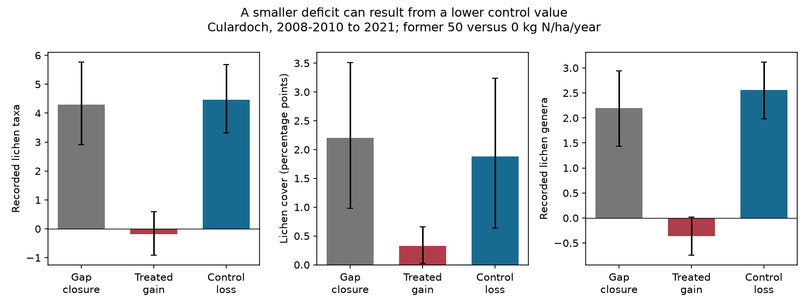
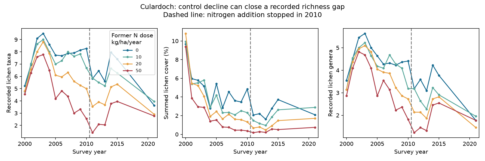

# Recorded lichen richness gaps closed mainly through control losses after nitrogen addition stopped at Culardoch

## Main result

At one Scottish alpine heath, the recorded lichen richness deficit in former high-nitrogen plots fell by 83% between 2008-2010 and 2021. This did not show a return of the lost richness. The high-dose plots recorded no clear gain. Most gap closure came from lower richness in controls. The cover deficit also became smaller, but it remained clear eleven years after nitrogen addition stopped.

This is evidence that a smaller treatment gap can give a misleading measure of biological recovery. It is not evidence that nitrogen caused the decline in control plots. Common environmental change and changes in recording can both contribute to that decline.

Contains data supplied by UK Centre for Ecology & Hydrology.



## Question and added knowledge

Earlier SCI work found weak transfer from spatial temperature gradients to community change in time. It also found weak transfer from land-cover gradients. That result raises a general question: can persistent community states limit response to a change in environmental pressure? We test an independent case in which an imposed pressure was removed. No BBS records, Finnish moth records, or network response summaries enter the analysis.

We asked whether vegetation recovered after experimental nitrogen addition stopped. A 2026 data release makes a long follow-up at Culardoch available. The release covers several experiments, but only Culardoch has repeated surveys through a long recovery period. The study is thus one site, not a synthesis of recovery across the UK.

Britton and Fisher (2007; doi:10.1111/j.1365-2664.2006.01251.x) already showed nitrogen effects on lichen diversity in the first five years at this site. Earlier recovery work at another heath also found slow responses of lichens and bryophytes (doi source listed below). We do not claim to discover nitrogen damage or slow recovery. Our addition is the 2021 test, an exact split of apparent deficit closure, checks at genus and cover thresholds, and a design audit of the new release. The methods are simple accounting and blocked randomization. The scientific result comes from new use of the long follow-up.

The recovery question preceded outcome inspection. The specific gap-closure test followed an inspection of annual group means. It is exploratory. files/PLAN.md records that sequence.

## Source and design

Perring and colleagues (2026), EIDC doi:10.5285/b9e76736-7db9-4576-acd9-dfdf9f8ff9a3, rescued species cover records and experimental metadata. The dataset publication date is 24 June 2026. We downloaded it on 11 November 2026. The source documentation describes fixed 50 by 50 cm quadrats surveyed in May. The data contain all 96 Culardoch plots in 17 years: 2000-2015 and 2021. The site is alpine Calluna-Cladonia heath at 57.0707 N, 3.3483 W.

Nitrogen doses were 0, 10, 20 and 50 kg N per hectare per year, supplied as ammonium nitrate from 2000 to 2010. All plots still received ambient deposition after treatment stopped. The design has three blocks, warming and burning subgroups, and nitrogen and clipping treatments within those subgroups. Burning took place in 1999. Warming began in 2004; the source reports about 0.36 C warming. Clipping removed about 12% of annual aboveground growth until 2022. We use these factors to match nitrogen comparisons. We do not estimate a causal warming interaction with only three blocks.

The metadata do not give exactly one plot per dose in two block-by-warming-by-burning-by-clipping strata. One has two controls and one has none. We did not infer a correction. We excluded both strata, which contain eight plots. The primary analysis uses 88 plots in 22 complete matched strata, including 22 high-dose and 22 control plots. All annual means and figures use this same subset. The code identifies the affected records from the metadata without storing a record extract in this bundle. The omission can affect generality if it removes a special context.

## Outcomes and method

We include all lichen records, with or without a BLS code. Code lists the 12 recorded lichen genus labels. Richness means the number of positive recorded taxon labels per plot. Some labels identify groups or genera. It is not a count of fully resolved biological species. A second measure counts the recorded genus labels. Synonyms are used as supplied; this genus check tests recording resolution, not a complete modern taxonomic revision. Cover is the sum of lichen percent covers. It can include vertical overlap and is not a biomass measure. Missing taxon rows are treated as unrecorded, not as known biological absence. All plot-years contain survey records.

For each matched stratum we compare former 50 with 0 kg N per hectare per year. The early endpoint is each plot's mean in 2008-2010. The late endpoint is 2021. Define C as the control value and T as the high-dose value. The deficit is D = C - T. Its closure obeys the exact identity:

D_early - D_late = (T_late - T_early) + (C_early - C_late).

Thus closure equals treated gain plus control loss. Positive closure alone is not sufficient evidence for recovery. The identity applies to recorded outcomes regardless of why their values change.

We use 19,999 bootstrap samples, drawing matched strata with replacement within each source block and retaining their full histories. Limits are descriptive, conditional 95% percentile intervals. They do not give uncertainty across sites or include observer error. Strata have different imposed contexts, so these intervals require a working assumption of exchangeable residual variation within blocks. They can understate uncertainty from common shocks.

For final deficits and deficit changes we swap the control and high-dose history within each matched stratum in 19,999 random assignments. We use two-sided tests and plus-one p values. These are conditional randomization tests under sharp nulls of no high-dose effect on the final outcome, or on its temporal change, respectively. The source reports random nutrient assignment within the nested design; inference also assumes no interference and correct retained labels. Bonferroni adjustment covers the three primary outcomes separately for final deficits and closure. The exploratory selection of the question is not removed by that adjustment.

Sensitivity analyses change the early window to 2007-2010 or 2009-2010, use 2013-2015 as an intermediate endpoint, count only lichen taxa with at least 0.5% or 1% cover, and show each block. All are reported, including results that differ from the primary result.

## Estimates

Values are means over 22 matched strata. Parentheses give conditional bootstrap limits.

| Outcome | Early deficit | 2021 deficit | Treated gain | Control loss |
| --- | ---: | ---: | ---: | ---: |
| Recorded taxa | 5.15 (3.67, 6.77) | 0.86 (0.09, 1.64) | -0.18 (-0.91, 0.59) | 4.47 (3.32, 5.68) |
| Summed cover, percentage points | 3.55 (2.13, 5.26) | 1.35 (0.59, 2.12) | 0.33 (0.02, 0.66) | 1.88 (0.63, 3.23) |
| Recorded genera | 2.20 (1.36, 3.03) | 0.00 (-0.50, 0.50) | -0.36 (-0.74, 0.02) | 2.56 (1.98, 3.12) |

For recorded taxa, control richness fell from 8.11 to 3.64, while high-dose richness changed from 2.95 to 2.77. The deficit closed by 4.29 taxa (2.91, 5.77). Control loss exceeded the net closure because the treated mean also fell. Genus counts show the same pattern. Each block had a large control richness loss, from 3.72 to 4.92 recorded taxa.

High-dose cover rose from 0.42% to 0.75%, while control cover fell from 3.97% to 2.09%. Of the 2.21 percentage point gap closure, 1.88 points, or 85% at the point estimate, came from control loss. This percentage is a descriptive ratio, not a precisely estimated process share. All three blocks retained a positive cover deficit in 2021.

The final cover deficit passed the three-outcome correction (adjusted p = 0.0114). Final taxon and genus deficits did not (adjusted p = 0.2397 and 1.0). Their conditional bootstrap intervals and randomization tests answer different uncertainty questions; the taxon interval above zero must not be used to override the randomization result. Closure tests passed that correction for taxa, cover and genera (adjusted p = 0.00015, 0.0108 and 0.00045).



At intermediate 2013-2015 surveys, the taxon deficit remained 3.73, with only 0.30 treated gain and 1.12 control loss since 2008-2010. Much of the final richness convergence appeared after 2015, across a six-year unsurveyed interval. We cannot date this change more closely.

Both alternative reference windows retain the primary pattern: treated taxon gain ranges from -0.53 to -0.16, while control loss ranges from 4.41 to 4.57. The cover-threshold checks are less uniform. At 0.5% cover, treated plots gained 0.58 taxa (0.18, 0.98), while controls lost 0.68 (0.03, 1.33). At 1% cover, treated gain was 0.14 (-0.05, 0.35), while control loss was 0.59 (0.17, 1.03). Thus some common-taxon recovery occurred. A claim that all apparent recovery came from control losses would be false. All-dose annual means also show that the final response is not a simple smooth monotone dose curve.

## Meaning and limits

The cover result gives an experimental constraint on community memory: the effect of a former high nitrogen dose remained measurable in recorded lichen cover after eleven years without that added dose. It is consistent with slow replacement, resource legacies or other persistent ecological effects. The records do not distinguish soil retention, toxicity, competition, recruitment or dispersal. There are no soil, propagule or detection estimates in this analysis.

The richness split adds a second constraint. Communities can become more similar through losses in the reference community. Similarity to a moving control is not the same as restoration. A scalar lag model of gap closure could treat this convergence as recovery even when the treated outcome does not improve. The useful monitoring target is therefore both the treatment deficit and the two absolute changes, with cover and membership reported separately.

This study does not explain a fraction of the thermal-tracking gap. There is no regional thermal-affinity benchmark, no spatial temperature gradient and no warming-only removal experiment. The result instead adds independent evidence about the limits of inferring community response from a single gap statistic.

The site is one alpine heath. The highest added dose was large. Ambient pollution continued. The source was harmonised from rescued records. Recording skill, taxonomic resolution, or survey sensitivity may have changed, especially by 2021. Reduced detection of rare lichens could mimic some of the observed richness convergence. Genus and threshold checks reduce some concerns but cannot rule them out. No paired observer calibration is available. Taxon absence is not an observed extinction, and a cover increase is not identified recruitment. Only 17 years are sampled; there are no records for 2016-2020. A continued-addition group after 2010 is absent, so changes after cessation cannot be attributed solely to cessation.

## Reproduction and rights

Job: sci-1107-dell-climate-pollution-biodiversity-19d3691d96bb. Topic: climate-pollution-biodiversity. Campaign: 11_07_2026. Machine: dell. Account: codex-olen. Model: gpt-6.1-sol, high reasoning effort. No agents were launched. The campaign-machine signing key is not a personal authorship claim.

The source data remain outside this publication. The exact shared path, release URL, ZIP hash and member hashes are in files/provenance.json. The supplied support archive was also inspected; its hashes are recorded. files/NOTICE-external-data.md gives attribution and terms. This bundle contains our code, narrative, figures and aggregate analysis estimates. It contains no plot-by-species extract or source documentation.

From an unpacked writable bundle, run:

```
python files/retrieve.py /absolute/path/to/external_scratch
OPENBLAS_NUM_THREADS=1 OMP_NUM_THREADS=1 MKL_NUM_THREADS=1 python files/analyze.py /absolute/path/to/external_scratch/ruder_data.zip /absolute/path/to/recomputed
python files/figure.py
```

The analysis reads the ZIP directly and needs no extracted raw table. It writes aggregate estimates and figures into the requested output directory. The last command rebuilds the decomposition figure from bundled aggregate estimates. To use recomputed estimates, place figure.py beside the recomputed primary.csv. Software versions and random seed are recorded. The complete panel, nonnegative covers, unique records, source strata and exact closure identity were checked by the analysis. An independent reconstruction of the main contrasts passed. Re-run it with: python files/validate.py /absolute/path/to/external_scratch/ruder_data.zip files/primary.csv.

## References

- Perring et al. (2026), source release: doi:10.5285/b9e76736-7db9-4576-acd9-dfdf9f8ff9a3.
- Britton and Fisher (2007), original five-year experiment: doi:10.1111/j.1365-2664.2006.01251.x.
- Edmondson et al. (2013), a separate heath recovery study: doi:10.1016/j.scitotenv.2012.11.074.
- Earlier SCI thermal benchmark: sci:sha256:0037934e440093284370046185fd30a78b7363fd6e940f8fd3d9860e2caedada.
