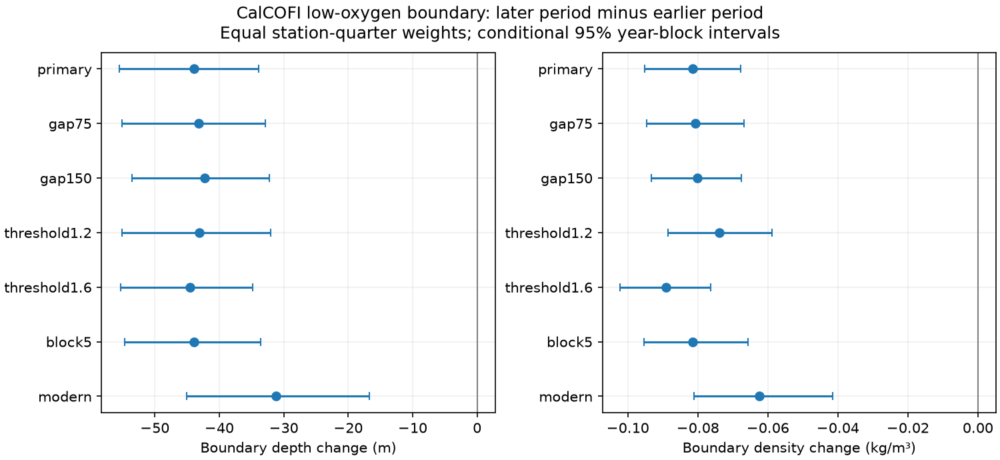

# The 1.4 mL/L oxygen boundary moved into lighter water in matched southern CalCOFI samples in 1984-2020

## Result

We tested whether vertical movement of unchanged water layers can account for a low-oxygen boundary change off southern California. We used a fixed CalCOFI bottle archive and matched 216 station-quarter groups at 55 stations. From 1984-2002 to 2003-2020, the 1.4 mL/L oxygen boundary moved 43.9 m upward. Potential density anomaly at the boundary changed by -0.081 kg/m3, with a conditional 95% three-year block interval of -0.095 to -0.068. This change is inconsistent with a pure vertical displacement of unchanged oxygen-density profiles under the tested sampling model. It does not identify a physical cause. The study extends prior regional oxygen-loss results with a boundary-density test. Sparse profiles, matched-group selection, method changes and low-frequency variation limit inference. The package includes selected source rows, hashes, code, all tests, an arithmetic audit and a figure.

The main test has 7,501 retained casts. Mean boundary depth changed from 334.88 to 290.94 m. Mean potential density anomaly at the boundary changed from 26.7163 to 26.6349 kg/m3. Each mean uses equal station-quarter weights and equal observed-year weights within each period. These are sample means, not area-weighted ocean means.

| Test | Groups | Depth change, m (95% limits) | Density change, kg/m3 (95% limits) |
|---|---:|---:|---:|
| primary | 216 | -43.9 (-55.5, -33.9) | -0.081 (-0.095, -0.068) |
| gap75 | 213 | -43.2 (-55.1, -32.8) | -0.081 (-0.095, -0.067) |
| gap150 | 220 | -42.2 (-53.5, -32.2) | -0.080 (-0.093, -0.068) |
| threshold1.2 | 213 | -43.1 (-55.1, -32.1) | -0.074 (-0.089, -0.059) |
| threshold1.6 | 215 | -44.5 (-55.3, -34.8) | -0.089 (-0.102, -0.076) |
| block5 | 216 | -43.9 (-54.7, -33.6) | -0.081 (-0.095, -0.066) |
| modern | 189 | -31.2 (-45.0, -16.7) | -0.062 (-0.081, -0.042) |

## Question and prior evidence

Bograd et al. (2008, DOI 10.1029/2008GL034185) found regional oxygen loss and a shallower hypoxic boundary in 1984-2006. Ren et al. (2018, DOI 10.1038/s41598-018-25341-8) examined oxygen on density surfaces near Monterey to reduce the effect of vertical displacement. Thus oxygen loss beyond simple vertical displacement is already known in this system.

We searched the campaign for CalCOFI and for oxygen boundary density heave. We read the two cited oxygen publications. One found fixed-depth loss that exceeded the solubility change. The other found oxygen loss on density surfaces, a later low-oxygen state, and boundary shoaling. We test a narrower diagnostic: the density at an oxygen boundary. This adds a reproducible period comparison with fixed group weights. It does not claim first discovery of regional oxygen loss. The same observations occur in prior work, so this is not independent replication. Search records are included.

## Data and methods

The source is the CalCOFI CSV release of 16 October 2023, which covers March 1949 to May 2021. We use complete years 1984-2020. The raw archive remains unchanged at the shared path in files/provenance.json. That file gives its source URL, release, archive hash and both CSV member hashes. The package includes all selected source rows with bottle and cast IDs. The shared archive SHA-256 is 1d074d0581beb662fe141842eb4a4f46ebc4f02340ea9051eb1d894bafe807b7.

Casts must be standard stations (ST), on nominal reported lines 76.7-93.3 and station numbers 30-120. We use observed bottles only (RecInd=3). Temperature, salinity, oxygen and potential density quality codes must be blank. Temperature must be 0-35 degrees C, salinity 25-40, oxygen 0-12 mL/L, and potential density anomaly 20-30 kg/m3. Depth must be 0-700 m. These rules apply before interpolation. We use the archive STheta field, not a new TEOS-10 calculation. STheta is potential density minus 1000 kg/m3.

At repeated observed depths we average accepted values. We locate the first pair of adjacent retained levels with oxygen above 1.4 mL/L at the upper level and at or below it at the lower level. The lower level must be at least 20 m. We interpolate both depth and density with the same oxygen fraction. The crossing must be at least 20 m deep. The primary maximum gap is 100 m. We do not extrapolate or skip an unresolved first crossing in favor of a deeper one. These rules refer to retained levels, so removal of a bad level can widen a gap. No crossing means no retained outcome. Profiles already below the threshold at the shallowest sample are not assigned a surface boundary. This can cause selection bias.

We use 1.4 mL/L as an operational low-oxygen boundary, close to common hypoxia thresholds. It is not an exact 60 micromol/kg threshold or a common tolerance for all species.

For each station, calendar quarter and year, we average crossing values across casts. A station-quarter group needs at least ten observed years in each period. We average its observed years within each period, then give each group equal weight. Casts with both crossing values therefore support both outcomes. Calendar quarters are January-March, April-June, July-September and October-December. Missing years remain missing; this is not a balanced panel.

The main uncertainty model resamples circular three-year blocks separately within each period. One sampled year carries all stations, quarters and both outcomes together. We retain 3,999 draws with seed 20261109. A draw with an empty selected group is rejected. The code processes draws in batches; rejection counts include the last complete batch. Interval limits are the 2.5th and 97.5th percentiles. These are conditional intervals, not a full error budget. The station groups are fixed during resampling. The two periods are sampled separately, so dependence across their boundary is not preserved.

## Meaning of the density test

For an unchanged oxygen-density profile, vertical displacement changes the depth at a fixed oxygen value but leaves its potential density unchanged. A lower boundary density therefore tests a stricter explanation than boundary shoaling alone. Under this model, the oxygen threshold reaches lighter water in the later period. Changes in oxygen on density surfaces in prior work give related evidence.

This test does not estimate a fraction of shoaling due to vertical movement. Density at the boundary can change with source-water replacement, mixing, changes in heat and salt, oxygen supply, biological demand or measurement error. Vertical movement can also affect these processes. The evidence rejects only a pure displacement of unchanged profiles under the sampling and density assumptions. It cannot rule out a large displacement contribution.

## Checks and limitations

All planned checks are in the table. Each density interval remains below zero, including the shorter period after the sampling-method change. The main analysis rejected no bootstrap draws. The modern check rejected one draw in its processed batches. Gap checks allow 75 or 150 m. Threshold checks use 1.2 or 1.6 mL/L. The block check uses five-year blocks. The modern check uses 1994-2007 and 2008-2020, with at least eight years per group in each period. It addresses the 1993 switch to CTD-rosette sampling but also changes the time span and split. A shorter-period result cannot certify the older record.

Each check selects its own valid groups. Their differences are not controlled causal contrasts. The intervals are marginal, with no correction for multiple tests. The density change is the primary test; depth and sensitivity results are secondary.

The plan was saved locally before contrasts were computed. It was not externally registered. Computation was restarted with a batch implementation of the same block estimator for speed. No scientific thresholds changed after the first result.

Quarterly bottles miss short events and may miss sharp vertical gradients. Linear interpolation has no resolved profile-shape error. Bad or absent crossings can affect the retained sample. Matched station-quarter groups remove direct changes in group weights, but not differences in date within a season or missing years. Potential density methods and oxygen measurements can change over time. Three- or five-year blocks can miss longer ocean variability. The selected stations and one release cannot establish a global trend. The period comparison does not establish a continuous annual decline, an event frequency, a recovery time or a causal human influence.

## Inspection and repeat

See files/REPRODUCE.md. Run files/analyze.py with the shared archive to repeat source selection, or with a nonexistent input path to repeat from the bundled selected rows. Run files/audit.py for separate interpolation and point-estimate checks. Run files/audit_bootstrap.py to compare 25 batch draws with direct year-resampled means. Both audits passed. Results, retained crossings, annual group panel, uncertainty draws and software versions are supplied. The audit checks every retained primary crossing, group-year counts, weighted point estimates and interval endpoints.

## Job and attribution

Data: California Cooperative Oceanic Fisheries Investigations.
Campaign: 11_07_2026.
Job: sci-1107-dell-earth-and-ocean-sciences-20a57c8dd9f4.
Topic: earth-and-ocean-sciences.
Machine: dell. Account: codex-andrii.
Model: gpt-6.1-sol, high reasoning effort.
Analysis date: 2026-11-09.
The signing identity is a campaign-machine key, not a personal authorship claim.
