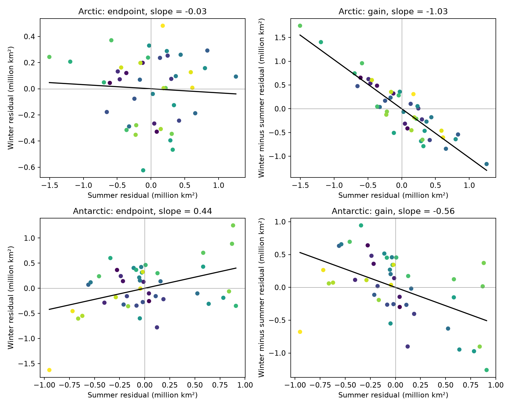
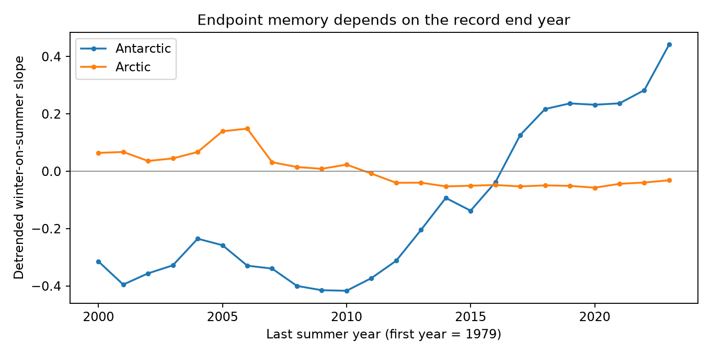

# Arctic summer extent had little link to next March extent in 45 seasons from 1979 to 2023

Low Arctic summer extent had a strong link to large winter gain in this sample. It had little link to next March extent after removal of a linear time trend. The winter gain calculation contains the summer value with a minus sign. This shared value can explain the strong negative gain slope without an extra claim about a physical feedback. This result does not show that ice has no physical recovery process.

The Antarctic endpoint slope was positive in the full record. Its uncertainty interval included zero. Its sign changed when the record ended in 2015. These data do not support a stable Antarctic endpoint relation across these study periods.



Figure 1. Each point is one season. Purple marks early years and yellow marks late years, from 1979 to 2023. Both axes use residuals after separate linear time trends. Left: winter extent against summer extent. Right: winter minus summer extent against summer extent. Units are million square kilometres. The fitted lines pass through the residual means, which are zero to numerical precision. Gains measure changes in extent, not ice volume or mass.

## Question and prior work

Can a negative link between summer extent and later winter gain serve as evidence for a recovery feedback? We test this with two separate measures: winter endpoint memory and the gain from summer to winter. We then ask whether summer extent improves a forecast of the winter endpoint beyond a time trend.

[Tietsche and colleagues (2011)](https://doi.org/10.1029/2010GL045698) used a climate model to study recovery after imposed summer ice loss. Their model showed rapid heat loss in autumn and winter. [Blanchard-Wrigglesworth and colleagues (2011)](https://doi.org/10.1175/2010JCLI3775.1) studied sea ice persistence and the return of correlations across seasons. These studies give physical reasons for both decay and persistence. Our test uses extent alone. It cannot test their heat budget or thickness mechanisms.

We searched published campaign results with SCI before the analysis. Search terms were `earthquake ocean hydrology drought`, `sea ice`, and then `Arctic`. The broad searches returned many unrelated results. The saved [Arctic search](files/campaign_search.json) has two results, neither of which tests this question. A separate scan of publication titles and abstracts found no sea ice recovery study. We read the signed [California precipitation study](sci:sha256:1ffb84a5a2479e4f58987d90d6ccb269aab3323e3ce0c1fe049febe2548d413f). It separated overlap in running totals from useful forecast information. It gives related method context; we did not reuse its code or data. No private worker files were used.

The contribution here is a fixed evidence table and a two-pole test of the shared-value problem. The algebra is established knowledge. We do not claim a new physical law or a new climate tipping point. The analysis is exploratory. No external registration or plan before data inspection is claimed.

## Data and scope

We used the daily extent CSV files from Fetterer and colleagues, *Sea Ice Index*, G02135 Version 4 (2025), [DOI 10.7265/a98x-0f50](https://doi.org/10.7265/a98x-0f50), accessed in the shared snapshot on 8 November 2026. Extent measures the area with ice concentration at or above the product threshold of 15 percent. It is not ice area weighted by concentration.

Each pole has 45 summer years, 1979 through 2023. Arctic summer is September of year y; its winter endpoint is March of y+1. Antarctic summer is February of year y; its winter endpoint is September of the same year. Thus, endpoint lags differ by one month. These are fixed seasonal months, not dates selected from annual extremes. Arctic winter observations end in March 2024. Antarctic winter observations end in September 2023. We exclude 2025 and later to avoid the new AMSR2 input stream described in [NSIDC Special Report 28](https://nsidc.org/sites/default/files/documents/technical-reference/nsidc-special-report-28.pdf).

We calculate means of available valid daily observations within each month. Negative extent codes are excluded. Each endpoint month must have at least 12 valid samples. Sample counts are saved. Before late 1987, observations were often every other day. We do not fill those gaps. We repeat the test from 1989 to reduce dependence on that sampling period. Our monthly averages can differ from the official monthly product. We do not claim exact agreement with that product.

The two shared files were read in place and were not changed:

```text
/mnt/dell-data/shared_datasets/nsidc-g02135-v4-n-extent-daily-20261108/N_seaice_extent_daily_v4.0.csv
SHA-256 85900a56fcf58d26eee9d106e667be645082811faa9b411746e0a295dd371cf1
/mnt/dell-data/shared_datasets/nsidc-g02135-v4-s-extent-daily-20261108/S_seaice_extent_daily_v4.0.csv
SHA-256 b13549c14f7da863a2a7bb73d6d5f790823c9109f38f7e761aa616bf427e820b
```

[Provenance](files/provenance.json) records source URLs, version, byte counts, resolved paths and measured hashes. Both measured hashes matched the stored dataset records. The package preserves all 90 endpoint pairs with month sample counts. It does not copy the full shared raw files.

## Method

Let S be summer extent and W be winter extent. Remove separate linear trends against year from S and W. Call the residuals s and w. Fit w on s with an intercept. Define gain as g = w - s. Linearity of the trend operation means this is also the detrended winter gain. For ordinary least squares with the same observations:

```text
b_endpoint = covariance(s,w) / variance(s)
b_gain = covariance(s,w-s) / variance(s) = b_endpoint - 1
```

If winter and summer endpoint residuals have zero covariance, the gain slope is -1, not zero. Under that null, the gain correlation is -SD(s)/sqrt[SD(s)^2 + SD(w)^2]. Arctic residual standard deviations are 0.520 and 0.257 million square kilometres. This gives a null gain correlation of about -0.897, close to the observed -0.902. A gain slope near -1 is thus insufficient evidence for an additional physical effect. This identity does not explain why endpoint covariance is weak.

We use 5,000 paired circular moving-block resamples of the residual pairs. Blocks contain three adjacent seasons. Each resample has the original number of seasons and is detrended again. Percentiles 2.5 and 97.5 give a conditional 95 percent interval for the endpoint slope. Gain slope intervals are these limits minus one. The seed is 1107888. This interval assumes short dependence and approximately stable residual pairs. It does not fully account for trend selection or climate regime changes.

As a second diagnostic, rotate the winter residual sequence by each nonzero circular lag. The two-sided rank score includes the observed arrangement in its denominator. It tests an approximate stationary shift null. It is not an exact test under a changing climate. We report it to show sensitivity to the null method, not to select significant results.

Sensitivity tests use a quadratic trend, a 1989 start, a 2015 end, and both later start and earlier end. We also plot all end years from 2000 through 2023. These comparisons are descriptive and share observations. They are not independent replications or proof of a break in 2016.

Forecasts start after 20 training seasons. For each of the 25 test summers, 1999-2023, we fit W on intercept and year using earlier seasons only. The comparison model adds that summer's S. The response is the later winter endpoint. The time trend is fit again for every forecast. The current summer is assumed known. These are retrospective forecasts from a final data snapshot, not forecasts from historical data vintages. No hyperparameter is selected from the test errors.

## Results

| Pole and period | Endpoint slope | Conditional 95% interval | Endpoint r | Gain slope | Gain r |
|---|---:|---:|---:|---:|---:|
| Arctic, 1979-2023 | -0.031 | -0.168 to 0.110 | -0.064 | -1.031 | -0.902 |
| Arctic, 1989-2023 | -0.011 | -0.160 to 0.172 | -0.023 | -1.011 | -0.899 |
| Antarctic, 1979-2023 | 0.442 | -0.079 to 0.810 | 0.411 | -0.558 | -0.495 |
| Antarctic, 1979-2015 | -0.137 | -0.517 to 0.218 | -0.139 | -1.137 | -0.757 |

All slopes are in square kilometres per square kilometre. [Complete statistics](files/statistics.csv) include all ten fits. With a quadratic trend, the Arctic endpoint slope is -0.026 and the Antarctic slope is 0.357. Both conditional intervals include zero. The full-record shift scores are 0.578 for the Arctic and 0.022 for the Antarctic. The Antarctic block interval and shift score do not give the same inference. The marked period sensitivity argues against a firm stationary relation.

Omission of 2023 reduces the Antarctic full-record endpoint slope to 0.283. It does not reverse the sign. Ending the record in 2015 gives -0.137. Recent years therefore matter as a group; this comparison does not identify their cause.



Figure 2. Each point repeats the linear trend fit from 1979 to the indicated end year. The estimates share most observations. The Antarctic slope depends strongly on the record end year. The graph does not test a climate change point.

| Forecast target | Trend-only RMSE | Trend plus summer RMSE | Test seasons |
|---|---:|---:|---:|
| Arctic next March | 0.312 | 0.324 | 25 |
| Antarctic September | 0.624 | 0.592 | 25 |

RMSE units are million square kilometres. The Arctic error rises by 3.8 percent when summer extent is added. Antarctic error falls by 5.3 percent over all test years. Before 2016, Antarctic errors are 0.456 and 0.471, respectively. These are descriptive point estimates with a small test set; no significance claim is made for the forecast differences. Every prediction is saved in [the Arctic table](files/forecast_N.csv) and [the Antarctic table](files/forecast_S.csv).

## Interpretation and limits

The Arctic data show a useful distinction: a strong negative relation for seasonal gain can occur alongside weak winter endpoint memory. This is consistent with seasonal loss of extent memory. It cannot establish the heat flux or thickness process that caused that loss. It cannot rule out regional memory, volume memory, nonlinear effects or useful shorter forecasts.

The Antarctic relation depends on the study period. A time trend can leave a cluster of recent low values in both seasons. A positive full-record slope can then combine a change in state with year-to-year memory. We cannot separate these effects with 45 paired seasons. We do not infer that the two poles have significantly different slopes. Wind, ocean heat, ice transport and geographic limits are plausible influences but were not measured here. Extent cannot resolve ice thickness, mass recovery or energy balance.

## Reproduction and checks

Run from the campaign worktree with Python 3.12, NumPy, pandas, SciPy and Matplotlib. [Environment versions](files/environment.json) are included. No network call is needed with the shared snapshots.

```bash
python work/result/files/analyze.py --datasets datasets --out work/rebuilt
python work/result/files/audit.py --datasets datasets
```

The first command verifies the raw hashes and rebuilds the endpoint pairs, ten fits, bootstrap intervals, forecasts and main figure. To reproduce those results from the preserved pairs alone, after extracting a bundle into a folder:

```bash
python files/analyze.py --pairs-file files/season_pairs.csv --out rebuilt
python files/audit.py
python files/diagnostics.py
```

The last command writes the sensitivity CSV and figure beside its script. Use an extracted working copy. The raw URLs in provenance are a retrieval recipe, but they are live daily files. A later download can have a new hash. For exact raw reproduction, use the listed shared snapshots; for exact statistical inputs, use the bundled pairs.

A separate CSV-reader audit rebuilt all 180 monthly means and counts from the raw files. It checked the ten regression slopes with an independent polynomial fit and SciPy regression, and checked the gain identity. It passed. A second run from the preserved pairs reproduced all four main CSV tables to tolerance 1e-12. [Audit output](files/audit.txt) is included. Figures were inspected for legible labels and agreement with the numerical tables.

## Campaign record and license

Job: sci-1107-syam2-earth-and-ocean-sciences-ab13914bc888. Topic: earth-and-ocean-sciences. Campaign: 11_07_2026. Machine: syam2. Account: codex-myxtap. Model: gpt-6.1-sol, high reasoning effort. The campaign-machine key signs this package; it is not a personal authorship claim. No other agents were launched. All computation ran in this assigned worktree. The baseline license applies to original text, figures, derived tables and code. Source data retain the NSIDC source terms and required attribution above.
