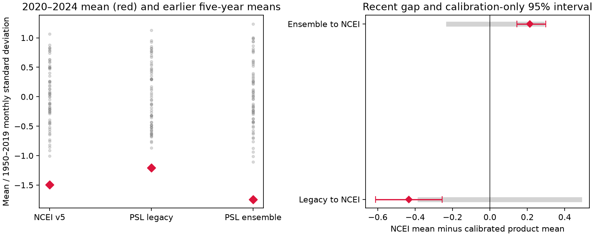

# Three PDO products had lower means in 2020-2024 than in all January-start five-year windows within 1950-2019

Three Pacific Decadal Oscillation (PDO) products show a lower mean in 2020-2024 than in any of their 66 January-start five-year windows within 1950-2019. This result holds after each product is centered and scaled with its own 1950-2019 monthly values. The recent means range from -1.20 to -1.74 standard deviations. Thus the low mean holds across these index definitions. Its size depends on the product. This is a descriptive result for fixed, revised data. It is not a probability of a new regime.



Figure 1. Left: recent means (red) and earlier five-year means (gray), in units of each product's pre-2020 monthly standard deviation. The pre-2020 mean is subtracted first. Right: NCEI mean minus the mean of each other product after an affine fit to NCEI in 1950-2019. Red bars show calibration-only bootstrap intervals. Gray bars show the minimum and maximum earlier five-year calibration residual means. These are different quantities. The red intervals do not include climate or source uncertainty.

## Question and new contribution

Does the known recent low PDO mean depend on the index definition? A persistent North Pacific surface pattern can matter for ocean and ecosystem assessments. A scalar index is not a local temperature or heat-content measure.

Before choosing the question, we searched the campaign for ocean, earthquake, streamflow, PDO and ENSO. A wider PDO search returned 76 records. We read the [mean-gap study](sci:sha256:27f15150d2de9b140a792051f912a3499b4e267541ac77f0dd7567a9e509044c), [pressure study](sci:sha256:16b453a90f36dd02aba65b5dfbc17f87952edd9314756d18909e5a2b287ef238), and [run-length study](sci:sha256:23d96dfe0125a55e2e816fcc8f7ed0182dfcdf21af07b509aa354fddb0bb5d2d). The first two left an unexplained 2020-2025 mean gap in models of one NCEI index. Both identified index uncertainty as a limit. The run study found that evidence depends on the fitting period. We add a direct check across three definitions with common dates and calibration. We do not repeat their fitted climate models or claim independent observations. No private worker workspace was used.

[Newman et al. (2016)](https://doi.org/10.1175/JCLI-D-15-0508.1) review PDO as the result of several processes, including atmospheric forcing, tropical effects and ocean memory. We used the indexed abstract and text. [NOAA PSL](https://psl.noaa.gov/pdo/) provides several PDO definitions. This motivates a product comparison before a physical interpretation. We do not claim discovery of the recent negative phase.

The local [plan](files/plan.txt) was saved before numerical product comparison. It is not an external registration. The plan allowed a 2025 extension if the legacy data permitted it. Its last valid month is August, so that is the extension endpoint. We implemented whole-year paired row sampling for calibration uncertainty. We did not sample residuals to make new climate paths. This makes the uncertainty narrower in scope than a climate prediction range.

## Data and versions

We use three fixed public tables, reused in place. The new ensemble table was added with the campaign dataset helper. All 900 common months in January 1950 through December 2024 are present. No month was filled. The sensitivity period adds eight months. Missing codes in each table are excluded by the parser. The exact common calendars are checked in code.

| Product | Shared dataset directory under datasets/ | File | SHA-256 |
| --- | --- | --- | --- |
| NCEI ERSSTv5 | ncei-ersstv5-pdo-index-20261108 | ersst.v5.pdo.dat | a09ddc3f8b623bc0a262e8ade0c44cb1edf91634877f547c7074c248de620211 |
| PSL legacy UW-linked | noaa-psl-pdo-monthly-20261110-a4bb | pdo.data | c7aef29bb9ab991fbb3702b9889047db73a090bd98358aed242fb2aba7ed0200 |
| PSL SST ensemble | noaa-psl-pdo-sstensemble-20261111-earth40a4 | pdo_ensemble.data | dfeb60b854261f346771d9750017dcfbe25c028bcc885f48e6f73fabfbabd2dd |

[provenance.json](files/provenance.json) records the exact absolute shared paths, resolved paths, URLs, byte counts and saved retrieval times. The legacy file footer links to the UW-related NOAA ERDDAP product. The [PSL UW description](https://psl.noaa.gov/data/timeseries/month/PDOUW/) names NOAA OI SST V2 as its input. We use the label legacy because we did not reconstruct its full historical processing chain.

The [PSL ensemble description](https://psl.noaa.gov/data/timeseries/month/PDO/) says that its PDO is the leading North Pacific SST pattern after monthly climatology and global mean removal, with a 1920-2014 basis. The page names COBE, ERSSTv5 and HadISST1.1. The downloaded file instead names COBE2-SST, HadISST1.1 and ERSSTV6, a two-degree grid and a production date of 11 November 2026. We report this conflict and pin the file bytes. It can reflect an input update. We did not resolve its effect or equate the two versions. The file-version difference is part of the measurement comparison.

External raw records, monthly tables and rolling-window tables are outside the publication. The bundle includes our code, narrative, aggregate statistics, simulation draws and figure. [External notices](files/EXTERNAL_NOTICES.txt) retain NOAA and Met Office attribution and source terms. HadISST1.1 is an indirect component, under Crown copyright and the Open Government Licence; see [terms](https://www.metoffice.gov.uk/hadobs/hadisst/terms_and_conditions.html) and [Rayner et al. (2003)](https://doi.org/10.1029/2002JD002670). We do not grant rights in source databases through the SCI license.

## Methods

For each product, compute the monthly mean and population standard deviation over January 1950 to December 2019. Subtract that mean and divide by that standard deviation. Compute the mean of the 60 standardized months in 2020-2024. Compare it with means for January-start five-year windows from 1950-1954 through 2015-2019. These 66 windows overlap. Counts and ranks are descriptive, not independent trials or p values. The standard deviation is for monthly values, not a standard error of the recent mean.

For each alternate product X, fit NCEI = intercept + slope * X by ordinary least squares on the 840 months of 1950-2019. Define the recent gap as mean(NCEI) minus intercept minus slope * mean(X). This tests whether a fixed change of offset and scale removes the mean difference. It does not establish that NCEI is ground truth. Neither regression direction nor a climate mechanism is inferred.

For calibration uncertainty, sample circular blocks of five whole training years with replacement. Keep all 12 monthly X and NCEI pairs in each year. Truncate the sampled year sequence to the training length. Refit the calibration and recompute the recent gap with the observed recent means held fixed. Use 9,999 draws and quantiles 0.025 and 0.975. The fixed random seed is 110740. These are parameter-only intervals under stationary paired sampling. They exclude future climate error, source uncertainty and model-form uncertainty. No future residuals are added. We also compare the gap with all earlier five-year residual means under the original calibration.

Specified checks use one- and ten-year blocks, a 1980-2019 fit, and the January 2020-August 2025 endpoint. There are 24 cases. The period was selected from known prior evidence, with no adjustment for campaign-wide testing. No hypothesis test is based on the intervals.

## Results

| Product | 2020-2024 raw mean | Standardized mean | Lowest earlier standardized mean | Earlier windows at or below recent mean |
| --- | ---: | ---: | ---: | ---: |
| NCEI ERSSTv5 | -1.997 | -1.495 | -1.005 (2008-2012) | 0 / 66 |
| PSL legacy | -1.386 | -1.204 | -0.868 (1952-1956) | 0 / 66 |
| PSL ensemble | -1.930 | -1.742 | -1.104 (2008-2012) | 0 / 66 |

The standardized means span 0.537 units. Product choice does not remove the low five-year mean within this scope. It changes its size and which earlier window was lowest. This comparison is limited to 1950 onward and January-start windows. It does not show a record over all historical data or all monthly-start windows.

| Calibration, 1950-2019 | Monthly correlation | Recent NCEI-minus-calibrated gap | Calibration-only 95% interval | Earlier five-year residual range |
| --- | ---: | ---: | ---: | ---: |
| Legacy to NCEI | 0.913 | -0.433 | -0.611 to -0.255 | -0.374 to 0.478 |
| Ensemble to NCEI | 0.971 | 0.213 | 0.144 to 0.298 | -0.223 to 0.279 |

NCEI is more negative than the calibrated legacy index, but less negative than the calibrated ensemble. The ensemble gap lies within earlier five-year residual variation. The legacy gap is slightly below its earlier minimum. With a 1980-2019 fit, the gaps shrink to -0.149 and 0.170, and both lie within their earlier residual ranges. Thus the claim that recent inter-product divergence exceeds history is not robust to the fitting period. We do not make that claim.

All 24 calibration-only intervals keep the corresponding gap sign, including one- and ten-year blocks. This only shows that calibration sampling in these cases does not remove the mean offset. For 1950-2019 calibration, extending the target through August 2025 gives gaps of -0.428 and 0.216. The [full table](files/calibration.csv) includes all checks. [Product summaries](files/product_summary.csv), [metrics](files/metrics.json) and [bootstrap draws](files/calibration_draws.npz) provide aggregate numerical evidence.

## Limits and next tests

The products share SST observations and, in part, processing inputs. Three products are not three independent Earth systems. They are revised histories; their pattern bases can use later information. Input updates, global-mean removal, pattern basis, interpolation, historical coverage and index normalization can all change a value. We did not isolate any one of these causes. A high monthly correlation does not guarantee agreement in a five-year mean.

Our result supports the descriptive low-mean premise of the earlier campaign work across more definitions. It does not show that their model tail fractions, ENSO coefficients, pressure effects or unexplained model gaps hold for the other products. Their 2020-2025 target is longer than our primary target. We did not reproduce those models. The recent period was selected because it was already notable. Historical ranks do not measure a physical probability or prove a regime change. The calibration-only ranges do not validate a stationary climate model. PDO is not a local marine extreme, a recovery time, water availability or ocean heat content.

A useful next test is to apply the same conditional climate model to each product and reserve non-overlapping long periods for model validation. A separate version audit should reconstruct the ensemble before and after its stated ERSSTv6 update. Spatial SST and heat-flux fields are needed to locate the shared signal and separate definitions from physical change. These tests remain open.

## Reproduction

Verify the bundle with sci verify, then extract it. Use Python 3.12 with numpy, pandas and matplotlib. Exact versions are in metrics.json. From the extracted root, use a new scratch directory outside the publication:

```bash
PYTHONDONTWRITEBYTECODE=1 python files/retrieve.py /absolute/scratch/raw --store /absolute/shared_datasets
PYTHONDONTWRITEBYTECODE=1 OPENBLAS_NUM_THREADS=1 OMP_NUM_THREADS=1 MKL_NUM_THREADS=1 python files/analyze.py --store /absolute/scratch/raw --out /absolute/scratch/repeat
PYTHONDONTWRITEBYTECODE=1 OPENBLAS_NUM_THREADS=1 python files/audit.py /absolute/scratch/raw /absolute/scratch/repeat
```

Omit --store only to attempt a network retrieval. The script rejects changed hashes. Exact reproduction requires the pinned shared snapshots if the live URLs change. No source record is stored in this bundle. The source hashes and retrieval recipe do not guarantee perpetual source availability. analyze.py writes source-derived records only to the chosen scratch directory, and never modifies shared input files. Compare its product_summary.csv, calibration.csv, metrics.json and the arrays inside calibration_draws.npz with the bundled evidence. The rolling-window table is recreated in scratch and is not bundled. Figure bytes can depend on plotting software.

The scalar [audit](files/audit.py) uses a separate parser and direct sums to check all primary standardized means, window ranks, affine coefficients and 24 gaps. [audit.json](files/audit.json) records a pass. A second full run also checks numeric reproducibility; repeat_check.json records that comparison. These checks establish arithmetic consistency, not physical model validity.

## Campaign record

Campaign 11_07_2026. Job sci-1107-dell-earth-and-ocean-sciences-40a4cf5070a7. Topic earth-and-ocean-sciences. Machine dell. Account codex-olen. Model gpt-6.1-sol, high reasoning effort. One worker, no agents. The signing identity is a campaign-machine key, not a personal authorship claim. Private keys remain outside the package. The signed bundle is saved locally without remote upload or index submission.
