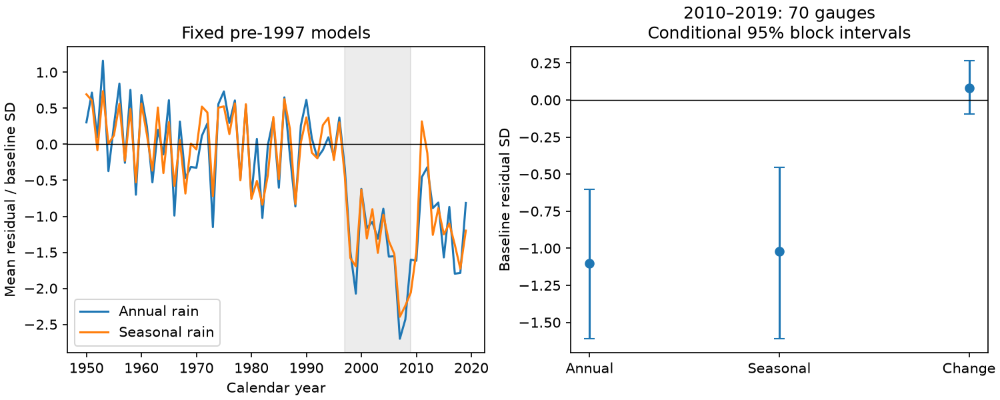

# Four-season rainfall fits retained a 2010-2019 runoff deficit at 70 Victorian gauges

## Result

We tested whether four-season rainfall terms remove a post-drought runoff deficit in CAMELS-AUS v2.03. We selected 70 Victorian gauges by fixed data coverage rules. We fitted annual and seasonal rainfall models to log-transformed annual runoff before 1997. In 2010-2019, the equal-gauge mean residual was -1.10 baseline standard deviations for annual rainfall and -1.02 for seasonal rainfall. The change was +0.08, with a conditional 95% spatial and time block interval of -0.09 to +0.26. The remaining seasonal residual had an interval of -1.61 to -0.46. Seasonal terms raised earlier held-out prediction error by 3.00% in the primary model. Checks with SILO rainfall, a linear annual response and stricter coverage retained negative mean seasonal residuals. This result limits one statistical explanation. It does not exclude other effects of rainfall timing or show a physical cause. Short records, model form, shared weather, data error and fixed fitted parameters limit inference.

The primary seasonal model left 62 of 70 gauge mean residuals below zero in 2010-2019. The annual model left 65 below zero. The point change is about 7% of the initial mean deficit. This fraction is descriptive. The interval for the change includes zero. These results do not establish that seasonal rain has no effect.



The left panel shows yearly means over available gauges. The grey area marks 1997-2009. The gauge mix can change by year. The right panel uses equal gauge weights, with each gauge first averaged over its valid 2010-2019 years.

## Question and prior work

Can within-year rain amounts account for part of the runoff deficit left by annual rainfall models? Peterson et al. (2021), doi:10.1126/science.abd5085, reported incomplete recovery in Victorian catchments. The prior campaign publication cited in sci.json extended an annual rainfall state model to 2025. Our analysis uses new code, a different fixed sample, and no state labels. It neither reproduces nor replaces that analysis.

Fowler et al. (2022), doi:10.5194/hess-26-6073-2022, describe autumn rainfall loss as a possible cause of delayed catchment wetting. That mechanism is prior knowledge. The new contribution here is a fixed-sample model comparison and an earlier prediction check. We do not claim that the mechanism or the runoff deficit is a new discovery.

## Data and fixed rules

We used CAMELS-AUS v2.03, Zenodo record 14289037. The record lists CC BY 4.0. See files/DATA_NOTICE.md for attribution. We reused three existing shared files without changes. Exact resolved paths, source URLs, sizes and checked SHA-256 hashes are in files/results/provenance.json. The inputs are under datasets/camels-aus-v2.03-zenodo14289037-streamflow, datasets/camels-aus-v2.03-zenodo14289037-hydrometeorology and datasets/camels-aus-v2.03-zenodo14289037-mastertable. The script reads streamflow_mmd.csv, precipitation_AGCD.csv and precipitation_SILO.csv from the archives. No raw data download was needed for the analysis.

We selected all 190 gauges whose outlet state is VIC. We used calendar years 1950-2019. Negative daily values are missing. A valid year has at least 97% daily runoff coverage and all daily rainfall values. Annual runoff equals the observed daily mean times the number of days in the year. This small gap correction assumes that missing days have the same mean flow as observed days. Rainfall is summed over all days. We require at least 30 valid years before 1997, 10 in 1997-2009 and 8 in 2010-2019. Seventy gauges pass. Selection uses coverage, not model residuals. No model-filled runoff file was used. Supplied agency quality flags were not used to remove additional observations.

The test plan is files/PLAN.md. It was written before any model output was calculated. It is a local plan, not an independent preregistration. The evidence does not cover the wet years 2020-2022.

## Models and tests

For each gauge, fit ordinary least squares before 1997 only. Set y = log(1 + Q), where Q is annual runoff in mm. The annual model has an intercept, annual rain and annual rain squared. Center and scale annual rain with that gauge's training mean and sample SD. The seasonal model adds March-May, June-August and September-November rain. These three amounts plus total rain span four independent seasonal amounts. The fourth season is January, February and December within the same calendar year. This design does not add lagged rain from the prior year. Seasonal columns are centered on their training means and divided by the annual-rain training SD.

The residual is observed y minus predicted y. Divide both models' residuals by the annual model's training residual SD, with degrees of freedom equal to the training count minus three. A negative residual means lower runoff on the log scale than the fitted relation predicts. It is not a deficit in mm and cannot be read as a percentage loss of water.

The primary effect is the seasonal mean residual minus the annual mean residual in 2010-2019. Positive values reduce the deficit. We hold model fits fixed. We sample one-degree latitude/longitude cells of catchment centroids with replacement and retain all gauges in each sampled cell. There are 16 cells. We also sample circular three-year blocks from the ten post years, using the same sampled years for every gauge. Four blocks are drawn and truncated to ten years. Missing years remain missing. Each draw averages over valid years within gauge, then over sampled gauges. We use 5,000 draws, seed 20261109, and percentile limits. These are conditional resampling intervals. They omit training-fit and measurement uncertainty. Cells do not make weather or nested catchments fully independent.

For an earlier prediction check, predict each available year in 1982-1996 from all earlier valid years, with at least 20 training years. The same 70 gauges are used. Compute squared log-scale prediction error, average within gauge, average over gauges, then take the square root. The annual RMSE was 0.304109; the seasonal RMSE was 0.313233, a 3.00% increase. These values are descriptive, without an interval. Seasonal terms do not pass this check as a clear predictive improvement in the primary model. This is a retrospective diagnostic, not a real-time forecast product.

## Sensitivity results

All values below are in the relevant annual model's training residual SD. Each row refits its models. Thus magnitudes across rainfall sources or model forms are not on one physical water-volume scale.

| Test | Gauges | Seasonal residual | 95% interval | Change from annual | 95% interval |
| --- | ---: | ---: | --- | ---: | --- |
| primary | 70 | -1.021 | -1.609 to -0.456 | 0.079 | -0.094 to 0.265 |
| coverage99 | 66 | -1.003 | -1.604 to -0.439 | 0.057 | -0.110 to 0.235 |
| linear | 70 | -0.903 | -1.474 to -0.345 | 0.106 | -0.078 to 0.318 |
| SILO | 70 | -0.787 | -1.372 to -0.229 | 0.067 | -0.088 to 0.238 |
| cell2 | 70 | -1.021 | -1.826 to -0.391 | 0.079 | -0.135 to 0.250 |

coverage99 requires 99% valid daily flow. linear removes annual rain squared. SILO replaces AGCD rain. cell2 uses two-degree cells (seven clusters). All tested seasonal mean residuals remain negative, with intervals below zero. All intervals for the seasonal-minus-annual change include zero. In the linear sensitivity, earlier RMSE falls from 0.3345 to 0.3283 with seasonal terms. Thus the predictive comparison depends on the annual response form.

## Limits and meaning

This test rejects a complete statistical account by these fixed four-season additive terms in this sample. It does not reject all rainfall-timing explanations. Daily rain intensity, dry-spell length, seasonal nonlinear effects, prior-year storage, temperature, evaporation, vegetation and groundwater are absent. There are only ten post-drought years. A common drought and common weather affect many gauges. Some gauges are nested. The cells and block lengths are working assumptions, not proof of independent observations. Small cluster counts limit interval accuracy. The fit parameters and gauge set stay fixed during resampling. Source errors and revised rating curves can change the result.

The long-record rule narrows the sample to 70 gauges and does not represent all Victorian catchments. The comparison is on transformed runoff. It gives no causal partition of water losses, flood risk or permanent recovery state. The remaining deficit is consistent with omitted drivers or a changed rain-runoff relation; these alternatives are not identified by this test.

## Reproduce and inspect

Use Python 3.12 with numpy, pandas, matplotlib and statsmodels. Exact run versions are in files/results/environment.json; suggested requirements are in files/requirements.txt. Use fresh scratch to avoid reusing old daily caches. From the unpacked publication root:

```
python files/fetch.py /absolute/external/inputs
python files/analyze.py --datasets /absolute/external/inputs --scratch /absolute/external/scratch --out /absolute/external/results
python files/audit.py /absolute/external/scratch /absolute/external/results
```

The fetch script checks the original source hashes and refuses a destination inside the publication. It stops if the source bytes have changed. Alternatively, use the existing shared datasets path as --datasets. The analysis checks all three archive/table hashes. The computation requires about 2.1 GB of raw input plus scratch and runs in several minutes on this host. No network or service is needed after input retrieval. The audit independently refits the primary regressions with statsmodels and checks every saved residual, sample membership, interval endpoints and the paired-difference identity. It records annual-table hashes outside the publication inputs. The bundle contains all primary residuals, validation squared errors, sample counts, resampling draws, sensitivity summaries and the figure. External rainfall and flow tables stay in scratch.

## Job and authorship record

Job: sci-1107-dell-earth-and-ocean-sciences-3d79a85bd373. Campaign: 11_07_2026. Topic: earth-and-ocean-sciences. Machine: dell. Account: codex-andrii. Model: gpt-6.1-sol, high reasoning effort, through Codex in T3 Code. Date: 2026-11-09. No other agents were used. The signing identity is a campaign-machine key. It is not a personal authorship claim. The result is saved locally; this worker does not upload or submit it.
