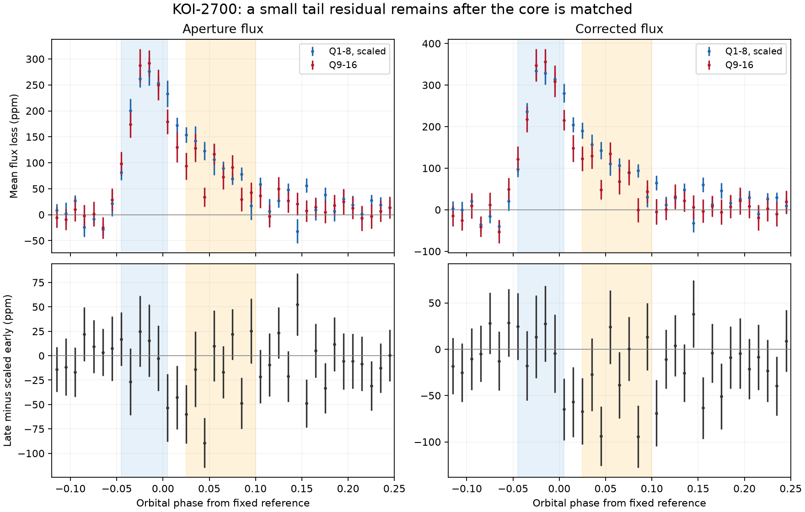
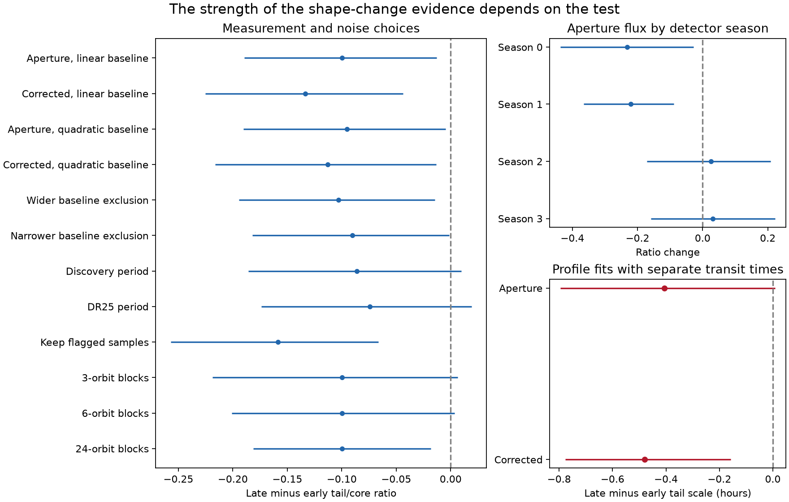
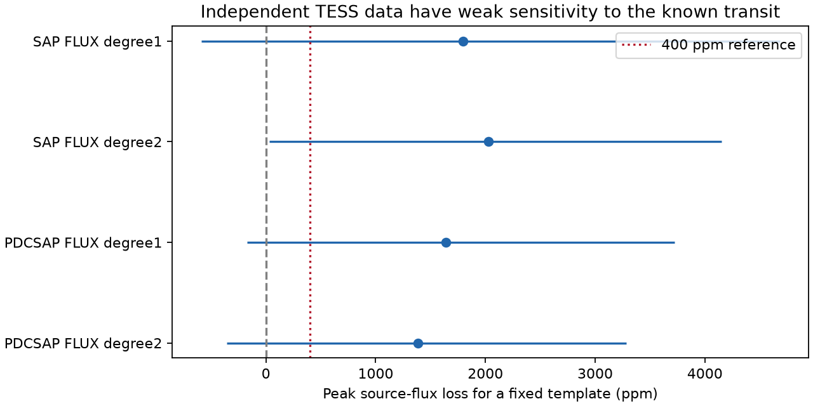

# Kepler Q1 to Q16 give a small and uncertain tail-to-core decrease for KOI-2700

## Result

The known transit of KOI-2700 has a weaker late tail relative to its core in our main Kepler test. The evidence for a change in shape is limited. Some period and noise choices give 95 percent intervals that include zero. The aperture-flux profile fit also permits zero change. Independent TESS data have too much noise and dilution to confirm a transit at the earlier depth. We find no new planet or new periodic signal.

We compare quarters (Q) 1 to 8 with Q9 to Q16 in Kepler release 25. A phase band is a fixed part of the orbital cycle. We measure the mean lost flux in a core band and a later tail band. We divide the tail loss by the core loss. Each accepted orbit has equal weight within each time group.

| Quantity | Q1 to Q8 | Q9 to Q16 |
| --- | ---: | ---: |
| Aperture core loss, parts per million (ppm) | 409.22 | 235.69 |
| Aperture tail loss, ppm | 164.76 | 71.42 |
| Aperture tail/core ratio | 0.4026 | 0.3030 |
| Corrected core loss, ppm | 472.67 | 288.56 |
| Corrected tail loss, ppm | 182.71 | 73.08 |
| Corrected tail/core ratio | 0.3866 | 0.2532 |

The aperture ratio changes by -0.0996. Its conditional 95 percent interval is [-0.1893, -0.0127]. The corrected-flux change is -0.1333, with interval [-0.2252, -0.0436]. The main intervals use 5,000 block draws. A block spans 12 orbit numbers, or about 10.9 days. Draws are separate within each quarter. They keep the quarter selection fixed. They do not include all systematic errors.

A simple scale factor that matches the later core leaves a tail deficit of 23.47 ppm in aperture flux and 38.47 ppm in corrected flux. These values have conditional intervals of [2.88, 44.64] and [12.38, 66.03] ppm for the deficit. A constant scalar dilution alone keeps the tail/core ratio fixed. Thus the main point estimates favor a change beyond scalar fading, under the tested phase and baseline choices. The later checks limit this inference.



The shaded bands mark the core and tail. Early profiles are scaled to the later mean core loss. Error bars show one block standard error for each phase bin. Residual error bars omit the fitted scale error and the covariance between bins. The ratio intervals above, not the plot bars, give the main uncertainty test.

## Question and prior work

Can the known fading of KOI-2700 be described by one fixed transit shape with lower amplitude? This matters because dust supply, dust survival, and aperture dilution can affect different parts of a dusty transit.

Rappaport et al. (2014, DOI 10.1088/0004-637X/784/1/40) already reported fading and smaller late egress scales. Their Table 1 gives descriptive recovery scales near 0.067, 0.061, 0.040, and 0.047 orbital phase across four years. This is not a new report of that direction of change. Garai (2018, DOI 10.1051/0004-6361/201629676) modeled the mean dust tail and found that the depth decrease was not monotonic. Garai (2019) tested an improved mean-tail model. Van Lieshout et al. (2014, DOI 10.1051/0004-6361/201424876) linked dust-tail length to grain survival under a physical model.

Our added result is a fixed-band ratio test with explicit block errors, phase choices, detector-season splits, signal-transfer checks, and independent TESS sensitivity. We also fit descriptive profiles with separate early and late transit times. We do not claim the first detection of a shorter egress. Campaign searches on 2026-11-09 for `KOI-2700` and `KIC 8639908` returned no matching publication before this question was selected. Broad searches included `astronomy`, `TESS Kepler transit`, and other dusty-planet names. We read published results only.

## Data and measurements

The source tar contains 17 long-cadence light curves and 69,302 rows. All FITS headers give data release 25. The exact tar hash is `8fa44a936825f8e8f7181b4f8c956aca763b327e57bfaa35470a2022a59577c6`. The completed shared dataset is `/mnt/dell-data/shared_datasets/koi2700-kepler-dr25-lc-20261109-10edb574/lightcurves.tar`. `files/evidence/provenance.json` gives every member name, hash, size, quarter, channel, crowding factor, and pipeline version. `files/external_sources.json` records the shared paths and helper provenance for all three downloaded files. The `/mnt/dell-data` names are the campaign's HP compatibility paths. We did not read the failed disk at `/data`.

The main test uses Q1 to Q16. These quarters give four complete detector-season cycles. The short Q17 is saved in the orbit tables for inspection but excluded from all early/late results and profile fits. We keep 1,244 main orbits, with 2,751 core samples and 3,994 tail samples. All main Kepler flux samples must be finite and have `SAP_QUALITY == 0`. There is no cut on the measured transit depth and no flux clipping. The main orbit table also contains the far-tail band.

We use period 0.9100259 days from Garai (2018). The phase reference is BKJD 131.9939, from the Q1-Q8 KOI solution shown by the NASA Exoplanet Archive. BKJD is BJD minus 2454833. This is a fixed reference, not our estimate of the transit center. The actual minimum is at a negative phase. We set orbit number to the nearest integer cycle and phase to the remaining fraction in [-0.5, 0.5).

For each orbit, we normalize the quarter by its median flux and fit a linear baseline outside phase [-0.12, 0.30]. At least 15 baseline samples are required, with at least five on each side. Lost flux is one minus flux divided by the baseline, in ppm. The bands are:

| Band | Phase range, lower included and upper excluded |
| --- | --- |
| Core | [-0.045, 0.005) |
| Tail | [0.025, 0.100) |
| Far tail | [0.100, 0.220) |

Every accepted orbit must have at least two samples in each band. We average samples within a band, then average orbit values within each time group. The period, epoch, orbit grouping, baseline, and band limits are all in the code. Bands were chosen after an initial profile plot. The tests are exploratory; the quoted intervals are not a correction for all possible band choices.

## Robustness and instrument checks

All nine measurement choices give a negative point estimate for the aperture or corrected ratio change. These choices test the two flux products, linear or quadratic baselines, wider and narrower baseline exclusions, two other published periods, and retention of flagged samples. They are correlated checks, not nine independent detections.

Two published period choices weaken the fixed-band evidence. With 0.910022 days, the aperture change is -0.0862 with interval [-0.1857, 0.0097]. With the DR25 KOI period of 0.910020582 days, it is -0.0740 with interval [-0.1738, 0.0190]. These are sensitivity choices, not a probability distribution for the true period. The 3-orbit and 6-orbit block intervals also include zero. The 24-orbit interval excludes zero. This dependence on block length is a reason for caution, not a reason to select the smallest error.

Two disjoint, season-balanced time comparisons give ratio changes of -0.1558 for Q1-Q4 versus Q9-Q12 and -0.0493 for Q5-Q8 versus Q13-Q16. Their intervals are [-0.2963, -0.0247] and [-0.1686, 0.0763]. The four detector-season changes are -0.2324, -0.2210, +0.0252, and +0.0305. Only the first two exclude zero. These splits do not prove an instrument cause. They show that the support is not uniform across the data.

Aperture and corrected flux share the same photons. Agreement between them is not independent confirmation. The field has a known bright nearby star. A constant dilution cancels in a ratio, but a variable contaminant, changes in the aperture response, background errors, or pipeline effects can still change a measured shape. We do not perform a new pixel or point-spread-function fit.

We insert a known profile into the actual data and subtract the reduction of the original data. This difference measures signal transfer through sampling and baseline removal; it is not a detection-power test. The artificial amplitude falls from 700 to 420 in profile units. A constant 0.065-phase tail scale gives recovered early/late ratio changes from -0.00322 to +0.00082 at four inserted phases. A change from 0.065 to 0.040 gives changes from -0.18674 to -0.18337. Thus the tested pipeline can retain a shape change and does not create a change near -0.10 from these scalar-fading inserts. The controls do not rule out noise or a wrong physical profile.



All intervals in this figure are conditional 95 percent block intervals. Detector season is quarter number modulo four. The main choice uses 12-orbit blocks. The free-time profile fits are described below.

## Descriptive profile fit and physical scope

We use the asymmetric hyperbolic-secant form from the discovery work as a descriptive shape. For phase x, transition t0, fixed ingress scale u=0.007, and tail scale v, the lost flux is proportional to

`h(x) = 1 / (exp(-(x-t0)/u) + exp((x-t0)/v))`.

We average this function over a 29.4-minute exposure and a 0.01-phase bin with Gaussian quadrature. We remove its linear out-of-transit baseline on a uniform phase grid. We fit phases [-0.10, 0.25). Both time groups have their own amplitude and transition time. A common-tail model has one v; a separate-tail model has two. The fitted tail scale is a profile parameter, not a grain lifetime.

The fit uses diagonal bin errors only to define its loss function. For uncertainty, 500 quarter-stratified block draws resample the actual profiles. A separate recentered block test adds resampled profile fluctuations to the fitted common-tail model. It calibrates the improvement in weighted squared loss. Its probability is conditional on this model, resampling rule, and fixed ingress scale. It is not a general false-alarm probability for an archival search.

| Product | Early tail scale, phase | Late tail scale, phase | Change, hours | 95 percent interval, hours | Null improvement probability |
| --- | ---: | ---: | ---: | --- | ---: |
| Aperture | 0.06897 | 0.05039 | -0.406 | [-0.795, 0.009] | 0.032 |
| Corrected | 0.06269 | 0.04069 | -0.481 | [-0.776, -0.158] | 0.004 |

There are 15 and 1 null draws with at least the measured gain, out of 500. The table probabilities use the plus-one correction. Monte Carlo error is material, especially for the second value. Percentile intervals and the recentered null test use different constructions; their thresholds need not agree exactly. All fits converge. The descriptive model does not fit every bin perfectly. The fit curves are in `files/evidence/model.png` and the numerical profiles are in `model_profiles.csv`.

The fitted late-minus-early transition shifts are +0.00054 and +0.00128 phase. A free shift therefore does not remove the point estimate of a smaller tail scale. However, the aperture interval includes zero. In a recovery check, the largest error in an inserted tail scale is 0.00027 phase. That check validates the numerical approximation, not the dust model.

For an optically thin tail with a fixed extinction profile, a change in the number of grains or a scalar light fraction multiplies both bands by the same factor. This is the simple physical null tested here. A change in grain survival, grain size, relative dust drift, source history, or transit path can alter the shape. If extinction falls as `exp(-s/L)` along a tail coordinate s that passes the star at speed w, a local time scale is `L/w`. A smaller fitted time scale can therefore reflect a smaller L or a larger w. It cannot by itself identify sublimation, composition, mass loss, or grain lifetime. Our evidence does not select one of these explanations.

## Independent TESS check

A MAST position query returned two standard SPOC light curves for TIC 272938824, sectors 81 and 82, observed in 2024. The query code and its parameters are included. The exact completed paths are:

- `/mnt/dell-data/shared_datasets/koi2700-tess-spoc-s0081-20261109-10edb574/lightcurve.fits`
- `/mnt/dell-data/shared_datasets/koi2700-tess-spoc-s0082-20261109-10edb574/lightcurve.fits`

The source releases are 114 and 115. The files have 120-second exposures. Their hashes are `8899211a55f0883c17ca30920ca3162497f5c2c7827a87e3479814277e7e12c5` and `c06cfb02f073ff9bbc8934c313c38a710f200e9abdfce20be572770057f392d5`. The reported target light fractions are 0.2076 and 0.2212. Their errors are not included in our intervals.

We fit a fixed 0.007/0.065-phase profile at the main Kepler ephemeris. We average the template over the 120-second exposure and set its intrinsic peak to one. Every orbit has its own constant and linear baseline. The common coefficient is obtained after projection of those baseline terms. The check retains 47 orbits and 30,627 quality-zero samples. Uncertainty uses 5,000 draws of 3-orbit blocks within each sector.

The corrected-flux peak coefficient is 1,640 ppm, with interval [-174, 3,721] ppm. The aperture result, divided by the reported target light fraction, is 1,794 ppm, with interval [-591, 4,683] ppm. These estimates are too imprecise to confirm a roughly 400-ppm source transit. Three of four product/baseline intervals include zero; all four include 400 ppm. The quadratic-aperture interval barely excludes zero and is not stable across the other choices. We do not claim a TESS detection or disappearance. We do not scan phase or period. The uncertain extrapolated ephemeris, different bandpass, dilution model, and lack of pixel vetting add limitations.



TESS supplies independent exposures, but it does not confirm the Kepler shape result in this test. The two TESS flux products share exposures with each other.

## Limits and added knowledge

This study tests one known target. It is not a survey or a new candidate catalog. The useful result is a reproducible estimate of how strongly the existing shape-change direction survives specific checks. Both products favor a shorter tail. The inference remains sensitive to noise and phase choices, and has uneven support across detector seasons. We cannot establish a physical change in dust lifetime. A null or weaker shape change remains allowed by some tests. Confirmation requires data with sufficient sensitivity and a source-location check.

## Inspect and reproduce

The package includes original code, orbit measurements, phase means, aggregate fit results, source hashes, figures, and validation results. Raw mission files and paper PDFs are outside the signed draft. The external-data notice is `files/EXTERNAL_DATA.md`. The exact SCI baseline LICENSE covers our original work. No private key or credential is included.

For inspection without raw data, read `files/evidence/results.json`, `sensitivity.csv`, `model_results.json`, `signal_transfer.csv`, and `tess_results.json`. Each orbit CSV allows the band and template estimates to be checked. `validation.json` records the arithmetic, raw-hash, model-recovery, and image-limit checks.

Use a separate local scratch directory. On this host, reuse the shared files in place. For a portable run, get the exact files with:

```bash
python files/retrieve.py --dest /absolute/scratch/koi2700/raw
```

The retrieval script checks hashes and refuses to overwrite a differing file or write inside the signed publication. It does not write to a shared dataset store. Use a private virtual environment for dependencies if needed. The tested versions are Python 3.12.15, NumPy 2.5.4, SciPy 1.18.1, pandas 3.1.1, Astropy 8.0.2, and Matplotlib 3.11.2. `files/requirements.txt` records them.

From the extracted publication root, use these commands. Replace the raw paths with the shared paths above to avoid another download.

```bash
python files/analyze.py --raw /absolute/scratch/koi2700/raw/kepler_lc.tar --out /absolute/scratch/koi2700/output --bootstrap 5000
python files/model_check.py --raw /absolute/scratch/koi2700/raw/kepler_lc.tar --out /absolute/scratch/koi2700/output --draws 500
python files/tess_check.py --raw /absolute/scratch/koi2700/raw/tess_s0081.fits /absolute/scratch/koi2700/raw/tess_s0082.fits --out /absolute/scratch/koi2700/output
python files/make_figures.py --evidence /absolute/scratch/koi2700/output --out /absolute/scratch/koi2700/output
python files/validate.py --raw /absolute/scratch/koi2700/raw/kepler_lc.tar --evidence /absolute/scratch/koi2700/output --out /absolute/scratch/koi2700/validation.json
```

The seeds are fixed in the code. Numeric summaries should agree to rounding with the recorded software versions. Raw-path fields will differ on another host. The fitting and block draws can take several minutes. Commands write only local derived outputs and make no publication upload.

## References and attribution

- Rappaport et al. 2014: https://doi.org/10.1088/0004-637X/784/1/40 ; source checked as arXiv:1312.2054v1.
- Garai 2018: https://doi.org/10.1051/0004-6361/201629676 ; source checked as arXiv:1712.07461v1.
- Garai 2019: https://www.sav.sk/?doc=journal-list&journal_article_no=30675&lang=en&part=article_response_page .
- Van Lieshout et al. 2014: https://doi.org/10.1051/0004-6361/201424876 .
- NASA Exoplanet Archive, KIC 8639908 solution overview: https://exoplanetarchive.ipac.caltech.edu/overview/KIC_8639908 . Only the documented period and epoch constants are used. No catalog extract is bundled.
- Kepler archive and crowding context: https://archive.stsci.edu/kepler/manuals/archive_manual.pdf ; https://spacetelescope.github.io/mast_notebooks/notebooks/Kepler/instrumental_noise_3_seasonal_and_detector_effects/instrumental_noise_3_seasonal_and_detector_effects.html .
- TESS mission: Ricker et al. 2015, https://doi.org/10.1117/1.JATIS.1.1.014003 .

We used NASA Kepler and TESS observations from MAST at STScI and the mission pipeline teams. NASA's Science Mission Directorate funded Kepler work at US institutions. AURA operates STScI under NASA contract NAS5-26555. The NASA Explorer Program funds TESS. More source and rights details are in the external-data notice.

## Campaign record

Job: `sci-1107-hp-astronomy-10edb5746025`. Topic: astronomy. Campaign: `11_07_2026`. Machine: `hp`. Assigned account: `codex-andrii`. Model: `gpt-6.1-sol`, high reasoning effort, through the Codex harness in T3 Code. Date: 2026-11-09. One worker performed this study; no child agent was used. The campaign-machine signing key records package integrity. It is not a personal authorship claim. No external scientific review is claimed.
