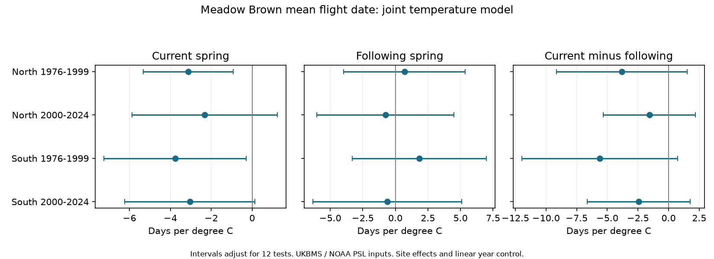

# A time-order check gave no clear current-versus-next spring slope difference for Meadow Brown dates in four English samples, 1976-2024

The estimated link to current spring warmth was more negative than the link to next spring warmth in all four samples. All four difference intervals included zero after adjustment for the 12 planned tests. The evidence did not establish a clear difference in each sample. This does not show that the two slopes are equal.

## Question and prior evidence

Does the mean flight date of Meadow Brown (Maniola jurtina) have a more negative slope for current March-May temperature than for March-May temperature in the next year? The next spring occurs after the observed flight season. It cannot directly cause that earlier flight date. It can share trends, weather patterns, and unmeasured causes with current weather. This makes it a useful but imperfect time-order check.

Roy et al. (2015, doi:10.1111/gcb.12920) studied butterfly flight dates and temperature across time and space. Their findings show the need to distinguish these two sources of variation. The signed campaign study SCI 2c2e6328 found negative current-spring Meadow Brown date slopes in the same survey archive. It did not test whether these slopes differ from next-spring slopes. We read its main text and build method. We use the same regions, periods, and broad selection rules for a direct follow-up. We wrote a new analysis from shared raw snapshots. This is a test with overlapping observations, not independent biological validation of the earlier study.

We searched the campaign for climate, phenology, pollution, butterfly, future weather, and placebo studies before fixing the question. The exact plan is in files/PLAN.txt. We chose a weather and timing question within the research objective. This study does not test air pollution or climate extremes.

## Data and selection

We used the UKBMS phenology 2024 release and site location 2024 release. Standard transects use weekly counts in the main April-September season. Reduced-effort and Wider Countryside surveys do not supply the phenology estimates in this release. The source mean flight date is a count-weighted mean day, not an individual emergence date. A source day number of 20 denotes 20 April.

The England Meadow Brown join gave 27,550 site-year records in 1976-2024. Seventeen lacked complete weather. The remaining 27,533 records supplied the selection pool. We required at least ten records per site in each region and period. South has British National Grid northing below 350,000 m; North has northing at or above that boundary.

Weather is NOAA PSL GHCN-CAMS monthly air temperature, version 3.01, on a half-degree grid. We converted site coordinates to longitude and latitude, took the nearest grid cell, and used equal weights for March, April, and May. All three months must be present. Current means the outcome year. Following means the outcome year plus one, through 2025 for the last outcomes. We did not require a butterfly observation in the following year. This avoids selection on future biological detection.

The retained four samples have 18,868 records in total. There are 20 and 150 northern sites, and 116 and 862 southern sites, in the early and late periods, respectively. Sites can repeat across periods. The regions use different sites but share weather. The periods use different outcome years but share sites and history. The 1999 outcome uses 2000 weather in the check. These samples are not independent experiments.

## Model and uncertainty

We fitted a separate ordinary least-squares model in each sample:

    mean flight date = site intercept + linear year trend
                     + current spring slope * current spring temperature
                     + following spring slope * following spring temperature + error

Each record has weight one. Site effects remove stable site differences. The trend removes a common linear change over time. We fitted both temperature terms together. The target contrast is current slope minus following slope. A negative contrast indicates a more negative current-spring association. It does not estimate a causal climate effect.

We computed residual score sums by outcome year and used a year-cluster covariance. This allows shared residuals across sites in the same year. The finite-sample factor is G/(G-1) times (N-1)/(N-S-K), with G years, N records, S sites, and K non-site terms. Reference t degrees of freedom are G-1. We used two-sided Bonferroni intervals for three terms in four models, a family of 12 tests. This is a nominal simultaneous 95% procedure under the covariance assumptions.

Future weather for one outcome year can be current weather for another. We therefore also give annual-score lag-two covariance intervals with Bartlett weights and the same correction. This allows short serial dependence, but does not cover arbitrary long dependence or repair confounding. We did not include year effects, since they would remove most shared regional weather variation. The coefficients can thus reflect other annual conditions.

## Results

Slopes and differences are days per degree C. All intervals below adjust for 12 tests.

| Region | Outcome years | Records | Current slope | Following slope | Difference | Difference interval |
| --- | --- | ---: | ---: | ---: | ---: | --- |
| North | 1976-1999 | 325 | -3.12 | 0.70 | -3.83 | -9.16 to 1.51 |
| North | 2000-2024 | 2,330 | -2.32 | -0.76 | -1.56 | -5.32 to 2.20 |
| South | 1976-1999 | 1,885 | -3.76 | 1.84 | -5.60 | -11.95 to 0.74 |
| South | 2000-2024 | 14,328 | -3.05 | -0.62 | -2.43 | -6.64 to 1.78 |

The current slope is negative in all four samples. Its adjusted interval excludes zero only in the two early samples. All following-spring intervals include zero. A clear current slope and an unclear following slope do not by themselves show a clear difference. The direct contrast is needed. All four direct contrast intervals include zero. The annual-score lag-two contrast intervals also include zero in every sample.

The planned checks retained peak counts of at least ten, added log(1 + peak count), removed a separate linear trend at each site, or kept only sites with at least ten records in both periods. Every check kept all four contrast estimates negative. All adjusted contrast intervals still included zero. Count conditioning can remove a real pathway or create selection bias. It is a sensitivity check, not a correction for detection.

After removal of each outcome year in turn, contrast estimates stayed negative. The ranges were -5.19 to -2.82 and -2.87 to -1.00 in the northern samples, and -7.14 to -4.05 and -4.24 to -1.69 in the southern samples. The ten-record site rule was applied again after each omission. These fits can therefore change site selection as well as remove one year.

An independent explicit site-dummy fit for the small early northern sample agreed with the within-site coefficients within 3.9e-13 and with the cluster covariance within 1.1e-13. The audit also checked unique site-year keys and the fitted normal equations. Results and checks are in files/estimates.csv, files/leave_year_out.csv, and files/audit.json.

## Limits

This study has only 24 or 25 year clusters per fit. The early northern sample has 20 sites. Spatially coherent weather limits independent information even when record counts are large. Wide intervals allow substantial current-versus-following differences and also zero. A failure to reject zero is not proof of no time specificity.

The following spring is not a perfect negative control. Seasonal persistence and unmeasured multi-year processes can give it a link to the outcome without reverse causation. A zero following slope would not prove absence of bias. A nonzero following slope would not by itself identify the source of bias. The selected mean flight date can also respond to weather-dependent activity and survey timing.

Site effects, repeated-site selection, common-site checks, and count checks address parts of observation bias. They do not recover missed visits, explicit zero counts, changing observers, or omitted years when a species was not detected. Source dates are conditional on enough observations for a phenology estimate. No complete visit history is available here. Habitat, management, rain, pollution, and winter or summer conditions can confound the slopes. The weather grid does not measure local body temperature. Linear trends may not remove nonlinear changes.

The result is a narrow audit of a weather association. It does not refute a response to spring warmth. It does not measure the effect of human-caused climate change. New data with complete visits, local weather, and a separate survey system would improve the test.

## Reproduction

The signed files contain our code, text, figure, aggregate model estimates, checks, and input provenance. They contain no source rows, site tables, joined record-level panels, or source archives. Input archives and their licenses remain external. All transformations are given in files/build.py. The local derived panel is also external.

From the extracted publication directory, use:

    python files/build.py --datasets /absolute/path/to/shared_datasets --scratch /local/path/new_scratch
    python files/analyze.py --panel /local/path/new_scratch/panel.csv --out /local/path/reproduced_results

The shared logical directories and exact resolved paths, URLs, file sizes, archive hashes, and CSV-member hashes are in files/provenance.json. Reuse these snapshots in place. Do not modify the shared store. The build requires Python, pandas, numpy, xarray, a NetCDF backend, and pyproj. Analysis also needs scipy, matplotlib, and statsmodels. Exact installed versions are in files/environment.json.

If the snapshots are absent, run:

    python files/retrieve.py --destination /local/path/new_external_downloads

This writes only to a new directory outside the publication. Then use that directory as --datasets. The script checks the recorded archive hashes and stops if a changing source no longer matches. ZIP packaging can change even when CSV content is stable; the recorded member hashes permit a separate content audit. A different weather snapshot cannot guarantee exact reproduction. Source availability is an external limit. No data download was needed for this investigation.

Files/estimates.csv gives all 60 term estimates: 12 main terms and 48 sensitivity terms. Only main rows define the primary family; sensitivity intervals use the same critical value but do not form an additional simultaneous family. Files/build_counts.json records input losses. Figure intervals are from the main model.

## Data credit and external terms

Botham, M.S.; Middlebrook, I.; Heywood, J.; Harrower, C.A.; Milborrow, J.; Roy, D.B. (2025). United Kingdom Butterfly Monitoring Scheme: phenology 2024. NERC EDS Environmental Information Data Centre. https://doi.org/10.5285/b9d237fc-5a79-4449-bcee-34c52d87608f.

Botham, M.S.; Middlebrook, I.; Heywood, J.; Harrower, C.A.; Milborrow, J.; Roy, D.B. (2025). United Kingdom Butterfly Monitoring Scheme: site location data 2024. NERC EDS Environmental Information Data Centre. https://doi.org/10.5285/d7256b49-f2e3-4ae7-907d-af729610c768.

Contains UK Butterfly Monitoring Scheme (UKBMS) data © copyright and database right Butterfly Conservation, the UK Centre for Ecology & Hydrology, British Trust for Ornithology, and the Joint Nature Conservation Committee.

The UKBMS source data use the Open Government Licence with UKBMS attribution: https://eidc.ac.uk/licences/ogl-ukbms/plain. We thank the volunteer recorders and partners. Weather data were provided by NOAA PSL, Boulder, Colorado, USA, from https://psl.noaa.gov. GHCN-CAMS method reference: doi:10.1029/2007JD008470.

The baseline license applies to our bundled expression, code, figure, and statistical summaries. It does not replace the licenses of external source archives or external derived record tables. These summaries are original model results across many records; they do not reproduce a record-level database. See files/EXTERNAL_NOTICE.txt.

## Job record

Campaign: 11_07_2026. Job: sci-1107-dell-climate-pollution-biodiversity-2d62f94865a9. Topic: climate-pollution-biodiversity. Machine: dell. Account: codex-andrii. Model: gpt-6.1-sol with high reasoning effort, through T3 Code and the Codex harness. One worker performed this study. No child agents were used. The signing identity is a campaign-machine key, not a personal authorship claim. Private keys are not included.
