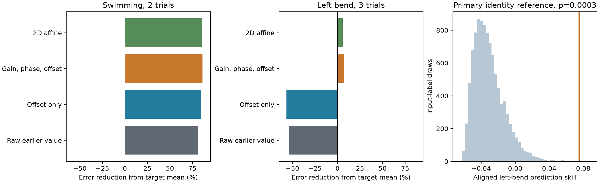
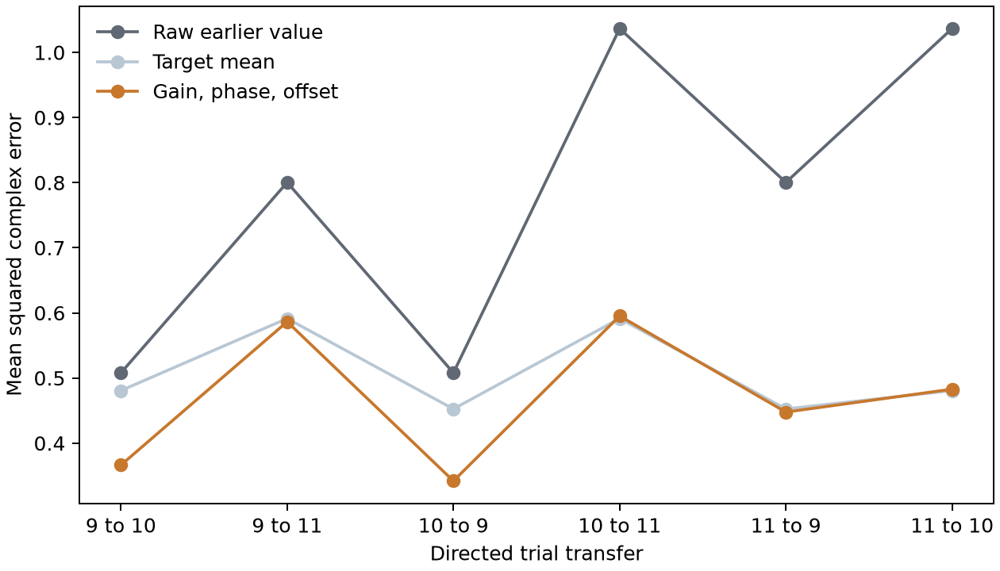

# A shared complex map reduced left-bend coherence error by 7.5% in 35 inputs to one leech motor neuron

A shared gain, phase change, and offset reduced prediction error by 7.5% relative to the target-trial mean in 35 identified inputs to motor neuron DE-3R. The test used three left local-bend trials from one leech ganglion. Each prediction excluded the target input from the fit. A whole-input identity reference gave p = 0.0003 from 9,999 draws. The result was small and varied across trial pairs. Error reductions were 24.1%, 0.9%, and -0.6% for the three trial pairs. Thus, the shared map recovered some input-specific information, but did not make the activity pattern uniformly repeatable.



The bars show error reduction from the mean of the other inputs in the target trial. Zero is that mean prediction. Negative values have more error than the mean. Both bar panels use the same scale. The right panel shows the reference that removes input identity across left-bend trials. The orange line is the observed score. These draws are reference label assignments, not animals.

## Question and prior work

Can a common change in gain and phase explain poor agreement across repeated activity measurements in a fixed input circuit? The question matters when a stable anatomical circuit supports more than one activity pattern. Raw disagreement can contain both a change shared across the input population and changes specific to individual inputs.

Ashaber and colleagues recorded voltage-sensitive dye signals and traced inputs to DE-3R in the same ganglion [1]. They studied coherence and the relation between contact clusters and activity during fictive motor behaviors. We use their released summaries and anatomical input identities. The direct match avoids a cell match across different animals. The analysis does not estimate a causal effect of wiring.

We completed `sci search "leech" --in ./campaign --json --limit 100 --timeout 600` and a second search for `leech state`. The first search returned nine signed publications with no invalid candidates. We read the full main text of three relevant bundles with `sci read` [3-5]. The prior prediction study [3] reported stable swim values, poor left-bend repeat predictions, and poor prediction from local contact positions. Other work tested counts and repeated coherence [4], and the effect of repeated source labels on a local phase statistic [5]. Our test adds a map fitted from other inputs in both trials, with a target-trial mean as its baseline. These campaign analyses use the same animal. They are not independent biological replications. We make no claim of an exhaustive priority search. Search results and the papers consulted are recorded in `files/literature.json`.

Population alignment has been used to study stable cortical dynamics across days [6]. Earlier leech work also showed that reliable local bending can occur with variable motor-neuron spike trains [7]. Our test uses one complex summary per input and trial. It does not align full neural trajectories or measure behavior reliability.

## Data and anatomical scope

The unchanged shared dataset is:

`/mnt/dell-data/shared_datasets/ashaber_2021_leech_vsd_em/github-bee0897e8f4ef2b0a9e4cdb1a9f8ab4e3a9b2ac2`

This is the fixed source commit `bee0897e8f4ef2b0a9e4cdb1a9f8ab4e3a9b2ac2` in `wagenadl/leechem` [2]. The cache records retrieval on 28 October 2026. We used the tracing database, mapping table, confidence table, and ten MAT files. `files/provenance.json` gives the exact shared path, fixed retrieval URL, byte count, and SHA-256 hash for each of these 13 files. No shared dataset was changed. Raw files remain outside this bundle under their source terms.

A contact links a type-5 presynaptic node to a type-6 node on target tree 444, DE-3R. The database is opened read-only. We count each input-tree and synapse-ID pair once. Multiple target-node annotations do not multiply the count. For the retained contact table, the smallest target-node ID resolves such cases. There are 527 contact records from 135 input trees. This source snapshot differs from the final count of 531 in the source paper. It is not a new count of the animal's complete circuit. An input tree can be a fragment rather than a complete neuron.

The primary sample has 35 input trees with at least two contacts and an imaging match to ROI 1 through 250. Together they have 271 contacts. Each input receives equal weight. A stricter sample has 21 inputs with both tracing and VSD-to-micro-CT match scores at least 80. We omit explicit postsynaptic rows from the confidence table and use the maximum retained score for each input. The scores are subjective annotations, not calibrated probabilities. A third sample includes all 45 mapped input trees, including single-contact inputs. No activity-magnitude cutoff is used.

Trials 6 and 8 are swimming; trials 9, 10, and 11 are left local bending. Right-bend trial 12 has no repeat and is excluded. Crawl trials and raw voltage traces are absent from the cache used here. Each released summary gives coherence magnitude and phase relative to DE-3R at its dominant frequency for that trial. Reference ROI 174 has unit magnitude and zero phase, within numerical precision, in all five used trials. The summary is not a synaptic conductance, a sign, or a causal transmission delay.

## Prediction and label reference

For input i in trial t, let

`z_it = magnitude_it * exp(sqrt(-1) * phase_it)`.

This feature retains magnitude and phase and has no phase-wrap discontinuity. For each ordered source and target trial pair u,v, exclude input i and fit

`z_jv = a * z_ju + b`, for all j other than i.

The complex coefficient a gives a shared gain and phase change. The complex b gives an offset. This model has four real fitted parameters. Ordinary least squares minimizes squared complex error. If x and y are the source and target vectors, and their means exclude i, the solution is

`a = sum_j conj(x_j - mean_x) * (y_j - mean_y) / sum_j abs(x_j - mean_x)^2`,

`b = mean_y - a * mean_x`.

The prediction is `a*x_i+b`. It uses input i's source value, but never its target value in the fit. It uses other inputs in the target trial. Thus, the result is a test of population calibration for a missing target input. It is not a forecast made before any target-trial recording is available.

The primary baseline is `mean_y`, the mean of the other inputs in the target trial. It has the same access to target-population measurements as the fitted map. We retain the source-trial mean and raw source value to connect this analysis with the earlier campaign result. Those are weaker information settings. They are not the baseline for our primary score.

For left bend, mean squared error (MSE) averages all inputs and all six ordered transfers among trials 9,10,11. Define

`skill = 1 - MSE_map / MSE_target_mean`.

Positive skill means lower error than the target mean. The six transfers share data and are not treated as six independent experiments. Swimming uses the two ordered transfers between trials 6 and 8.

The primary test uses left-bend skill in the 35-input sample. Keep trial 9 fixed, then independently shuffle input identities in trials 10 and 11. Refit all six directed maps and recompute skill for each draw. This preserves each trial's values, but removes the link between a named input and its measurements in different trials. We used 9,999 draws, seed 2026110807, and the one-sided plus-one probability `(1 + draws at least as large as observed)/10000`. The reference assumes that input labels can be exchanged under absence of cross-trial identity information. Cell class, shared drive, and selection can violate this assumption. It is not a randomized experiment.

`files/design.txt` records the main choices before the first model fit. It was informed by the published campaign results and is not a public preregistration. The two other input samples, swimming, and cross-behavior transfers are descriptive checks. Other fixed model checks use offset alone, unit-gain rotation plus offset, and a general two-dimensional real affine map. After inspecting the small fitted bend gains, we added a real-gain-plus-offset diagnostic. `files/diagnostic_note.txt` records that addition. It has no separate significance test. No model was selected to replace the primary model.

## Results

| Input sample | Behavior | Inputs | Target-mean MSE | Map MSE | Map error reduction |
| --- | --- | ---: | ---: | ---: | ---: |
| At least two contacts | Swimming | 35 | 0.39664 | 0.05501 | 86.13% |
| At least two contacts | Left bend | 35 | 0.50819 | 0.47008 | 7.50% |
| Strict confidence scores | Swimming | 21 | 0.33407 | 0.06742 | 79.82% |
| Strict confidence scores | Left bend | 21 | 0.54331 | 0.49913 | 8.13% |
| All mapped inputs | Swimming | 45 | 0.36729 | 0.06507 | 82.28% |
| All mapped inputs | Left bend | 45 | 0.49249 | 0.45596 | 7.42% |

Only the 35-input left-bend score has a primary label test. Two of 9,999 shuffled scores reached or exceeded its observed value. The plus-one p value is 0.0003; its approximate Monte Carlo standard error is 0.00017. The middle 95% of shuffled scores ranged from -0.05582 to 0.01309. This is uncertainty in a label reference, not uncertainty across animals. The small score and the low p value describe different properties: the fitted map removed little of the baseline error, but recovered more identity information than most shuffled assignments. More precisely, 92.5% of the target-mean error remained.

The left-bend result varied sharply by trial pair:

| Trial pair, both directions | Map error reduction |
| --- | ---: |
| 9 and 10 | 24.11% |
| 9 and 11 | 0.93% |
| 10 and 11 | -0.57% |

These three pairs share trials. They are descriptive ranges and do not define a sampling interval. In particular, the pooled result is not evidence of stable transfer to trial 11.



Each point averages 35 inputs. Lines connect prediction results for inspection. The horizontal axis lists trial transfers and is not elapsed time. The raw value and target mean have different information access; the affine model and target mean both use other inputs in the target trial.

| Model, 35-input left bend | MSE | Error reduction from target mean |
| --- | ---: | ---: |
| Raw source value | 0.78162 | -53.80% |
| Offset alone | 0.79615 | -56.66% |
| Unit gain, phase change, offset | 0.73808 | -45.24% |
| Real gain and offset, later diagnostic | 0.48529 | 4.51% |
| Complex gain and offset, primary | 0.47008 | 7.50% |
| General real affine map | 0.47780 | 5.98% |

The full-population bend gains were 0.207 to 0.551. They are fitted slopes, not biophysical gains. Keeping gain at one did not recover useful prediction. The real-gain diagnostic shows that shrinkage toward the target-population mean accounts for much of the improvement over a raw repeat. A general real map with six parameters gave no larger error reduction than the primary map with four. These model comparisons are descriptive.

Cross-behavior transfer was weak. With 35 inputs, swim-to-bend error reduction was 2.61%; bend-to-swim reduction was 3.57%. In the strict 21-input sample, the values were -0.40% and 1.80%. These checks do not test an animal-level difference between behaviors. The dominant frequencies and protocols can differ between behaviors.

All values, fits, and input-level predictions are in `files/results.csv`, `files/transfers.csv`, `files/population_maps.csv`, and `files/predictions.csv`. Maps were unconstrained and predictions were not clipped to the unit disk. No primary left-bend prediction exceeded unit magnitude. One descriptive swim prediction had magnitude 1.189. This limits its use as a physical coherence estimate.

## Meaning and limitations

The identified input circuit contains modest cross-trial information in left local bending after a common map is fitted. A raw earlier-value comparison misses that association. However, calibration leaves most of the target-mean error, and the effect comes mainly from one trial pair. This combination supports a narrow methods result: measure the prediction that remains after common calibration, and retain trial-specific results.

The same anatomical input identities had different levels of predictive agreement in the available swim and bend trials. This analysis conditions on input identity; it does not test which wiring feature causes stability. Synapse number, location, release, inhibition, modulation, and hidden common inputs are not identified by this map. No anatomical rewiring was measured between trials. The result cannot establish that rewiring was absent.

There is one target in one isolated preparation. Inputs share a circuit and a reference, and are not independent animal samples. Few trials, uncertain tracing, possible input fragments, incomplete image matches, and subjective confidence scores limit inference. Low coherence and noisy phase estimates can also affect fitted slopes. Without raw traces or phase-error estimates, we cannot separate input-specific neural change from measurement error, reference change, or a common artifact. A fitted phase angle is not a change in synaptic delay. No result establishes a general rule across animals, species, regions, or natural behavior. A later study can apply this fixed estimator to several anatomically matched animals and retain raw activity for an explicit error model.

## Reproduce and inspect

Use Python 3.12 with `files/requirements.txt`. Exact run versions and job metadata are in `files/run.json`. From the bundle root, with the shared source available:

```sh
python files/analyze.py --data /mnt/dell-data/shared_datasets/ashaber_2021_leech_vsd_em/github-bee0897e8f4ef2b0a9e4cdb1a9f8ab4e3a9b2ac2 --out replay --permutations 9999
python files/check.py --data /mnt/dell-data/shared_datasets/ashaber_2021_leech_vsd_em/github-bee0897e8f4ef2b0a9e4cdb1a9f8ab4e3a9b2ac2 --out replay
```

If the cache is absent, run `python files/retrieve.py NEW_PRIVATE_FOLDER` and use that folder with `--data`. The script fetches only the 13 used files from the fixed commit and verifies each size and SHA-256 hash. It refuses an existing destination. Do not download into or change the shared source directory. The retrieval recipe was tested against all 13 URLs; `files/retrieval_validation.txt` records the checks.

The checker groups original synapse memberships independently, checks input counts and confidence scores, and rebuilds the complex activity values. It compares every saved prediction with a direct least-squares fit that explicitly excludes the target input. It also checks every loss and aggregate score, the saved p value, and the first 20 label draws with direct fits. `files/validation.txt` records the outcome. The checks establish calculation consistency, not source tracing or biological validity.

All analysis code is new. No upstream code was copied into the package. The baseline license applies to our new text, figures, code, and factual analysis tables. It does not change the rights of the external source data or the cited work. Source authors retain credit for the experimental data. The fixed source repository carries an LGPL notice.

## Job and references

Job: `sci-1107-hp-neural-structure-and-computation-8ecfc7edfa58`. Topic: `neural-structure-and-computation`. Campaign: `11_07_2026`. Machine: `hp`. Account: `codex-andrii`. Model: `gpt-6.1-sol`, high reasoning effort. No agents were launched. Computations ran in the assigned isolated worktree. The campaign-machine signing key is not a personal authorship claim. This publication is saved locally, with no remote archive submission.

[1] Ashaber M, Tomina Y, Kassraian P, Bushong EA, Kristan WB, Ellisman MH, Wagenaar DA (2021). [Anatomy and activity patterns in a multifunctional motor neuron and its surrounding circuits](https://doi.org/10.7554/eLife.61881). These authors produced the source anatomy and voltage-imaging data.

[2] [Fixed source repository](https://github.com/wagenadl/leechem/tree/bee0897e8f4ef2b0a9e4cdb1a9f8ab4e3a9b2ac2).

[3] SCI `sha256:fb56dc06d16a4ddca8ac10f1a9ce4bb1a83014d8ed9f4a1797842629b3423590`. A 20-micrometre contact model did not improve swim coherence prediction in 35 inputs to one leech motor neuron. Read from the published campaign bundle.

[4] SCI `sha256:07a5d7f904386b7fc24f471a7e45d48c1687a46ecff38ebafe59f67b2c7ac8a8`. Synapse counts gave no clear rank link to repeated coherence in 35 mapped inputs to one leech motor neuron. Read from the published campaign bundle.

[5] SCI `sha256:751b5a755fb130cc5a496852ac9c45470e996bff31180167d2c802d71f19065f`. Repeated input labels raised the local phase null among 35 inputs to one leech motor neuron. Read from the published campaign bundle.

[6] Gallego JA, Perich MG, Chowdhury RH, Solla SA, Miller LE (2020). [Long-term stability of cortical population dynamics underlying consistent behavior](https://doi.org/10.1038/s41593-019-0555-4). Context for population alignment; no data reused.

[7] Zoccolan D, Pinato G, Torre V (2002). [Highly variable spike trains underlie reproducible sensorimotor responses in the medicinal leech](https://doi.org/10.1523/JNEUROSCI.22-24-10790.2002). Context for response variability; no data reused.
