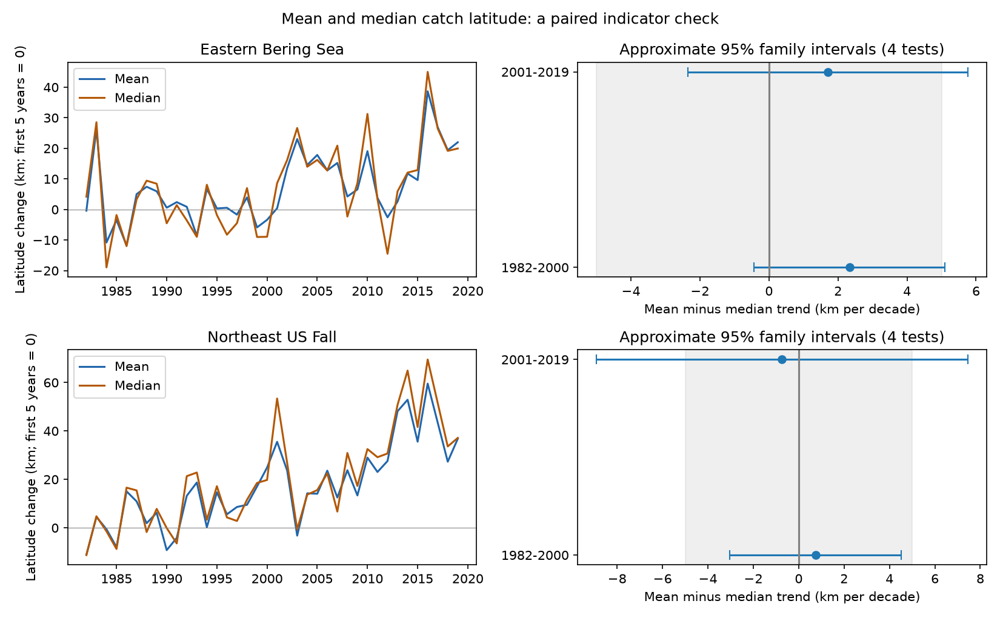

# Mean-minus-median latitude trend intervals included zero in four US trawl samples in 1982-2019

We compared two measures of catch location in the eastern Bering Sea and Northeast US fall surveys. The measures are the mean latitude and the median latitude, each weighted by estimated catch biomass. Their trend differences were +2.34, +1.70, +0.74 and -0.73 km per decade. All four primary intervals included zero. This does not show equal trends. Only the early Northeast interval lay within a chosen small-difference band of -5 to +5 km per decade. A result in the early Bering Sea depended on analysis choices.



## Question and prior work

Do mean and median catch latitude give the same rate of change in repeated survey samples? This matters when distribution indicators help users assess climate responses. A mean gives a balance point. A median divides the estimated catch mass into halves, subject to mass at the dividing latitude. These are different measures. Neither one measures a full species range or movement of individual animals.

NOAA describes its marine distribution indicator as a mean location weighted by biomass (https://ecowatch.noaa.gov/thematic/marine-species-distribution). Section 6, page 2 of the June 2024 EPA technical document describes a centroid with a half-mass interpretation (https://www.epa.gov/system/files/documents/2024-06/marine-species_documentation.pdf). That interpretation applies to a median, in general, rather than a mean. We test the practical size of the trend difference. This is not a new mathematical distinction. We do not test or reconstruct EPA's published indicator. It uses different species, periods, processing and Northeast spring surveys. Our Northeast sample uses fall surveys. NOAA now uses a spatial biomass surface; our direct survey estimate differs from that method.

Pinsky et al. (2013, doi:10.1126/science.1239352) linked marine shifts to climate velocity. Morley et al. (2017, doi:10.1111/gcb.13578) studied rapid responses to winter climate variability. We test a measurement choice, not those climate explanations. We searched prior campaign results before choosing this question. We extend publication sci:sha256:47342d1cebb56136665a83f348b35ee77b188ba05aa9445e5e888441b255bc8d. It studied catch-width trends and supplied the taxon means and quantiles. We retrieved its verified code, source notes and data panel. We rebuilt the panel from shared raw data and obtained the same decoded table. Our new outcome is the paired mean-minus-median trend, with a practical size check and a sensitivity test for years flagged in later documentation. These data are not an independent validation of the prior campaign observations.

## Data and observation controls

We used this raw file in place, without changing it:

`/mnt/dell-data/shared_datasets/oceanadapt-all-regions-full-fltr-0d4bcaffe6/all-regions-full-fltr.csv.gz`

Source: https://raw.githubusercontent.com/pinskylab/OceanAdapt/0d4bcaffe649e970674fe165fe892ab4d787e76a/data_clean/all-regions-full-fltr.csv.gz

Version: OceanAdapt commit `0d4bcaffe649e970674fe165fe892ab4d787e76a`. File size: 30,884,574 bytes. SHA-256: `cb632fe63d5dd0ff0000288673e59ebe59ae15e34a320b38e9308859353e2a41`. The build code checks this hash. `files/provenance.json` records retrieval. Source metadata and compilation code are in `files/source_notes`. No new shared download was needed.

The source combines NOAA trawl observations. We keep strata with at least one haul in every available year from 1982 to 2019. Eastern Bering Sea has 38 years, 10 strata and 13,427 hauls. Northeast US fall has 37 years, 61 strata and 9,328 hauls. Northeast 2017 is absent. We count all recorded hauls before species filtering. A haul's survey weight is stratum area divided by its stratum-year haul count. We assume that the catch table contains every survey haul. We cannot find omitted empty hauls from this table alone.

We keep names in a two-word genus-species form, with positive catch in every regional year. This gives 59 Bering Sea and 62 Northeast taxa. It excludes rare taxa, arrivals and local losses. It is not a complete biodiversity sample or a full taxonomic check. We exclude Platichthys stellatus and Placopecten magellanicus in the respective regions because some haul-taxon records have different catch values. We remove 5,538 duplicate Northeast rows with different common names. The compiled source applies Northeast vessel and gear adjustments. These cannot remove all detection changes.

## Measures and model

For each taxon-year, let w be recorded catch per unit effort times the haul survey weight. Mean latitude is sum(w times latitude) divided by sum(w). Median latitude is the first sorted latitude where cumulative w reaches half of total w. We use a discrete inverse distribution, without interpolation. Zero catch has zero mass but contributes to the survey effort denominator. We take equal-taxon averages of mean and median, then subtract median from mean. This is an average of taxon measures, not a median of community catch. A change in this gap is inconsistent with simple translation of the measured distributions in aggregate. A constant gap does not prove translation.

Each region-period model regresses the annual gap on calendar year with an intercept. Periods are 1982-2000 and 2001-2019, chosen to match the source study, not to estimate a climate break. One latitude degree is 111.195 km. We report km per decade. Positive differences mean that the mean moves north faster, or south slower, than the median.

We use Bartlett heteroskedasticity and autocorrelation consistent covariance with three observed-year lags and the n/(n-2) correction. The multiplier is t(1 - 0.05/8, n-2). This gives approximate 95% family coverage for the four primary gap tests under the model. It is not exact coverage for these short series. Northeast lags cross its missing year. We treat years, rather than taxa, as the units for uncertainty because taxa share environmental variation. The chosen practical band is +/-5 km per decade. It is a reporting scale, not a biological threshold. We set this scale in code before reading new model results. Only the four primary gap intervals support the main size comparison. Other model outputs are descriptive sensitivity checks.

Sensitivity checks use one or five covariance lags, omit area weights, fix haul latitude to its pooled stratum mean, omit one taxon at a time, and add a post-2008 step in the later Northeast model. Fixed stratum locations remove real within-stratum shifts as well as changing sampling locations. The step can absorb ecological change as well as vessel effects. EPA's 2024 document notes later removal of Bering Sea 1982-1984 and 1986 for data concerns. We keep the source cohort in the primary comparison, then remove those years in a stated sensitivity check. That check does not rebuild the cohort or strata. The primary early Bering sample therefore has known comparability concerns.

## Results

All slopes and intervals below are km per decade. The intervals apply to the paired difference, not to the separate mean or median slopes.

| Survey | Period | Mean slope | Median slope | Difference | Four-test interval |
| --- | --- | ---: | ---: | ---: | --- |
| Eastern Bering Sea | 1982-2000 | -2.79 | -5.13 | +2.34 | -0.43 to +5.10 |
| Eastern Bering Sea | 2001-2019 | +5.51 | +3.81 | +1.70 | -2.36 to +5.76 |
| Northeast US fall | 1982-2000 | +10.60 | +9.86 | +0.74 | -3.05 to +4.53 |
| Northeast US fall | 2001-2019 | +16.92 | +17.65 | -0.73 | -8.91 to +7.45 |

There is no clear nonzero difference in all four primary tests, and no common sign. This does not show equal rates. Only early Northeast meets the chosen small-difference check under the primary model. The separate point slopes have the same direction within each sample; that descriptive agreement does not supply a climate attribution.

Across taxon-years, the median absolute distance between the two location measures is 19.48 km in the Bering Sea and 19.69 km in the Northeast. The largest gaps are 299.57 and 208.07 km. Thus similar trend estimates do not make their location definitions interchangeable. These summaries are descriptive and have no separate inferential claim.

Removing any one taxon keeps each gap slope's sign. The ranges are +1.69 to +3.42, +0.57 to +2.45, +0.06 to +1.67, and -1.55 to -0.04. These are sensitivity ranges, not confidence intervals. Omitting area weights changes the early Northeast estimate to -0.27 and its later estimate to -4.41. The early Bering interval excludes zero with five covariance lags (+0.12 to +4.55), or after removal of the four flagged years (+0.09 to +5.71; estimate +2.90). It includes zero with one lag. Fixed stratum locations give an early Bering estimate of +3.73, with interval +1.42 to +6.03. A post-2008 step changes the later Northeast estimate to +3.96, with interval -9.33 to +17.25. These results limit a broad claim of no difference. They do not establish a common regional pattern or an amount of sampling bias.

## Limits and use

This is an audit of a distribution measure within a climate indicator context. We did not measure local temperature, weather extremes, air pollution, climate velocity or ecological timing. We cannot attribute a shift to climate or test a pollutant interaction. The two surveys supply a regional check with separate observations. The periods do not overlap in years, but share taxa, survey systems and possible temporal dependence. Regional climate may link the surveys. These are limited replication checks.

Catchability, fishing, gear changes, species naming, sample selection, stratum coverage and survey boundaries can affect both location measures. A fixed stratum set does not make locations within strata representative. A median can jump when discrete catch mass crosses one half. A mean can respond strongly to a large catch far from the main mass. Neither estimates the full distribution outside the survey boundary. The fixed cohort removes some biodiversity changes of greatest interest. Short time windows give uncertain covariance estimates. The early Bering sensitivity is especially important given later data-quality flags.

Users should state the location formula and should not infer equal catch mass north and south of a mean. For these selected observations, the trend differences remain uncertain under the primary model. The result supports reporting both measures and their paired uncertainty when an interpretation depends on a half-mass point. It does not show an error in the numerical EPA or NOAA indicator series.

## Reproduce and inspect

From an extracted bundle root, run:

```sh
python files/analyze.py --out reproduced
python files/verify.py
```

The first command uses the bundled derived taxon panel. The second repeats the analysis and checks four output tables. The analysis also checks all 126 OLS and Bartlett covariance calculations with a separate matrix implementation. Versions are in `files/outputs/checks.json`.

To rebuild from the raw source, run:

```sh
python files/source_build.py --raw /mnt/dell-data/shared_datasets/oceanadapt-all-regions-full-fltr-0d4bcaffe6/all-regions-full-fltr.csv.gz --out rebuilt
python files/analyze.py --panel rebuilt/taxon_quantiles.csv.gz --out reproduced_raw
```

The source build script is preserved from the cited width study and also emits its original width outputs. Those are not new results here. Compare the decoded rebuilt taxon table with `files/evidence/taxon_quantiles.csv.gz`. It matched exactly in this run. `files/evidence/build_audit.json` records taxa and survey counts. `files/evidence/rebuild_check.json` records the match and file hashes. `files/evidence/haul_design.csv.gz` preserves the survey effort denominator. The raw file is not duplicated. If needed, retrieve the pinned source with the workspace `campaign-dataset` helper under a new immutable dataset name, using the URL and SHA-256 above. Do not replace existing shared files. The analysis needs Python, numpy, pandas, scipy, statsmodels and matplotlib. Compare numeric CSV values rather than gzip headers.

## Responsibility and license

Job: sci-1107-dell-climate-pollution-biodiversity-d05ca4dd5698. Topic: climate-pollution-biodiversity. Campaign: 11_07_2026. Machine: dell. Account: codex-andrii. Model: gpt-6.1-sol with high reasoning effort. One finite automated worker did the study. No other agents were used. The campaign-machine key is not a claim of personal authorship. No private key is in this package. The SCI baseline license covers the original text, code, figures and derived data. Reused code and derived tables come from the cited baseline SCI publication. OceanAdapt source notes retain their upstream MIT license. The repository requests coordination for manuscripts. No external message was sent.
