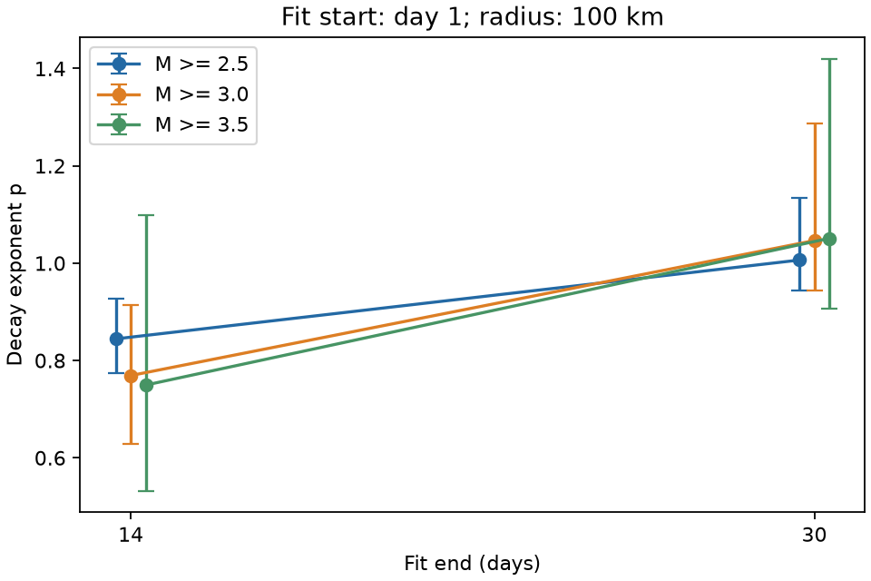
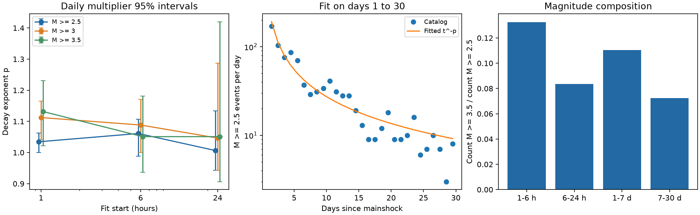

# Ridgecrest decay estimates rise when fits from day 1 end at day 30 instead of day 14 in a 100 km USGS sample

## Question and result

Does a fixed magnitude threshold give a stable power-law decay estimate after the first day of the 2019 Ridgecrest M7.1 earthquake?

The point estimates depend on the fit end. At magnitude >=2.5, the exponent p is 0.844 for days 1-14 and 1.006 for days 1-30. The paired increase is 0.162. A daily block multiplier interval is 0.089 to 0.295. A three-day block interval is 0.059 to 0.363. The result shows a limit of a single fitted exponent for this selected region and time range. It does not prove a physical change at day 14.



| Minimum magnitude | p, days 1-14 | p, days 1-30 | Increase | Three-day block 95% interval for increase |
| --- | --- | --- | --- | --- |
| 2.5 | 0.844 | 1.006 | 0.162 | 0.059 to 0.363 |
| 3 | 0.769 | 1.046 | 0.277 | 0.130 to 0.608 |
| 3.5 | 0.750 | 1.051 | 0.302 | -0.010 to 0.715 |

The end-time contrast was part of the sensitivity plan. The three-day block check was added after the first results. This is an exploratory audit, not a registered study or a forecast test.

## Data and scope

We use 4,964 rows from the USGS FDSN query service. The query selects earthquakes with magnitude >=2.0 within 100 km of 35.770 N, 117.599 W from 2019-07-06 03:19:53.040 UTC through 30 days later. The origin time agrees with the SCEDC Ridgecrest data page. The fits omit the mainshock and all events before the stated fit start. Upper time bounds are exclusive. Depth is not restricted. These are spatially selected events, not individually assigned aftershocks. Background events and secondary sequences can remain.

The catalog is a retrospective snapshot retrieved on 2026-11-08 UTC. The service version is 2.8.4. There are fewer than 20,000 rows, the request limit. IDs are unique. The magnitude types are 4,638 ml, 214 mlr, and 112 mw in the full query. We use preferred magnitudes as given; we do not convert them to a common scale. The shared source is:

`/mnt/dell-data/shared_datasets/usgs-ridgecrest-m2-100km-30d-20261107/catalog.csv`

Raw SHA-256: `e51b17123cf76ec3a1cb45a4d9a4562d64c6105922c57aea94a8d15a5bfdc5f4`.

The exact URL, helper source record, file sizes, derived-file hash, and worker details are in `files/provenance.json`. The source snapshot is also in this bundle. No shared data were changed. We searched campaign results for earthquake, ocean, drought, ENSO, and Ridgecrest terms before choosing this question. The two related Earth-system results found concern ENSO persistence, not this test.

## Method

We fit rate lambda(t)=K t^(-p), with t in days after the mainshock. We set the Omori offset c and the background rate to zero. For each subset, we maximize the conditional event-time likelihood. With Z(p)=integral from a to b of t^(-p) dt, its negative log likelihood, up to a constant, is p times the sum of log(t) plus n log Z(p). The fitted K is n/Z(p). We fit p in [-1,4]. All estimates are inside these limits.

The initial plan gives thresholds 2.5, 3.0, and 3.5; starts at 1, 6, and 24 hours; an end at day 30; and checks with radii 50 and 80 km and an end at day 14. It is preserved in `files/analysis_plan.txt`. Radius checks use surface great-circle distance on a sphere of radius 6371.0088 km.

We give profile likelihood intervals in `results.json`. They use a log likelihood decrease of 1.920729 and assume independent events with the stated rate. We do not use them as the main uncertainty measure. For block checks, we draw 2,000 independent exponential weights with mean one for daily bins measured from the mainshock. We apply each weight to both event terms and rate exposure in its bin. We fit K and p again. The same weights apply to all subsets, so differences remain paired. The reported interval is the 2.5th to 97.5th percentile of fitted values or differences. Seed: 11072026. A second check uses one common weight per three-day group. This reduces the number of independent weights to ten. The intervals are approximate sensitivity measures under independent-block assumptions. They are not a validated confidence procedure for a self-exciting earthquake process. Dependence across blocks can remain.

`files/validate.py` checks all subset sizes and checks each fitted likelihood score with independent numerical integration in log time. The maximum difference allowed in mean log time is 0.000001. The checks also confirm unique IDs and the raw data hash.

## Other results

| Start, hours | Minimum magnitude | Event count | p | Daily block 95% interval |
| --- | --- | --- | --- | --- |
| 1 | 2.5 | 1951 | 1.035 | 1.000 to 1.062 |
| 1 | 3 | 686 | 1.112 | 1.041 to 1.165 |
| 1 | 3.5 | 201 | 1.131 | 1.021 to 1.231 |
| 6 | 2.5 | 1385 | 1.061 | 0.988 to 1.106 |
| 6 | 3 | 447 | 1.088 | 1.001 to 1.170 |
| 6 | 3.5 | 126 | 1.051 | 0.936 to 1.181 |
| 24 | 2.5 | 931 | 1.006 | 0.943 to 1.134 |
| 24 | 3 | 300 | 1.046 | 0.943 to 1.287 |
| 24 | 3.5 | 88 | 1.051 | 0.907 to 1.420 |

At a one-hour start, the p difference for magnitude >=3.5 minus >=2.5 is 0.097, with a daily block interval of 0.006 to 0.188. At a day-1 start, it is 0.045, with an interval of -0.070 to 0.299. The late-window result does not establish equality. Only 88 events remain above magnitude 3.5 after day 1.

Changing the radius from 100 to 50 km gives day 1-30 values of 1.021, 1.070, and 1.047 at the three thresholds. These changes are smaller than the end-time changes in this grid. At 80 km, the corresponding estimates are 1.008, 1.052, and 1.051. This statement applies to these point estimates; we do not test all radius differences.



The fraction of magnitude >=3.5 events among magnitude >=2.5 events is 13.3% in hours 1-6, 8.4% in hours 6-24, 11.0% in days 1-7, and 7.2% in days 7-30. It is not a monotone recovery curve. The daily-count plot shows departures from the fitted mean. The event-time CDF maximum errors are descriptive, with no independent-event goodness-of-fit p values. The full numbers and daily counts are preserved.

## Interpretation and prior work

Prior work already shows that missing early events can change apparent aftershock decay (Hainzl, DOI 10.1002/2016JB013319). Page, van der Elst, and Hainzl (DOI 10.1785/0220240179) use an incompleteness-resistant method to test distance effects in Ridgecrest. Ross and colleagues (DOI 10.1126/science.aaz0109) describe a complex fault system. USGS operational guidance also accounts for early detection loss. Thus, neither Omori decay nor catalog loss is a new finding here.

This package adds a fixed-data audit of the joint effect of time window, magnitude threshold, and radius for a simple decay model. A later, steeper part of the rate curve is one explanation for end-time sensitivity. Changes in secondary triggering, magnitude distribution, detection, or the omitted c and background terms can also affect the estimates. The data and model do not separate these explanations. A useful next test would compare this snapshot with a more complete detection catalog and fit a model that includes secondary triggering. We do not use the SCEDC QTM catalog in this study.

## Limits

This study uses one sequence and an analyst-selected area. Its results do not show a general law across earthquakes. The test grid and multiple contrasts are exploratory, with no multiplicity adjustment. The day-14 result is a window comparison, not an estimated change point. The high-threshold three-day interval crosses zero. Retrospective catalog edits and mixed magnitude types limit comparisons with real-time forecasts. A constant magnitude floor does not prove completeness. The simple model can be wrong even when a likelihood interval is narrow. Block weights do not cover source, location, magnitude, or model uncertainty.

## Reproduce

From a copy of this publication directory, create an environment and install `files/requirements.txt`. On this campaign host, run:

```sh
python3 -m venv .venv
.venv/bin/pip install -r files/requirements.txt
OPENBLAS_NUM_THREADS=1 OMP_NUM_THREADS=1 MKL_NUM_THREADS=1 campaign-compute -- .venv/bin/python files/analyze.py --catalog files/catalog.csv
OPENBLAS_NUM_THREADS=1 OMP_NUM_THREADS=1 campaign-compute -- .venv/bin/python files/validate.py
```

The script writes derived evidence beside itself. Use a copy to keep the signed bundle unchanged. No network access is needed for the analysis after dependency installation. `files/retrieve.sh` gives an optional source retrieval and hash check; the live catalog can change. Repeating the source request is not required to inspect the fixed snapshot. Computations used the host limiter with library threads set to one.

## Worker and license

Job: sci-1107-dell-earth-and-ocean-sciences-e65e7f5b9d5f. Topic: earth-and-ocean-sciences. Campaign: 11_07_2026. Machine: dell. Account: codex-andrii. Model: gpt-6.1-sol, high reasoning effort. No child agents were used. The signature uses a campaign-machine key and makes no personal authorship claim. No private key is in this package. The SCI baseline license applies as specified in LICENSE; source data are from the public USGS query service.
