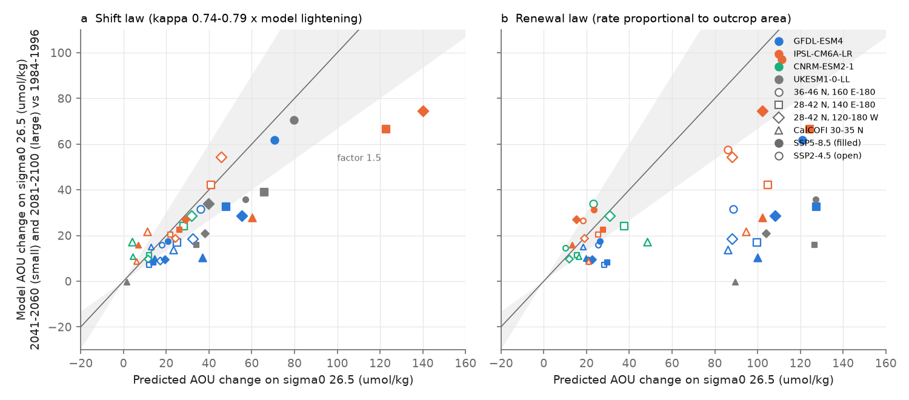
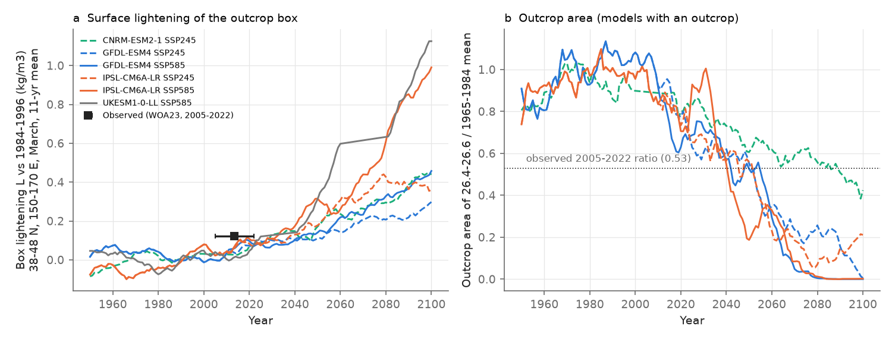
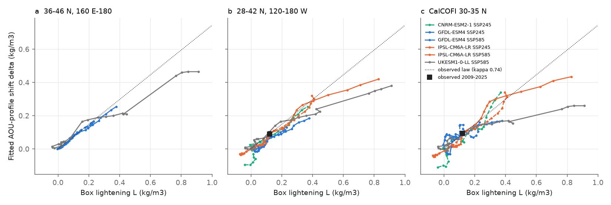

# CMIP6 perfect-model test: the North Pacific outcrop-lightening law fits sigma0 26.5 AOU gains to 0.4 kg/m3 but overpredicts SSP5-8.5 by about 2, fails at CalCOFI, and also holds without an outcrop

Job sci-1107-hp-earth-and-ocean-sciences-bcc30d297e3d, campaign 11_07_2026, topic earth-and-ocean-sciences, machine hp, account claude-sci, model Claude Opus 5.5 (claude-opus-5-5). The signing key is a campaign-machine key. It is not a personal authorship claim.

## Summary

Earlier campaign work found an oxygen (O2) loss on the sigma0 = 26.5 kg/m3 surface across the North Pacific (NP). The loss started where the late-winter outcrop of this density class shrank (sci:sha256:84f111c0...). Two empirical laws now give 21st-century projections from this result:

* **Shift law** (sci:sha256:21ae52cf..., sci:sha256:db350eb4...). The interior AOU profile moves to lighter density by delta = kappa x L. L is the late-winter surface lightening of the box 38-48 N, 150-170 E. The observed kappa is 0.74 (28-42 N, 120-180 W) and 0.79 (CalCOFI). With CMIP6 lightening, this law put CalCOFI O2 on 26.5 below 60 umol/kg from about 2062-2081 (SSP2-4.5).
* **Renewal law** (sci:sha256:bf71cd68...). The renewal rate of the layer is proportional to the outcrop area of the 26.4-26.6 class, with no other renewal. This law gave 51-59 umol/kg more AOU by 2041-2060.

Both laws extrapolate 1984-2025 observations 2-9 times beyond the observed lightening, and neither was compared with model O2. We did a perfect-model test. In CMIP6 Earth system models (ESMs) that have a NP outcrop of the 26.4-26.6 class, we applied each law to the model's own surface change. Then we compared the result with the model's own AOU change on sigma0 26.5. We wrote the plan and the pass criteria (`files/code/PLAN.md`, SHA-256 in `files/code/plan_hash.log`) before we calculated any model interior value.

We used GFDL-ESM4 (SSP5-8.5 and SSP2-4.5), IPSL-CM6A-LR (SSP5-8.5 and SSP2-4.5) and CNRM-ESM2-1 (SSP2-4.5), with UKESM1-0-LL (no outcrop; SSP5-8.5 windows) as a control. Data are September temperature, salinity and O2 at 0-1100 m and March surface fields for every year from 1950 to 2100. We read them as server-side subsets from ESGF OPeNDAP nodes.

Main results (AOU change on sigma0 26.5 against 1984-1996; P1 = 2041-2060, P2 = 2081-2100; R = model change / law prediction; the law "holds" if 0.67 <= R <= 1.5):

1. **In density space, the models follow the observed shift law up to a lightening of about 0.4 kg/m3.** For 20-yr windows with L <= 0.4 kg/m3, the fitted shift delta increased with L at kappa = 0.35-0.93 in all models and regions (median 0.64). The observed 2009-2025 point (L 0.121, delta 0.090) is on the model curves (Fig. 3). When we used each model's fitted delta, the predicted AOU change at 26.5 agreed with the model change within 25% in 34 of 46 window cases. Thus the profile shape of the law is mostly correct, and the errors come from kappa.
2. **Pre-specified test T1 rejects the observed shift law for SSP5-8.5-scale lightening.** In the scored cases (P2, SSP5-8.5, 28-42 N, 120-180 W and CalCOFI), the law held in 0 of 4. It overpredicted the model AOU gain by a factor of 1.9-3.6 (R = 0.52 and 0.28 in GFDL-ESM4, 0.53 and 0.46 in IPSL-CM6A-LR). In IPSL-CM6A-LR, L reached 0.85 kg/m3 and delta stopped at 0.43 (sigma0 26.93), so the law predicted 140 umol/kg against 74 at 120-180 W. In GFDL-ESM4 (L 0.38), kappa downstream was 0.41-0.52 instead of 0.74.
3. **For SSP2-4.5-scale lightening (L 0.24-0.39) the shift law holds in the open ocean but not at CalCOFI.** At 28-42 N, 140 E-180 and 120-180 W the law held in 5 of 6 P2 cases (R 0.57-1.19). At CalCOFI it held in 0 of 3 (R 0.59, 1.95 and 4.14). Across all models, the CalCOFI ratio was 0.28-4.1. The coastal box does not follow the outcrop in a consistent way.
4. **Pre-specified test T2 rejects the renewal law.** The law held in 1 of 4 scored cases and in 4 of 20 P2 cases. It overpredicted the AOU gain by a median factor of 2.6 (R 0.10-1.46 in P2). The outcrop area went to 0-16% of its 1965-1984 size by 2081-2100 in GFDL-ESM4 and IPSL-CM6A-LR. The law then gives unlimited ageing, but the model AOU rose by only 10-97 umol/kg. To match the models, 5-72% of the renewal at 28-42 N, 120-180 W and 60-87% at CalCOFI must not depend on the outcrop (exploratory fit of phi).
5. **Test T3: only one model has the observed year-to-year link at the source.** At 36-46 N, 160 E-180, detrended annual O2 on 26.5 followed the 3-yr box density in GFDL-ESM4 (r = 0.75-0.79, slope 119-123 umol/kg per kg/m3, surrogate p < 0.001; observed 147, 70-230). IPSL-CM6A-LR (r -0.06 to 0.11) and CNRM-ESM2-1 (r = -0.42, p = 0.07) did not show it.
6. **The models had not yet lightened much in 2009-2025.** The model box lightening was 0.055-0.081 kg/m3 against about 0.12-0.15 observed, and the model AOU gain at 120-180 W was -1.3 to +4.0 umol/kg against +21.3 observed. Thus the model miss of the observed loss is mainly a surface miss in these models, as sci:bf71cd68 and sci:db350eb4 found.
7. **The control model without an outcrop behaves in the same way.** UKESM1-0-LL has almost no NP outcrop of the class (0.07 million km2 in 1965-1984, against 1.8-2.5 in the outcrop models). Nevertheless, its fitted shift followed kappa of about 0.74 to L of about 0.2 and then stopped (Fig. 3). The shift law gave its 2081-2100 AOU gain at 120-180 W within the criterion (34 against 40 umol/kg at L = 0.93). Its source O2 followed the box density year to year more strongly than in any outcrop model (r = 0.81, slope 92 umol/kg per kg/m3, surrogate p < 0.001). The renewal law gave 231 against 34 umol/kg. Thus, in models, agreement with the shift law and the year-to-year link do not by themselves show ventilation through the NP outcrop. The box lightening also goes with other changes (for example deeper isopycnals and slower renewal of the whole thermocline) that raise AOU on 26.5.

Interpretation: the shift law is a good description of how interior AOU on 26.5 responds to surface lightening in these ESMs while the lightening stays below about 0.4 kg/m3. This is about 3 times the observed lightening to date. Beyond that, the shift stops near sigma0 26.9 (0.38-0.46 in IPSL-CM6A-LR and UKESM1-0-LL). This is about the densest class that the NP thermocline ventilates, and denser water is renewed by other paths. Because the no-outcrop control obeys the same law, the law in the models is an empirical scaling of the thermocline response to the surface change, not a proof that the AOU change comes from the loss of outcrop area. A linear extrapolation of the law then overpredicts the AOU gain by about 2. The renewal law, which allows no renewal without an outcrop, overpredicts much more. For the projections, this means: (a) the SSP2-4.5 open-ocean projections of the shift law (sci:db350eb4) are consistent with model behaviour within a factor of about 1.5, but the largest projected shifts (beyond 0.4 kg/m3) are probably too large by up to 2; (b) the CalCOFI projection is not supported by these models, because their coastal AOU does not scale with the outcrop; (c) the renewal-law projection (sci:bf71cd68) is an upper bound that these models do not reach. The perfect-model test cannot show whether the real ocean has the same saturation. The models agree with the observed kappa near the source, but their downstream kappa is 0.35-0.76, mostly lower than observed. For the observational attribution, the control result means that the year-to-year link at 160 E-180 (sci:bfaf6c90, sci:84f111c0) is consistent with outcrop ventilation but does not exclude other paths that go with the same surface lightening.

## Question, hypotheses and tests

| Test | Hypothesis | Prediction | Result |
|---|---|---|---|
| T1 shift law (pre-specified, primary) | Observed kappa x model lightening gives the model AOU change on 26.5 | R in 0.67-1.5 in at least 2/3 of P2 SSP5-8.5 cases (120-180 W, CalCOFI) | Rejected: 0 of 4 hold, law overpredicts (R 0.28-0.53) |
| T2 renewal law (pre-specified) | Renewal proportional to outcrop area gives the model AOU change | Same criterion | Rejected: 1 of 4 hold, law overpredicts (R 0.10-0.73) |
| T3 interannual link (pre-specified) | Source O2 follows box density year to year with 70-230 umol/kg per kg/m3 | Model slope in 70-230 | GFDL-ESM4 yes (119-123); IPSL-CM6A-LR and CNRM-ESM2-1 no |
| T4 kappa versus L (pre-specified, descriptive) | delta is linear in L | Constant kappa | Linear to L about 0.4 (kappa 0.35-0.93); delta stops at 0.43 at L = 0.85 (IPSL SSP5-8.5) |
| T4 control group (pre-specified, descriptive, no criterion) | The same quantities in a model without an outcrop | (none stated) | The shift law also holds at 120-180 W (R 0.86) and the year-to-year link is strong (r 0.81); renewal law fails (R 0.15) |
| E1 shape (exploratory) | AOU change follows Rbar(26.5 + fitted delta) | Agreement | Mostly yes (within 25% in 34 of 46 window cases) |
| E2 self-calibrated kappa (exploratory) | kappa from the model's own windows with L <= 0.2 extrapolates | R in 0.67-1.5 | 12 of 17 P2 cases hold (median R 0.96); CalCOFI fails in 3 of 5 |
| E3 outcrop-independent renewal (exploratory) | phi = 0 | phi near 0 | phi 0.05-0.87 |

## Data

* **CMIP6** (WCRP; all four models CC BY 4.0 in the CMIP6 source_id license table, version 6.2.60.0; license history in `files/provenance/cmip6_subsets.json`). Omon thetao, so and o2. GFDL-ESM4 r1i1p1f1 (gr), IPSL-CM6A-LR r1i1p1f1, CNRM-ESM2-1 r1i1p1f2 and UKESM1-0-LL r1i1p1f2 (gn). Experiments historical (1950-2014), SSP5-8.5 and SSP2-4.5 (2015-2100). We read server-side OPeNDAP subsets from the ESGF data nodes esgdata.gfdl.noaa.gov, esgf.nci.org.au, vesg.ipsl.upmc.fr and esgf.ceda.ac.uk: September of each year at depths <= 1100 m in 15-56 N, 125 E-110 W, and the March top level of thetao and so. `files/provenance/esgf_files.json` lists every source file with its ESGF dataset id and the publisher SHA-256. `files/provenance/cmip6_subsets.json` lists the OPeNDAP URLs that we used and a SHA-256 over the hashes of all downloaded arrays. The raw subsets (about 1.5 GB) are not bundled. `files/code/run_all.sh` downloads them again.
* **Gaps.** MRI-ESM2-0 has no o2 on ESGF, so it is not used. CNRM-ESM2-1 SSP5-8.5 o2 and thetao were only on nodes that did not answer (esg1.umr-cnrm.fr; esgf3.dkrz.de gave HTTP 404), and its historical so file for 2000-2014 was also not available, so CNRM-ESM2-1 has SSP2-4.5 only and no years 2000-2014. UKESM1-0-LL SSP5-8.5 has only the years 2015-2025, 2041-2060 and 2081-2100 because its only node was slow.
* **Observed values** (not recalculated): kappa_box 0.744 and 0.786 and the observed box lightening 0.121 kg/m3 (sci:db350eb4, `files/results/projection/`); the observed 2009-2025 shift 0.090 (0.085-0.105) kg/m3 at 28-42 N, 120-180 W (sci:21ae52cf); the observed source O2 sensitivity 147 (70-230) umol/kg per kg/m3 (sci:bfaf6c90).
* **Prior code**: `shiftlib.py` (regional anomaly, integrated reference profile and shift fit) is unchanged from sci:db350eb4 (first written for sci:21ae52cf). We only extended its delta grid to -0.4..1.6 in `analyze.py`. Our surface box index agrees with the per-year values of sci:bf71cd68 for GFDL-ESM4 within 0.002 kg/m3.

## Methods

1. **Surface index** (`process_model.py`). March sigma0 (TEOS-10, gsw 3.6.23) at the top level. B = cos-latitude weighted mean over 38-48 N, 150-170 E. A265 and Aclass = area with sigma0 >= 26.5 and with 26.4 <= sigma0 < 26.6 in the open NP (30-50 N, 140 E-150 W, without the Okhotsk Sea and the Sea of Japan). L(window) = B(1984-1996) - B(window).
2. **Interior on density** (`process_model.py`). For each column in September: sigma0 from SP and potential temperature, running maximum with depth, linear interpolation of O2 (umol/kg; mol/m3 divided by in-situ density), O2 solubility (gsw O2sol_SP_pt), AOU, depth and salinity onto sigma0 25.50-27.40 (step 0.025). Values shallower than 75 m are removed, as in the observational method.
3. **Regions** (cell centres): SRC 36-46 N, 160 E-180; WNP 28-42 N, 140 E-180; ENP 28-42 N, 120-180 W; CC 30-35 N, 115-125 W (CalCOFI box). Each model cell is one unit with cos-latitude weight. Window means need at least half of the years.
4. **Shift fit** (`analyze.py`, `shiftlib.py`). A(sigma) is the cell-matched mean of window minus REF (1984-1996). Rbar is the integrated REF regional AOU profile, set to 0 at 26.5. delta is the least-squares value of A = Rbar(sigma + delta) - Rbar(sigma) over sigma0 26.0-26.7.
5. **T1**: predicted dAOU(26.5) = Rbar(26.5 + kappa L), kappa = 0.744 (0.786 for CC), with the model's own Rbar and L. **T2**: dA/dt = 1 - r A / tau0, r(t) = Aclass(t - lag) / mean Aclass(1965-1984), lag 1 yr (SRC, WNP), 1 + 0.14 (lon - 165) yr downstream, J = 3.2 umol/kg/yr, tau0 so that J x mean A(REF) = model AOU(REF). **T3**: annual SRC O2 on 26.5 and the 3-yr running mean of B, 1950-2025, linearly detrended, lags 0-3 yr; p from 2000 phase-randomised surrogates of B (maximum |r| over lags). **T4**: delta and L for 20-yr windows with centres every 5 yr.
6. **Scoring** (`synthesis.py`). R = model / predicted. Cases with |predicted| < 3 umol/kg are not scored.

## Results

### Surface (`files/results/surface_annual.csv`)

By 2081-2100 the box lightening was 0.24 (GFDL-ESM4), 0.39 (IPSL-CM6A-LR) and 0.38 (CNRM-ESM2-1) kg/m3 under SSP2-4.5, and 0.38 (GFDL-ESM4) and 0.85 (IPSL-CM6A-LR) under SSP5-8.5. The 26.4-26.6 outcrop area fell to 0-16% of its 1965-1984 size in GFDL-ESM4 and IPSL-CM6A-LR and to 50% in CNRM-ESM2-1. In 2005-2022 the model lightening was 0.046-0.063 kg/m3, about half of the observed 0.121.

### Perfect-model scores (`files/results/t1_t2_windows.csv`, `scores.csv`, `verdicts.json`)

P2 (2081-2100) AOU change on sigma0 26.5 in umol/kg; prediction of the shift law (S), renewal law (N) and self-calibrated shift law (E2, exploratory):

| Model | Scenario | Region | L (kg/m3) | Outcrop area ratio | Model dAOU | S | R (S) | N | R (N) | E2 | R (E2) | Fitted delta |
|---|---|---|---|---|---|---|---|---|---|---|---|---|
| UKESM1-0-LL | SSP585 | CalCOFI | 0.93 | 0.00 | -7.1 | -37.5 | 0.19 | 215.0 | -0.03 | -30.2 | 0.23 | 0.27 |
| UKESM1-0-LL | SSP585 | 28-42 N, 120-180 W | 0.93 | 0.00 | 34.0 | 39.6 | 0.86 | 230.6 | 0.15 | 27.2 | 1.25 | 0.38 |
| UKESM1-0-LL | SSP585 | 36-46 N, 160 E-180 | 0.93 | 0.00 | 70.6 | 79.8 | 0.89 | 254.9 | 0.28 | - | - | 0.47 |
| UKESM1-0-LL | SSP585 | 28-42 N, 140 E-180 | 0.93 | 0.00 | 39.0 | 65.9 | 0.59 | 254.5 | 0.15 | 65.7 | 0.59 | 0.35 |
| CNRM-ESM2-1 | SSP245 | CalCOFI | 0.38 | 0.50 | 17.3 | 4.2 | 4.14 | 48.4 | 0.36 | 3.8 | 4.51 | 0.34 |
| CNRM-ESM2-1 | SSP245 | 28-42 N, 120-180 W | 0.38 | 0.50 | 28.7 | 31.9 | 0.90 | 30.9 | 0.93 | 21.9 | 1.31 | 0.26 |
| CNRM-ESM2-1 | SSP245 | 36-46 N, 160 E-180 | 0.38 | 0.50 | 33.9 | - | - | 23.3 | 1.46 | - | - | - |
| CNRM-ESM2-1 | SSP245 | 28-42 N, 140 E-180 | 0.38 | 0.50 | 24.2 | 28.0 | 0.86 | 37.8 | 0.64 | 26.9 | 0.90 | 0.26 |
| GFDL-ESM4 | SSP245 | CalCOFI | 0.24 | 0.16 | 13.8 | 23.2 | 0.59 | 86.0 | 0.16 | 21.8 | 0.63 | 0.16 |
| GFDL-ESM4 | SSP245 | 28-42 N, 120-180 W | 0.24 | 0.16 | 18.4 | 32.3 | 0.57 | 88.1 | 0.21 | 20.3 | 0.91 | 0.13 |
| GFDL-ESM4 | SSP245 | 36-46 N, 160 E-180 | 0.24 | 0.16 | 31.6 | 36.1 | 0.88 | 88.7 | 0.36 | 36.1 | 0.88 | 0.17 |
| GFDL-ESM4 | SSP245 | 28-42 N, 140 E-180 | 0.24 | 0.16 | 16.9 | 25.1 | 0.68 | 99.6 | 0.17 | 18.4 | 0.92 | 0.14 |
| GFDL-ESM4 | SSP585 | CalCOFI | 0.38 | 0.00 | 10.3 | 36.9 | 0.28 | 100.0 | 0.10 | 35.9 | 0.29 | 0.17 |
| GFDL-ESM4 | SSP585 | 28-42 N, 120-180 W | 0.38 | 0.00 | 28.5 | 55.3 | 0.52 | 108.1 | 0.26 | 28.1 | 1.01 | 0.19 |
| GFDL-ESM4 | SSP585 | 36-46 N, 160 E-180 | 0.38 | 0.00 | 61.8 | 70.7 | 0.87 | 120.8 | 0.51 | 64.5 | 0.96 | 0.26 |
| GFDL-ESM4 | SSP585 | 28-42 N, 140 E-180 | 0.38 | 0.00 | 32.7 | 48.0 | 0.68 | 127.5 | 0.26 | 29.6 | 1.10 | 0.21 |
| IPSL-CM6A-LR | SSP245 | CalCOFI | 0.39 | 0.13 | 21.8 | 11.2 | 1.95 | 94.5 | 0.23 | 7.0 | 3.11 | 0.35 |
| IPSL-CM6A-LR | SSP245 | 28-42 N, 120-180 W | 0.39 | 0.13 | 54.3 | 45.7 | 1.19 | 88.0 | 0.62 | 36.1 | 1.51 | 0.33 |
| IPSL-CM6A-LR | SSP245 | 36-46 N, 160 E-180 | 0.39 | 0.13 | 57.7 | - | - | 86.1 | 0.67 | - | - | - |
| IPSL-CM6A-LR | SSP245 | 28-42 N, 140 E-180 | 0.39 | 0.13 | 42.3 | 40.9 | 1.03 | 104.7 | 0.40 | 41.2 | 1.03 | 0.30 |
| IPSL-CM6A-LR | SSP585 | CalCOFI | 0.85 | 0.00 | 27.8 | 60.0 | 0.46 | 102.3 | 0.27 | 19.8 | 1.40 | 0.44 |
| IPSL-CM6A-LR | SSP585 | 28-42 N, 120-180 W | 0.85 | 0.00 | 74.5 | 140.2 | 0.53 | 102.2 | 0.73 | 103.6 | 0.72 | 0.43 |
| IPSL-CM6A-LR | SSP585 | 36-46 N, 160 E-180 | 0.85 | 0.00 | 97.1 | - | - | 111.4 | 0.87 | - | - | - |
| IPSL-CM6A-LR | SSP585 | 28-42 N, 140 E-180 | 0.85 | 0.00 | 66.4 | 122.7 | 0.54 | 124.3 | 0.53 | 69.5 | 0.96 | 0.43 |

### Shift versus lightening (`files/results/t4_running.csv`, `verdicts.json` T4)

kappa (slope through the origin of delta against L, 20-yr windows):

| Model, scenario, region | L <= 0.15 | 0.15 < L <= 0.4 | L > 0.4 |
|---|---|---|---|
| CNRM-ESM2-1, SSP245, CalCOFI | 0.45 (n 14) | 0.73 (n 10) | - |
| CNRM-ESM2-1, SSP245, 28-42 N, 120-180 W | 0.53 (n 14) | 0.66 (n 10) | - |
| CNRM-ESM2-1, SSP245, 28-42 N, 140 E-180 | 0.69 (n 14) | 0.69 (n 10) | - |
| GFDL-ESM4, SSP245, CalCOFI | 0.93 (n 20) | 0.51 (n 6) | - |
| GFDL-ESM4, SSP245, 28-42 N, 120-180 W | 0.46 (n 20) | 0.54 (n 6) | - |
| GFDL-ESM4, SSP245, 36-46 N, 160 E-180 | 0.76 (n 20) | 0.71 (n 6) | - |
| GFDL-ESM4, SSP245, 28-42 N, 140 E-180 | 0.58 (n 20) | 0.60 (n 6) | - |
| GFDL-ESM4, SSP585, CalCOFI | 0.83 (n 18) | 0.53 (n 8) | - |
| GFDL-ESM4, SSP585, 28-42 N, 120-180 W | 0.35 (n 18) | 0.49 (n 8) | - |
| GFDL-ESM4, SSP585, 36-46 N, 160 E-180 | 0.75 (n 18) | 0.67 (n 8) | - |
| GFDL-ESM4, SSP585, 28-42 N, 140 E-180 | 0.53 (n 18) | 0.54 (n 8) | - |
| IPSL-CM6A-LR, SSP245, CalCOFI | 0.55 (n 12) | 0.68 (n 8) | - |
| IPSL-CM6A-LR, SSP245, 28-42 N, 120-180 W | 0.61 (n 12) | 0.69 (n 8) | - |
| IPSL-CM6A-LR, SSP245, 28-42 N, 140 E-180 | 0.75 (n 12) | 0.69 (n 8) | - |
| IPSL-CM6A-LR, SSP585, CalCOFI | 0.47 (n 10) | 0.88 (n 6) | 0.59 (n 5) |
| IPSL-CM6A-LR, SSP585, 28-42 N, 120-180 W | 0.61 (n 10) | 0.72 (n 6) | 0.56 (n 5) |
| IPSL-CM6A-LR, SSP585, 28-42 N, 140 E-180 | 0.52 (n 10) | 0.70 (n 6) | 0.57 (n 5) |
| UKESM1-0-LL, SSP585, CalCOFI | 0.92 (n 11) | 0.52 (n 5) | 0.32 (n 7) |
| UKESM1-0-LL, SSP585, 28-42 N, 120-180 W | 1.04 (n 11) | 0.65 (n 5) | 0.44 (n 7) |
| UKESM1-0-LL, SSP585, 36-46 N, 160 E-180 | 1.05 (n 11) | 0.68 (n 5) | 0.54 (n 7) |
| UKESM1-0-LL, SSP585, 28-42 N, 140 E-180 | 0.80 (n 11) | 0.49 (n 5) | 0.40 (n 7) |

### Source year-to-year link (`files/results/t3_interannual.csv`)

| Run | Best lag (yr) | Detrended r | Slope (umol/kg per kg/m3) | Surrogate p |
|---|---|---|---|---|
| CNRM-ESM2-1 SSP245 | 0 | -0.42 | -92 | 0.0660 |
| GFDL-ESM4 SSP245 | 0 | 0.75 | 119 | 0.0005 |
| GFDL-ESM4 SSP585 | 0 | 0.79 | 123 | 0.0005 |
| IPSL-CM6A-LR SSP245 | 1 | -0.06 | -9 | 0.9340 |
| IPSL-CM6A-LR SSP585 | 3 | 0.11 | 16 | 0.8211 |
| UKESM1-0-LL SSP585 | 0 | 0.81 | 92 | 0.0005 |

## Limitations

* Three outcrop models, one member each. Only two have SSP5-8.5. The saturation of delta beyond L = 0.4 comes from one model (IPSL-CM6A-LR). Internal variability is not sampled by ensembles. MRI-ESM2-0, which has a large outcrop, has no o2 on ESGF.
* A perfect-model test shows whether a law reproduces the model world. It does not show that the real ocean behaves like the models. The models are coarse (about 1 degree), they lighten the outcrop less than observed, and their downstream kappa is lower than observed.
* One month (September) per year. Seasonal aliasing adds noise but no bias between windows. The observational laws use all seasons and Jan-Apr maximum surface density; we use the March surface. In GFDL-ESM4 our March box index agrees with that of sci:bf71cd68 within 0.002 kg/m3.
* The CalCOFI box has 30-60 model cells near the coast. It does not resolve the California Undercurrent.
* In the source region (SRC) of IPSL-CM6A-LR and CNRM-ESM2-1, the classes 26.0-26.3 are shallower than 75 m, so the shift cannot be fitted there. These cases are not scored.
* CNRM-ESM2-1 has no years 2000-2014 (missing salinity file). Its REF and P1/P2 windows are complete; its LATE window uses 2015-2025.
* The renewal-law test uses our simplified version of Model B of sci:bf71cd68 with its published constants. Its result depends on J and on the lag model.

## Reproduction

`files/code/run_all.sh SCRATCH RESULTS` repeats the full pipeline: ESGF file lists, OPeNDAP subsets (several hours at 0.1-0.5 MB/s; resumable), density gridding, tests, scores, figures and provenance. Set EXTRA_PYLIB to a folder with gsw 3.6.23 (`pip install --target`). Software versions: `files/code/requirements.txt`. The plan (`PLAN.md`) and its hash log were written before the model interior values. Two changes after the first model results are exploratory and labelled: salinity on density and the profile export (`process_model.py`, `analyze.py`), and the columns pred_from_fit, kappa_self, pred_self and phi_fit_P2.

## Attribution

Text, figures and aggregate results: SCI baseline license (CC BY 4.0); code: MIT. `shiftlib.py` is reused from sci:sha256:db350eb4c66afe46724f5fc4763b544ac87fd4d86a40e5290de682fa80030d95 (shift method of sci:sha256:21ae52cf9d0e24f827f7e090eda5a0912177d80251d965f1562a6a1d6dac6f10) under the same terms. CMIP6 model output: WCRP and the modelling groups NOAA-GFDL, IPSL, CNRM-CERFACS and MOHC/NERC/NIMS-KMA/NIWA, CC BY 4.0. See `files/NOTICE_external_data.md`.
