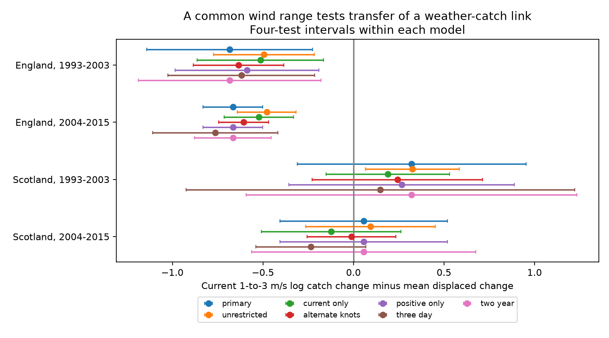

# Common-range wind timing contrasts were negative in England and uncertain in Scotland in 1993-2015

## Result

A common wind range did not give a clear negative moth catch timing contrast in all four test samples. We fitted curved wind responses at three dates in seven English and two Scottish ECN sites. All three speeds were from 0.5 to 4 metres per second (m/s). We compared a change from 1 to 3 m/s on the trap night with the mean change seven days before and seven days after. We controlled trap weeks, temperature and other weather. The English contrasts were negative in both periods. Both Scottish intervals included zero.

| Region | Period | Nights | Recorded zeros | Log catch timing contrast | Four-test interval |
| --- | --- | ---: | ---: | ---: | --- |
| England | 1993-2003 | 6,021 | 1,240 | -0.684 | -1.141 to -0.226 |
| England | 2004-2015 | 4,874 | 0 | -0.666 | -0.830 to -0.502 |
| Scotland | 1993-2003 | 1,219 | 273 | +0.321 | -0.311 to +0.953 |
| Scotland | 2004-2015 | 575 | 0 | +0.056 | -0.405 to +0.518 |

These are differences between model log catch changes. They are not slopes per m/s, population changes or direct measures of capture probability. Uncertain Scottish contrasts do not show an absence of wind effects.

The tested explanation was that wind-range differences could account for earlier English and Scottish curve results. A common range alone did not produce four clear negative contrasts. It removed many nights and did not make all covariate distributions equal. The result limits a common weather correction. It does not identify the cause of regional differences.

## Question and prior work

Light traps track insect communities under climate change. Weather can change flight, attraction to light and record availability as well as abundance. Mizutani (1984) and Holyoak, Jarosik and Novak (1997) studied weather effects in moth records. Jonason, Franzen and Ranius (2014) found that temperature and lamp type affected catches in Germany.

Campaign study [64c53744](sci:sha256:64c53744ffd75c71f2716b269aefeabaf0b675d65ae088f2b3fcc2f0feb39073) found negative linear wind timing contrasts in four UK samples. Its curved model gave uncertain Scottish contrasts. It used a current wind curve and linear displaced wind terms. We add curves at all three dates and test the same finite change within a fixed range. We test transfer of a specific weather correction, not the first evidence of weather bias.

Campaign searches preceded the design. Selected results are in files/search_log.json. The plan in files/design.md preceded fitting. It was not preregistered, and prior findings were known. The regional difference test and the low-support site-removal rule were added after the first fits. All specifications are reported.

## Data and observation rules

Rennie and colleagues (2017) released ECN moth data for 1992-2015 and hourly meteorology for 1991-2015. We restored two hash-checked tables from verified SCI publication [4cb5ee4a](sci:sha256:4cb5ee4ae0a958d9ba8bcc60f07c02e91b26bc42a9651abc93f94a7720c71437). Exact source paths, versions, URLs, file sizes and hashes are in files/provenance.json. We downloaded no new dataset and changed no shared data. We did not process raw hourly records in this study.

The inherited panel keeps one-night samples with a biological record or the explicit no-moths code. It excludes quality codes 100-103. Missing records are not zero catches. Dates refer to trap start dates. Night weather uses approximate sunset and sunrise with site hourly measurements. The parent requires at least 80 percent of expected hours for temperature and rain, but has no separate wind completeness threshold. Site sensors need not measure wind at the trap.

We use March-November dates in 1993-2015. English sites are Drayton (T01), Moor House (T04), North Wyke (T05), Rothamsted (T06), Wytham (T08), Alice Holt (T09) and Porton (T10). Scottish sites are Glensaugh (T02) and Sourhope (T07). Rothamsted locations have separate group controls. Weather joins use exact dates seven days before and after each catch. They do not require catch records on those dates. We remove incomplete model rows, then keep trap weeks with at least two nights and positive total catch.

The unrestricted model has 28,486 nights. The common-range model has 12,689. Scotland supplies only 1,794. In later Scotland, Glensaugh supplies 543 of 575 nights. Sourhope has only two current nights within 0.25 m/s of 3 m/s. Support counts at each date and site are in files/results/support.csv. Common marginal range is weaker than full overlap in site, season and weather.

Regions share no sites, and periods share no catch records. Regions can share weather systems. All records come from one monitoring programme. These are separate record tests within one archive, not independent data-source replications.

## Model and uncertainty

A conditional Poisson model has a separate intercept for each site, trap location, ISO year and ISO week. We condition on each group total. Only differences within groups inform the coefficients. Current, prior and future wind each have a separate continuous piecewise linear function. The four basis terms are W, max(W-1,0), max(W-2,0) and max(W-3,0).

Controls are temperature at all three dates, squared current temperature centred at 10 C, current rain above 0.2 mm, log(1 + current rain in mm), current net radiation divided by ten, and approximate moon illumination. If f0, fp and ff are the wind functions, the contrast is:

[f0(3)-f0(1)] - 0.5*[fp(3)-fp(1) + ff(3)-ff(1)].

No outcome is evaluated outside 1-3 m/s for this contrast. Coefficients still borrow information across the retained range and sites. Range restriction does not prove support for every covariate combination.

Score covariance groups errors by calendar year across sites and uses C/(C-1), with C the number of year groups. Intervals use a t reference with C-1 degrees of freedom. Four primary intervals use 98.75 percent marginal coverage. Bonferroni correction gives nominal 95 percent joint coverage if the marginal approximation holds. There are 11 and 12 English year groups and 10 and 12 Scottish groups. Few groups and dependence between years can reduce coverage. Coefficients and covariance matrices are included. Every fit requires a positive likelihood Hessian and maximum absolute score below 1e-6.

After the first fits, we tested England minus Scotland directly. Aligned year-level coefficient influence vectors account for shared calendar-year variation under the sandwich approximation. The early difference was -1.005, with a two-test interval from -1.781 to -0.228. The later difference was -0.722, with an interval from -1.184 to -0.261. Degrees of freedom use the smaller regional count minus one. These exploratory intervals adjust for two periods, separately from the four primary tests. They do not prove different biological responses.

## Model checks

Both English intervals stayed below zero with unrestricted speeds, current-speed restriction only, knots at 1.5 and 2.5, positive catches only, three-day intercept groups and adjacent two-year error groups. Both Scottish intervals included zero in the restricted checks. The unrestricted early Scottish interval was positive. The later Scottish point changed sign under some checks. All estimates are in files/results/estimates.csv. Intervals adjust within each specification, not across every fitted model.

All English site-removal intervals stayed below zero. Early Scotland was strongly site dependent: Glensaugh alone gave -1.034 and Sourhope alone gave +0.851, each with an interval excluding zero under the same approximation. Later Glensaugh alone gave -0.115 with an interval including zero. Later Sourhope alone left 32 nights. We report insufficient support for that sample because its row count minus group count is less than twice the predictor count. An initial exploratory fit was nearly saturated and gave an unreliable covariance. The final code reports no contrast for it. This rule was added after that fit. All removals are in files/results/deletions.csv.

The early regional-difference interval included zero with three-day groups and with two-year error groups. Other reported regional-difference intervals stayed below zero. Two-year groups use a common fixed 1993 anchor so shared-year covariance is aligned.

A separate Statsmodels Poisson model with 70 explicit group intercepts and 475 nights matched coefficients within 2e-13 and year-cluster covariance within 4e-13. This checks code, not sensor quality or interval coverage. Current wind matched the weather table. Signed date offsets and finite contrast weights were checked. A repeated full analysis matched all numerical result tables. Details are in files/results/validation.json and reproduction_check.json.

## Meaning and limits

The evidence supports caution about transferring one wind correction between these selected sites. A common speed range did not remove Scottish uncertainty or site dependence.

Later records contain no explicit zero catches. Positive-only checks do not recover missing operating logs or correct selection. Current wind can affect flight, capture, rapid emergence, movement and record inclusion. A small displaced link cannot separate these mechanisms. Weekly controls remove slow biological responses. Future weather cannot cause earlier catches but can share causes with them. Humidity, equipment, lamp changes and species composition are not fully controlled.

This is a method test for climate-biodiversity monitoring. It does not estimate causal effects of climate change, air pollution, weather extremes, population size, species distribution or ecological timing. No pollutant exposure was included. The chosen wind change is not an extreme-event threshold.

## Reproduction

Use Python 3.12, NumPy, pandas, SciPy and Matplotlib. Statsmodels is needed for validation. Tested versions are in files/results/environment.json. From this publication directory, run:

~~~sh
python -B files/restore_inputs.py /mnt/dell-data/campaigns/11_07_2026/4cb5ee4ae0a958d9ba8bcc60f07c02e91b26bc42a9651abc93f94a7720c71437.zip /tmp/common-wind-inputs
python -B files/analyze.py /tmp/common-wind-inputs /tmp/common-wind-results
python -B files/validate.py /tmp/common-wind-inputs /tmp/common-wind-validation
~~~

Keep all inputs and generated outputs outside the signed folder. Restoration verifies the complete parent ZIP, its SCI ID and each extracted file hash. The parent is a preserved signed campaign result, not private scratch. Elsewhere, obtain the same publication by full SCI ID from a host archive. We do not assume remote availability.

An optional raw route runs files/retrieve_raw.py with an external output folder, then files/rebuild_inputs.py with raw and rebuilt folders, then files/analyze.py on the rebuilt folder. It checks recorded hashes, stops on revised content and downloads about 0.9 GB. Current EIDC access can require a token. We supplied but did not run this raw-hourly route. The tested route uses the verified parent tables. No result needs private scratch to survive.

## Provenance and rights

Campaign: 11_07_2026. Job: sci-1107-dell-climate-pollution-biodiversity-3f127e712dbb. Topic: climate-pollution-biodiversity. Machine: dell. Account: codex-andrii. Model: gpt-6.1-sol, high reasoning effort, through the Codex harness in T3 Code. Date: 2026-11-09. No other agent was used. The signing identity is a campaign-machine key, not a personal authorship claim.

Contains data supplied by UK Centre for Ecology & Hydrology. Copyright UK Centre for Ecology & Hydrology. External ECN records use Open Government Licence v3. This bundle contains text, code, statistical summaries and a figure. It contains no source record table or derivative record database. files/EXTERNAL_DATA_NOTICE.md identifies external rights and code attribution. The exact SCI baseline license applies to bundled material and does not replace source terms.

## References

- Rennie, S. et al. (2017). UK Environmental Change Network (ECN) moth data: 1992-2015. NERC Environmental Information Data Centre. https://doi.org/10.5285/a2a49f47-49b3-46da-a434-bb22e524c5d2
- Rennie, S. et al. (2017). UK Environmental Change Network (ECN) meteorology data: 1991-2015. NERC Environmental Information Data Centre. https://doi.org/10.5285/fc9bcd1c-e3fc-4c5a-b569-2fe62d40f2f5
- Mizutani, M. (1984). The Influences of Weather and Moonlight on the Light Trap Catches of Moths. Applied Entomology and Zoology 19, 133-141. https://doi.org/10.1303/aez.19.133
- Holyoak, M., Jarosik, V. and Novak, I. (1997). Weather-induced changes in moth activity bias measurement of long-term population dynamics from light trap samples. Entomologia Experimentalis et Applicata 83, 329-335. https://doi.org/10.1046/j.1570-7458.1997.00188.x
- Jonason, D., Franzen, M. and Ranius, T. (2014). Surveying Moths Using Light Traps: Effects of Weather and Time of Year. PLOS ONE 9, e92453. https://doi.org/10.1371/journal.pone.0092453
- SCI 4cb5ee4ae0a958d9ba8bcc60f07c02e91b26bc42a9651abc93f94a7720c71437: parent tables, methods and raw hashes.
- SCI 64c53744ffd75c71f2716b269aefeabaf0b675d65ae088f2b3fcc2f0feb39073: wind timing study, model and reproduction code.
- SCI 7fd8cfc164b5e33274ecc80f9b0a73ea3e761da9693fbe9ec4681cb42f6fad39: temperature timing study and earlier conditional model.
