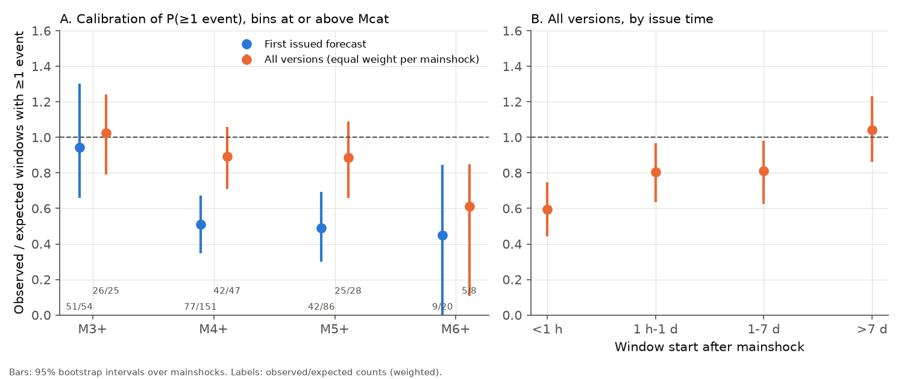
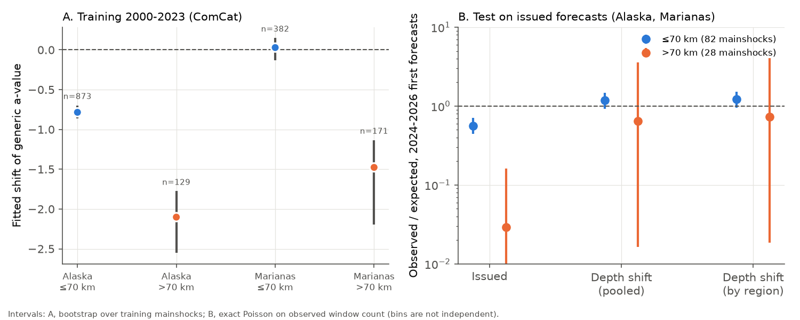
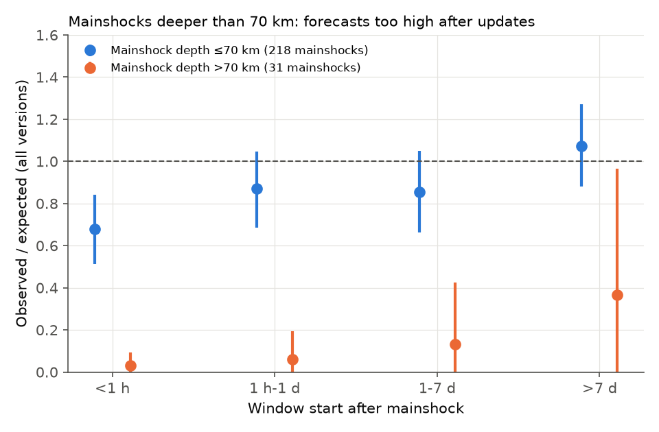

# Issued USGS aftershock forecasts for 252 earthquakes (2024-2026) were almost calibrated after updates, but first forecasts gave 1.8 times too many events, mainly for mainshocks deeper than 70 km

Job `sci-1107-dell-earth-and-ocean-sciences-2973d24d3867`, campaign 11_07_2026, topic earth-and-ocean-sciences, machine dell, model claude-opus-5-5 (Claude Code). The signing key is a campaign-machine key. It does not make a personal claim of authorship.

## Summary

The USGS publishes aftershock forecasts for earthquakes of M4 or more in the contiguous United States and M5 or more in other US states and territories. It also publishes forecasts for some international earthquakes. Each forecast is a ComCat "oaf" product. Each forecast gives, for 1 day, 1 week, 1 month and 1 year, the probability of at least one earthquake of M3, M4, M5, M6 and M7 or more. It also gives the 95% range of the count and the probability of an earthquake that is equal to or larger than the mainshock. We found no published independent test of the issued forecasts. The only USGS evaluation we found used simulated forecasts (Hardebeck, Schneider et al., SSA 2025 abstract).

We downloaded all 14,249 versions of the products for all 252 mainshocks in ComCat (most from November 2024 to November 2026). We compared each issued number with the earthquakes that ComCat later recorded in the same circle and time window (snapshot 2026-11-10 07:54 UTC). We wrote the analysis plan and committed it to git before we downloaded the outcome catalog (`files/prereg/`).

Main results (pre-registered, magnitude bins at or above the forecast's own completeness magnitude Mcat):

1. **First forecasts were too high.** The first issued forecast for each mainshock was mostly a generic Reasenberg-Jones forecast, issued about 20 minutes after the mainshock. Over all windows and magnitudes, these forecasts expected 313.7 windows with at least one event. ComCat recorded 179 (observed/expected O/E = 0.57; 95% bootstrap interval over mainshocks 0.44-0.71). For M4+, O/E was 0.51 (77 against 151.1). For M5+ it was 0.49 (42 against 85.7), and for M6+ it was 0.45 (9 against 20.0). M3+ was calibrated (0.94, 51 against 54.0), but only 37 mainshocks in the contiguous US had Mcat of 3 or less.
2. **Updates removed most of the bias.** With all versions and equal weight for each mainshock, O/E was 0.89 (0.76-1.02). By issue time, O/E was 0.59 (0.44-0.75) for windows that started less than 1 hour after the mainshock. It was 0.81 for 1 hour to 1 day, 0.81 for 1-7 days and 1.04 (0.88-1.24) for windows that started after 7 days. The randomized PIT histogram of all versions did not differ clearly from uniform (chi-square p = 0.63). The PIT histogram of the first forecasts had too few values near 1 (p = 0.0008), which agrees with counts that are lower than forecast.
3. **The probability of an equal or larger event was too high.** The first forecasts gave a sum of 12.5 for "an event at or above the mainshock magnitude within 1 month". Three mainshocks had such an event (Poisson-binomial p = 0.002). For 1 year the values were 9.5 against 1 (p = 0.001).
4. **The issued 95% count ranges were wide.** Only 0.2% (first forecasts) and 0.6% (all versions) of the observed counts were above the 95% range. The nominal value is 2.5%, but count discreteness makes this test conservative.
5. **One recalibration helped the first forecasts.** A single odds multiplier, fitted leave-one-mainshock-out, decreased the Brier score of the first forecasts from 0.0411 to 0.0357 (difference -0.0054; 95% interval -0.0093 to -0.0014). The fitted multiplier was 0.38.

Explanation (exploratory, after the planned analysis):

6. **Mainshocks deeper than 70 km caused most of the extreme error.** Of the 31 mainshocks deeper than 70 km, 30 were in the Aleutians, Alaska and the Mariana Islands. Their first forecasts expected 35.7 windows with events, and 1 occurred (O/E 0.03). These forecasts used the same generic a-values (-2.47 and -2.34) as the shallow mainshocks in the same regions. Bayesian updates corrected this only slowly (O/E 0.03-0.13 for windows that started in the first week, 0.37 after day 7). For shallow mainshocks, the first forecasts had O/E 0.64 (0.50-0.79), and all versions had 0.95 (0.82-1.08). Shallow M6+ mainshocks had O/E 0.80 (0.55-1.00) for the first forecasts. This agrees with the earlier campaign result that generic forecasts were calibrated for shallow M6+ mainshocks in 2016-2025.
7. **The depth error was known in older data.** In ComCat for 2000-2023, intermediate-depth (more than 70 km) M5.0-6.5 mainshocks in the same regions had 11 of 134.7 expected 30-day windows with an aftershock at or above Mcat. A fitted a-value shift was -1.91 (95% bootstrap -2.30 to -1.62). We applied this shift, from the training years only, to the issued 2024-2026 first forecasts for 28 deep mainshocks. The expected count changed from 34.3 to 1.5, against 1 observed. The Brier score decreased from 0.0377 to 0.0030, and the log loss decreased from 0.137 to 0.015. The shallow Alaska mainshocks were also too high in the training data (O/E 0.54). The shallow Mariana mainshocks were calibrated (O/E 1.04).
8. **The 10 km forecast circle is part of the remaining shallow error.** Most mainshocks below M6 have a 10 km circle. When we counted events in a circle 1.5 times larger, the first-forecast O/E changed from 0.57 to 0.74, and the all-version O/E changed from 0.89 to 1.15. Thus the calibration of the updated forecasts depends on the counting circle, and some of the deficit can be location error of offshore aftershocks.

Main limitations: ComCat is the outcome and also the input of the forecasts. A short catalog period (most windows in 2025-2026) and dependent bins (nested windows and magnitudes) make the intervals approximate. We used a bootstrap over mainshocks to account for the dependence. Only 1 deep mainshock had an aftershock, so the test of the depth shift has very few events. The depth analysis and the radius check were not in the plan.

## 1. Question and context

Operational aftershock forecasts are public products. They are used for emergency decisions after an earthquake. The USGS Operational Aftershock Forecasting (OAF) system starts with "generic" Reasenberg-Jones parameters for the tectonic region (Page et al., 2016). Later forecasts use a Bayesian combination of generic and sequence-specific parameters, or an ETAS model. An earlier campaign publication (sci:sha256:1bc9d0d0...) tested a re-implementation of the first generic forecast for global shallow M6+ mainshocks. It found calibration in 2016-2025, and it stated that it did not test the issued forecasts or the updates. Other campaign publications found that PAGER fatality probabilities (sci:sha256:156946e5...) and public gravitational-wave p_astro values (sci:sha256:0b51eda4...) were too high. Here we test the numbers that the USGS actually issued.

Questions: (a) Are the issued probabilities calibrated? (b) Do the updates improve them? (c) Why are some forecasts wrong?

## 2. Data

* **Forecasts.** We listed all ComCat events with an `oaf` product (FDSN event service, `producttype=oaf`, 252 events). Then we downloaded every version (`includesuperseded=true`) of `forecast.json`. This gave 14,249 versions (17 versions with status DELETE have no content). Two files (Kamchatka 2025 M8.8) had trailing commas. We removed these commas before parsing and recorded the repair (`json_repaired` column). The models were: Reasenberg-Jones Bayesian combination (12,292 versions), Reasenberg-Jones generic (804), Reasenberg-Jones sequence-specific (627), and ETAS Bayesian combination (526).
* **Prospective rule.** We added this rule after we inspected the forecast metadata and before scoring. A version counts only if it was created no later than 1 minute after its window start. The 368 versions that failed were all ETAS forecasts for 10 international mainshocks (Myanmar 2025, Kamchatka 2025, Afghanistan, Vanuatu and others). Their windows started up to several days before issue. We excluded them. Five more ETAS versions had no forecast region, and they were also not prospective.
* **Outcomes.** For each mainshock we downloaded ComCat events of M2.9 or more within a circle that covers 1.5 times every version's circle. The time span was from 1 day before the mainshock to the snapshot time. We counted events with preferred magnitude at or above the bin magnitude, with the epicentre in the version's own circle (great-circle distance), and with the origin time in [window start, window end). We excluded the mainshock itself (all its ComCat IDs). We scored only windows that ended before the snapshot: 281,372 bin rows. Of these, 273,999 were prospective, and 178,057 of those were at or above Mcat (the primary set).
* **Training catalog (depth check).** ComCat 2000-2023 for an Aleutian-Alaska box (50-72 N, 160 E to 129 W, M3.4 or more) and a Mariana box (10-22 N, 140-150 E, M4.5 or more).

All forecast and catalog data are USGS/ANSS public products. Section 7 gives the exact URLs and hashes.

## 3. Methods

The plan (`files/prereg/analysis_plan.md`, SHA-256 `025f1feb...c720`) is in git commit `1b13bbc7` (2026-11-10 07:00 UTC). The outcome catalog snapshot came 54 minutes later.

* **Complete bins.** These are bins with magnitude at or above the version's Mcat (the `Mcat` or `Mc` parameter). Bins below Mcat (mostly M3 and M4 outside the contiguous US) test catalog detection, not the forecast. We report them separately (`files/results/table_below_mcat.csv`).
* **Sets.** P1 is the earliest issued prospective version of each mainshock. P2 is all versions, with weight 1/n for the n versions of each mainshock x window x magnitude cell, so that each mainshock counts once per cell.
* **Metrics.** The main metric is O/E, the number of windows with at least one event divided by the sum of the issued P(at least 1). For P1 we give the Poisson-binomial p-value and an exact Poisson interval for each cell. For pooled values we give a bootstrap over mainshocks (2,000 resamples). We also compute the fraction of counts outside the issued 95% range and a randomized PIT. The PIT uses the issued fractiles, with F(0) = 1 - P(at least 1) exact and other values at the midpoint of the fractile bracket.
* **Above-mainshock probability.** We compared the issued P(at least one event at or above the mainshock magnitude) with the outcome, using the first forecast of each mainshock.
* **Recalibration (plan item 4).** We fitted one additive logit shift, leave one mainshock out, to P1 complete bins.
* **Depth shift (exploratory).** Training mainshocks were ComCat M5.0-6.5 events in 2000 to November 2023 in the two boxes, without an event of equal or larger magnitude within 100 km in the 30 days before. We counted aftershocks at or above Mcat (3.5 Alaska, 4.6 Marianas) from 20 minutes to 30 days, in a 10 km circle (15 km above M6), as OAF does. The expected value is the generic Reasenberg-Jones P(at least 1) with a Gaussian a-value. For each group we used the generic a, p, c, sigma and Mcat that OAF issued for the same group in 2024-2026. We fitted one shift of a by maximum Bernoulli likelihood. To apply the shift to the issued forecasts, we multiplied each issued probability by the ratio of our recomputed probabilities with and without the shift. Our recomputation agrees with the issued probabilities to a median of 1.2%. Issued values with low probability are about 20% higher than our values, so we use only the ratio.

## 4. Results

### 4.1 First forecasts (P1) by window and magnitude, complete bins

| Magnitude | Window | Mainshocks | Expected | Observed | O/E | Poisson-binomial p |
|---|---|---|---|---|---|---|
| M3+ | 1 day / 1 week / 1 month / 1 year | 37 / 36 / 35 / 13 | 12.7 / 15.4 / 17.4 / 8.4 | 11 / 14 / 17 / 9 | 0.86 / 0.91 / 0.98 / 1.07 | 0.62 / 0.73 / 1.0 / 0.96 |
| M4+ | same | 190 / 186 / 181 / 80 | 32.8 / 42.2 / 47.8 / 28.3 | 14 / 21 / 23 / 19 | 0.43 / 0.50 / 0.48 / 0.67 | <0.0001 / <0.0001 / <0.0001 / 0.011 |
| M5+ | same | 251 / 247 / 241 / 117 | 16.0 / 22.9 / 27.7 / 19.2 | 7 / 10 / 16 / 9 | 0.44 / 0.44 / 0.58 / 0.47 | 0.004 / 0.0002 / 0.003 / 0.002 |
| M6+ | same | 252 / 248 / 241 / 117 | 2.9 / 5.3 / 7.0 / 4.7 | 1 / 3 / 3 / 2 | 0.34 / 0.57 / 0.43 / 0.42 | 0.37 / 0.36 / 0.08 / 0.20 |
| M7+ | same | 252 / 248 / 241 / 117 | 0.34 / 0.71 / 1.07 / 0.74 | 0 / 0 / 0 / 0 | 0 | 1.0 / 0.96 / 0.65 / 0.92 |

The windows and magnitudes are nested, so the p-values in a row are not independent.

### 4.2 Pooled calibration, complete bins (bootstrap 95% intervals over mainshocks)

| Group | P1 first forecast O/E | P2 all versions O/E |
|---|---|---|
| All | 0.57 (0.44-0.71), 179 / 313.7 | 0.89 (0.76-1.02) |
| RJ generic | 0.56 (0.41-0.71), 211 mainshocks | 0.60 (0.45-0.75) |
| RJ Bayesian | 0.22 (0-0.74), 30 mainshocks | 0.91 (0.72-1.08) |
| ETAS Bayesian (10 mainshocks) | 0.71 (0.32-1.08) | 0.93 (0.67-1.16) |
| RJ sequence-specific (12 mainshocks) | - | 1.16 (0.94-1.39) |
| Window start < 1 h | 0.56 | 0.59 (0.44-0.75) |
| 1 h - 1 day | - | 0.81 (0.63-0.97) |
| 1 - 7 days | - | 0.81 (0.63-0.99) |
| > 7 days | - | 1.04 (0.88-1.24) |
| Alaska/Aleutians (73) | 0.53 (0.33-0.74) | 0.92 (0.72-1.08) |
| Contiguous US (64) | 0.61 (0.38-0.85) | 0.84 (0.58-1.09) |
| Mariana Islands/Guam (50) | 0 of 22.8 | 0.10 (0-0.30) |
| Other, including international (61) | 0.87 (0.49-1.34) | 1.06 (0.79-1.43) |

### 4.3 Sensitivity (`files/results/table_sensitivity.csv`)

| Check | P1 O/E | P2 O/E |
|---|---|---|
| Primary | 0.57 | 0.89 |
| Magnitude at or above M - 0.05 | 0.62 (0.48-0.75) | 0.92 (0.79-1.04) |
| Circle radius x 1.5 | 0.74 (0.59-0.88) | 1.15 (1.00-1.31) |
| Mainshock depth 70 km or less | 0.64 (0.50-0.79) | 0.95 (0.82-1.08) |
| Mainshock depth more than 70 km (31) | 0.03 (0-0.09), 1 / 35.7 | 0.14 (0-0.34) |
| Shallow, mainshock M6 or more (23) | 0.80 (0.55-1.00) | 0.97 (0.82-1.11) |
| Shallow, mainshock below M6 (198) | 0.58 (0.41-0.76) | 0.92 (0.74-1.12) |
| Shallow, without Mariana Islands | 0.68 (0.52-0.84) | 0.97 (0.84-1.10) |

The bootstrap in this table used 1,000 resamples, so its primary intervals differ slightly from section 4.2.

### 4.4 Probability of an event at or above the mainshock magnitude (first forecasts)

| Window | Mainshocks | Expected | Observed | p |
|---|---|---|---|---|
| 1 day | 252 | 5.8 | 2 | 0.14 |
| 1 week | 248 | 9.6 | 3 | 0.025 |
| 1 month | 241 | 12.5 | 3 | 0.002 |
| 1 year | 117 | 9.5 | 1 | 0.001 |

All three equal-or-larger events followed shallow mainshocks. For shallow mainshocks alone, the 1-month value was 3 against 10.3.

### 4.5 Depth (exploratory)

Training (2000-2023), 30-day windows, aftershocks at or above Mcat:

| Group | Mainshocks | With an aftershock | Expected | O/E | Fitted a shift (95% CI) |
|---|---|---|---|---|---|
| Alaska, 70 km or less | 873 | 326 | 600.5 | 0.54 | -0.79 (-0.86 to -0.70) |
| Alaska, more than 70 km | 129 | 7 | 86.6 | 0.08 | -2.10 (-2.55 to -1.78) |
| Marianas, 70 km or less | 382 | 92 | 88.6 | 1.04 | +0.03 (-0.13 to +0.15) |
| Marianas, more than 70 km | 171 | 4 | 48.2 | 0.08 | -1.48 (-2.19 to -1.13) |
| Pooled, more than 70 km | 300 | 11 | 134.7 | 0.08 | -1.91 (-2.30 to -1.62) |

Test on the issued first generic forecasts in the same boxes (2024-2026, all windows and complete bins):

| Mainshocks | Forecast | Expected | Observed | O/E | Brier | Log loss |
|---|---|---|---|---|---|---|
| 28 deep | issued | 34.3 | 1 | 0.03 | 0.0377 | 0.137 |
| 28 deep | pooled depth shift | 1.55 | 1 | 0.65 | 0.0030 | 0.015 |
| 28 deep | shift by region | 1.37 | 1 | 0.73 | 0.0030 | 0.016 |
| 82 shallow | issued | 131.0 | 74 | 0.56 | 0.0523 | 0.173 |
| 82 shallow | pooled shallow shift | 62.8 | 74 | 1.18 | 0.0466 | 0.152 |

The shallow shift is driven by the Alaska training data. It over-corrects the test set a little (O/E 1.18). We do not suggest a specific operational value. The result shows that a depth term, estimated from data that existed before the forecasts, would have removed most of the deep error.

### 4.6 Count distribution

The PIT values are random draws inside the issued fractile bracket of each observed count (seed in `04_score.py`). An earlier run with a different random draw gave p = 0.00016 for the first forecasts and p = 0.36 for all versions.

## 5. Interpretation

The USGS forecasts became almost calibrated after the first day. This is a positive result for the Bayesian update design. The public first forecasts were too high by a factor of about 1.8 (2.0 for M4+ and M5+). Two causes explain most of this error. The first cause is that the generic parameters do not depend on depth. Intermediate-depth earthquakes have few aftershocks, and this is well known. ComCat data from before 2024 showed the size of the effect. The second cause is the small 10 km counting circle for mainshocks below M6, together with apparent low productivity in the Aleutians. When we removed deep mainshocks and enlarged the circle, the first-forecast O/E became close to 0.8. The probability of an equal or larger event, which is the number that the public reads first, was too high by about 3 to 4 times for 1 week to 1 year.

## 6. Limitations

* The period is short (most completed windows are in 2025-2026), and most mainshocks are M4-5.5. We had only 117 completed 1-year windows.
* ComCat is the outcome and also the forecast input. ComCat locations and magnitudes change after review. We used the snapshot, and the forecasts used the catalog at their issue time.
* Bins are nested in time and magnitude. The bootstrap over mainshocks keeps this dependence, but the per-cell p-values do not.
* Our counting rule (epicentre in the circle, preferred magnitude, all depths) may differ from the USGS internal rule. The radius check shows that the result depends on it.
* The depth analysis is exploratory and was not in the plan. The deep test has 1 observed event. The training boxes and the "no larger event in 30 days within 100 km" rule only approximate OAF mainshock selection.
* Our re-implementation of the generic model differs from the issued values for low probabilities, so the depth correction uses probability ratios.
* We did not test the ETAS forecasts for international events, because their windows started before issue.

## 7. Reproduction and provenance

* Code: `files/code/` (`run_all.sh SCRATCH_DIR` runs steps 01-09 and writes only into the scratch directory; `10_hash_inputs.py`, `11_package.py`). Python 3.12, numpy, pandas 3.1.1, pyarrow, scipy, matplotlib.
* Our derived evidence: `files/data/forecast_versions.csv.gz` (one row per issued version, with model parameters), `files/data/scored_bins.csv.gz` (every scored bin with the issued probability, range and our outcome count), `files/data/comcat_outcome_events.csv.gz` and `comcat_outcome_queries.csv` (outcome catalog extract and queries), `files/data/comcat_training_2000_2023.csv.gz`, and `files/data/raw_input_sha256.csv` (SHA-256 of all 14,507 raw files that we used: 14,249 forecast JSON files, the event list, 252 outcome catalogs, the snapshot time and 3 training catalogs).
* Result tables: `files/results/`. Figure data: `files/figures/*_data.csv`.
* Two scoring implementations (a row loop and the vectorized `04_score.py`) gave the same counts and CDF values for all 281,372 common rows. The loop version kept 120 rows without a region, which were not prospective. The machine was heavily loaded, so we stopped the final rerun of `05_analyze.py` on the vectorized scores after it wrote `table_calibration_complete_bins.csv` and `table_pooled_complete_bins.csv`. These two files were byte-identical to the loop-version run. `table_above_mainshock.csv` and `table_below_mcat.csv` come from the loop-version run, which has the same prospective inputs and random seeds.
* Sources: FDSN event service https://earthquake.usgs.gov/fdsnws/event/1/ (queries in the code). Product files have the form https://earthquake.usgs.gov/product/oaf/{code}/{source}/{updateTime}/forecast.json. External-data terms: `files/NOTICE-external-data.md`.
* Because ComCat changes, a new download can give slightly different outcome counts. Use the included derived tables for exact checks.

## References

* Page, M.T., van der Elst, N., Hardebeck, J., Felzer, K., Michael, A.J. (2016). Three ingredients for improved global aftershock forecasts: tectonic region, time-dependent catalog incompleteness, and intersequence variability. BSSA 106(5). doi:10.1785/0120160073
* Reasenberg, P.A., Jones, L.M. (1989). Earthquake hazard after a mainshock in California. Science 243. doi:10.1126/science.243.4895.1173
* van der Elst, N.J., Hardebeck, J.L., Michael, A.J., McBride, S.K., Vanacore, E. (2022). Prospective and retrospective evaluation of the U.S. Geological Survey public aftershock forecast for the 2019-2021 Southwest Puerto Rico earthquake and aftershocks. SRL 93(2). doi:10.1785/0220210222
* Hardebeck, J., Schneider, M., Barall, M., Michael, A., Page, M., van der Elst, N. (2025). Evaluating the forecasting performance of U.S. Geological Survey aftershock forecasts. SSA Annual Meeting abstract (simulated forecasts).
* USGS OAF overview: https://earthquake.usgs.gov/data/oaf/overview.php
