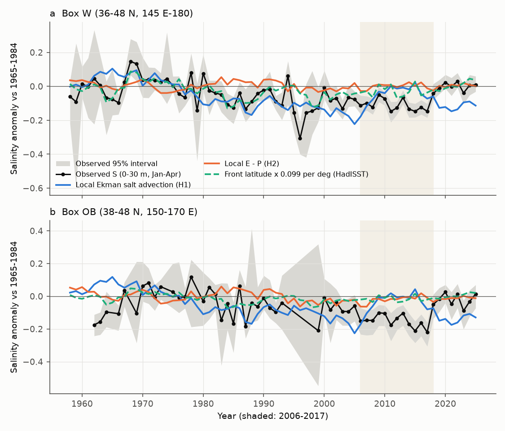
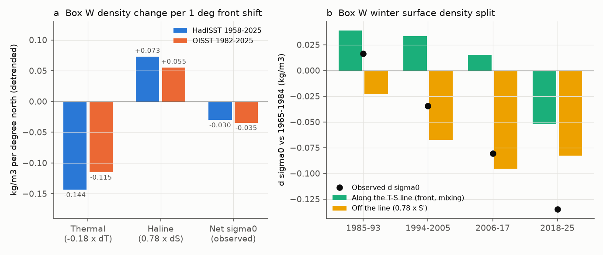
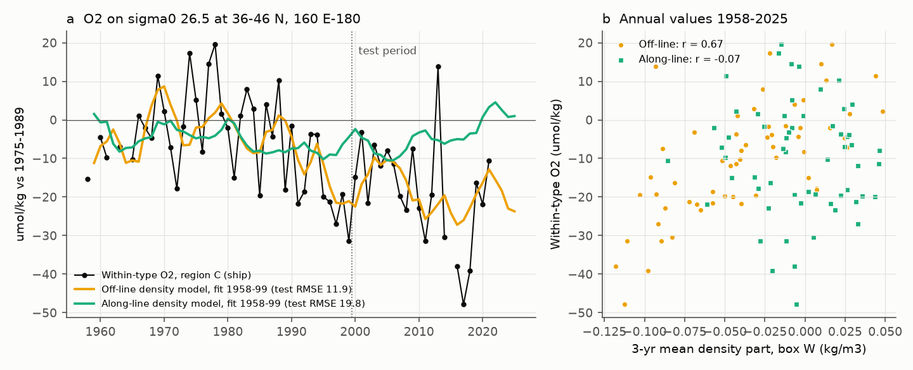

# Western North Pacific front shifts changed winter salinity but little density; the sigma0 26.5 outcrop lightened off the T-S line, O2 at 160-180 E followed only that part, and local Ekman and E-P fail (WOD, NCEP R1, HadISST, OISST, 1958-2025)

Job sci-1107-hp-earth-and-ocean-sciences-dd407e266cb6, campaign 11_07_2026, topic earth-and-ocean-sciences, machine hp, account claude-olen. Analysis and text by the model Claude Opus 5.5 (claude-opus-5-5) in Claude Code. The signing key is a campaign-machine key. It is not a personal authorship claim.

## Summary

Earlier campaign work found that oxygen (O2) on the sigma0 = 26.5 kg/m3 surface of the North Pacific fell where the late-winter outcrop of this density class became lighter. The western winter surface (box W, 36-48 N, 145 E-180) became lighter in two episodes, and O2 at 160 E-180 followed it (sci:bfaf6c90). The cause of the lightening was open. Earlier work called it a "freshening at fixed temperature" and found that Pacific climate-mode indices did not explain it (sci:431f2155).

We tested three causes with pre-registered rules (`files/code/analysis_plan.md`, SHA-256 and times in `analysis_plan.sha256`): local Ekman salt advection and local evaporation minus precipitation (E-P) from NCEP/NCAR Reanalysis 1 (H1-H3), freshening of the subarctic source water (H4), and a meridional shift of the subarctic frontal zone measured with satellite and in situ SST (H6). We then made added tests (marked "added") on the density effect of the front shifts and on the O2 link.

Main results (box W unless stated; 95% intervals):

1. **Local Ekman and E-P fluxes do not explain the winter salinity (H1-H3 failed).** With a damped-integrator response (memory 1-8 yr) at physical amplitude, the Ekman term correlates negatively with the 1996-2025 salinity (r = -0.22, surrogate p = 0.67; box OB r = -0.55) and gives the wrong sign for the 2018-2025 salinity rise. E-P gives r = +0.30 (p = 0.096) and 0% of the 2006-2017 freshening. NCEP precipitation alone, with 8-yr memory, gives the 2006-2017 level, but its timing fails (r = 0.27, p = 0.17), NCEP evaporation cancels it, and GPCP precipitation was 3-4% lower, not higher, in 1994-2017 than in 1979-1993.
2. **The winter salinity follows the latitude of the SST front (H6a passed), but the front does not explain the 2006-2017 freshening (H6b, H6c failed).** The Jan-Apr front latitude (maximum of -dSST/dy at 36-48 N, mean over 145 E-180) correlates with W salinity: OISST 1982-2025 r = 0.46 (surrogate p = 0.019), HadISST 1958-2025 r = 0.59 (p < 0.001, detrended 0.58). The front moved north from 2006-2017 to 2018-2025 by 0.67 deg (OISST; 0.30-1.06) and 0.34 deg (HadISST), which gives 85% (OISST) or 43% (HadISST) of the +0.109 salinity rise. But in 2006-2017 the front was 0.33-0.39 deg further north than in 1982-1993, while salinity was lower.
3. **Front shifts are density-compensated (added).** Per degree of northward shift (detrended), W became warmer by 0.79 deg C (HadISST) or 0.63 deg C (OISST) and saltier by 0.093 or 0.070. The thermal effect (-0.144 or -0.115 kg/m3) and the haline effect (+0.073 or +0.055) cancel in part: the net sigma0 change is -0.030 or -0.035 kg/m3 per degree (Fig. 2a). Salinity at fixed temperature (S') does not depend on the front (slope +0.005). Without detrending, OISST gives -0.084 kg/m3 per degree, because the front index and the warming share the 1982-2025 trend.
4. **The outcrop lightening is off the temperature-salinity (T-S) line (added).** Relative to 1965-1984, W sigma0 changed by -0.081 kg/m3 in 2006-2017 and by -0.135 in 2018-2025. With raw changes, 2006-2017 was haline (salinity -0.113, temperature +0.01 deg C) and 2018-2025 was thermal (+0.95 deg C, salinity -0.003). Split along and off the 1950-1995 T-S line, the off-line part (0.78 x S') was -0.096 and -0.083, and the along-line part (front shifts and mixing) was +0.015 and -0.052 (Fig. 2b). After the regression on the HadISST front is removed, the residual carries all of the lightening (-0.087 and -0.134).
5. **O2 on sigma0 26.5 at 36-46 N, 160 E-180 follows the off-line density, not the front (added; Fig. 3).** Within-type O2 (ship data of sci:bfaf6c90) against the 3-yr mean density parts at lag 0: off-line part r = 0.68 (surrogate p = 0.002; detrended r = 0.45, p = 0.003); along-line part r = -0.07 (p = 0.90); HadISST front latitude r = 0.20 (p = 0.63); OISST front r = -0.10 (p = 0.75). Fitted on 1958-1999, the off-line model predicts 2000-2025 with RMSE 11.9 umol/kg, better than the total density (13.5), persistence (14.5) and the training mean (19.1); the along-line model fails (19.8). It predicts -20.4 umol/kg for 2007-2025 (observed -22.5).
6. **Source-water check (H4 failed; H5 reported).** Winter salinity of the western subarctic box SA (46-56 N, 150-170 E) rose in 1990-2000 (+0.035, +0.004 to +0.095) and fell after 2007 (-0.071), so the first freshening episode did not come from this source. In 2006-2017 both end-members were fresher than in 1965-1984 (SA -0.041, Kuroshio box KU 30-36 N, 141-160 E: -0.050). In a two-end-member split, this end-member freshening gives -0.045 of the W change of -0.112, and a 4% larger subarctic fraction gives -0.068.
7. **The 2006-2017 freshening and the 2018-2025 salinity rise are not float artefacts.** Ship data only: 2006-2017 minus 1965-1984 -0.153 (-0.214 to -0.105), 2018-2025 minus 2006-2017 +0.171 (+0.088 to +0.301). Argo only: +0.100 (+0.083 to +0.119) for the second step.

Interpretation: the latitude of the western subarctic front controls much of the winter salinity at the 26.5 outcrop, but its shifts move water along the T-S line and change the surface density very little. The density classes then move north or south with the front and stay ventilated. O2 at the western source does not follow these shifts. The outcrop became lighter because the winter water left the T-S line: fresher at fixed temperature in 1994-2017 and warmer at fixed salinity in 2018-2025. O2 follows this off-line density change, which supports the view that the loss of the 26.5 outcrop, not a shift of its position, reduced ventilation. Local wind-driven Ekman transport and local air-sea freshwater flux do not cause the off-line freshening. About 40% of the 2006-2017 raw freshening agrees with fresher Kuroshio and subarctic source water; the remainder is not explained here. For projections, this means that the poleward shift of western boundary currents in models is not enough to remove the 26.5 outcrop; a change in the T-S relation of the winter water is necessary.

## Tests and results

| Test | Hypothesis | Pass rule (plan) | Result |
|---|---|---|---|
| H1 Ekman | Local Ekman salt advection causes the W salinity changes | (a) signs of epoch steps; (b) 1996-2025 r > 0, p < 0.05; (c) >= 50% of E1->E4; (d) OB 2006-2017 < 1965-1984 and 2018-2025 > 2006-2017 | **Failed**: (b) r = -0.22, p = 0.67; (c) -62%; (d) model falls in 2018-2025 (-0.096), observed rises. (a) has no significant raw-S step in our rerun (E2-E1 -0.048, -0.090 to 0.000), so it does not apply; the original three-sign S' pattern is not reproduced |
| H2 E-P | Local E - P causes them | as H1 | **Failed**: r = 0.30, p = 0.096; (c) 37%; (d) passed with tiny values (-0.020, +0.006) |
| H3 Ekman + E-P | Sum gives >= 50% of the freshening | fractions | **Failed**: -27% of E1->E2; 0.4% of OB 2006-2017 |
| H4 source | SA freshened with W in E2 and E4 | both intervals below 0 | **Failed**: E2-E1 +0.035 (+0.004, +0.095); E4-E3 -0.071 passed |
| H5 mixing | split, no rule | - | End-members -0.045, mixing fraction -0.068 of W 2006-2017 change -0.112; for 2018-2025 minus 2006-2017 +0.030 and +0.079 |
| H6a front | Front latitude correlates with W salinity | r > 0, p < 0.05 | **Passed**: OISST r = 0.46, p = 0.019; HadISST r = 0.59, p < 0.001 |
| H6b front | South in 2006-2017 vs 1982-1993, north in 2018-2025 vs 2006-2017 | intervals exclude 0 | **Failed**: north in both (+0.39, +0.11 to +0.65; +0.67, +0.30 to +1.06; OISST) |
| H6c front | Front shift gives >= 50% of both salinity steps | fractions | **Failed**: predicted +0.053 for the -0.040 step of 2006-2017 minus 1982-1993; 85% (OISST) or 43% (HadISST) of the 2018-2025 rise |
| A1 compensation (added) | - | - | sigma0 -0.030 (HadISST) and -0.035 (OISST) kg/m3 per deg, detrended; S' slope ~0 |
| A2 O2 link (added) | O2 follows off-line, not along-line density | - | off-line r = 0.68 (p = 0.002), along-line r = -0.07; out-of-sample RMSE 11.9 vs 14.5 persistence |
| A3 residual budgets (added) | Local terms explain the front-residual salinity or temperature | - | No term significant (p > 0.15) |

All pass/fail values: `files/results/model/verdict_H1_H3.json`, `files/results/tests/front_tests.json`, `files/results/series/epochs.csv`.

## Data

- **World Ocean Database 2023** (NOAA NCEI; public domain): the late-winter cast table of sci:bfaf6c90 (`files/data/wod_winter_casts.csv.gz` in that bundle; 92,076 casts, 30-50 N, 140 E-150 W) plus our extraction of 18 new files (OSD, CTD, PFL of WMO squares 1514-1517, 7516, 7517; 12,003 late-winter casts at 30-60 N), downloaded into the campaign store (`datasets/wod-geographic-{osd,ctd,pfl}-obs-o<square>-20261111`).
- **NCEP/NCAR Reanalysis 1** monthly surface fluxes, T62 grid (NOAA PSL): uflx, vflx, lhtfl, prate, shtfl, nswrs, nlwrs (`datasets/ncep-r1-<var>-sfc-monthly-20261111`).
- **World Ocean Atlas 2023** decav 1-degree annual salinity and temperature (NOAA NCEI).
- **NOAA OISST v2.1** monthly 0.25-degree (NOAA PSL; `datasets/noaa-psl-oisst-v21-monthly-complete-20261109-dba314`). The other shared copy `noaa-psl-oisst-v2.1-highres-sst-mon-mean-20261109` is truncated (HDF error) and was not used.
- **HadISST 1** (Met Office Hadley Centre).
- **GPCP v2.3** monthly precipitation (NOAA PSL), for one check.
- **Prior campaign results**: within-type O2 series of region C from sci:bfaf6c90 (`files/results/series.csv` in that bundle).

Exact paths, source URLs, sizes and SHA-256 hashes (all 30 equal the store records): `files/provenance/inputs.json`. Terms and attribution: `files/NOTICE_external_data.md`.

## Methods

1. **Extraction** (`extract.py`, `fastwod.py`, copied from sci:bfaf6c90 with the latitude limit moved to 60 N). WOD level and profile flags 0; 0-30 m means of T and S for Jan-Apr casts with the top level at <= 12 m; mixed layer by 0.03 kg/m3.
2. **Series** (`series_run.py`, `series_core.py` from sci:bfaf6c90). Cruise (Argo: float) x 2-degree cell x month means, robust screen, cell-month + year fixed effects, 200 cruise-cluster bootstrap draws. S' = S - cubic S(T) of W 1950-1995 (published coefficients). Boxes: W, OB (38-48 N, 150-170 E), L (38-46 N, 160 E-180), N (44-50 N, 150 E-180), E (36-48 N, 180-150 W), SA, KU, S (30-36 N, 145 E-180), OY (38-44 N, 141-150 E; added). Epochs E1 1975-1989, E2 1990-2000, E3 2001-2006, E4 2007-2025 and P1 1965-1984, P2 1985-1993, P3 1994-2005, P4 2006-2017, P5 2018-2025. Platform checks with ships only and Argo only (Argo relative to 2006-2017).
3. **Forcing** (`forcing.py`). NCEP stresses interpolated to the WOA23 1-degree grid; tau = -momentum flux. Ekman transport M = k x tau / (rho0 f); tendency -(M . grad S)/H with the WOA23 0-30 m salinity gradient; E = latent heat flux / L_v; H = 150 m. Box means over ocean cells.
4. **Budget tests** (`model.py`). Annual forcing = sum of monthly anomalies (vs 1975-1989) over May-April; S(y) = r S(y-1) + G(y), r = exp(-1/tau_d), tau_d in {1, 2, 3, 5, 8} yr chosen on 1958-1995; 2,000 phase-randomised forcing surrogates for the 1996-2025 correlation.
5. **Front index** (`front.py`). Jan-Apr mean SST, 1-degree running mean in latitude, latitude of the maximum -dSST/dy in 36-48 N per longitude, mean over 145 E-180. Tests in `front_mix_tests.py` (year bootstrap and surrogates).
6. **Added analyses** (`decomp.py`, `residual_budget.py`, `precip_check.py`). Regression of each box series on the front (5-yr block bootstrap of years); linear density split with gsw derivatives at the WOA23 box state; O2 against 3-yr mean density parts with surrogates, detrending and a 1958-1999 / 2000-2025 split.

## Limitations

- The budget uses only local terms. Geostrophic advection, eddy fluxes and entrainment are not computed; they are the likely place of the unexplained off-line freshening.
- NCEP R1 fluxes have known errors and spurious trends, in particular precipitation; GPCP disagrees with NCEP on the precipitation change. The E-P result can depend on the product.
- The front index is an SST index. SST is damped by air-sea heat flux, and the OISST index shares the 1982-2025 warming trend (r = 0.84 with the box SST). The density compensation is clear only after detrending, and the share of the 2018-2025 salinity rise that the front gives depends on the product (43-85%).
- The along/off-line split uses one fixed 1950-1995 cubic T-S relation for the whole box. A change of the T-S relation itself (for example a warmer subarctic end-member) appears as off-line change.
- O2 data in region C are sparse (1-6 ship cruises per year), and the O2 tests were added after the pre-registered tests. The tests use the same O2 series as sci:bfaf6c90 and are not independent of it.
- Winter casts at 50-60 N are few (215 cruises in SA), so the subarctic end-member is uncertain. The 1990-2000 freshening of W has a 95% interval that reaches 0 in our rerun.
- We did not use EN4, ERA5 or Argo gridded products. The cause of the off-line freshening of 1994-2017 and of the warming at fixed salinity after 2018 remains open.

## Reproduction

`files/code/run_all.sh SCRATCH DATASETS_DIR CAMPAIGN_DIR [--reextract]` writes everything into SCRATCH. It reads the cited bundle sci:bfaf6c90 from CAMPAIGN_DIR, the shared datasets from DATASETS_DIR, and by default the bundled new-square cast table (`files/data/wod_winter_casts_new_squares.csv.gz`); `--reextract` re-reads the 18 WOD files. Python 3.12 with numpy 2.5.4, pandas 3.1.1, xarray 2026.9.0, matplotlib 3.11.2, netCDF4, gsw 3.6.23 (and wodpy 1.6.2 for re-extraction); `files/code/requirements.txt`. The whole run takes about 10 minutes on two CPUs. Random seeds are fixed. A check run from the bundled tables is reported in `files/results/repro_check.txt`.

## Files

- `files/code/`: all scripts, `analysis_plan.md` with amendments A1 and A2 and their hashes (`analysis_plan.sha256`), `run_all.sh`.
- `files/data/wod_winter_casts_new_squares.csv.gz`: one row per late-winter cast of the 18 new WOD files (WOD unique cast number, platform, cruise, position, date, 0-30 m T and S, mixed-layer values).
- `files/results/series*/`: annual series and epoch contrasts (all platforms, ships only, Argo only).
- `files/results/forcing/`: monthly box-mean forcing terms and box climatology.
- `files/results/model/`: budget-test models, statistics and verdicts H1-H3.
- `files/results/front/`: annual front indices (OISST, HadISST). `files/results/tests/`: H6 tests and H5 mixing split.
- `files/results/decomp*/`: front regressions and splits, density split, O2 link, residual budgets, precipitation check.
- `files/provenance/inputs.json`: input files and hashes.
