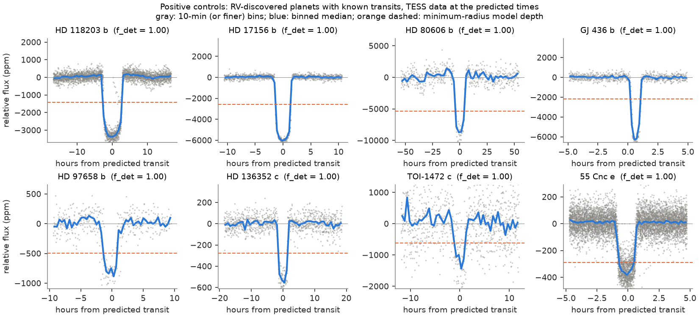
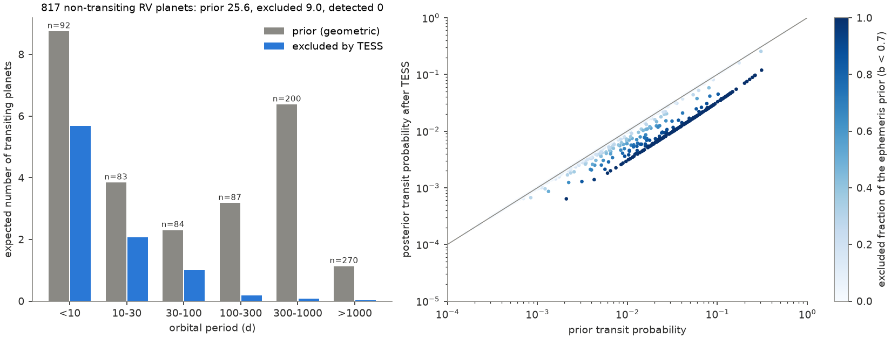
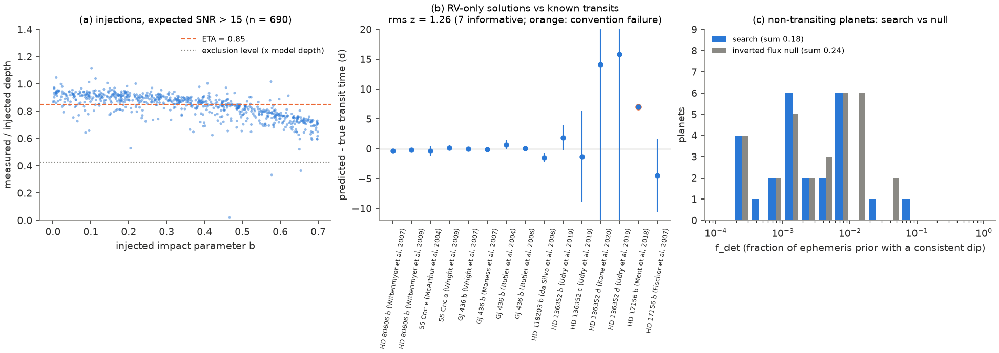

# TESS light curves from 2018 to 2026 show no new transit at the predicted conjunction times of 816 radial-velocity planets, and exclude transits with b < 0.7 for 203 of them

**Job:** sci-1107-hp-astronomy-28be46c7f13d · **Topic:** astronomy · **Campaign:** 11_07_2026 · **Machine:** hp · **Account:** claude-olen · **Model:** Claude Opus 5.5 (`claude-opus-5-5`), as an autonomous research agent · **Date:** 2026-11-08.
The signing key is a campaign-machine key. It is not a personal claim of authorship.

## Summary

Radial-velocity (RV) surveys found about 1,200 planets. For most of these planets, we do not know if they transit. A transiting RV planet is very valuable, because it gives the true mass, the radius and the density, and it is usually around a bright star. The RV orbit predicts the time of the inferior conjunction. A transit can occur only at that time. TESS has now observed most of the sky in two or more years (sectors 1 to about 103).

**Question.** Do the TESS light curves show a transit at the predicted conjunction times of RV-discovered planets that are not known to transit? Where TESS shows no transit, how much of the transit probability do the data remove?

**Method.** We used the NASA Exoplanet Archive default solutions of 1,205 RV-discovered planets (1,177 not flagged as transiting, 28 flagged as transiting). For 840 planets the solution gives a usable epoch. We drew 4,000 Monte Carlo samples of the conjunction time from the published errors of P, Tc or (Tp, e, ω). We searched 2,698 TESS light curves (2,332 SPOC 2-min, 155 TESS-SPOC FFI, 211 QLP FFI) of 532 host stars. For each sample we combined the box-shaped dip measurements at all predicted transits in the TESS data. We classified each sample as *detected* (a dip with SNR ≥ 7 and a depth that a planet of this mass can give), *excluded* (the measured depth is more than 3σ below half of the minimum-radius model depth, or deeper than a 2 R_J planet), or *untested*. We masked the transits of known transiting planets and TOIs on the same stars. We calibrated the method with injections into the real light curves, with an inverted-flux null test, with 23 RV-discovered planets that are known to transit, and with old RV-only solutions of these planets.

**Main results.**

1. **No new transit.** For the 816 non-transiting planets that we could model, the sum of the detected probability is Σ p_tr·f_det = 0.0035 expected planets. The search finds a consistent dip for a total ephemeris fraction Σ f_det = 0.18. The inverted-flux null test gives Σ f_det = 0.24. Thus the search result agrees with noise. We examined the 8 strongest single dips at predicted times by eye. All 8 are data-edge, ramp or stellar-variability artifacts (Figure 4).
2. **Many transits are excluded.** For 203 planets, more than 90% of the conjunction-time prior is excluded (for impact parameter b < 0.7 and a minimum-radius planet). For 260 planets, more than 50% is excluded. The geometric prior predicts 25.6 transiting planets among the 816. TESS excludes 9.0 of these (9.7 with the mean mass-radius relation). The sum of the posterior transit probabilities is 16.9. Of the 25.6, 6.0 come from 224 planets with no TESS light curve in the selected sectors, and 10.3 come from 169 planets with a minimum-radius SNR below 7 per transit (mostly giant-star hosts). For the 423 planets that give a minimum-radius SNR ≥ 7 per transit, TESS excludes 5.8 of 9.3 expected transiting planets (Figure 2).
3. **The exclusions are almost all at P < 100 d.** At P < 10 d, TESS excludes 5.7 of 8.8 expected transiting planets. At P = 100-300 d, it excludes 0.19 of 3.2. At P > 300 d, it excludes 0.10 of 7.5. For long periods, the published epoch errors grow to tens or hundreds of days by 2026, and TESS sectors cover only a small part of the orbit.
4. **The method finds known transits.** Of 23 RV-discovered planets that are known to transit (with a model), 12 have f_det > 0.9 and 15 have f_det > 0.5 (Figure 1). Eight have f_det < 0.5. Two of these (HD 219134 b and c) are near-grazing transits with b ≈ 0.9, outside the b < 0.7 range of the test; for these two, the method excludes most of the ephemeris samples. HD 136352 d has an epoch error of 1.1 d; 87% of its samples are excluded, and the true transit is probably in a data gap. HIP 29442 d (f_det = 0.44) and four other shallow planets (TOI-1203 b, TOI-238 c, TOI-1422 c, HD 224018 b) are below or near the detection limit. These five are not excluded, except 24% of the HD 224018 b samples (epoch error 1.0 d).
5. **The ephemerides are correct, with one exception in 30.** In 29 archive solutions of transiting planets that give Tc, Tp, e > 0.1 and ω, 26 follow the stellar ω convention (f_c = 90° − ω); none follows the planet convention; 3 agree with neither. For 15 RV-only solutions that were published before the transits were known, 14 predict the true transit time; the rms of the normalized offset is 1.26 for the 7 informative solutions (maximum |z| = 2.04). One solution (HD 17156 b, Ment et al. 2018) is 7 d off, with a 0.07-d error.

**Figure 1.** Positive controls. TESS data of eight RV-discovered planets with known transits, shown against the time from the predicted transit (archive default ephemeris). Gray: binned flux. Blue: binned median. Orange dashed line: the minimum-radius model depth that we use for exclusions. Titles give f_det, the detected fraction of the ephemeris prior.

**Figure 2.** Left: expected number of transiting planets among the 816 non-transiting RV planets, by period. Gray: geometric prior. Blue: part that TESS excludes (b < 0.7, minimum radius). Right: prior against posterior transit probability for each planet. The color gives the excluded fraction of the conjunction-time prior. The posterior cannot drop below 0.3 × prior, because the test does not cover b > 0.7.

**Figure 3.** Method checks. (a) Measured/injected depth for 690 injected trapezoid transits with expected SNR > 15, against b. Dashed: the adopted mean retention ETA = 0.85. Dotted: the exclusion level (0.5 × ETA × model depth). (b) Predicted minus true transit time for 15 RV-only solutions of planets that now have known transits. Orange: the solution with a convention failure. (c) Distribution of f_det for the non-transiting planets in the search (blue) and in the inverted-flux null test (gray).

**Figure 4.** The strongest single dips (SNR ≥ 7) at predicted conjunctions of non-transiting RV planets (one per planet). Normalized flux before detrending. Orange: the box. All are artifacts: a flux discontinuity (HD 153557 b), QLP trends (HD 185269 b, GJ 887 e, HD 28471 b), a large-amplitude variable or blended M dwarf (G 261-6 b), data edges or gaps (GJ 676 A d, HD 12235 b, HD 20003 b).

## Data

| Input | Source and version | Use |
| --- | --- | --- |
| Planetary Systems table `ps`, `default_flag=1`, `discoverymethod='Radial Velocity'` | NASA Exoplanet Archive TAP, retrieved 2026-11-08 (doi:10.26133/NEA12). File `files/data/ps_rv_default.csv`; query, time and SHA-256 in `ps_rv_default.provenance.json` | P, Tc, Tp, e, ω and errors; mass; stellar parameters |
| `pscomppars` (RV discoveries) | Same archive (doi:10.26133/NEA13), 2026-11-08, `files/data/pscomppars_rv.csv` | Fill missing stellar radius (402 planets) and mass |
| `ps` all solutions of 28 RV-discovered transiting planets | `files/data/ps_rvtransiting_allsolutions.csv` | RV-only ephemeris validation |
| `ps` transiting planets with Tc, Tp, e > 0.1, ω | `files/data/ps_omega_test.csv` | ω convention test |
| `pscomppars` transiting planets | `files/data/pscomppars_transiting.csv` | Masks of known transits |
| ExoFOP TOI table | Shared campaign dataset `/mnt/dell-data/shared_datasets/exofop-tess-toi-table-20261108/exofop_toi.csv`, source `https://exofop.ipac.caltech.edu/tess/download_toi.php?sort=toi&output=csv`, SHA-256 `ef22793ad87770c1795ff8da2243289b45e9282ff0bfb1ec3384fba1fbfd366a` | Masks of TOIs; check for TOIs at RV periods |
| TESS light curves: SPOC 2-min (doi:10.17909/t9-nmc8-f686), TESS-SPOC FFI HLSP (doi:10.17909/t9-wpz1-8s54), QLP HLSP (doi:10.17909/t9-r086-e880) | MAST, downloaded 2026-11-08. Product list: `files/data/mast_tess_obs.csv.gz`. Files used: `files/results/download_list.csv` (MAST URIs). SHA-256 of all 2,698 files: `files/data/tess_lightcurves_sha256.txt` | Photometry, PDCSAP flux (SPOC, TESS-SPOC) or KSPSAP flux (QLP), QUALITY = 0 |

The raw TESS FITS files (4.6 GB) are not in the package. They are public at MAST at the recorded URIs. The hashes let a reader confirm the same files.

## Method in detail

**Ephemerides** (`04_ephem.py`, `ephem_lib.py`). If the default solution gives Tc, we use Tc. Otherwise we compute Tc from Tp, e and ω with the stellar ω convention: true anomaly at conjunction f_c = 90° − ω. We need e > 0 and ω for this. A circular orbit with only Tp has no defined conjunction; we do not use these (365 planets have no usable epoch). We draw 4,000 samples from independent normal distributions of the published errors (mean of the upper and lower errors). If an error is missing, we use: σ_P = 0.01 P, σ_Tc = σ_Tp = 0.02 P, σ_ω = 20°, σ_e = 0.05 (recorded per planet in `planets_ephem.csv`, column `notes`). The random seed is fixed; the SHA-256 of the sample arrays (concatenated in sorted key order) is `bbd625e8718ee52b599a6afcd51d303aeacb73ce0f72f540ca41d231a386f9f4`.

**Planet model.** For a transiting planet, sin i ≈ 1, so the true mass is the minimum mass. We use two radius models. (1) Mean: Chen & Kipping (2017). (2) Minimum (for exclusions): Earth-like rock R = M^0.27 (Earth units) up to 30 M_E, 0.75 R_J above 100 M_E, log-linear between. The geometric probability is p_tr = (R*+R_p)/a × (1 + e sin ω)/(1 − e²). The box duration is the central (b = 0) duration with the same eccentricity factor. The maximum depth is that of a 2 R_J planet.

**Light curves** (`05_select_download.py`). For each host and sector we take one product: SPOC 2-min first, then TESS-SPOC, then QLP. We download a sector only if at least 0.5% of the conjunction samples of a planet fall in it.

**Box statistic** (`search_lib.py`, `06_search.py`). We remove points within 0.75 × duration + 0.05 d of known transits (171 archive planets and 121 TOIs on the hosts, except a signal at the period of the tested planet). We bin to min(10 min, D/6), divide by a running median of width 3.5 D (0.5 to 10 d) in each gap-free segment, and measure the mean depth in a box of width D on a grid of step D/8. A grid point is valid only if the box has ≥ 50% of the expected points and both neighbor boxes (before and after) in the same segment have ≥ 50%. The error is the robust scatter of the box depths in the sector, scaled by coverage. Thus it includes red noise.

**Classification.** For each sample, we take the inverse-variance mean depth d̄ ± σ over all its predicted transits in valid data. *Detected*: d̄/σ ≥ 7, d̄ not more than 3σ below 0.5 × ETA × δ_min, and not more than 3σ above δ_max. *Excluded*: not detected, and d̄ < 0.5 × ETA × δ_min − 3σ, or d̄ > δ_max + 3σ. ETA = 0.85 is the measured depth retention. The factor 0.5 allows b up to about 0.7 (box depth retention 0.77 at b = 0.35-0.7). f_det, f_excl and f_untested are the fractions of the 4,000 samples. The posterior transit probability is p_post = p_tr (1 − 0.7 f_excl)/(1 − 0.7 p_tr f_excl). The factor 0.7 removes the b > 0.7 geometries, which the test does not cover.

**Injection test** (`07_inject.py`). We injected trapezoid transits (b uniform in 0-0.7) at random times in 1,239 randomly selected planet-sector pairs; 980 fell on valid grid points. The median measured/injected depth is 0.86 (IQR 0.78-0.90) for expected SNR > 15. At the true transit time, the exclusion rule wrongly excludes 0.1% of injected transits with the mean-radius depth and 0.7% with the minimum-radius depth.

**Null test.** We repeated the full search with the sign of the detrended flux inverted. Brightenings then act as dips.

## Results in detail

`files/results/summary_numbers.json` has all summary numbers. `files/results/final_planet_table.csv` has one row per planet: the prior, model depths, number of sectors, f_tested, f_det, f_excl (minimum radius), f_excl_meanR (mean radius), the inverted-null f_det and f_excl, and p_post.

### Expected number of transiting planets among the 816 non-transiting RV planets

| Period (d) | Planets | Prior Σ p_tr | Excluded Σ 0.7 p_tr f_excl | Posterior Σ p_post |
| --- | --- | --- | --- | --- |
| < 10 | 92 | 8.75 | 5.68 | 3.34 |
| 10-30 | 83 | 3.84 | 2.07 | 1.81 |
| 30-100 | 84 | 2.30 | 1.00 | 1.32 |
| 100-300 | 87 | 3.18 | 0.19 | 2.99 |
| 300-1000 | 200 | 6.38 | 0.07 | 6.30 |
| > 1000 | 270 | 1.13 | 0.03 | 1.11 |
| All | 816 | 25.59 | 9.04 | 16.87 |

The prior at 300-1000 d is large because many of these hosts are giant stars with large R*/a. Their transit depths are mostly too small for TESS.

### Positive controls (RV-discovered planets with known transits)

| Planet | P (d) | p_tr | δ_min (ppm) | σ_Tc in 2026 (d) | Sectors | f_det | f_excl |
|---|---|---|---|---|---|---|---|
| 55 Cnc e | 0.737 | 0.307 | 290 | 0.008 | 5 | 1.00 | 0.00 |
| GJ 486 b | 1.467 | 0.092 | 1385 | 0.000 | 2 | 1.00 | 0.00 |
| GJ 436 b | 2.644 | 0.080 | 2168 | 0.001 | 2 | 1.00 | 0.00 |
| HD 219134 b | 3.093 | 0.096 | 322 | 0.014 | 5 | 0.00 | 1.00 |
| GJ 3470 b | 3.337 | 0.076 | 1164 | 0.066 | 6 | 0.69 | 0.31 |
| HIP 29442 c | 3.538 | 0.103 | 197 | 0.007 | 4 | 1.00 | 0.00 |
| TOI-1203 b | 4.157 | 0.121 | 119 | 0.004 | 7 | 0.00 | 0.00 |
| HD 118203 b | 6.135 | 0.177 | 1428 | 0.001 | 5 | 1.00 | 0.00 |
| HIP 29442 d | 6.430 | 0.069 | 212 | 0.013 | 4 | 0.44 | 0.00 |
| HD 219134 c | 6.765 | 0.060 | 308 | 0.188 | 5 | 0.07 | 0.93 |
| TOI-238 c | 8.466 | 0.054 | 437 | 0.007 | 4 | 0.00 | 0.00 |
| HD 97658 b | 9.490 | 0.044 | 497 | 0.001 | 2 | 1.00 | 0.00 |
| HD 224018 b | 10.641 | 0.056 | 137 | 0.982 | 3 | 0.00 | 0.24 |
| HD 136352 b | 11.578 | 0.052 | 174 | 0.022 | 5 | 1.00 | 0.00 |
| TOI-1472 c | 15.538 | 0.038 | 621 | 0.000 | 5 | 1.00 | 0.00 |
| HD 17156 b | 21.216 | 0.136 | 2582 | 0.001 | 8 | 1.00 | 0.00 |
| HD 63935 c | 21.403 | 0.031 | 335 | 0.250 | 6 | 0.87 | 0.13 |
| HD 136352 c | 27.592 | 0.029 | 277 | 0.010 | 5 | 1.00 | 0.00 |
| TOI-1422 c | 34.563 | 0.030 | 337 | 0.016 | 3 | 0.00 | 0.00 |
| HD 95338 b | 55.083 | 0.017 | 1438 | 0.001 | 4 | 1.00 | 0.00 |
| HD 136352 d | 107.245 | 0.012 | 243 | 1.111 | 2 | 0.00 | 0.87 |
| HD 80606 b | 111.437 | 0.018 | 5389 | 0.003 | 1 | 1.00 | 0.00 |
| HD 88986 b | 146.050 | 0.011 | 164 | 7.033 | 2 | 0.67 | 0.00 |

For GJ 3470 b, HD 63935 c and HD 88986 b, the 2026 epoch error is larger than the transit duration. The samples away from the true time are correctly excluded, and the samples near the true time are detected. The exclusion classifies ephemeris samples, not planets. A planet with an exclusion of f_excl keeps the probability in the untested and b > 0.7 part.

### Largest exclusions (p_tr ≥ 0.03 and f_excl ≥ 0.9; 130 planets; first 15)

| Planet | P (d) | M sin i (M_J) | p_tr | δ_min (ppm) | σ_Tc 2026 (d) | Sectors | f_excl | p_post |
|---|---|---|---|---|---|---|---|---|
| HD 41004 B b | 1.328 | 18.4 | 0.310 | 5479 | 0.09 | 5 | 1.00 | 0.119 |
| HD 217786 c | 2.522 | 0.023 | 0.263 | 153 | 0.74 | 3 | 1.00 | 0.097 |
| HD 102956 b | 6.495 | 0.96 | 0.261 | 287 | 1.01 | 7 | 1.00 | 0.096 |
| DMPP-2 c | 3.168 | 0.163 | 0.245 | 499 | 0.91 | 5 | 1.00 | 0.089 |
| HD 88133 b | 3.415 | 0.285 | 0.229 | 1003 | 0.49 | 5 | 1.00 | 0.082 |
| HD 86081 b | 2.138 | 1.48 | 0.213 | 2787 | 0.42 | 4 | 1.00 | 0.075 |
| HD 155918 b | 1.876 | 0.024 | 0.201 | 242 | 0.47 | 7 | 1.00 | 0.070 |
| HD 38529 b | 14.31 | 0.65 | 0.162 | 727 | 0.14 | 2 | 1.00 | 0.055 |
| tau Boo b | 3.312 | 4.32 | 0.148 | 2922 | 0.43 | 2 | 1.00 | 0.050 |
| HD 179949 b | 3.093 | 0.916 | 0.146 | 3702 | 0.77 | 1 | 1.00 | 0.049 |
| HD 219828 b | 3.835 | 0.060 | 0.141 | 170 | 0.45 | 2 | 1.00 | 0.047 |
| HD 187123 b | 3.097 | 0.523 | 0.140 | 4489 | 0.98 | 8 | 1.00 | 0.047 |
| DMPP-2 b | 5.203 | 0.540 | 0.140 | 1875 | 1.37 | 5 | 1.00 | 0.046 |
| Pr0211 b | 2.146 | 1.88 | 0.140 | 8687 | 0.65 | 4 | 1.00 | 0.046 |
| HIP 86221 b | 2.224 | 0.71 | 0.139 | 8663 | 0.65 | 6 | 1.00 | 0.046 |

The full list is `files/results/table_strong_exclusions.csv`.

### Largest untested transit probability with detectable depth (minimum-radius SNR ≥ 7 per transit)

| Planet | P (d) | p_tr | δ_min (ppm) | σ_Tc 2026 (d) | f_excl | p_tr × untested fraction |
|---|---|---|---|---|---|---|
| HD 122562 c | 84.96 | 0.026 | 674 | 24.7 | 0.34 | 0.017 |
| HD 95089 b | 464.4 | 0.016 | 230 | 135.9 | 0.05 | 0.015 |
| HD 72490 b | 858.0 | 0.014 | 242 | 250.4 | 0.04 | 0.013 |
| HD 75784 b | 341.2 | 0.016 | 514 | 99.8 | 0.18 | 0.013 |
| HD 5608 b | 768.7 | 0.013 | 202 | 223.0 | 0.02 | 0.013 |
| HD 131496 b | 896.0 | 0.013 | 301 | 124.5 | 0.01 | 0.012 |
| HIP 57274 c | 32.03 | 0.021 | 12849 | 13.4 | 0.45 | 0.012 |
| HD 127506 b | 65.78 | 0.016 | 927 | 19.1 | 0.28 | 0.012 |
| GJ 2056 b | 69.97 | 0.041 | 751 | 13.7 | 0.72 | 0.012 |
| HD 116029 c | 907.0 | 0.011 | 281 | 273.1 | 0.02 | 0.011 |
| HIP 114933 b | 1481.6 | 0.011 | 214 | 432.6 | 0.01 | 0.010 |
| HD 1605 b | 577.2 | 0.011 | 488 | 104.4 | 0.04 | 0.010 |

No single remaining planet has a large chance to transit. For these planets, a better RV epoch would help more than more TESS sectors, because the epoch errors are 14 to 430 d. The full list is `files/results/table_top_remaining_detectable.csv`.

### Strongest single events (all rejected)

| Planet | Sector | Product | BTJD | SNR | Depth (ppm) | Mean-radius model (ppm) | Reason for rejection |
|---|---|---|---|---|---|---|---|
| HD 153557 b | 51 | TESS-SPOC | 2698.7 | 13.3 | 1628 | 3437 | Flux step, not a dip |
| HD 185269 b | 81 | QLP | 3517.4 | 11.5 | 823 | 3979 | QLP trend of 15% |
| G 261-6 b | 26 | SPOC | 2023.6 | 10.6 | 72315 | 4340 | Flux changes of about 40% (systematics or variability) |
| GJ 676 A d | 93 | SPOC | 3855.0 | 10.5 | 500 | 558 | At the end of a data segment |
| HD 12235 b | 4 | SPOC | 1422.3 | 9.3 | 178 | 269 | Ramp after a gap |
| GJ 887 e | 68 | QLP | 3178.2 | 8.7 | 48 | 482 | Steep QLP trend |
| HD 28471 b | 98 | QLP | 4016.7 | 8.4 | 380 | 221 | Before a gap; other transits of the same samples show no dip |
| HD 20003 b | 63 | SPOC | 3034.1 | 7.7 | 266 | 1167 | Flux step at a gap |

For all eight planets, the combined test over all predicted transits gives f_det < 0.01. None of the non-transiting planets matches the period of a TOI or a known transiting planet within 1% (`files/results/rv_planets_matching_known_transits.csv`).

## Interpretation

TESS sectors 1 to about 103 contain no transit of an RV-discovered planet at its predicted conjunction, other than the transits that are already known. This agrees with the history of the field: TESS transits of RV planets (for example HD 118203 b and HD 95338 b) are already in the catalog. At short periods, the remaining chance of a transit with b < 0.7 is now small for most planets with usable ephemerides. For long-period planets, TESS does not constrain the transit probability much, because the RV epochs are too uncertain and the TESS sectors are short. The total remaining expectation, 16.9 transiting planets, is mostly in grazing geometries (b > 0.7), shallow transits around giant stars, and long-period planets with poor epochs.

## Limitations

* **Grazing transits are not tested.** The exclusion is valid for b < 0.7. HD 219134 b and c show that near-grazing transits (b ≈ 0.9) can be wrongly excluded when the box duration is the central duration. The posterior keeps 30% of the prior for b > 0.7, but this does not cover a wrong exclusion of grazing samples. Users must not take f_excl as a statement about grazing orbits.
* **Radius assumption.** The minimum-radius model (Earth-like rock below 30 M_E, 0.75 R_J above 100 M_E) is conservative for most planets, but it is not a hard limit. Iron-rich or very old, dense planets can be smaller.
* **Dilution.** We use PDCSAP (SPOC, TESS-SPOC) and KSPSAP (QLP) flux. Unresolved companions that are not in the TIC are not corrected. For close binaries (for example HD 41004 A/B), the true depth can be smaller than the model, and the exclusion can be too strong.
* **Ephemeris errors.** We sample the published errors as independent normal distributions. The real errors are correlated. The validation gives rms z = 1.26, so the errors are possibly about 25% too small. One of 15 RV-only solutions and 3 of 29 transiting solutions do not agree with the stellar ω convention. Thus about 3-10% of the Tp-based epochs can be wrong; for those planets, the exclusion applies to a wrong time. Missing errors were replaced by fixed fractions of P.
* **Coverage.** We use one light-curve product per sector and no 20-s data. We skip sectors with less than 0.5% of the conjunction samples. 365 planets have no usable epoch, and some hosts have no SPOC, TESS-SPOC or QLP light curve.
* **Composite parameters.** For 402 planets, the stellar radius comes from `pscomppars`, which can mix references.
* **Detection threshold.** A single transit with SNR between about 5 and 7 is not reported. The method is designed for exclusion and for clear detections, not for marginal candidates.

## Relation to other work

Earlier studies predicted or searched for transits of known RV planets (for example the Transit Ephemeris Refinement and Monitoring Survey, and studies of TESS prospects for RV planets). We did not do a full literature review; some individual planets in our tables can have published transit searches that we did not use. Individual TESS discoveries of transiting RV planets are in the archive and serve as our controls. A sibling campaign study (`sci:sha256:d57ede30…`) used a similar idea for Gaia DR3 SB1 orbits: TESS dips at the Gaia conjunction times. This study applies a calibrated conjunction-time test to the full RV planet catalog with all TESS sectors to 2026, and it gives a per-planet posterior.

## Reproduce

1. Make a work folder with `code/` (copy of `files/code/`), `data/`, `out/`, `lc/` and `figs/`. Put a link `../datasets` to the shared campaign datasets, or edit the TOI path in `05b_known_transits.py`.
2. Use Python 3.12 with numpy, scipy, pandas, astropy, matplotlib; install `astroquery` for `02_mast_list.py`.
3. Run `bash code/run_all.sh`. The archive queries are live. Use the saved CSV files in `files/data/` to reproduce the exact inputs (replace the query steps 01, 01b, 03, 05b and 08a with these files). The light-curve download takes about 40 minutes and 4.6 GB. Check the files with `sha256sum -c` against `files/data/tess_lightcurves_sha256.txt` (paths `lc/<file>`).
4. The search (`06_search.py`) runs in about 1 minute on 8 cores. Use `INVERT=1 TAG=inverted` for the null test.

Package contents: `files/code/` (all scripts), `files/data/` (archive tables with provenance, MAST product list, light-curve hashes), `files/results/` (per-planet and per-event tables, injection results, validation results, summary numbers), `files/figures/` (Figures 1-4).
