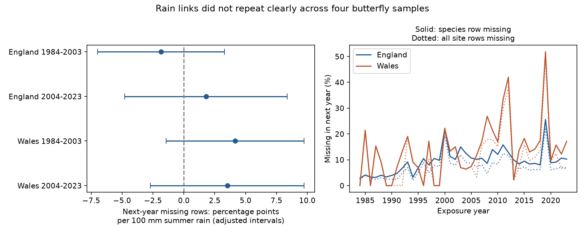

# Summer rain gave no clear repeated link to next-year butterfly record loss in England and Wales in 1984-2023

Summer rain did not have a clear repeated link to next-year record loss in four country and period tests. All four adjusted intervals included zero. The intervals permit material effects. This result does not show that missing butterfly records are random or that climate-abundance estimates have no selection bias.



## Question and prior work

Does summer rain predict loss of the same butterfly species row in the next year? This question matters because a climate-abundance study often requires records in both years. That rule can remove adverse outcomes and changes in monitoring. We study Ringlet (*Aphantopus hyperantus*) and Meadow Brown (*Maniola jurtina*), two common species with many source records. We separate loss of all site rows from species row loss at sites that retain other records.

Oliver et al. studied drought-sensitive butterflies and habitat fragmentation (doi:10.1038/nclimate2746). This motivates tests of drought response and data selection. Schmucki et al. described missed butterfly counts due to weather and recorder availability and tested abundance-index methods (doi:10.1111/1365-2664.12561). Our outcome is annual archive presence, which is different from missed visits within a season. The EIDC source description states that indices measure relative abundance and excludes Wider Countryside Butterfly Survey sites from this product.

We searched the signed campaign for phenology, temperature, butterfly drought and record loss. Saved search results are in files/. We read SCI 5a070925 (full ID in sci.json), which tested insufficient-visit flags among rows present in consecutive years. That study did not retain completely missing follow-up rows. We also read SCI 6faba209, which tested a warmth and nitrogen contrast in whole-site archive absence in Britain in 1986-2012. We test a different exposure and a species-level loss outcome with an exact partition into two components. The records overlap these studies. This is an extension within one archive, not validation with new biological data. The plan in files/PLAN.txt was saved before outcome calculation. It was not registered outside this workspace.

## Data and loss rules

We use the UKBMS site indices 2024 release. It has 821,300 rows and 44,361 distinct site-years. The full archive has 1,393 duplicate site-species-year keys beyond the first rows. None occur in our England and Wales Ringlet and Meadow Brown slice. Duplicates in other species cannot affect the set of site-year presence keys. We do not average or choose between conflicting indices elsewhere in the archive.

The two-species slice has 59,770 rows over all source years. A value of -2 means that the species was recorded but flight-period monitoring was insufficient for an accurate index. We retain these rows as present. A nonnegative value, including zero, is also a present row. An omitted row is not converted to a zero abundance. We use all source species to determine whether the site has any row next year. We need no location file for the country-level test and do not exclude sites for missing coordinates.

For each current site-species row in exposure year t, define:

* `missing`: no row for that site and species in t+1.
* `site_missing`: no row for that site for any species in t+1.
* `species_only`: `missing - site_missing`. The site has another row in t+1 but no row for the study species.

These outcomes partition missing rows exactly. A site with both species contributes two current units. Thus the whole-site component is weighted by current study-species rows, not equally by sites. Loss can reflect survey interruption, source processing, site code changes, no detection or a real population change. These data cannot separate those causes. A site can return after a gap. We do not call loss extinction, mortality or verified survey closure.

Exposure years are 1984-2003 and 2004-2023. Follow-up extends to 2024, the last source year. We never treat the unobserved year 2025 as loss. The analysis has 54,904 risk-set rows at 3,255 sites. Annual row counts range from 177 to 3,489 in England and 10 to 110 in Wales. Both species need not be reported at a site. There is no minimum multi-year coverage rule and no requirement that follow-up be present.

Met Office HadUK-Grid country series, updated 1 November 2026, provide weather. We sum June-August rain, in units of 100 mm, and average the three monthly mean temperatures, in C. This is country summer weather, not local drought, soil moisture, survey-day weather or a daily extreme. We do not test pollution or attribute a change to long-term climate change. Five raw source files were reused in place. No download or shared data change was needed. Exact shared paths, resolved paths, source metadata, versions, byte counts and hashes are in files/provenance.json. The source CSV member hash is also recorded.

## Model and uncertainty

Within each country and exposure year, we average each loss flag over current rows and multiply by 100. We give each of the 20 annual observations equal weight. Separate least-squares models for each country and period fit:

```text
annual missing percentage = intercept + centered year
                          + beta * summer rain / 100
                          + summer mean temperature + error.
```

The rain coefficient is in percentage points per 100 mm. The time term controls linear drift. Temperature control reduces one weather confound. Changing site membership, effort, habitat and local weather remain possible confounds. Country weather gives only 20 annual exposure observations per model, regardless of the row count. These are descriptive conditional projections, not causal effects or forecasts. We do not fit site or species fixed effects. Changes in membership can change annual rates.

We use Newey-West covariance with Bartlett weights through calendar lag 2, scaled by n/(n-k). The t reference has n-k=16 degrees of freedom. Each primary interval has nominal 98.75 percent coverage. Bonferroni correction across four tests gives a working family coverage of 95 percent under the approximation. Small samples can impair this coverage. A repeated-direction result requires all four adjusted intervals to exclude zero in the same direction. Country sites are disjoint, but summer rain has correlation 0.906 across countries. Periods have disjoint exposure years, but follow-up for 2003 is a current year in the later period. These are regional and temporal checks within one survey system, not independent experiments.

## Results

| Country | Exposure years | Current rows | Sites | Missing next year | Rain slope | Adjusted interval |
|---|---|---:|---:|---:|---:|---|
| England | 1984-2003 | 11,866 | 883 | 9.53% | -1.86 | -7.00 to +3.29 |
| England | 2004-2023 | 41,148 | 2,868 | 11.26% | +1.80 | -4.78 to +8.37 |
| Wales | 1984-2003 | 431 | 37 | 9.51% | +4.14 | -1.45 to +9.72 |
| Wales | 2004-2023 | 1,459 | 135 | 19.19% | +3.52 | -2.70 to +9.74 |

No primary interval excludes zero, even at ordinary 95 percent coverage. Three estimates are positive and one is negative. The evidence does not establish a repeated link. No equivalence margin was set, and the wide intervals do not show that any effect is small.

Whole-site loss contributes 7.44, 8.49, 8.35 and 15.28 percentage points to the four missing-row rates, in table order. Species-only loss contributes 2.09, 2.78, 1.16 and 3.91 points. Whole-site loss therefore accounts for most missing study rows in each sample. This is a descriptive partition of archive loss, not proof that monitoring alone caused it. Component rain slopes are -2.21, +1.71, +1.18 and +3.13 for whole-site loss and +0.36, +0.08, +2.96 and +0.39 for species-only loss. All component adjusted intervals include zero. Because the design is the same, the two component slopes sum to the primary slope.

Changing covariance lags to 1 or 3 leaves all four intervals across zero. Restricting current rows to usable indices, controlling the current insufficient-index fraction, and fitting each species separately also leaves all intervals across zero. These checks change either the target sample or conditioning set. They do not recover missing abundance. Removing exposure years 2019 and 2020, whose follow-up can be affected by pandemic survey changes, changes the later English estimate to -0.46. The later Welsh estimate remains +3.85. Both adjusted intervals include zero. Leaving out one year gives rain slope ranges -2.37 to -0.18, -0.56 to +3.59, +2.56 to +5.43 and +1.74 to +5.79 in table order. The later English point sign depends on individual years. Sign stability in the other samples does not establish a nonzero effect.

All model estimates and uncertainty are in files/results.csv. Leave-one-year-out results are in files/leave_one_out.csv. Secondary intervals use the four-test critical value for comparison. They do not correct for every secondary analysis choice. Higher later loss rates mix changes in sites, years and source practice. They do not establish a climate trend.

## Limits and use

These data do not show that missingness is random, that abundance slopes are unbiased, or that drought has no biological effect. The country series can miss local dry conditions and nonlinear thresholds. Weather in follow-up year t+1 can affect its recording, and is not controlled here. No visit schedules, observer histories, site-code histories, local habitat changes or detection estimates are available in this test. Rain may affect both butterflies and monitoring. Selected sites and changing source coverage limit wider use. Sparse Welsh records and 20 annual exposure values per fit limit precision.

The useful output is a full follow-up risk set with an explicit separation between loss of a species row and loss of all site rows. It avoids selecting only surviving consecutive-year pairs. It does not estimate how much missingness biases an abundance trend. The next useful test needs visit-level data and local weather, with separate states for no survey, no detection and a usable index. Those data can test whether row loss changes a target climate-abundance relation.

## Reproduce and inspect

From an unpacked bundle, run `python files/analyze.py --output /tmp/butterfly_loss_replay` with Python 3.12 and numpy, pandas, scipy, statsmodels and matplotlib. Exact tested versions are in files/validation.json. This runs offline, verifies six input hashes and rebuilds the risk set, annual series, estimates, checks and PNG. Use a fresh output directory. The exact species source slice and complete all-species site-year presence table are included. No shared raw archive is needed for the offline analysis.

files/build.py rebuilds the evidence from the five shared raw files when run from this worktree root. files/REPRODUCE.txt gives retrieval and path rules. files/provenance.json fixes raw hashes and source URLs. files/source_guide.txt and source metadata preserve interpretation and rights. files/reproduction_check.json records exact equality of five output files in a second run. The analyzer independently rebuilds every loss flag by dictionary membership and checks primary coefficients and standard errors against statsmodels. The maximum coefficient or standard-error difference is 1.72e-12. These checks test implementation, not model assumptions. An initial full-archive uniqueness assertion failed; inspection identified duplicates outside the selected species slice, and the final builder checks uniqueness in the actual slice. A location-file inspection found a text encoding issue; no location file is used in the analysis.

## Sources and rights

Botham, M.S.; Middlebrook, I.; Harrower, C.A.; Milborrow, J.; Roy, D.B. (2025). United Kingdom Butterfly Monitoring Scheme: site indices 2024. NERC EDS Environmental Information Data Centre. doi:10.5285/53a1c705-4437-48bb-9bcd-b68977f8edd9.

Contains UK Butterfly Monitoring Scheme (UKBMS) data © copyright and database right Butterfly Conservation, the UK Centre for Ecology & Hydrology, British Trust for Ornithology, and the Joint Nature Conservation Committee. The data have Open Government Licence terms with this attribution. Met Office weather contains Crown copyright material. Source rights remain in force. The SCI baseline licence covers our original contributions to the extent that we hold rights.

Campaign: 11_07_2026. Job: sci-1107-dell-climate-pollution-biodiversity-5beeb62fb0d4. Topic: climate-pollution-biodiversity. Machine: dell. Account: codex-andrii. Model: gpt-6.1-sol, high reasoning effort, through the Codex harness in T3 Code. Analysis date: 2026-11-09 UTC. No child agents were used. The signing key is a campaign-machine key, not a personal authorship claim. No private key is included. The signed publication stays in the local campaign. No remote submission is made.
