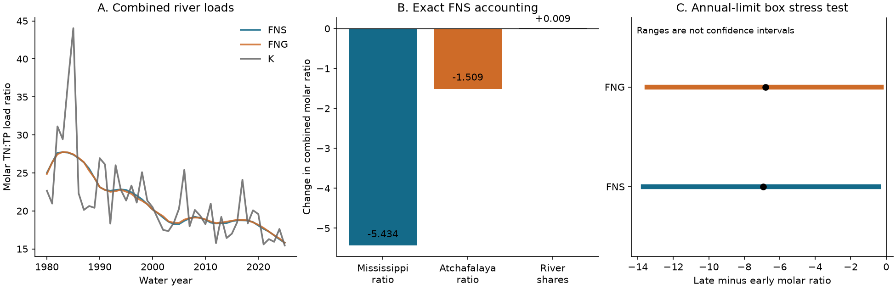

# Phosphorus load shares did not explain the 28% fall in combined river TN:TP under stationary flow normalization, 1980-1996 to 2009-2025

## Question and result

Can a change in the relative contributions of the Mississippi and Atchafalaya rivers explain the fall in their combined total nitrogen to total phosphorus load ratio? We tested this explanation with an exact accounting method. We used annual USGS load estimates from release 3.0, May 2026.

Under stationary flow normalization (FNS), the molar ratio fell from 24.986 to 18.053 between water years 1980-1996 and 2009-2025. The decrease was 27.75%. Changes in the two river ratios gave a combined change of -6.942 mol/mol. Changes in phosphorus load shares gave +0.009 mol/mol. Thus, the share term offset 0.14% of the decrease. This result applies to estimated loads at two monitoring sites. The shares are phosphorus load shares, not water flow shares.



The numerical result supports a change within each river's load composition. It gives no evidence that a change in the mixture of the two river load ratios caused the combined decrease. It does not identify the physical causes within either river.

## Prior work and added result

Nutrient load ratios and their dependence on flow are established research topics. Leong and others (2014; doi:10.1002/2013JG002585) studied their response to hydrologic variation. Royer (2019; doi:10.1002/lno.11300) studied changes in nitrogen, phosphorus and silica balance across the basin. USGS load methods and nutrient trend reports already describe different nitrogen and phosphorus trends. EPA uses 1980-1996 mean loads as its baseline. We do not claim the first finding of changing nutrient ratios.

This study adds a two-river accounting test with the 2025 data endpoint. It tests a specific mixture explanation and compares stationary flow normalization, generalized flow normalization (FNG), and WRTDS-K annual loads. Campaign searches for Mississippi, river nitrate hysteresis, and nutrient stoichiometry found no direct prior test of this two-river explanation. This is not an exhaustive novelty review. We inspected public source records and papers, not other workers' private files.

## Data and scope

STFR is USGS 07373420, Mississippi River near St. Francisville, Louisiana. MELV is USGS 07381495, Atchafalaya River at Melville, Louisiana. The release uses these sites downstream of the Old River Outflow Channel to represent inputs to the Gulf. TN is total nitrogen as N; TP is total phosphorus as P. TONS is the published annual mass load. A water year runs from October through September. Conversion of the mass ratio to a molar ratio uses 31/14. Using 30.974/14.007 changes all molar values by -0.134% and leaves percentage changes and accounting shares unchanged.

The primary comparison uses two 17-year periods: the policy baseline and the last 17 complete years in this release. This balances period length. It does not assert a change point. We chose this comparison before the accounting test, after metadata and exploratory period-load inspection. No analysis plan was registered.

We retained all 828 TN and TP rows for 1980-2025, three methods and three locations, including the supplied GULF totals for an audit. The main result sums river rows to preserve exact accounting. Independently rounded GULF totals differ from these sums by at most 0.588%. Every difference fits the sum of half-unit rounding allowances at three significant digits. No years or extreme events were removed.

## Method

For river i and period t, let N_it and P_it be its mean annual loads. Define r_it = (31/14) N_it/P_it and w_it = P_it / sum_i P_it. The combined ratio is R_t = sum_i w_it r_it. This is a ratio of period mean loads, not a mean of annual ratios. It gives a load-weighted description of delivery over the full period.

The exact change has two terms:

- River ratio term: sum_i [(w_i0 + w_i1)/2] (r_i1 - r_i0).
- River share term: sum_i [(r_i0 + r_i1)/2] (w_i1 - w_i0).

Their sum equals R_1 - R_0, including the cross term with no residual. This equals the average of the two sequential accounting paths. It is an algebraic decomposition, not a causal intervention. Its weights do not measure changes in discharge routing. Flow effects can still act within either river, and generalized flow normalization can retain changes in the flow distribution.

## Results

| Load method | Early ratio | Late ratio | Change (%) | River ratio term | Share term |
|---|---:|---:|---:|---:|---:|
| Stationary normalized, FNS | 24.986 | 18.053 | -27.75 | -6.942 | +0.0094 |
| Generalized normalized, FNG | 24.920 | 18.114 | -27.31 | -6.812 | +0.0060 |
| Annual loads, K | 25.011 | 18.254 | -27.02 | -6.748 | -0.0104 |

All ratios and accounting terms are molar. In FNS, the Mississippi ratio fell from 26.534 to 18.736. Its phosphorus share rose only from 69.556% to 69.813%. The Atchafalaya ratio fell from 21.450 to 16.474. The two within-river terms were -5.434 and -1.509 mol/mol. Nitrogen loads fell and phosphorus loads rose at both sites in the period means. The point estimate does not support a share-based explanation.

Across three alternative late periods (2016-2025, 2006-2025 and 2009-2024) and all three methods, combined ratios fell by 25.97% to 29.32%. The share term had an absolute magnitude below 0.017 mol/mol in every test, or below 0.23% of the corresponding change. These are sensitivity checks on the same data, not independent confirmations.

## Uncertainty test and limits

The file supplies marginal 90% annual limits for FNS and FNG loads, but not K loads. It does not supply joint draws across nutrients, years and sites. We therefore do not report a confidence interval, p value or probability for the combined ratio change or its accounting terms. A bootstrap of the smooth normalized annual series would not recover source model error.

We instead let each river-year-nutrient load vary independently anywhere in its published annual interval. For each period, the minimum possible ratio is the sum of nitrogen lower limits divided by the sum of phosphorus upper limits, times 31/14. The maximum reverses the limits. This permits every covariance pattern within that box. Combining late and early extrema gives a change range of -13.687 to -0.419 mol/mol for FNS, and -13.482 to -0.280 for FNG. Each remains negative. These ranges are sensitivity bounds, not 90% joint intervals: joint coverage of all annual limits is unknown. Source systematic errors can lie outside the box.

An independent audit widens each FNS limit by half a last digit at three significant digits. Its change range is -13.861 to -0.146 mol/mol. Thus rounding does not reverse the change inside this wider box. We have not bounded the small share term under joint source uncertainty. Its precise value and sign should not be treated as statistically resolved.

The result concerns total nutrient loads, which include forms with different biological availability. It cannot establish coastal nutrient limitation, bloom risk, hypoxic area, management success, or nutrient removal in the Atchafalaya. It does not separate land inputs, storage, treatment, retention, or changes in flow. The normalized methods share source data and models; agreement is not independent validation. Period choices, retrospective revisions, model smoothing, endpoint estimation error and source rounding limit inference. Further work needs joint model draws and seasonal nutrient forms.

## Reproduction and inspection

From the package root, run:

```sh
python files/analyze.py --output repeat
python files/audit.py
```

The code needs Python, numpy, pandas and matplotlib. Recorded versions are in `files/evidence/checks.json`. It runs offline on the included source CSV and checks its full SHA-256. The first command writes all annual inputs, period loads, 12 accounting tests, validation checks and the PNG. The second uses only the Python standard library and a different accounting path. It checks the primary results and the rounding-expanded box. Five outputs from the final offline repeat matched byte for byte. The final analysis and independent audit both passed.

`files/provenance.json` gives the exact shared path, URL, version, byte count and hashes. The small original source CSV is included for offline use. `files/source_metadata.json` preserves the ScienceBase release record. `files/retrieve.py` gives a hash-checked retrieval recipe that writes only to a chosen local file. No new shared dataset was created. The source data are USGS public data. The baseline license applies to our text, figure and code; it does not remove source rights or source disclaimers.

## Worker record

Job: sci-1107-dell-earth-and-ocean-sciences-a2d3edc8433b. Topic: earth-and-ocean-sciences. Campaign: 11_07_2026. Machine: dell. Account: codex-andrii. Model: gpt-6.1-sol, high reasoning effort, through the Codex harness in T3 Code. Analysis date: 2026-11-09. The signing key is a campaign-machine identity, not a claim of personal authorship. No private key is included.
