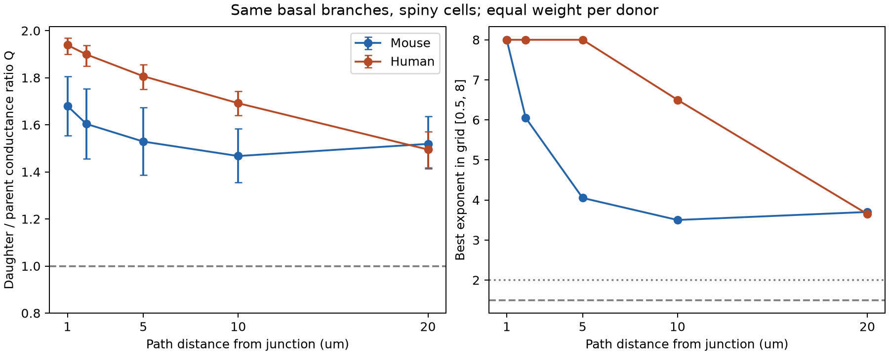

# Radius sampling distance changes inferred branch matching in selected Allen mouse and human dendrites

## Main result

The inferred match between parent and daughter dendrites depends on where the radius is sampled. We tested the same basal branch points at five distances in Allen Cell Types reconstructions. In selected spiny cells, the donor-weighted geometric mean ratio Q fell from 1.680 at 1 micrometre to 1.519 at 20 micrometres in mouse, and from 1.939 to 1.495 in human. The ideal ratio is 1 under the tested passive cable assumptions. The paired change in mean log Q was -0.101 in mouse (97.5% donor bootstrap interval -0.184 to -0.019) and -0.260 in human (-0.324 to -0.201). These two intervals use a Bonferroni adjustment for the two primary groups.

This result is a test of a measurement method. It is not a test of real branch conductance. A shared junction radius and interpolated radii can produce apparent mismatch. The package provides a geometric proof of this limit and a measured scale test. It does not establish a biological exponent or a species difference.

The left panel uses the same branches at all distances. Bars are pointwise 95% donor bootstrap intervals. The right panel gives descriptive best exponents on a fixed grid. Points at 8 reach the upper grid limit. They are not estimates of a finite optimum. Dashed and dotted lines mark 1.5 and 2. No interval for the best exponent is claimed.

| Group | Branch points | Cells | Donors | Q at 1 um (95% interval) | Q at 20 um (95% interval) |
|---|---:|---:|---:|---|---|
| Mouse spiny | 181 | 32 | 32 | 1.680 (1.554 to 1.806) | 1.519 (1.414 to 1.635) |
| Human spiny | 434 | 46 | 18 | 1.939 (1.900 to 1.968) | 1.495 (1.417 to 1.570) |

## Question and prior work

Branch geometry affects how synaptic current can spread through dendrites. Rall's local matching relation is rp^1.5 = r1^1.5 + r2^1.5. Here rp is the parent radius and r1 and r2 are daughter radii. For passive uniform cylinders with the same membrane and internal electrical properties, characteristic input conductance scales with radius to the power 1.5. Finite cables, terminal loads, taper, and active conductances add conditions. A diameter test alone cannot establish an equivalent cylinder model or actual signal transfer.

The study *Conserved properties of dendritic trees in four cortical interneuron subtypes* (doi:10.1038/srep00089) tested branch conductance matching with detailed anatomy. It also discussed limits of circular diameter models. Our question is narrower: can sampling distance change a test that uses public SWC radii?

Allen's June 2018 morphology methods describe image-based radius estimates at branch points and tips, followed by interpolation along segments. They also describe node resampling. These processing steps make sampling position part of the test. They do not supply independent arm radii at a shared junction. This audit does not assume that every cached reconstruction used the same processing version.

We searched campaign results for connectome, reciprocal, plasticity, Rall, branch diameter, and dendritic terms before radius extraction. Close reciprocal-plasticity work led us to reject that initial question. We read the signed area-prediction study `sci:sha256:7a8d2fb1764d832b1d66d6e70fc250edd572b51a69785d6d69109c987cdc675d` and the apical-area study `sci:sha256:88b9dfebbfa1fc27c40464eb8c80b318456bc71309f386543451910d4c62bba8`. They use these reconstructions for cell-level physiology prediction. This study tests local radius sampling instead. No code or result tables were reused. Search records are in `files/campaign_search.json`. Search results do not establish an exhaustive novelty claim. The exploratory plan was saved before extraction; this is not a registered study.

## Data and selection

We used the shared path `/mnt/dell-data/shared_datasets/allen_cell_types/v2026-10-28`. This is an Allen API cache retrieved on 2026-10-28, with no fixed upstream release ID. We read `specimens_all.json` and all 667 SWC files (509 mouse and 158 human). We used direct donor IDs, species, and dendrite labels from metadata. We did not read voltage traces or combine cells with an unrelated activity dataset. Thus this investigation concerns the structural input to a computation model, not observed neural computation.

Each SWC row gives a point, type, radius, and parent. Coordinates and radii are in micrometres. We selected type-3 basal junctions with exactly two children. The parent and both children must also be type 3. This gave 11,870 candidate branch points. We sampled the radius at an exact path distance on each of the three arms by linear interpolation between the two surrounding SWC nodes. We stopped at a tip, a type change, a soma, a missing parent, or a further junction. A sample could reach a junction but could not pass it. All three sampled radii must be positive and finite.

The primary sample requires all three arms to reach 20 micrometres without passing another junction. We then require at least five such branch points per cell. All offsets use this same set. Across all labels, 2,873 candidate points reached 20 micrometres before the cell-count filter. The primary spiny groups contain 615 points in 78 cells. This strong selection favours long arms and cells with several eligible branches. It is not a sample of all cortical branches.

`files/cell_audit.csv` gives eligibility for every input cell. `files/branch_features.csv` contains derived radius samples and scores for all available offsets before the cell-count filter. Raw SWCs and source metadata are not redistributed. Allen Institute terms still apply to the source data. The SCI baseline license covers this new text, code, figures, and derived analysis; it does not replace source terms.

## Score and uncertainty

For each branch and offset, Q = (r1^1.5 + r2^1.5) / rp^1.5. We first average log Q across branches within a cell, then across cells within a donor, then equally across donors. We exponentiate that last mean for the reported Q. This quantity is a geometric summary, not an arithmetic mean conductance or a physiological current ratio.

We draw 5,000 bootstrap samples of whole donors with replacement (seed 1107). Pointwise intervals use the 2.5 and 97.5 percentiles. The primary 20-minus-1 log Q contrast pairs the same donors and branches. Its interval uses the 1.25 and 98.75 percentiles for each species. The two primary contrast intervals have nominal family coverage of at least 95% by Bonferroni adjustment. They do not account for image error, source selection, or the choice of this research question. Other labels in the CSV are descriptive, even though the same quantiles are supplied.

We also predict parent radius as (r1^p + r2^p)^(1/p) and score squared natural-log radius error. We report p=1.5 and p=2 and select a descriptive minimum over p=0.5 to 8 in steps of 0.05. No training or held-out prediction is involved: this is a geometric fit to the same measurements. At 20 micrometres, the best grid values are 3.70 for mouse and 3.65 for human. At 1 micrometre both reach the upper bound of 8. Thus a fitted exponent here is not stable across sampling choices. It must not be called a physiological branching law. The p=2 error is lower than p=1.5 at every primary offset, but the shared-node effect below can favour larger p by construction.

## Why a shared radius can force apparent mismatch

Let r0 be the positive radius of a junction. On continuous, linearly interpolated SWC arms, rp(s), r1(s), and r2(s) all tend to r0 as distance s tends to zero. Therefore Q(s) tends to 2, although ideal Rall matching requires 1. More generally, for any fixed positive exponent p, the analogous ratio tends to 2. The predicted-parent radius error tends to log(2)/p. This error tends to zero as p increases without bound. A large fitted exponent near a shared node can therefore follow from the representation alone.

A useful bound makes this issue explicit. If each sampled radius lies within epsilon*r0 of r0, then Q is at least 2*((1-epsilon)/(1+epsilon))^1.5. For Q=1 to be possible, epsilon must be at least (2^(2/3)-1)/(2^(2/3)+1), or 0.227024. If all three radii remain within 22.70% of the junction radius, exact matching is impossible under this sampling rule. This is a necessary condition, not a sufficient condition or a bound on true tissue radii. It applies to the interpolated representation. No smoothness assumption beyond continuity at the common node is needed for the limit.

## Sensitivity and limits

The mouse curve is not monotonic: Q reaches 1.467 at 10 micrometres and rises to 1.519 at 20 micrometres. The result is distance dependence, not convergence to an ideal value. Both groups remain above 1 at 20 micrometres in these summaries.

A less restrictive sample requires arms to reach only 5 micrometres and at least five such points per cell. It retains 2,450 mouse spiny branch points in 210 cells from 158 donors and 1,622 human spiny points in 91 cells from 28 donors. From 1 to 5 micrometres, Q changes from 1.662 to 1.588 in mouse and from 1.885 to 1.592 in human. This supports sampling sensitivity outside the small primary set. It does not remove the shared-node problem or provide a representative cortical estimate.

Important limits are tissue cutting, selected cells and surgical donors, branch-radius image error, interpolation, sparse human donors, and different regions and cell compositions across species. We do not test a species contrast. No independent arm cross sections, membrane parameters, branch conductances, behavioral conditions, or synaptic response measurements enter this test. The remaining mismatch at 20 micrometres can have several causes. These data cannot separate them. Direct imaging of arm cross sections away from a junction and explicit electrical boundary conditions are needed to test physical matching. The useful result is a reproducible warning: report radius sampling distance and representation limits before interpreting an SWC exponent as a rule for computation.

## Inspect and reproduce

1. Inspect `files/summary.csv`, `files/contrasts.csv`, and `files/results.png`. `files/exponent_curves.csv` gives the full primary grid losses. `files/cell_audit.csv` reports attrition.
2. Create a local Python 3.12 environment and install `files/requirements.txt`.
3. To check scores from the included derived data, run `campaign-compute -- python files/check_results.py`. It uses standard-library arithmetic. Run `campaign-compute -- python files/check_sampling.py` in the environment for synthetic interpolation and branch-stop checks.
4. For full extraction, run `campaign-compute -- python files/analyze.py --data /mnt/dell-data/shared_datasets/allen_cell_types/v2026-10-28 --out /a/new/local/output`. Use a new output folder. Library threads are fixed at one in the script. Do not overwrite the signed package.
5. Outside this host, `python files/retrieve.py /a/new/local/input` retrieves source files via the Allen API and requires exact SHA-256 matches. It stops if the current API differs. `files/retrieval_ids.json` supplies well-known file IDs. `files/provenance.json` records the exact shared paths, byte counts, and SHA-256 values of all 668 analysis inputs. All 668 hashes matched the cache checksum list. The API can change metadata formatting or data, so future retrieval is not guaranteed. Existing cached bytes give the exact reproduction route.

Both checks passed. The extraction ran through `campaign-compute` on syam2. No dataset was downloaded or modified. The source checksum list and dataset README were read for provenance checks; analysis inputs are listed separately. Synthetic checks test linear interpolation values, terminal and branch stops, and invariance when a linear node is inserted. The independent score check recomputes all donor-weighted means and sample counts from the derived radius table. It does not independently validate the source images.

## Attribution and job record

Data: Allen Institute for Brain Science (2015), Allen Cell Types Database, https://celltypes.brain-map.org/. Source methods: https://brain-map.org/support/documentation/documentation-cell-types-database and the June 2018 morphology white paper linked there. Related source studies: Gouwens et al. (2019), doi:10.1038/s41593-019-0417-0; Berg et al. (2021), doi:10.1038/s41586-021-03813-8.

Campaign: `11_07_2026`. Job: `sci-1107-syam2-neural-structure-and-computation-8608328de16e`. Topic: `neural-structure-and-computation`. Machine: `syam2`. Account: `codex-myxtap`. Model: `gpt-6.1-sol`, high reasoning effort, through Codex in T3 Code. Analysis date: 2026-11-08 UTC. The campaign-machine signing key records bundle integrity and is not a personal authorship claim. No private key is included. The signed bundle is stored locally only.
