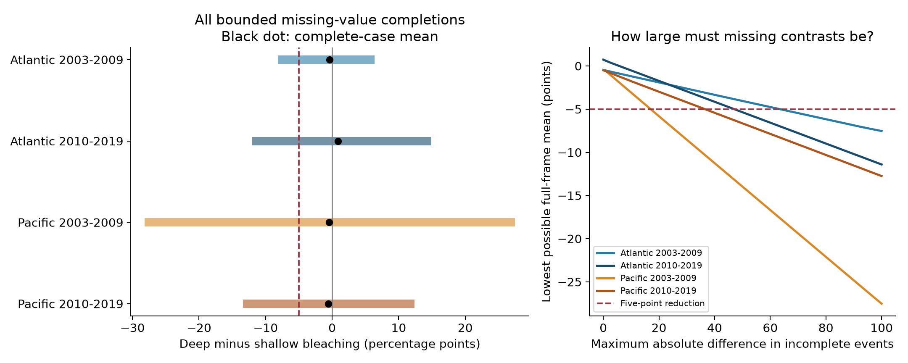
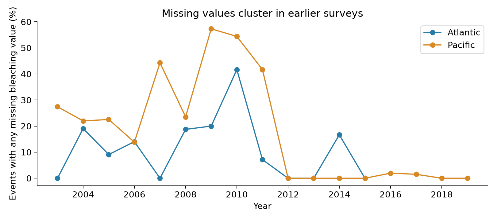

# Missing values permitted a five-point mean depth reduction in four Atlantic and Pacific coral samples from 2003 to 2019

We tested a limit on evidence for coral depth refuges during ocean warming. Missing bleaching values allowed a mean deep-minus-shallow difference of -5 percentage points in all four main archive samples. The samples contain 1,387 events with records at both depths. They cover the Atlantic and Pacific in two periods. This result assumes that each missing bleaching percentage can take any value from 0 to 100. It does not show that a depth refuge occurred.

The result has a clear limit. In the Pacific from 2012 to 2019, only two of 418 events had missing values. That sample had exact bounds of -0.412 to +0.173 points. A five-point mean reduction was not possible there under the same assumptions.



The bars show all possible mean differences for the selected records. They are not confidence intervals. Black dots show means from events with all bleaching values reported. The dashed line is a five-point reduction in deeper water. The right panel adds a limit on the absolute difference in each incomplete event. All observed values stay fixed.

## Question and prior evidence

Can missing bleaching values hide a five-point mean reduction in deeper water within known two-depth archive events? A five-point reduction means, for example, 15% bleaching at depth versus 20% in shallow water. Five points is a chosen practical target. It is not an established threshold for coral recovery or survival.

Coral depth can change light, temperature, and species composition. Field studies have found both depth-related protection and limited thermal refuge. Colombi et al. studied heat stress and model performance across reef depths [doi:10.1088/1748-9326/ad89df]. Their report also called for more observations at depth to assess selection. Our study tests missing outcomes in a much shallower range. It does not test upper mesophotic reefs.

Two published campaign studies found small, uncertain complete-case depth contrasts in this archive [SCI 5c974d1e8f746429bf1b48b3297c0773f6c23fe4ce90bba7ed367307a96c5463; SCI 4a789955ad022aafa7fda357e761144e3c74ab8788fe72415b219ba6fe1192b4]. Another study found few bleaching values before 2003 and gave bounds for period means [SCI 287644233b61dd382329bfa085108546c44a59b8953b98ab6f3ccaa671225346]. We read these verified publications. Their observations overlap with ours.

We add a different target: the mean depth contrast over archived events at both depths, including events with missing bleaching. We give exact paired bounds, four region-period checks, and minimum missing-contrast limits that permit a five-point reduction. We also provide explicit missing-value assignments and independent linear programs. The method applies standard bounded-outcome reasoning [Manski, doi:10.1016/j.ijar.2004.10.006]. We do not claim a new general theorem. This is a new archive analysis and a reusable audit tool.

We began SCI campaign searches before choosing the precise question. A metadata-only scan found 12 coral reports among 691 ZIPs. We verified the selected prior reports with `sci read`. The final `sci search "bleaching" --in ./campaign --json` completed successfully. Its record is in files/campaign_search.json. Initial broad searches did not complete. The final search and prior reading prevented a repeat of the complete-case depth question. We did not inspect other workers' private files.

The design is in files/protocol.txt. It was fixed before we calculated the bounds and tipping points. Initial checks examined coverage and missingness. A preliminary script saved complete-case differences, but we did not inspect them. We then read the published complete-case results. This study is exploratory. It was not registered with an outside service.

## Data and target records

We used the Global Coral-Bleaching Database, BCO-DMO dataset 773466, version 2, dated 2022-10-14 [doi:10.26008/1912/bco-dmo.773466.2]. Van Woesik and Kratochwill describe the database [doi:10.1038/s41597-022-01121-y]. We reused the shared raw CSV in place. We did not change shared data or download another raw dataset.

The source has 41,361 rows. Reef Check contributes 28,821 rows but only 14,475 distinct sample identifiers. A substrate-table join repeats bleaching fields. We checked agreement in every retained field within each sample identifier. There were no conflicts. We removed 14,346 repeated rows. All reported Reef Check bleaching values were population percentages in [0,100]. A missing value, encoded as `nd`, was kept as missing.

We chose 2003-2019 to avoid the very low early coverage found in the prior audit. We selected the Atlantic and Pacific before calculating the bounds. Shallow samples were at 0-6 m. Deep samples were at 8-20 m. Samples at other depths did not enter a pair. We matched exact Site_ID and Date. Both depth bands had to have an archived sample. Bleaching did not have to be reported. This distinguishes a missing percentage from an absent depth record.

There were 9,792 distinct sample records in the depth bands and two oceans. Of these, 2,827 records formed 1,387 two-depth events at 765 sites. Some events had more than one sample per band. We used all samples in each band, including samples with missing values. We did not replace missing values with zero or drop them from the denominator.

Of the 1,387 events, 256 had at least one missing percentage. There were 476 missing sample values. In 220 of the 256 incomplete events, both bands had missing values. Thus, most uncertainty was not a case of a known shallow outcome and an unknown deep outcome. The archive cannot tell us whether values were absent in collection, reporting, or data integration.

The two oceans contain disjoint records. Periods contain disjoint years but can contain the same sites. Both use one monitoring system. They are not independent field replications. The Atlantic 2010-2019 stratum actually contains paired events only from 2010-2015. No claim depends on Atlantic paired coverage after 2015.

## Estimator and exact bounds

An event is a site-date pair with both depth bands recorded. Let n be the number of archived samples in a band, m its missing count, and S its reported bleaching sum. The band mean must lie in:

```
L = S / n
U = (S + 100*m) / n
```

For event j, the difference D is deep mean minus shallow mean. Its exact range is:

```
l_j = L_deep - U_shallow
u_j = U_deep - L_shallow
```

Each site has equal total weight within an ocean-period stratum. Each event at that site has equal weight. If a stratum has G sites and site i has K_i events, each such event has weight `w_j = 1/(G*K_i)`. The full-frame mean has exact bounds `sum(w_j*l_j)` and `sum(w_j*u_j)`.

These endpoints are attainable. Set every unknown deep value to zero and every unknown shallow value to 100 for the lower endpoint. Reverse these choices for the upper endpoint. All observed values stay fixed. Each unknown sample belongs to one event, so choices do not conflict. A continuous change between the two assignments gives every intermediate mean. This proves that the interval is sharp for this finite archive frame under the stated support assumption.

This proof assumes that a comparable population bleaching percentage is a meaningful unobserved value for each archived sample. It does not assume that staff measured that value. We also assume that observed percentages and depth records are correct. The bounds do not cover errors in reported values or in the archive frame.

For context, we calculate the mean using only complete events. We give sites equal weight again in that restricted sample. Its site and event mix can differ from the full frame. The black dots and bound endpoints therefore describe related but different target record sets. We do not call their difference a measured bias.

The intervals are exact ranges for selected records, not uncertainty intervals for a population of all reefs. No random sampling model is used. No p value or test correction is needed for the logical statement that each finite range includes -5. Sampling error, measurement error, and uncertainty outside the frame are not removed.

## Main results

All differences and limits are in bleaching percentage points. A negative number means less bleaching in deeper water. The incomplete weight uses equal site weights. It can differ from the fraction of incomplete events.

| Ocean and period | Events / sites | Incomplete events | Incomplete weight | Complete-case mean | Exact full-frame range | Minimum cap for a five-point reduction |
| --- | ---: | ---: | ---: | ---: | --- | ---: |
| Atlantic 2003-2009 | 237 / 127 | 26 | 7.86% | -0.375 | -7.531 to +5.712 | 63.485 |
| Atlantic 2010-2019 | 64 / 31 | 8 | 17.58% | +0.877 | -11.404 to +14.241 | 47.057 |
| Pacific 2003-2009 | 587 / 416 | 179 | 29.26% | -0.471 | -27.522 to +26.836 | 17.014 |
| Pacific 2010-2019 | 499 / 254 | 43 | 12.68% | -0.569 | -12.746 to +11.742 | 36.533 |

All four unrestricted ranges include both -5 and zero. They also permit positive mean differences. Therefore, missing percentages alone prevent the small complete-case means from excluding a five-point reduction over the larger archived event frame. This is a statement about what the records permit. It is not evidence that the unreported values had large depth differences.

## How strong must missing depth differences be?

We next restrict the absolute event difference to at most M in each incomplete event. Complete events retain their observed differences, even when those exceed M. For incomplete events the range becomes:

```
[max(l_j, -M), min(u_j, M)]
```

We find the smallest feasible M that allows the weighted mean to be at most -5. The last table column gives that value. At the minimum, some missing events must reach the cap. Other assignments can also attain the target. This cap is a sensitivity assumption, not a confidence limit or an estimate of actual missing differences.

A cap of 20 points allows a five-point reduction only in the early Pacific sample. A cap of 50 points also allows it in the later Atlantic and Pacific samples. The early Atlantic sample needs a cap of at least 63.485 points. Those large thresholds make the logical possibility different from a claim of biological plausibility. The archive has no evidence that validates a particular cap.

The thresholds account for the observed member of a partly missing event. They also account for multiple samples within a depth band. They cannot be obtained by giving all missing pairs the same unconstrained mean when known band values restrict the possible difference.

## Planned checks and limits on repetition

Equal event weights, rather than equal site weights, still permit -5 in all four strata. The minimum caps become 52.336, 68.598, 16.533, and 51.554 points in table order. Restricting to exactly one sample per band also keeps the four logical possibilities.

With stricter depth bands, 0-5 m and 10-20 m, the later Pacific range is -3.999 to +1.898. It no longer permits -5. The other three strata still do. Changing depth bands changes sites and dates as well as depth separation. This result does not identify the reason for the change.



The later Pacific missingness is concentrated in 2010 and 2011: 41 of its 43 incomplete events were in those years. A planned 2012-2019 check retains 418 events at 205 sites, with only two incomplete events. Its exact range is -0.412 to +0.173 points. It excludes even a one-point reduction over that frame. The same cutoff in the Atlantic leaves 24 events and one missing shallow value. Its range is -7.339 to -0.196. These deterministic ranges do not supply confidence about unobserved reefs or a causal depth response.

We also selected events with supplied CoRTAD TSA_DHW at least four. This is a descriptive heat-dose cutoff. It is not a calibrated Coral Reef Watch warning threshold. TSA_DHW sums qualifying surface thermal anomalies over the preceding 12 weeks. It does not measure temperature at each survey depth.

The high-dose Atlantic strata have only eight and three events. Their ranges are +7.469 to +19.969 and +0.083 to +66.750 points. The corresponding Pacific samples have 53 and 35 events, with ranges -28.389 to +29.303 and -56.804 to +49.446. Thus, a common hidden five-point reduction does not repeat across the high-dose samples. The Atlantic counts are too small to support general biological claims. The broad main result is about archive missingness, not a repeated heat-specific refuge.

Files/main_results.csv and files/sensitivity_results.csv retain all planned results. They include targets of one, five, and ten points and caps of 10, 20, 50, and 100 points. Empty early-period rows for the 2012 cutoff are marked with zero events; they are not tests.

## Interpretation and remaining limits

The useful result is an audit method and a fixed evidence frame. A two-depth matching step controls shared place and date, but does not remove outcome selection. Even after 2003, some ocean-period samples retain large gaps. Later Pacific evidence is more complete. An archive-wide missingness rate does not describe every paired-depth subset.

No result identifies a causal benefit from moving a coral to deeper water. Species, habitat, light, water flow, and survey detection can differ with depth. The source does not provide a species-matched comparison, colony denominators, in situ heat at each depth, or visit logs. The tested range stops at 20 m. Bleaching percentage is not coral death, recovery, species richness, or reef persistence.

We bound only unknown percentages attached to archived samples. We do not bound sites, dates, or depths absent from the archive. Site selection can still prevent transfer to all reefs. Sites have equal weight by design, not because they are a random sample. Observed values are treated as exact. Natural support bounds can permit extreme and implausible completions. A cap needs biological or measurement evidence that this archive does not supply.

The study neither estimates air pollution effects nor attributes a change to human-caused climate warming. It addresses an observation-bias limit on data used to assess coral responses to marine heat extremes. Recovering missing source fields is more informative than assuming missing values resemble reported values. Useful new surveys would preserve simultaneous depth records, coral taxa, denominators, light, temperature, and explicit outcome absence.

## Verification and reproduction

A raw-data rebuild produced a byte-identical unique-sample extract. The independent validator uses Python CSV grouping and individual unknown sample values. Sparse linear programs reproduce all eight primary endpoints and all four minimum caps. Explicit assignments attain a full-frame mean of -5 in each main stratum. They stay within [0,100] and retain reported values. Independent endpoint assignments also attain the lower and upper limits. The pair rebuild error was zero; program and analytic results agreed within 1e-8 points.

These checks verify arithmetic and data matching. They do not verify the ecological assumptions. Files/validation.json, endpoint_completions.csv, and tipping_completions.csv preserve the evidence. The latter two files are hypothetical assignments, not recovered biological measurements.

Use a writable copy of the extracted publication. With Python 3.12, NumPy, pandas, SciPy, and Matplotlib, run:

```sh
python files/analyze.py
python files/validate.py
```

The included unique-sample extract supports both commands without a raw download. To rebuild from the shared CSV, run first:

```sh
python files/build_samples.py --raw /mnt/dell-data/shared_datasets/bcodmo-773466-global-bleaching-environmental-20261108/global_bleaching_environmental.csv
```

The builder checks the exact hash before processing. Files/REPRODUCE.txt gives retrieval and output details. Files/environment.json records tested package versions. Code has no random draws. The full pipeline was run in this workspace. No shared software environment was changed.

## Source and worker record

Exact shared path: `/mnt/dell-data/shared_datasets/bcodmo-773466-global-bleaching-environmental-20261108/global_bleaching_environmental.csv`.

Version: BCO-DMO 773466, version 2, 2022-10-14. Shared snapshot: 2026-11-08. Size: 16,772,400 bytes. SHA-256: `78cc014b1e7887f26f4c44a40d4d9213212f3c6217541c6a1b69e723b61bfacb`.

Source URL: https://datadocs.bco-dmo.org/file/B11vA82u7y2Owp/global_bleaching_environmental.csv. Files/provenance.json records the resolved path, source URL, description-file hash, attribution, and retrieval recipe. The source data and documentation use CC BY 4.0. Credit belongs to the source investigators, BCO-DMO, Reef Check, and other contributing programs. The baseline license applies to our work subject to those source rights. The source PDF is included as attributed documentation.

Campaign: 11_07_2026. Job: sci-1107-hp-climate-pollution-biodiversity-80a9ec781d03. Topic: climate-pollution-biodiversity. Machine: hp. Account: codex-myxtap. Model: gpt-6.1-sol with high reasoning effort, in the Codex harness through T3 Code. Date: 2026-11-08. No agents were launched. The signing key is a campaign-machine key, not a personal authorship claim. No private key is included. The publication is saved locally. No remote archive or index submission is made.
