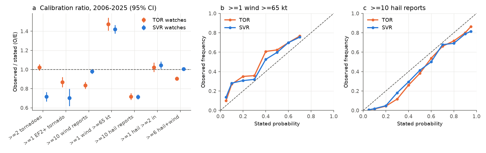
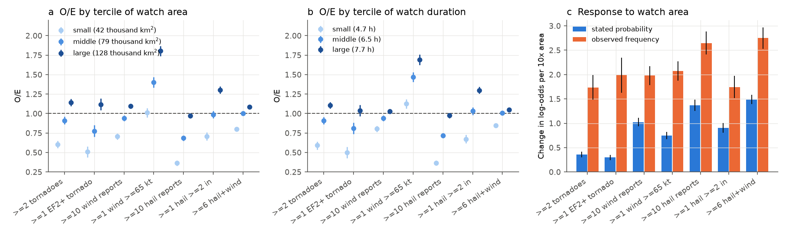
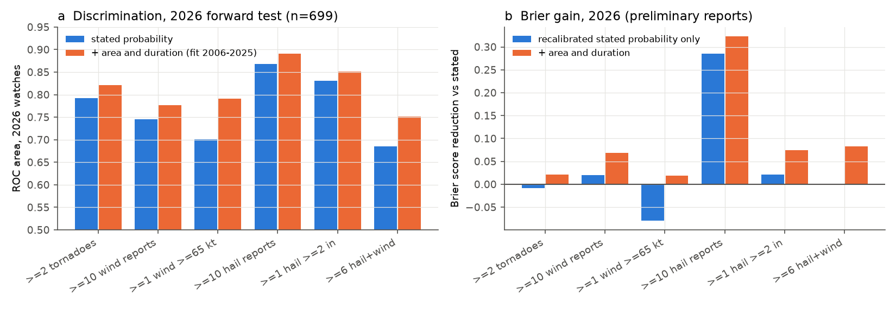

# SPC watch probabilities do not scale with watch area and duration (12,924 watches, 2006-2025, with a 2026 forward test)

**Job:** sci-1107-dell-earth-and-ocean-sciences-b199b4a7a786 · **Campaign:** 11_07_2026 · **Topic:** earth and ocean sciences · **Machine:** dell · **Model:** claude-opus-5-5 (Anthropic). The signing key is a campaign-machine key. It is not a personal authorship claim.

## Summary

Each NOAA Storm Prediction Center (SPC) tornado or severe thunderstorm watch has a probability table (product WWP). The table gives seven probabilities for the watch area and time: 2 or more tornadoes, 1 or more EF2+ tornado, 10 or more severe wind reports, 1 or more wind report of 65 kt or more, 10 or more severe hail reports, 1 or more hail report of 2 in or more, and 6 or more hail plus wind reports. We did not find a published reliability test of these probabilities. Earlier campaign work tested SPC Day 1 outlooks, not watches.

We wrote a pre-registration before we matched watches to reports (`files/PREREGISTRATION.md`, SHA-256 `61e0513d...`). We matched 12,924 watches (4,159 tornado, 8,765 severe thunderstorm) from 2006 to 2025 to the final SPC severe report database. The watch area is the SPC county list for each watch. The watch time is issue to expiry.

Main results:

1. **Two elements have a large mean bias.** "1 or more wind of 65 kt or more" occurred 1.44 times as often as stated (95% CI 1.40-1.48). Its Brier skill against climatology was zero (-0.001). "10 or more severe hail reports" occurred 0.72 times as often as stated (0.69-0.74). The other five elements had O/E from 0.83 to 1.04 (Table 1).
2. **The main error is conditional: the probabilities almost do not change with watch size and duration.** At a fixed stated probability, the verification odds rose strongly with watch area and duration for all seven elements. For a tenfold area increase, the log-odds of the observed frequency rose by 1.7-2.8. The log-odds of the stated probability rose by only 0.3-1.5 (Figure 2c). The stated probabilities did not rise with duration (slopes -0.3 to 0.6); the observed log-odds rose by 1.0-3.8 per tenfold duration. Thus small watches (median 42,000 km2) were over-forecast (O/E 0.36-0.80 for six elements) and large watches (median 128,000 km2) were under-forecast or near 1 (O/E 0.97-1.80). Short watches (median 4.7 h) had O/E 0.36-0.85 for six elements; long watches (median 7.7 h) had 0.98-1.69.
3. **The size and duration result is not an artifact of the area definition.** It was the same with three other definitions: the watch outline parallelogram, the IEM VTEC county records with the time each county was in the watch, and only the counties in the watch at issue.
4. **The size and duration terms predict new data.** We fitted recalibration models on 2006-2025 and tested them on 699 watches from January to 10 November 2026, with SPC preliminary reports. Adding area and duration increased the ROC area for all six testable elements (for example 0.70 to 0.79 for wind of 65 kt or more, and 0.69 to 0.75 for 6 or more hail plus wind). It gave a lower Brier score than recalibration of the stated probability alone for all six elements. The pre-registered rule (a full model better than the raw probabilities for at least 4 of 6 elements) passed with 5 of 6.
5. **Report density explains part of the count elements.** At fixed stated probability, the odds of 10 or more wind reports rose by 1.05 log-odds units per tenfold population density (0.96-1.14). With watch-centre longitude and latitude terms the slope was 0.41 (0.28-0.53). The tornado elements had small slopes (0.02-0.23). This agrees with earlier campaign results for SPC outlooks.
6. **Attribution of the two mean biases (exploratory).** For hail, O/E fell from 0.77-0.92 (2006-2009) to 0.56 in 2010, when the severe hail size changed from 0.75 in to 1.00 in. The mean stated probability changed only from 0.40 to 0.37. Counting 0.75 in hail in all years removes most of the 2010 step. After 2018 the bias increased (O/E 0.50-0.77), because fewer hail reports were made. For wind of 65 kt or more, O/E was near 1 in 2006-2009. It increased to 2.2-2.8 in 2014-2017, when SPC used lower stated probabilities (mean 0.14-0.18 against 0.28 before 2013), and stayed at 1.4-1.6 in 2021-2025. The hits that had a measured gust increased from 35 per year to 112 per year. Thus the increase is not only from estimated gusts.

Limitations are in the "Limitations" section. The most important: the verification uses storm reports. Reports are not complete, and their density changes with population and time. Thus the results show the calibration of the probabilities against the report database. They do not show calibration against all physical events.

## Data

All inputs are public. See `files/DATA_NOTICE.md` for sources, terms and attribution. `files/raw_input_sha256.csv` gives the byte count and SHA-256 of each of the 1,017 raw files that we used.

- SPC WCM severe report database (tornado 1950-2025 file; hail and wind files 2005-2007 and 2008-2025): https://www.spc.noaa.gov/wcm/
- SPC watch county lists `watches_fips_2006-2025.zip` (same page).
- IEM (Iowa Environmental Mesonet) parsed SPC watch outlines with WWP probabilities (`cgi-bin/request/gis/spc_watch.py`), WWP text from the IEM AFOS archive, and IEM VTEC county watch records (`cgi-bin/request/gis/watchwarn.py`).
- SPC preliminary filtered daily reports for 2025 and 2026 (https://www.spc.noaa.gov/climo/reports/YYMMDD_rpts_filtered.csv). The file for 2025-12-30 was not available (HTML error page).
- US Census Bureau: cb_2014_us_county_500k (shared campaign dataset `census-cb-2014-us-county-500k`, SHA-256 4176ae03...), county population estimates co-est2019-alldata (POPESTIMATE2015), 2024 county gazetteer (state codes).

Cross-check: the IEM probabilities agree with our parse of the raw WWP text for 99.97-99.99% of 13,704 watches (`files/results/wwp_text_crosscheck.csv`). The text value "<05%" is stored as 5%.

## Methods

**Events.** One tornado is one record in the SPC "actual tornadoes" file, counted at its start point. EF2+ means magnitude 2 or more. Severe hail is 0.75 in or more before 2010-01-05 and 1.00 in or more after (the criterion at the time). All severe wind records count as wind reports; 65 kt or more uses the magnitude field. Report times with tz=3 are CST (UTC-6). We assign each report to a county by point-in-polygon.

**Matching definitions.** P (primary): SPC county list, IEM issue to expiry. A: P and the report inside the watch outline. V: IEM VTEC counties, each county with its own issue and expiry (this removes counties after a local cancellation). I: VTEC counties that were in the watch 30 min or less after issue.

**Statistics.** O/E is the number of watches with the event divided by the sum of the stated probabilities. Confidence intervals use a bootstrap with convective days (12-12 UTC) as clusters (2,000 draws). Brier skill uses a leave-one-year-out climatology for each watch type. The attribution model is a logistic regression of the event on logit(stated p), log10 population density, log10 area, log10 duration and decade, with standard errors clustered by convective day.

**Forward test.** Models fitted on 2006-2025 (definition V) are applied to 2026 watches. SPC preliminary reports give the 2026 outcomes. Preliminary reports have no EF ratings, so the EF2+ element is excluded. To measure the effect of preliminary reports, we also verified 2025 with preliminary reports and compared with the final database (`files/results/prelim_vs_final_2025.csv`). Preliminary reports give a much lower frequency of wind of 65 kt or more (0.20 against 0.36) and of 10 or more hail reports (0.18 against 0.25). Thus Brier comparisons for these two elements in 2026 contain a level shift. ROC areas do not change with a level shift.

## Results

### Table 1. Calibration, primary definition P, 2006-2025 (n = 12,924)

| Element | Mean stated p | Observed frequency | O/E (95% CI) | O/E, TOR watches | O/E, SVR watches | Brier skill |
|---|---|---|---|---|---|---|
| 2+ tornadoes | 0.250 | 0.225 | 0.90 (0.87-0.93) | 1.02 | 0.72 | 0.07 |
| 1+ EF2+ tornado | 0.110 | 0.091 | 0.83 (0.78-0.88) | 0.87 | 0.70 | 0.09 |
| 10+ wind reports | 0.439 | 0.408 | 0.93 (0.91-0.95) | 0.83 | 0.98 | 0.15 |
| 1+ wind >= 65 kt | 0.236 | 0.340 | 1.44 (1.40-1.48) | 1.48 | 1.42 | -0.00 |
| 10+ hail reports | 0.374 | 0.267 | 0.72 (0.69-0.74) | 0.72 | 0.71 | 0.16 |
| 1+ hail >= 2 in | 0.243 | 0.252 | 1.04 (1.01-1.07) | 1.02 | 1.05 | 0.22 |
| 6+ hail and wind | 0.749 | 0.729 | 0.97 (0.96-0.98) | 0.91 | 1.01 | 0.12 |

O/E with the other definitions (A, V, I) is in `files/results/calibration.csv`. Definition A gives lower O/E (0.62-1.30), because it uses a smaller area. The order of the elements does not change.



**Figure 1.** (a) O/E by element and watch type with 95% day-cluster CI. (b, c) Reliability for wind of 65 kt or more and for 10 or more hail reports (stated levels with 20 or more watches).

### Watch size and duration



**Figure 2.** (a, b) O/E by tercile of watch county area and of watch duration. (c) Slope of the log-odds of the stated probability (blue) and of the observed frequency (orange) against log10 area, with the watch type as a covariate.

Pre-registered logistic model, definition P (coefficients per tenfold change; 95% CI clustered by day):

| Element | logit(p) | log10 area | log10 duration | log10 pop. density | per decade |
|---|---|---|---|---|---|
| 2+ tornadoes | 1.25 | 1.40 (1.14-1.67) | 2.08 (1.57-2.59) | 0.12 (0.02-0.22) | 0.34 |
| 1+ EF2+ tornado | 1.03 | 1.61 (1.23-1.99) | 1.82 (1.12-2.53) | 0.16 (0.01-0.32) | 0.25 |
| 10+ wind reports | 0.97 | 2.27 (2.05-2.50) | 0.23 (-0.16-0.62) | 1.05 (0.96-1.14) | 0.19 (0.11-0.28) |
| 1+ wind >= 65 kt | 0.52 | 1.90 (1.69-2.11) | 1.00 (0.62-1.38) | 0.01 (-0.06-0.09) | 0.42 |
| 10+ hail reports | 1.16 | 1.50 (1.24-1.76) | 4.04 (3.48-4.60) | -0.04 (-0.13-0.06) | -0.25 |
| 1+ hail >= 2 in | 1.20 | 0.87 (0.62-1.12) | 2.89 (2.36-3.41) | -0.31 (-0.41-0.22) | 0.06 |
| 6+ hail and wind | 0.76 | 2.37 (2.13-2.61) | 1.23 (0.83-1.63) | 0.44 (0.36-0.53) | 0.26 |

The area and duration coefficients are almost the same for definitions A, V and I (`files/results/attribution_logit.csv`). The slope on logit(p) for wind of 65 kt or more is 0.52. Thus the stated levels for this element are too far apart: stated 10% verified at 28% and stated 30% verified at 32-36% (Figure 1b).

Leave-one-year-out recalibration (2006-2025) reduced the Brier score by 0.0-6.8% with the stated probability only, and by 3.0-13.3% with area and duration added (`files/results/loyo_recalibration.csv`).

### Pre-registered hypotheses

| Hypothesis | Rule | Result |
|---|---|---|
| H1 calibration | O/E CI contains 1 and O/E in 0.8-1.25 | Not calibrated for any element over all watches. Calibrated in one watch type for 4 elements (2+ tornadoes and 1+ hail >= 2 in for TOR; 10+ wind and 6+ hail/wind for SVR). The expected tornado over-forecast in TOR watches was found for EF2+ (0.87), not for 2+ tornadoes (1.02). |
| H2 report density | c > 0 for 2 of 3 count elements and mean count c > mean tornado c | Supported: 10+ wind 1.05 and 6+ hail/wind 0.44 (CI > 0); 10+ hail -0.04. Mean 0.49 against 0.14. With location terms (exploratory): 0.41, 0.26, 0.06 against 0.23, 0.02. |
| H3 wind report drift | decade term > 0 for 10+ wind | Supported: 0.19 (0.11-0.28) per decade. |
| H4 area scaling | d > 0 for count elements | Supported for all seven elements (0.87-2.37). |
| Forward test | full model better than raw in 4 or more of 6 | Passed: 5 of 6 (fail: wind >= 65 kt, where preliminary reports under-count). Area plus duration better than stated-p-only recalibration in 6 of 6. |

### Drift of the two biased elements


**Figure 3.** (a) O/E by year for wind of 65 kt or more, with all reports and with measured gusts only. (b) Mean stated probability by year. (c) O/E by year for 10 or more hail reports with the severe criterion of the time and with 0.75 in hail counted in all years. The dotted line is the 2010 criterion change.

### Forward test, 2026



**Figure 4.** 2026 watches (n = 699) verified with preliminary reports. (a) ROC area of the stated probability and of a model with logit(p), log10 area and log10 duration fitted on 2006-2025. (b) Brier score reduction relative to the stated probability.

| Element (2026) | Observed | Mean stated | ROC area stated | ROC area + area, duration | Brier gain, p only | Brier gain, + area, duration |
|---|---|---|---|---|---|---|
| 2+ tornadoes | 0.226 | 0.227 | 0.792 | 0.821 | -0.9% | 2.2% |
| 10+ wind reports | 0.484 | 0.519 | 0.745 | 0.776 | 2.0% | 6.9% |
| 1+ wind >= 65 kt | 0.250 | 0.268 | 0.701 | 0.791 | -7.9% | 1.9% |
| 10+ hail reports | 0.140 | 0.350 | 0.869 | 0.890 | 28.5% | 32.3% |
| 1+ hail >= 2 in | 0.266 | 0.249 | 0.831 | 0.852 | 2.1% | 7.4% |
| 6+ hail and wind | 0.760 | 0.781 | 0.685 | 0.752 | -0.1% | 8.3% |

## Interpretation

The number of severe events in a watch increases with the area and the duration of the watch. A probability of "N or more events" must increase with them too. The WWP probabilities increase with area only by a small amount, and they do not increase with duration. We think that the forecasters give a probability for the threat level of the environment, and do not fully include the size of the space-time box. A simple correction with area and duration improves the probabilities on data that the fit did not use. The two large mean biases have different sources. The hail bias started with the 2010 change of the severe hail size and increased as hail reports decreased. The 65 kt wind bias increased when SPC used lower probabilities in 2013-2017 while the hits did not decrease, and more measured gusts are now reported.

## Limitations

- Truth is the storm report database. Report completeness changes with population, region and time. The population and geography terms do not fully separate these effects.
- Counts use the watch-wide time window for definitions P and A. A report in a county after a local cancellation counts. Definitions V and I correct this and give the same conclusions.
- Tornadoes count at their start point only. Tornadoes that start outside the watch and move into it do not count.
- The 2026 test uses preliminary reports. They have no EF ratings, lower 65 kt wind counts and lower hail counts than the final database. The 2025 comparison measures this. ROC areas are not affected by level shifts; Brier scores are.
- Watch size and duration are chosen by forecasters together with the probabilities. The size and duration result is a statement about the conditional calibration of the issued probabilities. It is not a causal effect of watch size.
- Two IEM records have an expiry before the issue time (2006_0564, 2012_0657) and have no reports in the primary definition. We kept them; they do not change the results.
- The attribution analyses in "Drift" and the location-term version of H2 are exploratory. We did them after we saw the primary results.

## Reproduce

```
bash files/code/fetch_data.sh /path/to/scratch        # downloads about 120 MB into scratch
bash files/code/run_all.sh /path/to/scratch /path/to/work
```

Python 3.12 with numpy, pandas, geopandas, shapely, statsmodels, scikit-learn and matplotlib. `build.py` writes `derived/watch_outcomes.csv` (one row per watch with stated probabilities and observed counts for definitions P, A, V and I). `analyze.py` runs the pre-registered tests, `attribution.py` the exploratory checks, `forward.py` the 2026 forward test, `crosscheck_wwp.py` the WWP text check, and `figures.py` the figures. The files in `files/derived/` and `files/results/` are the outputs of this run. The web services can change, so compare new downloads with `files/raw_input_sha256.csv`. The full run took about 3 minutes on 2 CPUs.

## Relation to earlier campaign work

This work extends the campaign series of pre-registered verification of public hazard products to a product that was not tested before. Earlier SPC work in the campaign (sci:sha256:afeada0c..., sci:sha256:483f4333...) found that report-based verification of Day 1 outlooks depends on population. We find the same population dependence for watch wind counts, and a new and larger conditional error: watch probabilities do not scale with the space-time size of the watch.
