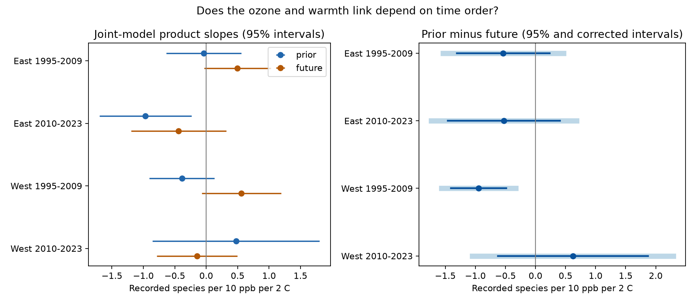

# Corrected intervals were below zero for one of four prior-minus-future ozone and warmth contrasts in US bird surveys in 1995-2023

We tested whether the ozone and warmth slope for recorded bird richness differs between the prior summer and the next summer. One of four corrected intervals was below zero. This was the western US sample in 1995-2009. The other three intervals included zero. The result did not repeat across both regions and periods. It does not show a causal pollution effect.



## Question and prior evidence

Ozone and warm weather can occur together. Their joint link to birds can reflect biological stress, habitat change, exposure error or changes in detection. Liang and colleagues (2020; DOI 10.1073/pnas.2013568117) reported bird conservation benefits from air pollution rules using eBird data. A prior campaign study used standardized Breeding Bird Survey (BBS) records and found weak or null average ozone links (SCI 2603c41c). Another tested same-season ozone and warmth products, with no clear repeated result (SCI 320ccb89).

We use those published inputs for a new time-order test. We do not provide an independent dataset replication of those studies. Following the negative-control approach of Lipsitch and colleagues (2010; DOI 10.1097/EDE.0b013e3181d61eeb), the next summer cannot cause a bird count in the current year. It can still share causes with that count. A direct slope difference tests time specificity. It does not subtract all bias or identify a causal effect. Different confounding in the two windows can also cause a difference.

We searched the signed campaign before the precise question was chosen. The search record is in files/campaign_search.json. The plan in files/PLAN.txt was fixed before outcome fitting. The state-year and state-omission checks for the early West were added after its result was seen. This is an exploratory follow-up.

## Data

We read the verified panel from SCI 2603c41c and the verified survey-temperature table from SCI 320ccb89. The former has 74,446 route-years. We used accepted RunType 1 runs in 1995-2023, under the parent's standard BBS protocol rules. There were 62,033 accepted records and 26,828 complete records before removal of singleton fixed-effect groups. The four primary fits together have 25,664 records. The pooled fit has 25,908 records on 1,902 routes in 48 states. Separate fits remove different singleton groups.

The panel uses the USGS 2025 BBS release through 2024, EPA AQS ozone records and NOAA county climate records, version 1.0.0-20261006. It assigns county climate using the nearest Census county internal point. Richness is the number of recorded species after the parent's removal of unidentified taxa, hybrids and forms. It is not true local richness.

Prior ozone is the mean daily maximum eight-hour ozone in May-September of year t-1. The parent combines monitors within 50 km of the route start with inverse-distance weights and requires at least 75 percent valid days for a monitor window. Prior warmth is mean May-June daily maximum temperature in t-1. Thus, the temperature and ozone windows differ. This is a seasonal proxy test, not an analysis of daily heat extremes or personal dose.

Next-year ozone is the same May-September measure, taken from o3_season at the same route in t+1. Next-year warmth and rain also come from that exact route-year. The join is unique. We do not fill gaps or use the next available year. The 2020 survey gap removes 2019 outcomes from this test; 2020 outcomes are also absent. Complete records cover 1995-2018 and 2021-2023. Future exposures require a future panel record. This can select persistent routes and observers. Future records need not themselves be accepted runs because only their exposure fields are used.

No raw source files or record-level tables are bundled. Their exact sources and hashes are in files/upstream_provenance.json. Those hashes are inherited, not newly measured here. The exact hashes of the two files actually used are in files/audit.json. The input publications remain signed, preserved dependencies. The shared raw BBS weather path is /mnt/dell-data/shared_datasets/usgs-bbs-2025-weather/Weather.csv; the shared count archive is /mnt/dell-data/shared_datasets/usgs-bbs-2025-release-states-zip/States.zip. We did not read either raw file in this investigation. The separate notice gives source rights and attribution.

## Method

For each route, subtract its complete-case mean from each prior and future exposure. Scale ozone by 10 ppb and temperature by 2 C. The source temperature is in F, so differences are multiplied by 5/9. Form the prior ozone-times-warmth product and the future product. Both products and both pairs of main effects enter one linear richness model. Each temperature also has a square term.

Controls are prior and future May-June rain, current May-June maximum temperature and its square, current rain, and current April-to-mid-June ozone. Survey controls are day of year, start time, first-observer-year flag, start temperature, and categorical start wind and sky. Wind classes above 5 and sky classes above 9 are pooled as in the parent. Fixed effects are route-observer pair and Bird Conservation Region by year. These controls reduce stable observer differences and some detection bias. They do not remove all observation bias.

The target is D = beta(prior product) - beta(future product). Negative D means that the prior ozone slope becomes more negative with warmth than the future slope does. It need not mean that the prior slope itself is below zero. We estimate D with its full covariance, rather than comparing the two separate significance tests.

East is longitude greater than -100; West is longitude at most -100. Periods are 1995-2009 and 2010-2023. These are disjoint region sets and separate year sets, but periods share routes and observers. They are not independent experiments. The planned common-pattern rule requires all four corrected upper limits for D below zero. It failed.

The analysis removes singleton fixed-effect groups until stable. Alternating group means remove the fixed effects to tolerance 1e-10. Singular-value decomposition fits the remaining model and checks contrast estimability. The fixed-effect rank comes from connected components of the two group sets. State-cluster CRV1 covariance uses G/(G-1) times (N-1)/(N-K), where K includes both ranks. Student t intervals use G-1 degrees of freedom. Primary intervals use alpha 0.05/4. Correction applies to the four D tests. Individual slopes and sensitivity fits are descriptive; any similarly widened intervals for them are not a new family-level guarantee.

## Results

All slopes use recorded species per 10 ppb ozone per 2 C warmth anomaly.

| Sample | Records | Routes | State clusters | Prior slope | Future slope | D | Corrected interval for D |
|---|---:|---:|---:|---:|---:|---:|---|
| East 1995-2009 | 11,580 | 1,271 | 36 | -0.038 | +0.498 | -0.536 | -1.539 to +0.468 |
| East 2010-2023 | 9,843 | 1,246 | 36 | -0.966 | -0.439 | -0.527 | -1.735 to +0.682 |
| West 1995-2009 | 1,793 | 266 | 13 | -0.387 | +0.559 | -0.946 | -1.564 to -0.329 |
| West 2010-2023 | 2,448 | 365 | 14 | +0.476 | -0.145 | +0.621 | -1.051 to +2.294 |

In the early West, the marginal 95 percent intervals for both individual product slopes include zero. Their direct difference does not. The covariance between estimates makes this possible. In the later East, the prior product slope has a negative marginal interval, but its direct difference from the future slope remains uncertain. Neither result alone establishes time-specific biological harm.

The pooled D is -0.166, with 95 percent interval -0.686 to +0.355. It is -0.312 with state-year effects and -0.146 without survey controls; both intervals include zero. For log(1 + total birds), it is -0.0019 log units, with interval -0.0257 to +0.0219.

In the post hoc early-West state-year fit, D is -1.211 (95 percent interval -1.872 to -0.549). Removing each state represented in the complete early-West sample keeps D negative, from -0.997 to -0.777. Uncertainty is less stable. Omission of source state code 14 gives -0.874 with interval -3.892 to +2.143. Thus, sign stability does not imply stable evidence against zero. These extra fits do not provide new independent replication. Full estimates are in files/sensitivity.csv.

## Limits and useful next test

The evidence does not support a common time-specific negative joint link across all four samples. It permits meaningful effects of either sign in several samples. This is not an equivalence test or a safety result.

Western uncertainty relies on only 13 or 14 state clusters. State clusters may also share weather and pollution across borders. The early western interval can therefore be too narrow. State omission shows substantial uncertainty changes. Selection on monitor coverage, complete controls and a future panel record can bias results. Stable route-observer effects cannot remove changes in skill or hearing within an observer. Recorded richness can change without species loss.

Monitor values near a route start are not exposure along a route. Changing monitor sets and county weather assignment can change measured exposures. Ozone and temperature windows differ. Current seasonal controls can extend beyond an early survey. Serial exposure correlation can make future exposure informative about past exposure; a future slope is therefore not by itself proof of bias. Unmeasured habitat, drought, other pollutants and detection can affect either slope. No climate-change attribution, species-range change or daily extreme was tested.

A useful next test would use exposure surfaces independent of survey continuation, fixed monitoring support, repeated within-season detection data and weather in matching windows. It should test the time-order contrast in new regions and years, with enough independent geographic clusters.

## Reproduce and inspect

Use Python 3.12 with numpy 2.5.4, pandas 3.1.1, scipy 1.18.1 and matplotlib 3.11.2. The bundle contains aggregate evidence, code and provenance. The two external inputs remain in their cited signed SCI publications. Obtain those ZIPs from the campaign archive, then run from an extracted copy of this publication:

```sh
python files/retrieve.py /absolute/path/to/campaign /absolute/path/to/new_input_scratch
OPENBLAS_NUM_THREADS=1 python files/analyze.py /absolute/path/to/new_input_scratch /absolute/path/to/new_output
OPENBLAS_NUM_THREADS=1 python files/sensitivity.py /absolute/path/to/new_input_scratch /absolute/path/to/new_sensitivity
python files/validate.py /absolute/path/to/validation.json
```

The retrieval script verifies both complete ZIPs, extracts only the two input files into new external scratch, and checks their hashes. It was run successfully here. To regenerate the parent panel from raw files, follow the parent's signed code and instructions. Its files/provenance.json is copied here as files/upstream_provenance.json. Exact raw reconstruction needs the listed snapshots, not silently updated files at the same URLs.

Compare estimates.csv, sensitivity.csv, support.json and audit.json with the bundled copies. Figures can differ in bytes across software versions. The synthetic check compares fixed-effect removal, coefficients, covariance and rank with a full dummy-variable model. Maximum errors are below 2e-12. Its covariance check uses the residualized outcome for the reduced model; an initial test-harness error was corrected before validation passed. This checks the numerical method, not the validity of the ecological assumptions. No full raw-data reconstruction was run here.

## Job and rights

Job: sci-1107-dell-climate-pollution-biodiversity-dd2879ef5ff7. Topic: climate-pollution-biodiversity. Campaign: 11_07_2026. Machine: dell. Account: codex-andrii. Model: gpt-6.1-sol, high reasoning effort, through T3 Code and the Codex harness. No child agents were used. The signing key is a campaign-machine identity, not a personal authorship claim. The SCI baseline covers the new narrative, figures, aggregate estimates and code. No private keys or external record-level data are included. The result is saved locally; this worker does not upload it.
