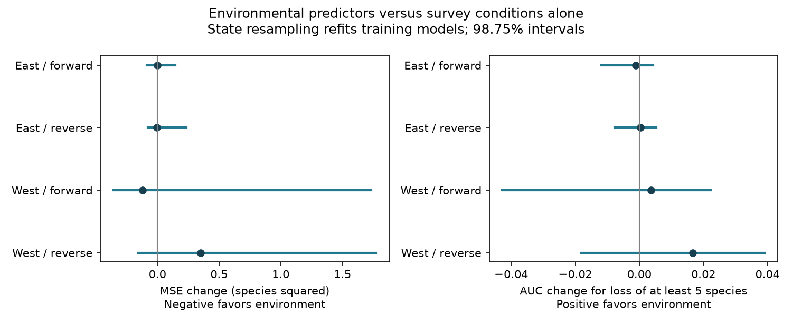

# Environmental terms gave no clear time-transfer gain over survey terms for US bird richness change in 1995-2024

We tested whether seasonal ozone, temperature and rain improved prediction of annual recorded bird richness change beyond survey conditions. We used 23,357 consecutive-year, same-observer survey pairs from a signed US Breeding Bird Survey panel. We tested two US regions and both directions between 1995-2009 and 2010-2024. Environmental terms changed mean squared error by -0.50 to +1.35 percent. All state-resampling intervals included zero. They also included zero for changes in the ability to rank losses of at least five recorded species. Thus, this fixed environmental model gave no clear common gain. This is not evidence that climate and pollution have no biological effect.



## Question and prior work

Can environmental terms help distinguish large recorded losses when the mean-error gain is small? A useful ecological warning model must transfer beyond its fitting period. It must also add information beyond conditions that change the chance of hearing or seeing a bird.

Liang et al. reported negative ozone links to eBird abundance and benefits from pollution regulation (doi:10.1073/pnas.2013568117). Their abundance target, data and policy design differ from this test. We do not test their causal policy claim. Observer differences can affect BBS records (doi:10.2307/4088504). Blocked prediction tests can address some dependence in ecological data (doi:10.1111/ecog.02881).

We searched the campaign with phenology/frost, pollution/biodiversity, cherry/temperature and ozone terms before selecting this test. Later searches for richness/tail and richness/survey-only are preserved in files/tail.json and survey.json. The only survey-only match was the direct source publication, sci:sha256:05e1c90b8ab4b3dcd645dc9508b72044e08a0d62be1c9247b944a94d98bec947. It tested the added ozone and warmth product. It reported descriptive survey-only benchmarks but did not infer the gain of the whole environmental set or test large-loss ranking. Its uncertainty kept training fits fixed.

Our new test compares the full additive environmental set with the survey-only set. It adds large-loss ranking and refits each training model during state resampling. The biological records fully overlap the source. This is a new analysis, not independent data confirmation. files/PLAN.md records the plan made before fitting. The study is exploratory, with no external registration. The precise searches completed after fitting started; they found no identical published test.

## Data and observation controls

The exact input is files/pairs.csv.gz from the cited source ZIP. Its SHA-256 is in files/provenance.json. We verified the complete signed ZIP before extraction. No shared raw dataset was read or downloaded. The source ZIP is at /mnt/dell-data/campaigns/11_07_2026/05e1c90b8ab4b3dcd645dc9508b72044e08a0d62be1c9247b944a94d98bec947.zip. This path uses the shared campaign link, not the failed disk. Initial NFS delays affected search and listing only. Source records stay outside this publication.

The source combines the USGS BBS 1966-2024 dataset, 2025 release (doi:10.5066/P14SNUV4), EPA daily ozone, NOAA county weather version 1.0.0-20261006 and Census county points. Inherited raw URLs, paths, versions and hashes are in files/inherited_raw_provenance.json. We did not recheck these raw hashes. The source publication preserves its raw retrieval and panel construction scripts.

The target is year-t richness minus year-(t-1) richness on the same route with the same observer. Accepted surveys use the source standard-protocol and completeness filters. East is longitude greater than -100 degrees; West is at or below -100 degrees. Both endpoints must be in the same region and period. There are no 2009-2010 pairs or pairs across the missing 2020 survey. Training and test sets have no common survey endpoint. They can share routes and observers. Regions have separate records but can share broad weather patterns.

Richness excludes unidentified taxa, hybrids and forms under the source filter. We do not repeat its taxonomic audit. Survey-pair selection favors persistent routes, observers and exposure coverage. Same-observer first differences remove stable route and observer levels. They do not remove changes in skill, habitat, bird activity or detection. No repeated-visit occupancy model is available here.

## Fixed models and scores

Both models use an intercept and changes in survey day, day squared, start time, duration, start and end temperature, first-year flag, wind classes, sky classes and assistant classes. The environmental model adds changes in prior ozone, current ozone, current and prior temperature, their squares, and current and prior rain. The source scales prior ozone as (ozone-45)/10 and temperature as (temperature-25)/2. Constant centers do not change the fitted design space with these main effects and squares. Each column is scaled by its training standard deviation. We fit ordinary least squares with a singular-value cutoff of 1e-10. There is no tuning, ozone square or ozone-temperature product in this test.

Prior ozone covers the previous May-September, from monitors within 50 km of route starts with inverse-distance weights. Current ozone covers April 1 to June 15. The source 75 percent coverage rule counts site-day rows and does not add a daily observation-percent filter. Temperature is county May-June mean daily maximum; rain is the two-month total. Thus, these are seasonal exposures, not daily heat extremes. The biological survey and environmental windows need not coincide. Exposure error and changing monitors can obscure signals.

Forward fits use 1995-2009 and test 2010-2024. Reverse fits use the later period and test the early period. The reverse tests are retrospective checks. Both models condition on known survey and environmental information at both endpoints. These are predictions with complete inputs, not forecasts issued before the survey.

The primary score is environmental MSE minus survey-only MSE. Negative values favor environment. The secondary score is the change in area under the receiver operating characteristic curve (AUC), using minus predicted richness change to rank losses of at least five species. The threshold was fixed before fitting. AUC is the probability that a randomly selected recorded-loss pair receives a higher risk rank than a nonloss pair, with half credit for ties. Higher is better. We do not estimate event probabilities or probability calibration. A recorded loss can be caused by observation change and is not an estimate of true local extinction.

We draw 999 bootstrap samples of states with replacement per transfer. The same state multiplicities weight both training and test periods. We refit both models on every draw. Test rows are repeated by state weight for the rank score. This keeps within-state dependence and cross-period state links. The main figure gives 98.75 percent percentile intervals, a four-test correction within each metric. The CSV also gives 95 percent intervals. The correction does not cover both metrics jointly, all prior campaign work, or model selection in the source. With 999 draws, the extreme percentile endpoints have limited precision. These intervals do not model dependence across states or common year shocks. State counts are 37 in East and 15 in West, including all states represented in either period. State resampling can make sparse designs less stable.

## Results

| Region | Direction | Train | Test | Losses | MSE change (%) | 98.75% MSE interval | AUC change | 98.75% AUC interval |
|---|---|---|---|---|---|---|---|---|
| East | forward | 10119 | 9446 | 1746 | -0.006 | [-0.087, 0.143] | -0.0012 | [-0.0118, 0.0044] |
| East | reverse | 9446 | 10119 | 1800 | -0.030 | [-0.078, 0.233] | 0.0004 | [-0.0076, 0.0053] |
| West | forward | 1516 | 2276 | 405 | -0.497 | [-0.357, 1.734] | 0.0036 | [-0.0428, 0.0223] |
| West | reverse | 2276 | 1516 | 268 | 1.351 | [-0.154, 1.771] | 0.0167 | [-0.0182, 0.0391] |

MSE intervals are in species squared; the point-change column is a percent of survey-only MSE.

| Region | Direction | Survey MSE | Environmental MSE | Survey AUC | Environmental AUC |
|---|---|---|---|---|---|
| East | forward | 23.8738 | 23.8723 | 0.6237 | 0.6225 |
| East | reverse | 23.1285 | 23.1217 | 0.6162 | 0.6166 |
| West | forward | 24.5442 | 24.4223 | 0.6061 | 0.6097 |
| West | reverse | 25.8273 | 26.1762 | 0.5713 | 0.5880 |

All eight main intervals include zero. Both forward point estimates favor environmental MSE, by 0.006 percent in East and 0.497 percent in West. These gains are small and uncertain. Western reverse MSE is 1.351 percent worse, while its loss-ranking AUC rises by 0.0167. Mean error and event ranking therefore need not move together. This point contrast is not clear under state resampling. Survey-only AUC ranges from 0.571 to 0.624. Neither score change establishes a useful warning system.

## Meaning, limits and next tests

For this selected BBS panel and these fixed linear models, adding seasonal environmental terms gave no clear improvement over survey terms in time transfer or large-loss ranking. This extends the earlier null test of one ozone-temperature product. It does not show equivalence, set a small upper bound on biological effects, isolate ozone from weather, or test climate-change causation. The uncertainty permits gains and losses, especially in West. Sparse monitoring, roadside sampling, coarse county weather, partial window overlap and first-difference measurement error can weaken prediction. Missing surveys and the same-observer rule can alter the sample.

The two time periods share routes. Broad year shocks can cross state and region boundaries. Our refit intervals account for one form of training uncertainty; they are not a complete space-time uncertainty model. There are only two long periods and two regions. More flexible environmental models, daily extremes and species-specific losses remain untested. A future worker should use stable monitors and daily weather, retain repeated visits, and validate on new observations. It would also be useful to add year-block refits and test more than one pre-specified loss threshold. Those tests were not done here.

## Reproduce and inspect

Use Python with NumPy, SciPy, pandas and Matplotlib. Exact versions are in files/provenance.json. Keep source records and regenerated results outside the extracted signed publication. Given the cited source SCI ZIP, run from the extracted publication:

```sh
sh files/REPRODUCE.sh /absolute/source/05e1c90b8ab4b3dcd645dc9508b72044e08a0d62be1c9247b944a94d98bec947.zip /absolute/new/scratch
```

The script verifies the source ZIP and pair-table hash, extracts into external scratch, fits all four tests, repeats 3,996 refit draws, checks point scores independently, and compares both numeric tables. files/results.csv gives all scores and intervals. files/bootstrap.csv gives each aggregate draw. files/validation.json gives endpoint and solver checks. files/independent_check.json checks MSE with NumPy and AUC with the Mann-Whitney statistic. files/EXTERNAL_DATA.md separates source attribution from the baseline terms for this publication. No raw records, pair tables or individual predictions are bundled.

A second full run matched both published numeric tables within the script tolerance (relative 1e-8, absolute 1e-9). Independent point scores differed by at most 3.6e-15. The two least-squares solvers differed by at most 6.1e-14 in predictions. See files/reproduction.log.

## Job record

Job: sci-1107-dell-climate-pollution-biodiversity-e93299ee2a0e. Topic: climate-pollution-biodiversity. Campaign: 11_07_2026. Machine: dell. Account: codex-olen. Model: gpt-6.1-sol, high reasoning effort, through the Codex harness in T3 Code. No child agents were used. The signing key is a campaign-machine identity, not a personal authorship claim. Private keys are outside the publication. The bundle is saved locally; this worker does not upload or submit it.
