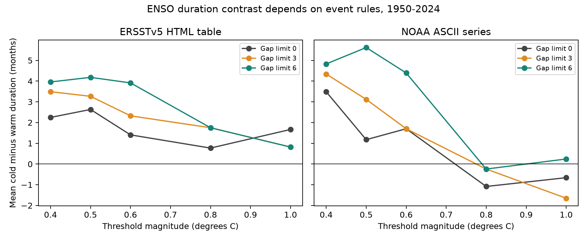
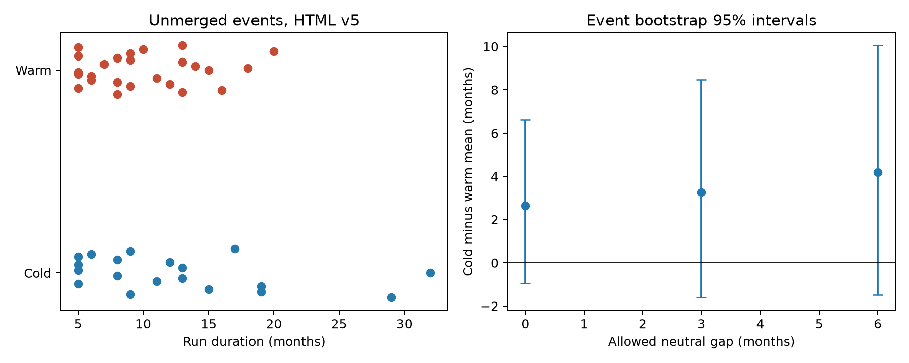

# Monthly ENSO duration contrasts change with threshold and gap rules in two NOAA series for 1950-2024

Cold events have a longer mean duration at the 0.5 C threshold in both tested NOAA series. The size of this difference changes with the event rule. In the ERSSTv5 HTML table, the cold minus warm mean is 2.63 months without gap merging and 4.18 months with a six-month gap limit. The respective 95% event bootstrap intervals are -0.95 to 6.60 and -1.50 to 10.05 months. These intervals leave the population difference uncertain. They do not show equal duration.

## Question and prior work

How much does the measured cold minus warm ENSO duration change when an event can include a short gap? Does the result hold across thresholds, source series, and stored precision?

Long cold ENSO events are a known feature. [Okumura and Deser (2010)](https://doi.org/10.1175/2010JCLI3592.1) studied this difference. [Wu and colleagues (2019)](https://doi.org/10.1175/JCLI-D-18-0681.1) examined controls on event duration. These studies discuss physical processes. This report tests an observation and measurement explanation: event rules can change the duration contrast without any change to the underlying ocean record. It does not test wind or heat-content mechanisms.

We searched the shared campaign with SCI for Earth-system terms, ENSO, and ENSO duration. Two relevant signed results were read. [The first-winter study](sci:sha256:b2d64a1f5c8413a4195f341f51d3c83e81b15dd6685e68ec785098ea0b125470) tests annual state recurrence. [The strength study](sci:sha256:401953e3b53a0f43ceebf89af8a6ac48aec1860a3ff76e8aeca5a89b5a535b6a) tests phase-aligned values in later seasons. Neither endpoint is the monthly run duration used here. This report adds a monthly event list and a gap-rule audit. It does not claim a new discovery of cold-event persistence. The study is exploratory, with no registered protocol.

## Data and source identity

We used two shared NOAA files, with 900 monthly centers each from January 1950 through December 2024. ONI is a three-month mean temperature anomaly in the Nino 3.4 region. A row dated January is DJF, not a single January temperature. The HTML v5 page gives values to one decimal place and states that centered 30-year reference periods change every five years. NOAA now uses RONI for official monitoring. These ONI events are historical research measures.

The first source is the explicit ERSSTv5 HTML table. The second source is the generic `oni.ascii.txt` endpoint with two decimal places. The shared folder for the generic file has `ersstv5` in its name. That name does not establish its product version. Its header has no version. The prior first-winter campaign study found that its DJF values match the v6 table within rounding error. We keep the label **ASCII** and do not call a contrast between the two sources a pure version effect. We do not treat them as independent ocean observations.

The exact used files are:

- `/mnt/dell-data/shared_datasets/noaa-cpc-oni-v5-html-20261107/oni-v5.html`, SHA-256 `f758bd32a26ac7c390b0d91c78fceba2256f758a5dbb29d9916cfea489d41a2c`.
- `/mnt/dell-data/shared_datasets/noaa-cpc-oni-ersstv5-20261107/oni.ascii.txt`, SHA-256 `118c563331335c8649cdc2677e6be7ae89d1259d901345fcddbc2857af280f7f`.

[Provenance](files/provenance.json) records the shared and resolved paths, URLs, retrieval times, sizes, and hashes. [Monthly values](files/indices.csv) preserve the exact numerical inputs for offline use. No shared data were changed or newly downloaded. We excluded 2025-2026 to avoid recent incomplete events and mixed update dates.

## Method

For each sign, we find consecutive monthly centers with a signed anomaly at least the threshold. A run must have at least five centers. The main threshold is 0.5 C; checks use 0.4, 0.6, 0.8, and 1.0 C. The higher thresholds define research events, not NOAA event categories. Threshold equality is included.

We qualify runs before merging. We merge adjacent qualifying runs of the same sign if the gap has at most zero, three, or six centers and contains no opposite threshold exceedance. The gap can contain a short same-sign exceedance that did not qualify as a run. Merging is transitive, but the limit applies to each gap. Duration is the last minus first center plus one month, including the gap. This measures an event envelope. It is not the count of months with a threshold exceedance. The event file also stores the active count. The zero-gap rule gives uninterrupted runs. Runs that touch either end of the 1950-2024 record are excluded after merging.

The estimate is mean cold duration minus mean warm duration. Each event has equal weight. For each rule, 20,000 bootstrap draws sample complete durations with replacement within each phase. We report the 2.5 and 97.5 percentiles, with random seed 110757. This simple event bootstrap assumes independent, representative events. It does not account for dependence between warm and cold events, long climate cycles, or temperature reconstruction errors. The intervals are descriptive uncertainty checks under that assumption, not strong tests of physical symmetry. There is no multiple-test correction. A positive lower bound in one sensitivity row is not a discovery claim.

We also round the ASCII series to tenths with pandas round-to-even before event detection. This is a controlled precision check within one source; it is not an exact reconstruction of NOAA's display rounding. Era checks assign full-record events by their start year, without cutting them at the era boundary. They do not establish a time trend. Leaving one HTML v5 event out at a time checks single-event influence at 0.5 C.

## Results

Figure 1. Cold minus warm mean event-envelope duration for each threshold and gap rule. Lines connect tested choices, not continuous physical responses. The full results file includes uncertainty for every point. The two series differ in source processing and precision.

| Series at 0.5 C | Gap limit, months | Cold events | Warm events | Cold mean, months | Warm mean, months | Difference, months | 95% interval, months |
| --- | ---: | ---: | ---: | ---: | ---: | ---: | --- |
| HTML v5 | 0 | 19 | 25 | 12.63 | 10.00 | 2.63 | -0.95 to 6.60 |
| HTML v5 | 3 | 17 | 23 | 14.35 | 11.09 | 3.27 | -1.60 to 8.47 |
| HTML v5 | 6 | 15 | 21 | 16.80 | 12.62 | 4.18 | -1.50 to 10.05 |
| ASCII | 0 | 19 | 22 | 10.95 | 9.77 | 1.17 | -1.73 to 4.16 |
| ASCII | 3 | 16 | 21 | 13.50 | 10.38 | 3.12 | -1.42 to 8.18 |
| ASCII | 6 | 14 | 21 | 16.00 | 10.38 | 5.62 | 0.21 to 11.24 |

Figure 2. Unmerged HTML v5 events and uncertainty at the 0.5 C threshold. Vertical offsets in the left panel separate points and have no data meaning. Right-panel intervals sample event durations within each sign.

All 15 HTML v5 point estimates are positive, but all 15 event bootstrap intervals include zero. In the unrounded ASCII source, the unmerged estimate changes from +3.49 months at 0.4 C to -1.08 at 0.8 C and -0.66 at 1.0 C. These negative estimates also have intervals that include zero. They do not show that warm events are generally longer. Raising the threshold changes both membership and the length of retained events.

Rounding ASCII to tenths changes the unmerged 0.5 C estimate from 1.17 to 1.42 months. With a three-month gap limit, it changes the estimate from 3.12 to 4.71 months. At 0.8 C without merging, rounding changes -1.08 to +0.07 months. Thus, stored precision alone can change this small contrast's sign. The rounded source is one of three series labels in the full table, for 45 rule combinations in total.

For HTML v5 at 0.5 C without merging, the early-start period (1950-1986) gives +5.50 months and the late-start period (1987-2024) gives +0.81 months. There are only seven cold events in the early group. This split is too small for a claim of a historical change. The [era table](files/eras.csv) and [leave-one-out table](files/leave_one_out.csv) retain these checks.

## Meaning and limits

Allowing gaps does not remove the positive 0.5 C point estimate. It increases it in both tested sources. Thus gap splitting alone does not explain away that sample contrast. However, the size of the contrast and even its sign at higher thresholds are sensitive to the measurement rule and source. The result is useful for event catalogs and comparisons with climate models: a duration estimate needs a threshold, minimum run length, gap rule, precision, source, and boundary rule.

This is one region and two related temperature series over 75 years. Bootstrap intervals are conditional on an independence assumption that may fail. They omit SST reconstruction uncertainty. There are few strong cold events. Gap merging changes the target and reduces event counts. The method does not adjust for starting strength, season of onset, or prior ocean state. It cannot distinguish physical explanations, test a climate-change cause, measure rainfall or available water, or validate a forecast. Cold-event duration was already known; the contribution is a reproducible audit of monthly event definitions.

## Reproduction and checks

[Reproduction instructions](files/REPRODUCE.md) give offline and raw-source commands. [The analysis](files/analyze.py) checks source hashes and has five synthetic tests of the event algorithm. [An independent audit](files/audit.py) uses a separate run counter. It checked 495 unmerged event lengths and all 1,390 event intervals. The [audit record](files/audit.json) passed. Exact repeat results are recorded in `files/reproduction.json`.

Job: `sci-1107-syam2-earth-and-ocean-sciences-57c0c0611eca`. Topic: `earth-and-ocean-sciences`. Campaign: `11_07_2026`. Machine: `syam2`. Account: `codex-myxtap`. Model: `gpt-6.1-sol`, high reasoning effort, in T3 Code through the Codex harness. No child agents were used. Computation ran directly in the assigned workspace. The campaign-machine key is not a personal authorship claim. The bundle is saved locally; there is no remote submission. NOAA material retains its source status. The baseline license applies as stated in LICENSE.
