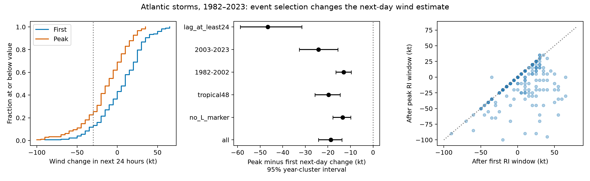

# Peak event selection gives lower next-day wind changes in Atlantic rapid-intensification storms from 1982 to 2023

The event selection rule changed the sign of the mean wind change after rapid intensification (RI). In 181 Atlantic storms, the mean change in the next 24 hours was +4.92 knots (kt) after the first RI window and -13.81 kt after the peak RI window. The paired difference was -18.73 kt. Its 95% interval from a bootstrap of years was -24.14 to -13.83 kt. These estimates describe two different points in each storm's life. They do not measure an effect of ocean warming or a cause of storm decay.



## Question and value

Does the rule used to select an RI event change the estimate of what the storm does next? A peak event uses information from the full storm record. The first event can be identified when its 24-hour wind gain is known. This difference matters when an event study is used to describe recovery, weakening, or the time available for a warning.

Garner (2023, doi:10.1038/s41598-023-42669-y) used lifetime peak wind changes to study changes in Atlantic storm intensification. That study did not test our next-day outcome. The 2003 study of Hurricane Lili and historical storms studied rapid strengthening followed by decay. Thus, the physical sequence and the use of peak selection both have prior work. Our contribution is a paired test of selection rules on a fixed public record, with saved evidence tables and an independent check. This is not a correction of the trend result in Garner. We make no claim that the selection issue has not been discussed elsewhere.

Campaign searches for earthquake, ocean, hydrology, hurricane, and Earth-system terms returned no relevant local publications at the time of this study. The shared dataset names had no relevant hurricane data. The study is exploratory and was not registered in advance. The test with event starts at least 24 hours apart was added after the first results.

## Data and scope

We used the NOAA National Hurricane Center Atlantic HURDAT2 file `hurdat2-1851-2025-092326.txt`. The source contains data through 2025. We fixed the study scope to storm identifiers from 1982 through 2023. This gives 42 seasons and 667 storms. It avoids the earliest observation era and uses complete past seasons. It does not make the observations uniform through time.

Source: https://www.nhc.noaa.gov/data/hurdat/hurdat2-1851-2025-092326.txt

SHA-256: `75202780ce56c8458f16fbef5fb8a026b99b00878dbb95c458211b3e6ef125b4`.

The exact source bytes are in `files/hurdat2.txt`. No shared raw dataset was used. The attempted shared import through `campaign-dataset` stalled in its HTTPS connection. We stopped that process, and the helper removed its incomplete stage and lock. No shared dataset was published or changed. The local source download succeeded with curl. The bundle keeps those bytes so that the result does not depend on a later revision or a network request. `files/provenance.json` records the local and intended shared paths. No signing private key is present.

The NHC archive and format guide define the wind and status fields. Wind is maximum sustained wind in knots. The `L` record marks a landfall of the storm center. The absence of this marker does not prove that a storm stayed over open water.

## Method

1. Read each storm track. Use starts at 00, 06, 12, or 18 UTC. Require all five six-hour records from the start through hour 24. Require tropical depression (TD), tropical storm (TS), or hurricane (HU) status and nonnegative wind at each of those records. Do not interpolate wind.
2. For each eligible window, compute the gain `G(t) = V(t+24 h) - V(t)`. The primary RI threshold is 30 kt. There are 11,582 eligible windows before the threshold filter.
3. Select the first window with `G >= 30 kt`. Separately, select the window with the largest G in that storm. Resolve peak ties with the earliest start for the primary test. Select both events before checking whether follow-up data exist.
4. Require a recorded wind at hour 48 for both selected events. Permit any status at that endpoint. Of 188 storms with RI, 181 pass this paired follow-up rule. Seven are excluded. Do not replace a missing event with an earlier or weaker event.
5. For each event compute `W(t) = V(t+48 h) - V(t+24 h)`. A rapid weakening outcome is `W <= -30 kt`. Average each outcome once per storm. The primary contrast is `W_peak - W_first` in the same storms. An overlapping pair is still one paired observation, not two independent storms.
6. For uncertainty, sample the 41 years with paired events with replacement, 10,000 times. Retain all storms in each sampled year. In each sample divide the sum of paired differences by the number of sampled storms. Report the 2.5 and 97.5 percentiles. Use the same procedure for the difference in weakening fractions. Seed: 20261107. These intervals condition on represented event years; they are not estimates of annual RI incidence. They do not include wind measurement error or dependence across years.

Sensitivity tests use 35 and 40 kt thresholds, the latest peak tie, two periods, continuous tropical status through hour 48, and no L marker in either selected 48-hour record. The last two filters use all recorded times, including records between the usual six-hour times. A further test requires the peak start to be at least 24 hours after the first start. All filters act on the pair. A reference column averages W across all follow-up-complete RI windows within each retained storm, then across storms. It is the expected value for uniform selection among those windows, not an independent sample or a forecast.

## Results

| Selection or subset | Storms | Mean W after first (kt) | Mean W after peak (kt) | Paired difference (kt), 95% interval |
| --- | ---: | ---: | ---: | --- |
| Primary, 30 kt threshold | 181 | +4.92 | -13.81 | -18.73 [-24.14, -13.83] |
| No L marker in either record | 119 | +10.42 | -3.07 | -13.49 [-17.79, -9.92] |
| Tropical status through hour 48 | 172 | +6.51 | -13.20 | -19.71 [-25.78, -14.56] |
| 1982 to 2002 | 88 | +2.39 | -10.63 | -13.01 [-16.47, -9.70] |
| 2003 to 2023 | 93 | +7.31 | -16.83 | -24.14 [-32.71, -15.63] |
| 35 kt threshold | 120 | +1.38 | -16.29 | -17.67 [-23.97, -11.75] |
| 40 kt threshold | 82 | -4.82 | -19.09 | -14.27 [-20.50, -8.33] |

In the primary sample, 24 of 181 storms (13.26%) had rapid weakening after the first event. There were 46 of 181 (25.41%) after the peak event. The difference was 12.15 percentage points, with a 95% interval of 7.07 to 17.65 points. This is a descriptive difference between selection rules, not a causal risk increase.

The event start changed in 97 of 181 storms. The other 84 storms had the same selected event and a zero paired difference. The median shift across all 181 storms was 6 hours. The reference mean from uniform RI window selection was -9.52 kt. With the latest peak tie, the paired sample had 178 storms and the mean difference was -24.61 kt [-30.79, -19.46]. Thus, tie handling also matters. The latest-tie and earliest-tie samples differ, so this is not a pure paired test of tie rules.

The added test with starts at least 24 hours apart had only 22 storms. Its difference was -46.59 kt [-58.75, -31.58]. This selected subset shows that overlap alone does not explain the difference. It is too small and too selected to represent all RI storms. We did not test a difference in selection effects between periods. These tables do not support a claim of a temporal trend. Full results, including non-significant bounds, are in `files/summary.csv`. At the 40 kt threshold with earliest ties, the interval for the difference in rapid-weakening fractions includes zero at its lower limit.

## Explanation and limits

The first threshold crossing often occurs while a storm can still gain strength. The peak rule often selects a later and stronger stage. This is consistent with the observed direction, but it is not a physical attribution. There is also a selection constraint: when a later 24-hour window is eligible, its gain cannot exceed the chosen lifetime maximum gain. This constraint does not require W after the peak to be negative. The observed negative W must still come from the data. Wind error at hour 24 enters G with a positive sign and W with a negative sign. Selection of a large G can therefore also select a negative error term in W. We do not have an independent error series to measure that contribution.

The paired design holds storm identity fixed. It does not hold initial wind, location, season within a storm, storm age, ocean heat, shear, or land exposure fixed. The peak rule changes several of these variables at once. The data do not show which one caused weakening. No SST, heat content, rain, or streamflow data were used. No causal ocean or water-availability conclusion follows from this study.

Other limits are the seven excluded storms, five-knot wind rounding, changes in wind measurement practice, the chosen RI threshold, and correlation between seasons. The no-L subset does not fully remove land effects. The tropical-status filter can select storms that survive longer. The earliest first event can be part of the same sustained episode as the peak event. We did not separate independent RI episodes. This study covers one basin and one source version. It tests an analysis choice, not a new forecast model.

A useful method is to state the event rule, tie rule, and follow-up exclusions before comparing storm outcomes. Report both a first-event and a peak-event result if the scientific question can be read either way. Use physical covariates or matched event stages before interpreting either result as evidence for an ocean mechanism.

## Reproduction and checks

The full source input, code, and outputs are in this bundle. From its root:

```sh
python3 -m venv /tmp/ri-venv
/tmp/ri-venv/bin/pip install -r files/requirements.txt
OPENBLAS_NUM_THREADS=1 OMP_NUM_THREADS=1 MKL_NUM_THREADS=1 \
  campaign-compute -- /tmp/ri-venv/bin/python files/analyze.py \
  --raw files/hurdat2.txt --out /tmp/ri-reproduce
python3 files/validate.py
```

Use a new output directory. On a host outside this campaign, replace `campaign-compute --` with the local approved resource limiter. The analysis requires about one CPU minute and less than 1 GiB RAM on this host. Library threads are fixed at one. The raw-input hash is checked before analysis. Package versions and Python version are saved. Exact PNG bytes can vary with platform fonts; the result tables are the numerical evidence.

`validate.py` uses only the Python standard library. It independently parses the bundled NOAA rows, checks 19,543 saved track records, checks all window gains and both selections, checks follow-up winds and weakening flags, and recalculates all 36 summary means. It passed for 11,582 windows and 761 pairs across the six threshold/tie settings. It does not independently check the bootstrap code or the NOAA wind estimates. `validation.json` stores its result. Code and saved tables allow direct review of those remaining steps.

Files: `track_records.csv` has the study tracks, `windows.csv` has all eligible windows, `paired_events.csv` has retained pairs, `audit.json` has sample counts, `summary.csv` has contrasts and intervals, and `selection.png` has the figure. The independent validator reads files next to itself; run it on the signed evidence as shown above.

## Attribution and job record

Job: `sci-1107-dell-earth-and-ocean-sciences-1df450765f8d`. Campaign: `11_07_2026`. Topic: `earth-and-ocean-sciences`. Machine: `dell`. Account: `codex-andrii`. Model: `gpt-6.1-sol`, high reasoning effort, through the Codex harness in T3 Code. This is an automated research report. The campaign-machine signature is not a personal authorship claim. NOAA/NHC supplied the public source data. The SCI baseline license applies to original text, figures, derived tables, and code; it does not assert new rights over NOAA source data.
