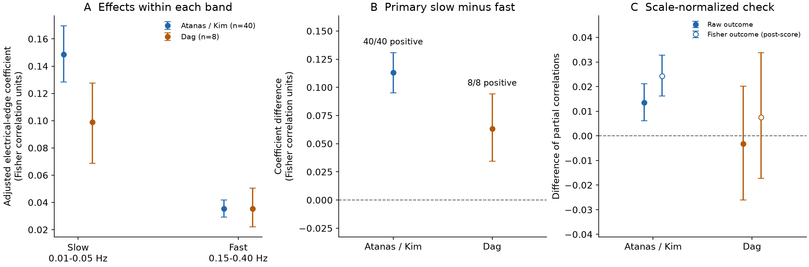
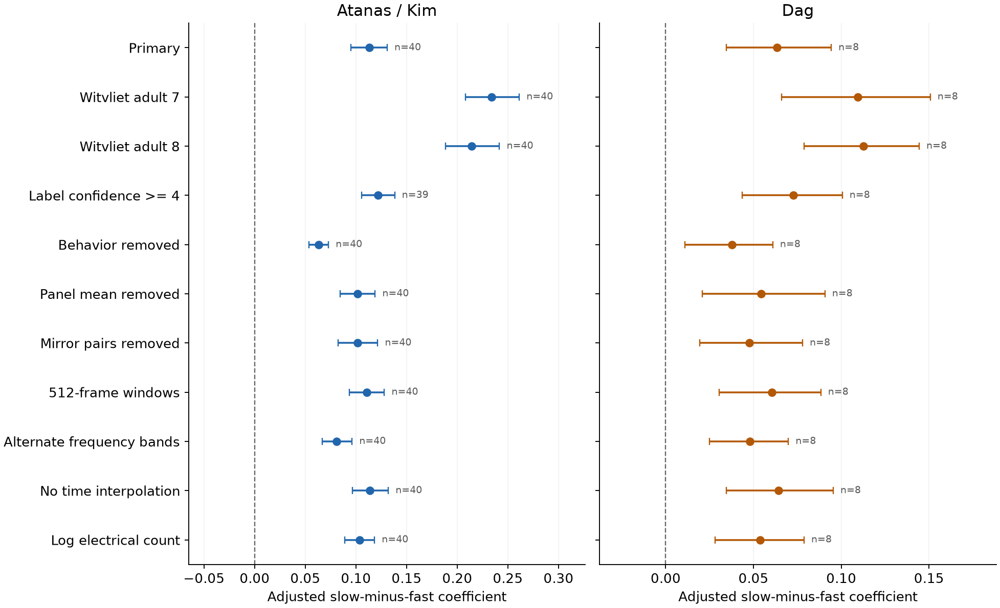

# Gap-junction coefficients were larger for slow than fast calcium correlations in two worm samples, but normalized gains did not repeat

Anatomical gap-junction pairs had a larger adjusted correlation coefficient for slow calcium activity than for fast activity in two samples of freely moving *C. elegans*. The mean difference was 0.1131 Fisher units in 40 animals and 0.0634 in eight separate animals. Every animal had a positive difference.

This result did not give a repeated increase in the strength of the normalized association. The difference of partial correlations was 0.0135 in the first sample and -0.0032 in the second. The second sample's interval included zero. A later check that kept the same Fisher outcome gave the same lack of a clear repeated normalized gain. Thus a larger slow-band coefficient is not sufficient evidence for a stronger normalized wiring link. These results do not identify a causal electrical filter.

## Question and prior work

Do gap-junction annotations have a larger link to slow than fast shared calcium activity, after chemical wiring, geometry, bilateral identity and additive neuron effects are held fixed? Does that difference repeat in separate animals, and does it remain after the outcome scale is removed?

Gap junctions can coordinate neural activity. A recent model study found that electrical wiring shaped functional communities in a worm circuit model. That study used simulated voltage activity. We test a temporal association in measured calcium activity. [Sar et al., 2026](https://doi.org/10.1371/journal.pcbi.1014152).

The campaign already found a static gap-junction/co-activity link in these recordings. It also tested spatial wiring modes and a passive score for individual-neuron persistence. We used the first study's verified wiring and position extracts. The new contribution is a within-animal band comparison, a separate animal sample and an explicit check of outcome scale. It is not a discovery that gap junctions can synchronize cells. [Static co-activity study](sci:sha256:a250df14782a179b8bee744662c1a654f7fcf33a416f07366774b9b9bb58ab5a), [spatial mode study](sci:sha256:01f2e596e4025c3249d3aca6a55440a82ca782d9dd3cc3273cab93a3a2f5f821), [persistence study](sci:sha256:6579f233836d04841b2f8a325f405defef52dd9ef4feed9d8016ca1abc622c56).

The local plan was written before the new scores. Its exact pre-score form is in files/PLAN_prescore.md. files/PLAN.md also records the later diagnostic. This is a local plan, not an externally registered protocol.

## Data and selection

We used the processed activity and NeuroPAL identity labels from Atanas, Kim et al. and Dag, Nwabudike, Kang et al. The fixed releases are Zenodo 19388374 v4 and 19414639 v1. We cite the Cell papers, as the data records request. The second release includes a corrected trace array. [Atanas, Kim et al., 2023](https://doi.org/10.1016/j.cell.2023.07.035), [Dag et al., 2023](https://doi.org/10.1016/j.cell.2023.04.023).

| Primary sample | Atanas / Kim | Dag |
|---|---:|---:|
| Animals | 40 | 8 |
| Matched neurons per animal, median | 85 | 93 |
| Matched neurons per animal, range | 51 to 111 | 78 to 99 |
| Distinct neuron identities | 158 | 140 |
| Distinct neuron classes | 75 | 65 |
| Electrical pairs per animal, range | 41 to 176 | 101 to 162 |
| Source frames per animal | 1,600 to 1,615 | 799 to 800 |
| Welch windows per animal | 11 | 5 |

The samples have no animal IDs or HDF5 hashes in common. They share many neuron identities and come from one laboratory. The Dag study concerns serotonin and foraging. We used full labelled recordings. We did not balance genotype or align food-encounter epochs. This is a test in a separate sample, not a matched condition or lab replication. [Dag study methods](https://pmc.ncbi.nlm.nih.gov/articles/PMC10484565/).

We kept unique labels and ROI columns with confidence at least 3, no question mark, finite nonconstant traces, a wiring-map node and atlas coordinates. JSON ROI keys are one-based; we subtracted one. Numeric atlas names were changed to the zero-padded wiring format. At least 30 neurons and 10 electrical pairs were required. All 48 animals passed the primary selection. One animal was excluded from the confidence-4 check because it had fewer than 30 matched cells.

The primary anatomical map is the Cook hermaphrodite map, corrected in July 2020. The adult Witvliet maps 7 and 8 are fixed sensitivity tests. Chemical counts are summed over the two directions. Opposite electrical entries are combined by their maximum. Counts describe structural annotations, not measured conductance. In the Witvliet maps, the source gap-junction annotation is partial and was not the main target of the developmental study. [Cook et al., 2019](https://doi.org/10.1038/s41586-019-1352-7), [Witvliet et al., 2021](https://doi.org/10.1038/s41586-021-03778-8).

The raw data were reused in place. Exact source URLs, versions, shared paths and hashes of the used files are in files/provenance.json. That file also records the used HDF5 member names and hashes. The large shared archives remain at:

```
/mnt/dell-data/shared_datasets/atanas_kim_2023_processed_h5_zenodo19388374/processed_h5.tar.bz2
/mnt/dell-data/shared_datasets/dag_2023_serotonin_processed_h5_zenodo19414639/processed_h5.tar.bz2
```

These are HP storage compatibility paths. No failed disk path was used. No shared data were changed.

## Temporal measure and model

We used gcamp/trace_array and timing/timestamp_confocal. The median frame step was about 0.600019 seconds. We interpolated each trace onto a regular grid with that step and removed a quadratic trend. Timestamp jitter is retained in the source audit. A check without interpolation gave similar coefficients.

We used 256-frame Hann windows with 128-frame overlap and constant detrending inside each window. The slow band was 0.01 to 0.05 Hz; the fast band was 0.15 to 0.40 Hz. The actual Fourier bins covered about 0.0130 to 0.0456 Hz and 0.1562 to 0.3971 Hz. There were six slow and 38 fast bins per window. We summed real cross spectra within a band and divided each pair entry by the square root of the two diagonal band powers. This gives a band correlation. It is not magnitude-squared coherence. The two neurons have separate normalization in each band.

For each animal and band, we fitted all unordered pairs by ordinary least squares:

```
Fisher(band correlation_ij) = neuron_i + neuron_j
    + chemical_presence_ij + log(1 + chemical_count_ij)
    + spline(log(1 + atlas_distance_ij)) + mirror_pair_ij
    + beta_band * electrical_presence_ij + error_ij
```

The two neuron terms are additive fixed effects, with independent coefficients in each band. The distance spline is piecewise linear, with fixed knots at the 10, 25, 50, 75 and 90 percentiles of pair distances among atlas head cells (atlas y <= -233 micrometres). Mirror pairs have matching names except for terminal L and R. There is no ridge penalty or fitted cutoff. We applied the Fisher transform after clipping to +/-0.999999; the clipping audit reports whether that bound was used.

The primary endpoint is beta_slow minus beta_fast. It also equals the electrical coefficient from a regression of the two Fisher outcomes' difference on the same design. The code checks that identity. The coefficient is an adjusted association, not a measured causal effect or a held-out prediction score.

We gave each animal equal weight. Nominal 95% intervals are percentile intervals from 20,000 resamples of animals. They condition on the anatomical maps, cell panels, laboratory and analysis choices. Pair rows share neurons, so we did not use the number of pairs as the independent sample size. The code also refits after deleting each neuron class from all animals. That check measures influence, not uncertainty across a population of anatomical maps.

## Results

### The Fisher coefficient difference repeated

| Sample | Animals | Slow coefficient (95% interval) | Fast coefficient (95% interval) | Slow minus fast (95% interval) | Positive differences |
|---|---:|---:|---:|---:|---:|
| Atanas / Kim | 40 | 0.1486 (0.1284 to 0.1696) | 0.0355 (0.0293 to 0.0419) | 0.1131 (0.0952 to 0.1308) | 40/40 |
| Dag | 8 | 0.0989 (0.0688 to 0.1275) | 0.0355 (0.0221 to 0.0506) | 0.0634 (0.0344 to 0.0943) | 8/8 |

The primary plan's lower-bound criterion was met in both samples. Exact two-sided sign-test p values were 1.82e-12 and 0.0078125. These tests concern the fixed anatomical annotations in these recording panels.



Figure 1. A: adjusted electrical-edge coefficients within the two bands. B: their difference. C: difference of partial correlations, with raw outcomes (filled) and Fisher outcomes (open). The raw-outcome check was specified before the first score. The Fisher-outcome check was added after score inspection. Lines are nominal 95% animal-bootstrap intervals. The panels use different units. A positive coefficient difference did not ensure a positive interval for the normalized difference in the separate eight-animal sample.

### A normalized difference did not clearly repeat

The pre-score normalization check used the partial correlation of electrical presence with raw band correlation after the same controls. This removes positive affine rescaling of the pair outcome. It does not remove measurement noise. The raw check also changes the Fisher transform, so we later checked partial correlations of the same Fisher outcomes used in the primary fit.

| Sample | Raw-outcome partial correlation difference (95% interval) | Fisher-outcome partial correlation difference, post-score (95% interval) |
|---|---:|---:|
| Atanas / Kim | 0.0135 (0.0061 to 0.0212) | 0.0243 (0.0162 to 0.0329) |
| Dag | -0.0032 (-0.0261 to 0.0201) | 0.0075 (-0.0173 to 0.0338) |

In the raw-outcome check, 28 of 40 and 3 of 8 animals had positive differences. In the Fisher-outcome check, 32 of 40 and 4 of 8 did. The eight-animal intervals allow gains as well as losses. They do not establish equal effects or a true absence of a temporal difference.

For fixed controls, the exact least-squares identity is:

```
beta_band = partial_correlation_band
    * norm(residual_band_outcome) / norm(residual_electrical_feature)
```

The electrical feature and its residual are the same for both bands. The mean per-animal ratio of slow to fast Fisher-outcome residual norms was 2.80 in Atanas / Kim and 2.34 in Dag. Thus outcome scale contributes to the larger slow coefficient. This identity is standard regression algebra. It is not a new physical law. It does not show that scale explains all of the observed difference.

Adding the measured fast Fisher correlation to the controls still gave positive slow coefficients: 0.1177 (0.1000 to 0.1352) and 0.0764 (0.0468 to 0.1064). This is added conditional association. Noise in the fast measure and unequal signal fractions can leave such an association even without a different biological coupling rule.

### The unstandardized result was stable across the fixed checks

| Check | Atanas / Kim difference (95% interval) | Dag difference (95% interval) |
|---|---:|---:|
| Primary | 0.1131 (0.0952 to 0.1308) | 0.0634 (0.0344 to 0.0943) |
| Witvliet adult 7 | 0.2341 (0.2081 to 0.2612) | 0.1095 (0.0659 to 0.1507) |
| Witvliet adult 8 | 0.2141 (0.1883 to 0.2417) | 0.1125 (0.0787 to 0.1443) |
| Label confidence at least 4 | 0.1219 (0.1058 to 0.1382) | 0.0728 (0.0437 to 0.1006) |
| Behavior removed | 0.0631 (0.0534 to 0.0728) | 0.0377 (0.0108 to 0.0610) |
| Panel mean removed | 0.1014 (0.0842 to 0.1189) | 0.0544 (0.0207 to 0.0906) |
| Mirror pairs removed | 0.1016 (0.0826 to 0.1214) | 0.0477 (0.0195 to 0.0779) |
| 512-frame windows | 0.1107 (0.0933 to 0.1280) | 0.0604 (0.0304 to 0.0883) |
| Alternate frequency bands | 0.0808 (0.0665 to 0.0961) | 0.0479 (0.0251 to 0.0698) |
| No time interpolation | 0.1138 (0.0964 to 0.1319) | 0.0642 (0.0344 to 0.0954) |
| Log electrical count | 0.1038 (0.0890 to 0.1183) | 0.0537 (0.0281 to 0.0788) |

The behavior design used velocity, head angle, angular velocity, pumping, curvature and reversal state. Each was passed through causal exponential filters with 1, 5, 15 and 50 frame constants, plus the quadratic time terms. The panel-mean check removes a possible common signal, but it can also remove real neural activity. Alternate bands were 0.02 to 0.08 Hz and 0.10 to 0.30 Hz. The log-count check changes the feature unit, so its coefficient magnitude is not directly comparable to a binary-edge coefficient. Except for the confidence-4 Atanas test (39 animals), all checks used all primary animals. These sensitivity intervals have no multiplicity correction. They do not test normalized gains across all configurations.



Figure 2. Mean slow-minus-fast coefficient and nominal 95% animal-bootstrap interval for each fixed check. All lower endpoints were positive. This supports the stability of the coefficient contrast within the tested panels. It does not resolve the normalized contrast or a causal mechanism.

Deleting one whole neuron class at a time left positive mean differences for all 75 tested classes in Atanas / Kim and all 65 in Dag. The ranges were 0.0749 to 0.1342 and 0.0437 to 0.0718. This check does not remove dependence from groups of classes or uncertainty in the wiring map.

## Limits and scientific use

The result separates an absolute adjusted coefficient from normalized association strength. Both must be stated when comparing temporal bands. A larger slow coefficient repeated here. A positive normalized gain did not clearly repeat in the smaller sample. The evidence therefore supports a descriptive temporal association and an analysis method, not a general electrical filtering mechanism.

The activity and anatomical maps are from different animals. We did not measure electrical conductance, direction, rectification or neuron-specific kinetics. Both activity samples come from one lab and share neuron identities. The separate sample has only eight animals. Its intervals are conditional and do not represent independent cell classes, connectomes, species, regions or laboratories. Class deletion is an influence check, not a replacement for such replication.

Slow and fast estimates have different numbers of Fourier bins. The windows overlap. The fast calcium band can contain a larger measurement-noise fraction. Standardization does not correct that difference, calcium sensor kinetics or estimation error. The results cannot establish a membrane time constant or test millisecond transmission. The normalized checks use the primary Cook map only.

Movement, common input, neuromodulation, optical crosstalk and unmeasured internal state can generate correlated activity. Behavior removal and panel-mean removal do not remove all such causes. Atlas soma positions are not measured positions in the activity animals and are not a measure of shared neurite contact. Additive neuron effects and a distance spline cannot control all pair-specific causes. A useful follow-up would combine matched anatomy and activity with calibrated indicator noise or direct voltage measures, and repeat the normalized test in an independent lab.

## Evidence, rights and reproduction

The signed package contains original code, narrative, two original aggregate figures, provenance hashes and small cohort-level result tables. It contains no external source records, pair matrices, cell tables or per-animal fitted values. Source data and record-level derivatives stay in separate local scratch. files/EXTERNAL_DATA_NOTICE.md gives attribution and the external terms check. The two activity API records did not state a license; public access was not treated as a new redistribution right. The baseline license is unchanged.

The spectral estimator agreed with scipy.signal.csd to 3.34e-16. The regression check agreed with a direct SVD fit to 4.45e-16. The Cook wiring extract matched every one of 7,707 nonzero entries in the original workbook, excluding self contacts. A repeated analysis gave identical values in all 74 summary rows. These are computational checks, not independent biological validation.

See files/REPRODUCE.md for exact commands. The short path is:

```bash
python files/code/audit.py
python files/code/retrieve.py --provenance files/provenance.json --campaign CAMPAIGN --external SCRATCH/external
python files/code/extract.py --datasets DATASETS --out SCRATCH/activity
python files/code/analyze.py --evidence SCRATCH/activity --external SCRATCH/external --scratch SCRATCH/analysis --aggregate SCRATCH/results
python files/code/scale_diagnostic.py --evidence SCRATCH/activity --external SCRATCH/external --scratch SCRATCH/scale --aggregate SCRATCH/results
python files/code/figures.py --results SCRATCH/results --out SCRATCH/figures
```

CAMPAIGN, DATASETS and SCRATCH are directory placeholders. SCRATCH must be outside this publication. The upstream SCI dependency and existing shared raw files suffice. No new raw dataset was downloaded. The retrieval code also gives a checked source-download route for another machine. Keep all external data outside the signed draft.

## Campaign record

Job: sci-1107-hp-neural-structure-and-computation-8d0332ada084. Topic: neural-structure-and-computation. Campaign: 11_07_2026. Machine: hp. Account: codex-myxtap. Model: gpt-6.1-sol with high reasoning effort, through Codex in T3 Code. Analysis date: 2026-11-09. No child agent was used. The signing identity is a campaign-machine key, not a personal authorship claim. Credit the source authors, OpenWorm and the cited campaign publications. The new work consists of the temporal tests, scale checks, original code and report.
